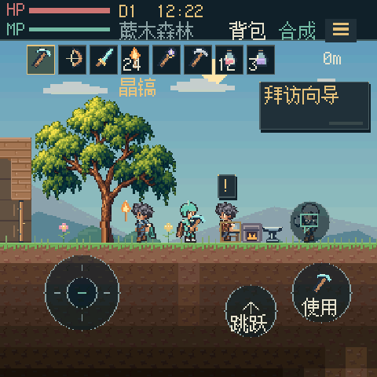
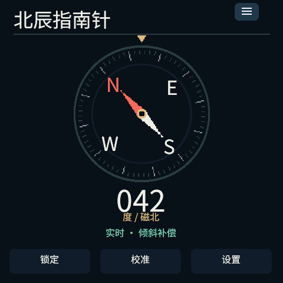

# PXA Apps

[简体中文](README.md) · [Install DevKit](https://pxa.doit.am/docs/setup/) · [Store publishing guide](https://pxa.doit.am/docs/store-publishing/)

App and game sources for PXA: ready-to-run utilities, reading apps, small games and ports, alongside shared fonts, assets and runtimes for learning and building your own applications.

Apps use the SDK and services from [pxa-system](https://github.com/SmartArduino/pxa-system). Device firmware and board drivers live in [pxa-workspace](https://github.com/SmartArduino/pxa-workspace).

## App preview

| Starsoil | Northstar Compass |
| :---: | :---: |
|  |  |

Captured from real PXA simulator runs, showing Chinese-language app interfaces. Live compass readings require the corresponding device sensor services.

## Apps to explore

| Category | Apps | What to try |
| --- | --- | --- |
| App distribution | [Store](store/README.md) | Browse, install and manage PXA apps |
| Sandbox exploration | [Starsoil](starsoil/README.md), [Voxel Craft](voxel-craft/README.zh-CN.md) | Pixel exploration, crafting and a 3D block world |
| Adventure and action | [Pixel Dungeon](pixel-dungeon/README.md), [Jump Jump](jump-jump-3d/README.md) | Dungeon exploration and touch-driven gameplay |
| Reading and network | [Novel Reader](novel-reader/README.md), [Browser](browser/README.en.md), [Weather](weather/README.md) | Online and offline reading, web browsing and forecasts |
| Utilities | [Calculator](calculator/README.md), [Spirit Level](spirit-level/README.md), [Compass](compass/README.md) | Calculations, tilt measurement and heading |
| Casual and puzzle | [2048](game-2048/README.md), [Chess](pocket-chess/README.md), [Sokoban](pocket-sokoban/README.md) | Short games with touch and controller input |
| Game ports | [Retro games](common/retro-games/README.md), [Shared SDL layer](common/sdl-games/README.md) | Porting entry points, shared code and upstream sources |

Each app documents its own builds, controls and resources. Sensors, networking, audio and storage depend on the capabilities of the target device.

## Run on your desktop

[Install DevKit](https://pxa.doit.am/docs/setup/) and confirm that `pxa --version` works:

```sh
git clone https://github.com/SmartArduino/pxa-apps.git
cd pxa-apps
pxa run pixel-dungeon
```

Close the simulator before trying another app or display profile:

```sh
pxa run voxel-craft --profile sensecap-watcher
```

Apps may reference shared code and resources in `common/`; preserve the repository layout while developing. To start a standalone app, use `pxa init my-app` and follow [Your first app](https://pxa.doit.am/docs/first-app/).

## Build and publish

From this repository's root, for example:

```sh
pxa build pixel-dungeon --target esp32s3,esp32s31,simulator
```

The tool prints the output package path. Check an existing package with `pxa publish <package-path> --check-only`, then follow the [store publishing guide](https://pxa.doit.am/docs/store-publishing/) to prepare your publisher identity, app information and release. See each app's guide for its resource and target requirements.

Each project's `pxa.lock` pins its SDK version. Upgrade explicitly and verify again. See the [DevKit guide (Chinese)](https://github.com/SmartArduino/pxa-system/blob/main/docs/zh-CN/devkit.md) for development signing and release identities.

## Develop with the firmware workspace

Run these commands from the **pxa-workspace root**:

```sh
git clone https://github.com/SmartArduino/pxa-apps.git local/pxa-apps
tools/dev.sh sim pixel-dungeon --source-root local/pxa-apps
tools/dev.sh device --board doit-gamekit-2 pixel-dungeon --port /dev/ttyACM0
```

The device must already run PXA firmware for its board. Use your actual serial port. See the [workspace guide](https://github.com/SmartArduino/pxa-workspace#readme) for further operations.

## Source map

- App directories: `package.json`, source code, icons and assets; see each app's guide for its entry points.
- [common/](common/): reusable UI, game runtimes, fonts and ported dependencies.
- [tests/native/](tests/native/) and [common/cpp/tests/](common/cpp/tests/): reusable native regression checks; app-specific tests live with each app.

Apps, shared code and third-party assets have their own license notices in the relevant directories. Ports retain their upstream copyright and licensing. Read the target app's documentation before using or publishing it.

Use the [English or Chinese issue templates](https://github.com/SmartArduino/pxa-apps/issues/new/choose) for feedback. Include the app ID, version, installation source and device.
