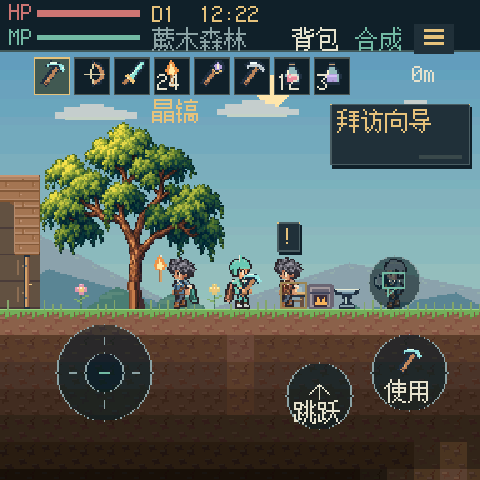
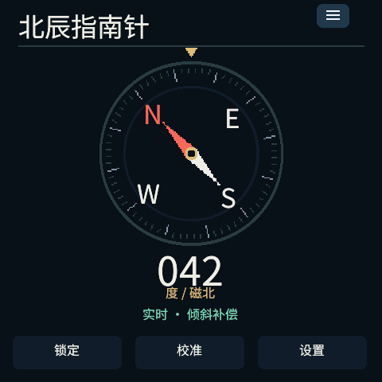

# PXA Apps

[English](README.en.md) · [安装 DevKit](https://pxa.doit.am/docs/setup/) · [商城发布指南](https://pxa.doit.am/docs/store-publishing/)

PXA 的应用与游戏源码集合。这里提供可直接运行的工具、阅读应用、小游戏和移植作品，也提供字体、资源与共享运行层，便于从现有应用开始学习和开发。

应用使用 [pxa-system](https://github.com/SmartArduino/pxa-system) 的 SDK 与服务；设备固件和板级驱动在 [pxa-workspace](https://github.com/SmartArduino/pxa-workspace) 维护。

## 应用预览

| 星壤物语 | 北辰指南针 |
| :---: | :---: |
|  |  |

真实 PXA 模拟器运行截图。指南针的实时方位需要设备提供相应传感器服务。

## 从这些应用开始

| 类别 | 应用 | 可以体验什么 |
| --- | --- | --- |
| 应用分发 | [商城](store/README.md) | 浏览、安装与管理 PXA 应用 |
| 沙盒探索 | [星壤物语](starsoil/README.md)、[体素世界](voxel-craft/README.zh-CN.md) | 像素探索、采集建造与三维方块世界 |
| 冒险与动作 | [像素地牢](pixel-dungeon/README.md)、[跳一跳](jump-jump-3d/README.md) | 地牢探索与触摸操作小游戏 |
| 阅读与网络 | [小说阅读器](novel-reader/README.md)、[浏览器](browser/README.md)、[天气](weather/README.md) | 在线与离线阅读、网页浏览、天气信息 |
| 实用工具 | [计算器](calculator/README.md)、[水平仪](spirit-level/README.md)、[指南针](compass/README.md) | 计算、倾斜测量与方向查看 |
| 休闲益智 | [2048](game-2048/README.md)、[国际象棋](pocket-chess/README.md)、[推箱子](pocket-sokoban/README.md) | 短局游戏、触摸与手柄操作 |
| 游戏移植 | [复古游戏集合](common/retro-games/README.md)、[SDL 共享层](common/sdl-games/README.md) | 查看移植入口、共享代码与上游来源 |

各应用目录包含自己的构建、操作和资源说明。传感器、网络、音频和存储功能依赖目标设备实际提供的能力。

## 在桌面运行

先[安装 DevKit](https://pxa.doit.am/docs/setup/)，并确认 `pxa --version` 可执行：

```sh
git clone https://github.com/SmartArduino/pxa-apps.git
cd pxa-apps
pxa run pixel-dungeon
```

关闭模拟器后，可以换一个应用或屏幕配置：

```sh
pxa run voxel-craft --profile sensecap-watcher
```

应用可能引用 `common/` 中的代码与资源，开发时保留仓库目录结构。新建独立应用可使用 `pxa init my-app`，教程见 [第一个应用](https://pxa.doit.am/docs/first-app/)。

## 构建与发布

在本仓库根目录构建，例如：

```sh
pxa build pixel-dungeon --target esp32s3,esp32s31,simulator
```

产物路径由工具输出。使用 `pxa publish <应用包路径> --check-only` 检查已有包，再按[商城发布指南](https://pxa.doit.am/docs/store-publishing/)完成签名身份、应用资料和发布。具体应用的资源与目标架构要求见其目录说明。

项目的 `pxa.lock` 固定 SDK 版本；升级时显式更新并重新验证。开发签名与正式发布身份的管理见 [DevKit 文档](https://github.com/SmartArduino/pxa-system/blob/main/docs/zh-CN/devkit.md)。

## 在固件工作区联调

下面命令在 **pxa-workspace 根目录**执行：

```sh
git clone https://github.com/SmartArduino/pxa-apps.git local/pxa-apps
tools/dev.sh sim pixel-dungeon --source-root local/pxa-apps
tools/dev.sh device --board doit-gamekit-2 pixel-dungeon --port /dev/ttyACM0
```

真机需已安装对应板型的 PXA 固件，串口名按实际设备修改。更多操作见[工作区开发说明](https://github.com/SmartArduino/pxa-workspace#readme)。

## 源码导航

- 应用目录：`package.json`、源码、图标与资源；具体入口以应用说明为准。
- [common/](common/)：可复用界面、游戏运行层、字体与移植依赖。
- [tests/native/](tests/native/) 与 [common/cpp/tests/](common/cpp/tests/)：可复用的原生回归检查；应用专用测试位于各自目录。

应用、共享代码与第三方素材的许可分别以对应目录中的声明为准，移植作品保留上游版权与许可。使用或发布前请阅读目标应用的说明。

问题反馈请使用 [中文或英文 Issue 模板](https://github.com/SmartArduino/pxa-apps/issues/new/choose)，注明应用 ID、版本、安装来源及运行设备。
