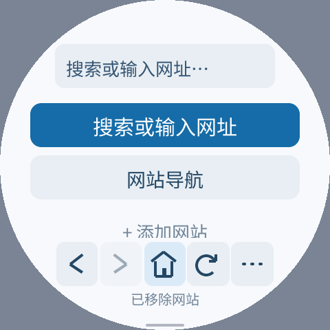
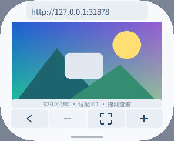

# 0.1.1 共享手势 SDK 迁移

浏览器同时存在另一组脚本引擎改动。本轮保留原工作区全部改动，以
`local/gesture-sdk-20261015/browser-validation-source` 独立快照验证手势；
基础版本和补丁保存在同目录的 `browser-validation-source.json` / `browser-gestures.patch`。
本报告的浏览器资源上限、三架构包和测试结果仅针对手势版本，未验证并行脚本版本。

移除收藏网站、带链接图片预览、主工具栏及图片工具栏提示均使用 `PressGesture`，
按住约 500ms 即执行一次，UP 不再执行短按。按下目标固定，释放不穿透到重绘后的项目。
移出容差后不能通过移回恢复点击。后台、屏幕变化、返回、导航和编辑取消旧捕获。

直接复用事件/帧钟时间戳。此前典型短按判断含一次 DOWN、四次 UP 的 `clock_gettime`；
现在手势判断不再读取系统时间。复用已有 20ms 循环，无新增定时器/协程/堆分配，
仅少量固定状态变化。最大 Guest 线性内存仍为 512KiB；未推算或宣称 FPS 收益。

模拟器完整 UI 检查在 296×240/160dpi/圆角58 和 480×480/320dpi 圆屏通过：
网站添加、去重、无效网址、**松手前已经移除网站**、UP 不穿透、保存/重启、滚动条拖动，
以及音量键翻页、按住重复、松手停止和输入框交还按键。
两个配置均额外验证了按住工具栏期间返回菜单后，不残留延迟动作。
带链接图片在松手前预览，UP 不导航；缩放、拖动、适应、返回及后续短按链接正常。
正文像素比较排除了临时状态提示；新正式包测试不使用 trace 或网络，并覆盖移出再移回和 CANCEL。

原生核心/编码测试通过 ASan/UBSan。SDK 另覆盖属性 PATCH、失败提交、动态标签、
When/Refresh/稳定键及虚拟列表/导航生命周期，详见 SDK
`sdk/guest-cpp/docs/2026-10-15-gestures-validation.zh-CN.md`。
结果摘要：[2026-10-15-sdk-gestures.json](2026-10-15-sdk-gestures.json)。

复现（源码工作区根目录）：

```sh
bash local/pxa-apps/browser/tests/test.sh
python3 local/pxa-apps/browser/tests/fixture.py
# 另一个终端：
PXA_BROWSER_TRACE=1 PXA_BROWSER_START_URL=http://127.0.0.1:31878/ \
  bash tools/app.sh build browser --source-root local/gesture-sdk-20261015/browser-validation-source --target simulator --aot-only \
  --output local/gesture-sdk-20261015/browser-qa
```

随后运行 `tests/ui_smoke.py`，320dpi 圆屏加 `--width 480 --height 480 --dpi 320 --round`。
图片以 `/image-linked` 为起始网址构建，再运行 `tests/image_smoke.py --case linked`。
参数说明均见 `--help`；本轮使用 `build/simulator/pai-touch/pxsys_product_simulator`、
`deps/pxa-system/apps/pxa/.dev-signing/publisher-public.der` 和隔离的 IME 包。
正式包使用 `tests/release_gesture_smoke.py`，固定小屏配置，无 trace/联网要求。
所有输出位于 `local/gesture-sdk-20261015/`，临时存储不会影响用户书签。

正式包包含模拟器、ESP32-S3 和 ESP32-S31 的 O3 AOT。未进行本轮真机验证，
桌面截图或书签落盘的观察时间不能当作真机输入延迟；未上传商店。




