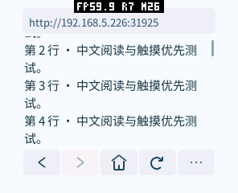
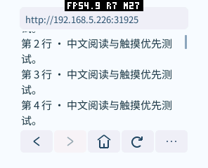
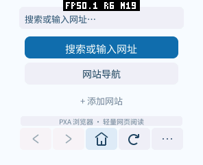

# 浏览器 AOT + Wasm 混合组件

界面、绘制、触摸、滚动、网络、Cookie 和图片保留在 `main.aot`；QuickJS、DOM 和临时 Web Storage 移到解释执行的 `script.wasm`。只使用现有 PXA 组件、IPC、资源服务和 WASI 导入，没有改动 Host 或新增系统 ABI。

目标是降低安装体积、静态页面驻留内存和加载峰值。解释执行会使脚本变慢；体积收益不等于脚本性能收益。不是 Wasm 按需分页执行：当前加载器仍会加载完整的脚本模块。

## 组件与生命周期

- 首次遇到允许执行的脚本页才创建客户端并调用脚本服务。纯静态运行不加载 QuickJS。
- 每个浏览器实例生成 128 位随机会话标识，每次页面切换递增版本号。在途消息由稳定的客户端持有；旧版本返回值不能覆盖新页面。
- 关闭或切换页面、关闭脚本、进入后台时销毁旧 VM、取消页面请求。Web Storage 在同一浏览器实例的页面间保留，清除会话或实例变化时清空，不写入磁盘。
- VM 销毁不等于卸载模块；线性内存增长后也不会自动缩小。停止整个浏览器才释放组件实例。
- UI 初始线性内存 128 KiB，脚本组件初始 192 KiB，各自以 64 KiB 页按需增长，单组件上限 8 MiB。上限不预分配，两个上限不代表设备可同时提供 16 MiB。
- 脚本堆设置保持自动最高 1 MiB、手动 256 KiB～4 MiB；所有分配仍受设备实际内存限制。

## 通信与调度

`pxa.browser.script.v1` 是应用私有协议。每条消息最多 1024 字节，大对象按顺序分块、整体最多 64 KiB；只有一个请求在途。协议包含版本、操作、会话、页面版本和偏移，接收端独立检查容量与分块顺序。不传递 Guest 指针、C++ 对象或 QuickJS 句柄。

HTML、异步响应和字段更新送往脚本组件；Cookie 变更、网络请求、导航与分批生成的 HTML 返回 UI。网络和授权仍由 UI 管理。Cookie 先于依赖它的网络请求回传；HttpOnly 和来源检查在 UI 再执行一次。资源加载使用包内签名资产，网页字节不会进入受信任的 QuickJS 字节码加载器。

空闲页根据下次定时器唤醒，没有周期性 IPC 轮询。拖动、菜单、输入和后台期间不发起新的脚本执行。传输完成与清理消息仍可继续，避免取消后留下未完成调用。DOM 更新合并后再排版；脚本组件不能直接绘制。

解释执行配置每次构建/快照最多处理 2 个 DOM 节点，避免沿用 AOT 的 8 节点批次造成不必要长任务。应用签名初始化代码独立使用较长的有界预算，网页脚本仍使用原来的 50 ms 超时。已有同步执行的脚本不能中途保存调用栈并恢复；IPC 隔离也不等于后台并行，不能承诺启动时完全无卡顿。

## 验证入口

以下命令从 `pxa-apps` 仓库根运行。独立 DevKit 可用 `PXA_CPP_SDK_ROOT` 指定 `sdk/guest-cpp` 目录。

```sh
bash browser/tests/test.sh
bash browser/tests/test_script_transport.sh
PXA_SCRIPT_TEST_WASI_MODEL=1 PXA_SCRIPT_TEST_INTERPRETED=1 \
  bash browser/tests/test_script.sh
python3 browser/tests/script_fixture.py --bind 0.0.0.0 --port 31925
```

`script_smoke.py` 在真实 PXA 模拟器运行混合包，覆盖事件、XHR/fetch、来源/CSP、超时、递归、内存边界、图片/GIF、导航取消、拖动暂停和空闲；`weread_smoke.py` 使用合成账号验证二维码流程、Cookie、取消、过期与设置；`session_smoke.py` 覆盖普通表单登录及会话清除。协议/客户端原生测试启用 ASan/UBSan，覆盖截断、超限、分块顺序、暂停、旧消息、关闭/重开、清理与取消。

生成模拟器包后可单独重跑解析边界，输入法包也使用对应平台构建：

```sh
python3 browser/tests/parser_smoke.py \
  --simulator /路径/pxsys_product_simulator \
  --package /路径/browser-simulator \
  --publisher-key /路径/publisher-public.der \
  --ime-package /路径/pinyin-ime-simulator \
  --output /tmp/browser-parser-check
```

真机对照使用同一固件、同一 `/bench-menu` 测试服务和相同页面内容。测试包启用 `PXA_BROWSER_TRACE=1`、`PXA_BROWSER_PROFILE=1`、`PXA_BROWSER_START_URL=http://电脑局域网地址:31925/bench-menu`。运行 `tests/device_script_bench.py --port /dev/ttyACM0 --output 输出目录 --case 0`（静态滚动），或 `--case 1`（脚本滚动）、`--case 2`（DOM/网络）；其他 case 测保护边界。它会停止、重开浏览器，不应用于需要保留内存登录会话的进程。

该工具用 `MEMORY START/STOP` 单独记录本次窗口的真实最低剩余堆，避免把开机以来历史峰值当作本轮峰值。截图在测量窗口外获取；帧率来自设备显示完成间隔，不是应用提交次数。正式包必须去掉测试启动地址和 TRACE/PROFILE，再恢复正常首页。

`--case 6` 是复杂解析恢复，会先滚动到测试入口；0–5 保留原有场景。原单 AOT 源码快照保留在本工作区 `local/browser-validation/mixed-20261016/app-before`，旧诊断包为 `before-bench.pxa`，最终诊断/正式包为 `final-bench.pxa` / `final-product.pxa`；它们的哈希包含在测量 JSON 中。公开报告不包含旧源码副本，复跑旧版需要保留的快照或相同哈希的旧包。

微信读书的真实书架/阅读兼容性与组件拆分验证是两项独立结论，不能用合成登录测试替代真实阅读验证。

## pai-touch 同固件对照

2026-10-16，296×240、160 dpi，固件版本 `host-tools-v0.1.0-25-g75673a9-d`。两侧使用同一份浏览器功能及字体，区别为单 AOT 和混合组件；页面均为固定 60 行，脚本页另有 20 ms 定时器。每项停止整个应用再启动。设备本身未冷启动，字体和网络缓存可能已预热。

下表是组件拆分完成后的配对结果，早于后续解析器栈修复；不把它冒充最终引擎修复后的新一轮数据。原始记录位于工作区 `local/browser-validation/mixed-20261016/device-{before,after-final}-{static,dynamic}`。FPS 来自拖动期间实际显示完成间隔，单次运行不足以断言 1% 左右差异有统计意义。

| 相同工作负载 | 单 AOT | UI AOT + JS Wasm |
| --- | ---: | ---: |
| 静态滚动显示 FPS | 28.87 | 28.98 |
| 静态稳定 PSRAM 增量 | 2,937,592 B | 1,240,632 B |
| 静态启动窗口 PSRAM 峰值增量 | 3,794,476 B | 2,033,304 B |
| 静态稳定 SRAM / 窗口峰值增量 | 1,192 / 5,256 B | 1,192 / 5,328 B |
| 脚本页拖动显示 FPS | 30.56 | 30.21 |
| 脚本页稳定 PSRAM 增量 | 3,207,560 B | 3,727,856 B |
| 脚本页启动窗口 PSRAM 峰值增量 | 3,794,408 B | 4,063,736 B |
| 脚本页稳定 SRAM / 窗口峰值增量 | 1,192 / 5,328 B | 1,896 / 6,032 B |
| 开页到 JS READY（约） | 0.9 s | 5.9 s |

内存增量以各次启动前剩余堆为基准；峰值使用本次 `MEMORY START/STOP` 窗口的最低剩余堆，不使用开机以来历史最低值，也不把应用预算统计当作包括代码和线性内存的总占用。显示后台、字体等公共开销已存在于启动前基准。首次打开脚本服务、模块准备和 VM 初始化均计入启动窗口。

结论：安装体积和纯静态页面收益明显；脚本运行时稳定 PSRAM **增加 520,296 B**，本轮峰值增加 **269,328 B**，因此混合方案没有达到“所有场景内存不增长”的旧目标。解释执行还明显延长脚本初始化和更新，不能宣传为 JS 提速。两侧拖动期间都没有脚本重绘；约 30 FPS 只说明拖动保护仍然有效，不代表脚本响应或端到端触摸延迟相同。

首次脚本服务加载约 2.5 s，解释执行的签名初始化约 0.77 s，最大初始化单步约 251 ms；原 AOT 初始化约 0.2 s，最大单步约 78 ms。完整 DOM 快照更新约 2.2 s 对约 0.8 s。50 ms 是中断检查预算，部分同步工作实测超过 130 ms，不能视为硬抢占上限。静态首页和滚动不需要运行该引擎。

配对测试包大小为 2,263,822 → 1,478,048 B，展开为 3,091,860 → 1,986,143 B。这两组包含诊断标记，正式首页包大小另记，不能混用。实际 Wasm 模块仍有文件、FAST 解释器准备代码、元数据及独立线性内存开销；停止 VM 后模块保留，完整退出应用才能释放。前后台、菜单退出和重复启动已在设备测试，退出后堆回到接近启动前水平。

## 体积优化取舍

UI 保留 O3；脚本组件的 C++ 使用 Oz，并对发布 Wasm 删除自定义名称等非执行节。将脚本 C++ 从 O3 改为 Oz，文件从 668,135 降到 625,123 B；进一步去掉非执行节后为 576,324 B。原生 64 位 WAMR 加载探针的模块分配从 1,953,831 降为 1,780,206 B；此探针只用于同平台选择方案，不能当作 ESP32 的 PSRAM 实测。

曾试验 Binaryen Oz：文件进一步变小，但 FAST 解释器准备后的模块反而增大，因此未引入这项工具链依赖。按文件字节数选压缩方案会遗漏运行时开销。

## 未完成与边界

- 没有实现从存储分块执行 Wasm，也没有修改 Host 的栈、加载器或 ABI。
- 复杂页面仍受脚本大小、DOM、Web API 和栈预算限制。漫画站脚本崩溃的复现及保护见 [mosaico 栈诊断](mosaico-script-stack-20261016.zh-CN.md)。可恢复错误不代表整个站点兼容。
- 合成登录流程已覆盖；本轮组件拆分后的真实微信读书书架、翻章和阅读没有完成账号实测，仍需重新扫码及验证。

## 栈与事件修复后的最终真机复测

最终代码再次运行相同静态/脚本滚动页面，固件和显示设置未改。启动菜单增加了复杂解析测试入口，实际测量的两个滚动页面保持原来的 60 行和定时器。每项为单次短窗口，不将微小差异解释为确定的提速或退步。

| 测量项 | 原单 AOT | 最终混合包 |
| --- | ---: | ---: |
| 静态拖动显示 FPS | 28.87 | 28.98 |
| 静态稳定 PSRAM 增量 | 2,937,592 B | 1,239,732 B |
| 静态启动窗口 PSRAM 峰值增量 | 3,794,476 B | 2,033,360 B |
| 静态稳定 SRAM / 窗口峰值增量 | 1,192 / 5,256 B | 1,192 / 5,328 B |
| 脚本页拖动显示 FPS | 30.56 | 30.31 |
| 脚本页稳定 PSRAM 增量 | 3,207,560 B | 3,734,940 B |
| 脚本页启动窗口 PSRAM 峰值增量 | 3,794,408 B | 4,072,616 B |
| 脚本页稳定 SRAM / 窗口峰值增量 | 1,192 / 5,328 B | 1,896 / 6,032 B |
| 相同诊断配置的安装包 | 2,263,822 B | 1,479,459 B |
| 展开的声明载荷 | 3,091,860 B | 1,989,323 B |

最终动态 PSRAM 代价为稳定 **+527,380 B**、启动峰值 **+278,208 B**。脚本页签名初始化 769,118 μs，最大初始化单步 251,050 μs；普通页面最大执行单步约 132 ms。复杂解析恢复测试单步最高 62,828 μs，递归恢复测试最高 118,443 μs，进一步说明 50 ms 预算不等于严格的抢占上限。

七项各自重开/退出后，相对该次启动前的 SRAM 差异在 −36～36 B，PSRAM 差异在 −24～804 B；没有保留脚本组件的大块内存。普通页面切换和后台仍会保留已加载模块，须完整退出应用才释放。

稳定占用与本次窗口峰值均在 [完整测量数据](benchmarks/aot-wasm-20261016/measurements.json) 中，包括显示间隔原始样本、七项设备检查、组件文件大小与 SHA-256。SRAM/PSRAM 为整机堆增量；本轮没有独立量出实际 Guest 页、代码映射、公共帧缓冲和 IPC 队列的逐项占用。清单的初始/最大页数是预算；`surface` 监控为零也不代表整个系统没有帧缓冲。




截图在测量窗口外拍摄，顶部 Host FPS 叠层随静止状态降低，未作为统计依据。两侧可见内容、视口和文字质量相同。

正式首页包去掉测试启动地址、TRACE 和 PROFILE：安装包 **1,446,929 B**，声明载荷 **1,939,444 B**；包括清单、签名在内的全部安装文件为 **1,941,913 B**。其中 UI AOT 为 1,220,928 B，脚本 Wasm 为 579,070 B。安装体积比较使用表中的两份诊断包；不把正式包和诊断基线混比。LittleFS 实际块占用还包含文件系统开销，不等于这些逻辑字节数。

另有单独的 ESP32-S31 正式构建，安装包 1,419,940 B、声明载荷 1,915,236 B，其脚本 Wasm 与 S3 包逐字节相同。S31 包已通过构建与格式检查，尚未在 mosaico 真机安装/复测；pai-touch 的 FPS 和内存数字不可套用到 S31。

最终已恢复该正常首页包，14 个安装文件逐项 FSSHA 校验一致，设备停在正常首页，MEMORY/PERF 监控已停止。本轮未刷固件、删除应用或修改设备设置。首页截图经实际查看确认；自动 OCR 无法可靠识别这套小字号抗锯齿字体，未将 OCR 失败误报为产品故障。



### 本轮改动的收益与代价

| 改动及原因 | 收益/体验 | 内存与体积变化 | 验证 |
| --- | --- | --- | --- |
| 按需 Wasm 脚本组件 | 静态浏览减少加载与驻留；拖动仍约 29–30 FPS | 包减约 35%；静态 PSRAM 降低，动态增加约 0.50 MiB | 同固件七项设备测试 |
| Worker C++ Oz、移除非执行节 | 缩小文件与 FAST 模块，UI 保持 O3 | 优于 O3 Worker 的文件/加载探针；没有引入 Binaryen 依赖 | 实际加载探针与真机 |
| 字面量小入口、固定优先级内核、共享递归保护 | 已覆盖复杂解析/JSON 返回正常错误，保留后续脚本与退出 | 使用现有 C 栈记录；新增一个运行时保护链指针；无大型解析堆缓存 | 164 份字节码一致、上游语义、原生消毒器、20 项真实解释器测试 |
| C++ 入口准备内联事件及缓存失效 | 避免在深层分发栈编译；更新/移除属性立即生效 | 复用节点缓存；桥接能力与代码按需进入脚本组件 | 点击/输入、全局 Function 替换、连续事件和停止传播回归 |

栈与事件修复相对最初混合诊断包增加脚本文件 2,977 B；动态稳定/峰值 PSRAM 分别多 7,084 / 8,880 B（整轮测量，未分离各项贡献）。这是修复正确性所需的代价，也已计入上表最终数字。没有单独量出内联事件编译的速度收益，因此只确认其栈安全和行为。
