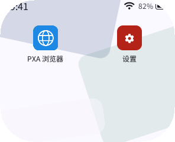
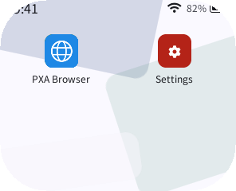
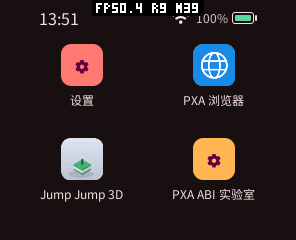
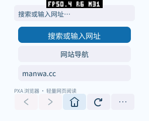

# PXA 浏览器名称与图标（2026-10-15）

统一名称为 **PXA 浏览器 / PXA Browser**。中文是包的默认名称，英文通过已有包本地化元数据提供，随系统语言选择；不增加应用内语言切换器。

图标改为蓝底白色地球线条，蓝色 `#1e88e5` 与 PXA 商店一致。保留可编辑的 `assets/icon.svg` 与 128×128 RGBA PNG，低至 24 px 的预览已人工检查。应用 ID `pxa-browser`、发布者及数据路径不变，沿用书签和设置。

## 验证

- 构建并检查已签名的模拟器、ESP32-S3 包：默认名、英文名、应用 ID、图标路径和 PNG 内容一致。
- 在实际系统模拟器的中文、英文桌面检查名称与新图标，截图如下。
- 原生 ASan/UBSan 核心测试通过，标题测试保留中英文混排与 UTF-8 分块覆盖。
- 六组显示回归通过：pai-touch、分数 DPI、480×480 / 320 DPI、圆屏、竖屏、宽屏。
- pai-touch 已安装新名称和图标的正式主页包；两次完整启动/停止及前后台恢复均以实际画面复核，书签与偏好文件逐字节一致。
- 图标仍为原有 128×128 RGBA 格式，没有新增绘制层、帧缓冲或应用默认缓存；本次没有重测整机峰值或 FPS，不据此提出性能收益。

设备空间不足以同时保留新旧安装目录和上传文件，先完整备份旧浏览器包，再通过系统 archive 保留私有数据、释放程序文件，随后安装新版；没有删除其他应用。
早先仅核对启动回执时设备已自动锁屏，那批结果明确判为未验证；最终证据取自解锁后逐屏确认的 `device/display-proof/`，不使用旧锁屏截图作为成功依据。没有修改锁屏时间、音量或 FPS 叠加层设置，测试后停止应用、返回桌面。

工作区原始证据在 `local/browser-validation/branding-20261015/`，含包备份、元数据检查、原生测试日志、六种屏幕截图及真机偏好核对。旧性能报告中的原始日志与截图保留当时名称。
