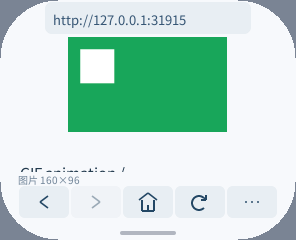
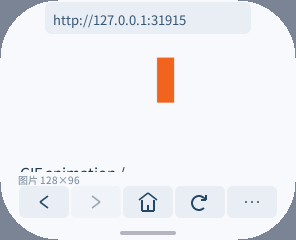
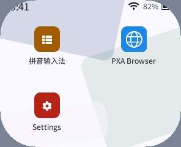
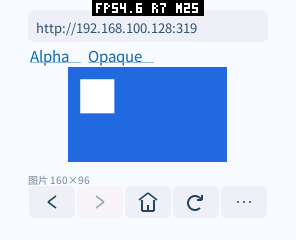
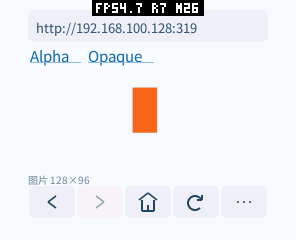

# GIF Host 原生路径验证（2026-10-15）

已接入 Assets 2.3、可选 C++ SDK 和浏览器动画；模拟器确认实际画面变化、透明处置、暂停与恢复、格式开关、取消和释放。
ESP32-S3 完整固件、实际应用分区更新和 AOT 安装通过；pai-touch 已验证三色动画、透明处置、前后台、重复启动和资源释放。真机记录见下文。

## 原因与实现

GIF 动画需要在帧之间处理透明、局部更新、背景清除和恢复上一画面，不能逐帧独立解码后覆盖。
Host 复用 LVGL 9.6 的扫描线 LZW 内核，只合成限制尺寸后的像素，不创建原图尺寸的画布。
输出为不可变图片资源，后续解码不会改写已提交给 UI 的帧；没有后台计时器或提前排队的动画帧。
普通 PNG/JPEG 的一次性接口保留，完成后不保留解码器或默认图片缓存。
全动画不含透明且有全局背景色时复用 RGB565 输出，不透明帧像素存储减半；颜色量化为 5/6/5 位，与现有 JPEG 路径一致。
包含透明的动画保持 BGRA8888；模拟器和真机画面均已检查，不将 RGB565 称为 RGB888 原色无损。

容器先做尺寸、矩形、调色板、扩展、数据块和结束标记检查；各帧按需检查代码引用及精确展开长度，复用原生字典作为长度表。
打开时不对整个动画所有帧做熵解码。压缩数据有界保留，下载完后开始；暂不支持边下载边呈现 GIF 首帧。

严格 UBSan 发现上游读取 32 位数据时存在有符号左移溢出。薄适配层使用原有 LVGL 源码、私有函数名和无符号字节读取，关闭行尾的推测性整字拷贝。
没有直接修改 managed component，也没有复制维护一份完整解码器。关闭 `LV_USE_GIF` 时为不分配内存的 unsupported 实现。

## 实测

8 组确定性参考用例逐帧通过：不透明局部帧、透明孔洞、处置 2、处置 3、混合处置、有限/无限循环、交错、局部调色板、缺失 GCE 时不继承透明状态、最小代码宽度 2、长延迟及大原图。
每个像素与 Pillow 全尺寸合成后按相同坐标采样的结果比较；RGB565 使用相同量化后比较，不可见的透明 RGB 分量不要求一致。
延迟、循环轮次、最后一帧标记和重复 EOF 也核对。

| 测试文件 | 请求帧数 | 本次预算真实峰值 |
| --- | ---: | ---: |
| opaque | 5 | 51,357 B |
| transparent | 10 | 65,949 B |
| restore | 5 | 65,949 B |
| mixed | 15 | 75,788 B |
| forever（主动停止） | 10 | 75,788 B |
| interlaced | 1 | 37,823 B |
| min-code-controls | 5 | 35,772 B |
| large-source（1024×512 → 64×32） | 1 | 77,408 B |

这里是开发机原生测试中分配器的预算字节，包含前缀、输入扩容时旧加新、解码状态、输出和处置备份；不是 ESP32 的 SRAM/PSRAM 实测。
测试额外保留首帧以检查不可变性，多帧峰值可能包含这个长期观察者。关闭解码器并释放观察帧后，每次预算计费归零；不把历史累计峰值当作本次峰值。
LVGL 初始化与系统常驻对象不在这个分配器内；端到端数据另列，不能与本表混用。

- 每个分配点注入 OOM、取消部分输入、截断和每文件 192 次单比特变异，检查所有权及清理。
- 对适配层、上游内核、Core、资源对象和预算分配器一起启用 ASan/UBSan，`-fno-sanitize-recover=all` 后通过；没有把打印诊断但退出码为 0 当作通过。
- 既有 PNG/JPEG、Assets 服务与图片服务共 4 个 CTest 通过。
- ESP32-S3 工具链在 GIF 启用、4096 行宽配置下成功构建；对应固件已在 pai-touch 实际运行。

## 限制与后续

不支持 GIF Plain Text、等待用户输入的交互帧、保留的处置方式和超过 65,000 个代码才清字典的少见流；后者避免上游 16 位计数器回绕。
输入及原图仍遵守已有有界资源策略，帧处置 3 最多需要额外一份缩小背景。

pai-touch 按硬件序列号识别，当前对应 ACM0。只更新 0x10000 应用分区，保留启动器、分区表、应用和数据；测试结束恢复正式主页包、原有书签与设置。
默认 LVGL/ESP 后端和桌面产品已加入 GIF；pai-touch 默认配置已启用对应原生内核。

复现与原始日志位于工作区 `local/browser-validation/gif-20261015/`；原生测试源码与生成器在 `deps/pxa-system/libpxa/tests/{gif_decode_test.c,test_gif_decode.py}`，适配说明见 `libpxa/adapters/image/README.md`。

## ABI、SDK 与浏览器集成证据

- `image-frames` 是可选能力，无新 Core 资源种类。DECODE 的 WITH_FRAMES 扩展结果带 delay/iteration/LAST，NEXT 只转移一个新图片句柄；旧像素保持不可变。资源槽位复用 ticket/state union，不扩容资源表；静态图没有保留的解码器。
- Host 服务测试和 ASan/UBSan 覆盖取消前不推进、重叠请求拒绝、旧图片引用、资源槽满、状态所有者提前关闭、错误帧、最终帧和 GIF 签名过滤。
- C++26 主机全套测试通过。新模块 `image_frames.hpp` 的 9 组情形覆盖静态/多帧、超长延迟、并发请求、取消与迟到句柄、畸形长度/flags/错误响应；最后协程槽位归零。
- 浏览器保持两个可选缓存槽，不增加图片层或帧缓冲。GIF 单图上限 64 KiB 编码、8192 输出像素；普通 PNG/JPEG 的 128 KiB/32768 像素保持不变。大 GIF 画质会下降，较少的源帧延迟最低按 30 ms 调度。
- 真实产品模拟器 12 项检查确认至少三种帧颜色、动画预览无需重载、透明处置、静态 GIF 无持续工作、菜单/离屏暂停、二进制伪装 GIF 的 Host 过滤、开关独立、截断/慢下载取消和重复加载。桌面系统 Home 手势返回启动器后动画停止；重新进入后重载并恢复。正常停止后 native 图片及临时预算计费归零。
- 模拟器本次整个场景（含 PNG 回归）的资源预算峰值为 187,414 B，临时类别峰值 46,120 B（`shell-current/runtime.log`）；它不包含 Guest、AOT 映射、LVGL 字体缓存或显示驱动，不能当作整机内存。原生表格因加入格式/动画上限字段，各用例比此前增加 8 B；如实记录，不宣称零增长。
- 登录、POST/Cookie、历史、清除会话和偏好保存回归通过；未重复真实账号登录，未保存真实凭据。六个屏幕/DPI/形状的现有布局矩阵通过。

复现示例（工作区根目录）：

```sh
python3 local/pxa-apps/browser/tests/fixture.py --port 31915
# 使用 TRACE=1、START_URL=http://127.0.0.1:31915/ 构建测试包；正式包不设置这两个变量。
python3 local/pxa-apps/browser/tests/gif_smoke.py --shell \
  --simulator build/simulator/pai-touch/pxsys_desktop_simulator \
  --package <测试包目录> --publisher-key <测试发布者公钥> \
  --ime-package <受信任输入法目录> --output <结果目录>
bash deps/pxa-system/tools/package/test_guest_cpp.sh
```

实际截图（模拟器，296×240）：





## pai-touch 实测与证据边界

完整 TRACE 功能测试通过：至少三种实际帧颜色、透明孔洞与处置 3、菜单暂停、系统后台释放解码状态、前台重载、正常停止与重复启动。截图不是只有输入回执或旧日志。正式主页包另做 5 次启动/停止，保留既有自定义网站。

性能统计使用同源、同 O3、关闭 TRACE 的测试包。以下为网站导航更新前的独立窗口测量；导航更新后的最终包另见 [网站与编码报告](sites-encoding-20261015.zh-CN.md)。

| 场景 | SRAM 稳定使用 | SRAM 本窗口峰值 | PSRAM 稳定使用 | PSRAM 本窗口峰值 |
| --- | ---: | ---: | ---: | ---: |
| 普通主页启动（5 次范围） | 272,184–272,192 B | 276,292–276,328 B | 2,487,496–2,487,560 B | 3,583,804–3,583,868 B |
| GIF 启动 | 272,192 B | 276,328 B | 2,537,504 B | 3,583,848 B |
| 不透明 GIF 稳定窗口 | 272,192 B | 272,356 B | 2,537,504 B | 2,556,192 B |
| 透明 GIF 稳定窗口 | 272,192 B | 272,468 B | 2,554,832 B | 2,625,948 B |

峰值取 MEMORY START/STOP 的本窗口最低空闲值；截图与 PERF 采集放在这些窗口之外。不是设备启动至今的 heap minimum 或预算历史 peak。

- 不透明图片预算 16,475 B，动画临时状态 32,160 B，均在 PSRAM；透明帧图片 32,855 B，临时状态仍为 32,160 B。处置 3 瞬时会有额外缩小背景，已包含在实际峰值。
- 此动画源帧延迟为 220/340/460 ms，标称约 2.94 次画面变化/秒。6.005079 秒观测到 25 次 LCD 完成，约 **4.16 次/秒**；它包含系统/UI 重绘与原本启用的 FPS 层，不能称为动画独立帧率或游戏 FPS。完整 TRACE 测试能确认三种颜色实际呈现，没有只用提交次数证明显示。
- 启动快照 Guest 线性内存 131,072 B；配置为初始 128 KiB、最大 512 KiB，最大值不是常驻占用。未把启动快照冒充整个 GIF 生命周期的 Guest 峰值。
- 原正式主页 AOT 请求映射 843,372 B，实际分配 851,968 B；GIF 测试包请求 844,908 B、实际同为 851,968 B。代码文件增加约 19 KiB，恰好未跨越映射粒度；不能据此推广为新增功能没有代码成本。
- pai-touch 既有一个 142,080 B LVGL 帧缓冲和两个同尺寸旋转输出缓冲，合计 426,240 B PSRAM；无新增图片图层、Z-buffer 或帧缓冲，Canvas 命令区仍为 4,000 B。
- 五次普通主页关闭后无持续下降。连续网络 GIF 三轮关闭短期约下降 416 B/轮；继续静置后空闲 PSRAM 回到 6,757,200 B，距先前稳定值仅 8 B，图片/临时预算均为零。观察到了回收；TCP 等待关闭（配置 MSL 60 秒）是可能原因，未枚举 PCB，不能把它写成已证明的归因。
- ESP32 实测 `pending_t` 若直接放 u64 会从 56 B 变成 64 B。最终改为已有字节读写函数存取句柄，恢复 56 B；16 槽避免额外 128 B，`resource_t` 保持 24 B。无 ABI 布局变化。

真机原始证据：`local/browser-validation/gif-20261015/device/{validation,benchmark,production-proof,settle}/`。公开可复现脚本：`tests/device_gif_smoke.py`、`tests/device_gif_benchmark.py`；前者用 TRACE 包做功能验证，后者用关闭 TRACE、固定测试 URL 的包测量，最终均恢复正常主页包并比较偏好文件。



