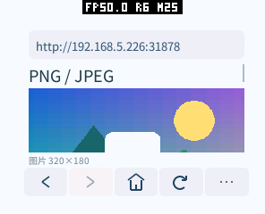
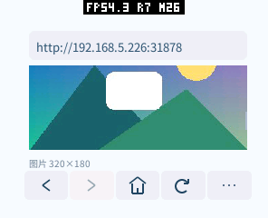
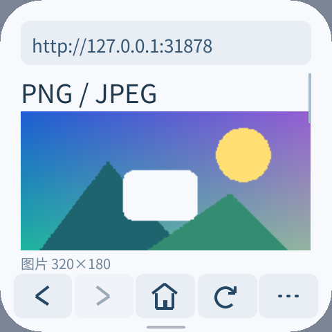

# 图片 ABI、平台解码与浏览器验证（2026-10-15）

浏览器现在把 HTTP 响应体直接移交给 `assets().decode_image`，取得普通图片 `Asset`。
编码数据不再经过 Guest 读回再写入 Host。平台选择解码器，应用不区分 ROM、LVGL 或系统库。
本轮替换了尚未发布的两阶段图片草案；设备固件和 SDK/应用包须一起更新。

## 设计与平台维护

```cpp
auto image = co_await context.assets().decode_image(std::move(response.body),
    {.max_width = 320, .max_height = 240, .max_pixels = 32768});
if (!image) co_return std::unexpected(image.error());
commands.image(region, *image);
```

同一 API 接受移入的 `File`，从当前位置读取。源对象在成功、失败、取消时自动关闭；
解码成功的图片独立持有像素。图片采用现有 Assets 资源绑定、Canvas/UI 绘制和引用计数。
不增加 Guest import，也不让应用管理临时 decoder 句柄、分块写入和 finish 顺序。

| 层 | 本轮处理 | 维护意义 |
| --- | --- | --- |
| Assets 2.2 可选功能 | 一个 `DECODE_IMAGE=6`，24 B 请求、36 B 结果，沿用 Core 请求与取消 | 格式或平台变化不扩充 wire |
| 通用 Host | 校验源的所属组件/类型/代数；分片读取、限额、缩放和最终资源 | 网络与文件共用，不在各 codec 重复 |
| 可选平台后端 | 固定 codec 列表；open/write/finish/close 四个会话回调 | 新平台无需重写 HTTP、FS、Wasm、Canvas 或 SDK |
| 已有 LVGL 的产品 | 共用 `pxa_lvgl_image_backend()`，调用已注册的 decoder | 不为每块板复制适配；私有头兼容集中于一个文件 |
| ESP32-S3 JPEG | 官方 ROM TJpgDec，MCU 输出、1/2/4/8 原生缩小 | 删除 PXA 内的 JPEG 源码副本 |
| 桌面 JPEG | 系统 libjpeg/libjpeg-turbo，扫描线输出 | 使用平台维护的库，不复制 JPEG 实现 |
| PNG 默认路径 | 可选 Pngle/miniz 流式适配器，缩小后写最终目标 | 避免 LVGL LodePNG 完整展开大原图造成峰值增长 |

通用 `libpxa` 在不链接 adapters 时不依赖 LVGL、PNG 或 JPEG 库，已单独构建验证。
安装导出的 Host SDK 后，独立 CMake 工程通过 `find_package(pxa)` 链接平台后端并运行成功。
有 LVGL 的新平台通常只需选择 backend 并传入两个现有预算 allocator；专有硬件只需实现 codec。
配置、接口和接入约定见 pxa-system 的 `docs/zh-CN/image-decoding.md`。

LVGL 是解码框架，是否使用硬件取决于产品注册的 decoder。ESP32-S3 ROM 仍由 CPU 执行，
不等于专用 JPEG 硬件。ESP32-S31/P4 的硬件后端本轮没有接入和实测，不能声称已经启用。
默认路径没有全图中间像素缓冲，也没有新增常驻线程、图片全局缓存或逐板分支。

## 流式与调度

PNG 可以边接收边解码，但完成校验后才发布图片；不是渐进显示。
当前 native JPEG 收集有界压缩输入后调用同步解码，避免要求每个 ROM/LVGL decoder 支持输入暂停。
Host 内仍有网络接收缓冲、codec 工作区与像素写入，不能称为全链路零拷贝。

每次服务 poll 最多读 4 × 1024 B，WOULD_BLOCK 立即让出，不忙轮询。
Host 在源就绪及 Guest 回调/取消后推进服务；poll 返回非零则继续安排 owner-loop。
文件大于 4 KiB、没有 Guest tick、没有 Net wait 请求的场景都不应停滞。
平台 codec 在 open 途中失败而交出部分会话时也会被 close，取消、停止与结果发布失败均回收资源。

## 实测条件与判读

- pai-touch，ESP32-S3，串口实际为 `/dev/ttyACM3`，MAC `a4:cb:8f:d5:d4:f0`。
- 296×240、160 DPI、圆角半径 58；O3/LTO。使用同一 `/images` 页面、相同布局、图片和手势。
- 固定图片为 320×180；透明 PNG 3653 B，彩色 JPEG 6162 B。输出 241×135，缓存最多两张。
- `PERF START display` 后注入 1600 ms / 96 点滚动，用 completed/window_us 算实际 LCD 完成帧率；
  同时保存 present 间隔。没有使用应用提交 FPS 或屏幕左上的系统 FPS 值代替。
- `MEMORY START/STOP` 分别包围 PNG 启动和 JPEG 加载，截图、PERF 和全量重绘在内存窗口外。
  记录窗口真实堆最低可用量；普通 MEMORY 的历史 min、PXA 累计 peak 与当前稳定量分开解释。
- 每版两轮启动。第一轮用于本次启动峰值，第二轮检验重复启动；不是两次断电冷启动。
- 工作区包含同期其他改动：原候选固件标识 `a72f162-d`，新固件 `744d1b8-d`。
  这是相同设备/页面的集成回归，不能用微小时间差宣称纯 codec 或语言性能提升。
  精确二进制大小与 SHA-256 见 [构建记录](images-20261015/artifacts.json)。

[原始新设备记录](images-20261015/device.json)包含两次独立 MEMORY 窗口和实际显示间隔。

| 指标（第 1 / 2 轮） | 重构前候选 | 本轮最终版 |
| --- | --- | --- |
| 实际 LCD FPS | 25.78 / 26.86 | 27.23 / 26.66 |
| 显示间隔中位数 μs | 23920.00 / 24024.00 | 23925.00 / 23940.00 |
| 显示间隔 P95 μs | 47717.00 / 47609.00 | 47710.00 / 47748.00 |
| PNG 单图 image 预算 B | 130235 / 130235 | 130235 / 130235 |
| PNG+JPEG image 预算 B | 195400 / 195400 | 195400 / 195400 |
| PXA 临时空间累计峰值 B | 46352 / 46352 | 45920 / 45920 |
| PXA external 累计峰值 B | 237792 / 237792 | 236820 / 236820 |
| PNG 加载窗口 SRAM 最低可用 B | 43987 / 44099 | 44039 / 44099 |
| PNG 加载窗口 PSRAM 最低可用 B | 5239640 / 5184960 | 5257512 / 5202928 |
| 双图稳定 SRAM 可用 B | 48235 / 48235 | 48235 / 48235 |
| 双图稳定 PSRAM 可用 B | 5904748 / 5885884 | 5905352 / 5885440 |

两轮实际帧率均处于约 26–27 FPS 范围，P95 基本相同；不能凭这两个短窗口证明 FPS 提升。
图片驻留不变，PXA 临时峰值减少 432 B、external 峰值减少 972 B。PNG 加载窗口 PSRAM
低水位改善约 17–18 KiB；稳定双图 PSRAM 两轮差异为多 604 B 可用、少 444 B 可用，属于
本次系统/网络波动范围，不能保证全系统每次采样的严格字节单调下降。稳定 SRAM 不变。
没有新增 framebuffer、depth buffer 或命令队列；现有 Canvas 路径继续使用已有 LVGL 绘制缓冲。
Guest 初始/实测线性内存 131072 B、上限 524288 B，AOT 映射 720896 B，均保持不变。

生产 Wasm 252376 → 249522 B，S3 AOT 712132 → 700936 B，固件 3415312 → 3412672 B；
不是通过降低 O3 或画质压缩体积。包大小和映射大小不等同，实际映射按页对齐保持不变。

PNG 从发起请求到可发布的总时间为 584 / 238 → 513 / 256 ms；JPEG 为
222 / 112 → 126 / 146 ms，包含局域网接收、调度及解码，未单独测 codec 时间。
数据有交叠，不宣称确定的加载提速。已确定的改进是更简单的所有权和取消机制、
消除编码图片数据经过 Guest 的往返，以及共享平台适配边界；ROM CPU 与总显示速度不是同一指标。


图片像素驻留包含资源开销，不只是宽×高×像素字节数。返回首页后，image 和 temporary 预算均为 0；
没有预算拒绝或分配失败。包内目录、已有其他应用和数据均保留，仅更新应用固件分区及测试浏览器。
测试没有修改设备网络、音量、主题或显示偏好，最后安装回默认首页的生产包。

JPEG 输出为 RGB565、有损原生缩小；PNG 保留 straight alpha。两者保持原始宽高比，
最终显示缩放使用就近采样。PNG 透明孔洞、图像通道、局部/全量重绘和滚回页面均检查过；
JPEG 不保证和不同 IDCT 实现逐像素一致，原生测试用独立 Pillow 参考及误差阈值验证。

| 真机 PNG | 真机 JPEG | 高 DPI 模拟器 |
| --- | --- | --- |
|  |  |  |

## 验证覆盖

机器可读记录：[当前验证](images-20261015/validation.json)、[旧版设备记录](images-20261015/before-device.json)。

- C++26 SDK：完整 host 测试，包括源对象立即移入、一个控制请求、零 Guest 图片 IO、错误、
  协程取消、畸形结果及句柄恰好关闭一次。
- 原生 decoder：PNG RGBA、调色板、灰度、Adam7、bKGD，RGB/灰度 JPEG；1/7/1024/4096 B 分块；
  截断、前 16 次分配失败注入、3500 组变异输入、结果生命周期及预算归零。
- 实际 LVGL LodePNG：五种 PNG 的共享适配器路径、通道、透明度与原图缓冲处理。
- Assets 服务：普通文件/流、4 KiB 让出、WOULD_BLOCK 不自旋、无 Guest tick 推进、外组件访问、
  已关闭源、权限撤销、取消和 stop 回收；codec 部分打开失败和 unsupported 后回退的释放。
- ASan/UBSan：PXA 通用层及 PNG/native 适配器运行上述图像压力测试；另运行浏览器解析器测试。
  LVGL/系统 libjpeg/ROM 本体不全是 sanitizer 编译的，不能把它描述为全栈内存安全证明。
- 模拟器：透明 PNG、彩色 JPEG、异常格式、慢下载取消、两槽缓存淘汰重载、长图中段、
  480×480/320 DPI、240×240 圆屏和 240×320 竖屏；生产首页还通过六种显示配置。
- 浏览器完整交互回归：链接、锚点、前进后退、搜索偏好、IME、POST、重定向、取消和容量边界。
- 固件 Host 后端回归与 wire spec 检查；真机 PNG/JPEG 两轮显示、滚动、局部重绘、首页释放。
- 最终 ABI 的公开 HTTPS 图片：xkcd `standards.png`，原图 500×283、24305 B，
  真机输出 240×135、驻留 129687 B，从请求到发布 1838 ms；不把公网时间当作 codec 耗时。
  页面来源 [xkcd #927](https://xkcd.com/927/)，图像作者 Randall Munroe，CC BY-NC 2.5。
  [真机截图](images-20261015/device-https.png)。

测试早期发现未修改的 LVGL TJpgDec 在变异 JPEG 的 IDCT 上有有符号溢出，原始 sanitizer
失败日志保留于本地验证目录。桌面默认改用系统 libjpeg 后重新通过；未修改托管 LVGL 源码，
也未关闭 sanitizer 来掩盖失败。这是选择当前默认后端的原因之一。

## 可复现命令

在 pxa-workspace 根目录启动 fixture；局域网测试使用电脑的实际 IP：

```sh
python3 local/pxa-apps/browser/tests/fixture.py --bind 0.0.0.0 --port 31878
bash deps/pxa-system/tools/package/test_guest_cpp.sh
bash firmware/components/pxa/tests/test_host.sh
bash local/pxa-apps/browser/tests/test.sh
python3 deps/pxa-system/spec/draft/tools/check_spec.py
ctest --test-dir build/libpxa-lvgl96 \
  -R 'pxa_(image_decode|image_service|assets_service|lvgl_ui)_test' --output-on-failure
```

构建测试包时设置 `PXA_BROWSER_START_URL=http://127.0.0.1:31878/images`，真机改为局域网 IP；
使用工作区 `tools/app.sh build browser --target esp32s3` 或仓库的 package_app 工具。
生产包清除该变量。测试脚本 `image_smoke.py`、`device_image_smoke.py`、`display_matrix.py`、
`simulator_smoke.py` 均可通过 `--help` 查看参数；image 脚本需使用对应路由构建的包。

```sh
python3 local/pxa-apps/browser/tests/device_image_smoke.py \
  --port /dev/ttyACM3 --repeat 2 --output local/image-device-check
```

设备须已联网、解锁、前台可见，并安装 `/images` 测试包。锁屏后的应用会正确停止加载不可见图片；
不能把该情况下的测试等待当作解码性能结果。`MEMORY START` 重置局部堆低水位；PXA 预算 peak
仍是 owner 生命周期累计值，第一轮前确认 image/temporary 为 0 且记录原始计数。

## 当前限制

ESP32-S3 的旧版 ROM 不支持灰度 JPEG，真机已验证替代文字回退；桌面系统 libjpeg 支持。
progressive JPEG、WebP、GIF、SVG 尚未实现；新增 codec 不改变 Guest ABI。
LVGL 的预乘 alpha/未支持像素格式明确返回 unsupported，避免错误颜色。

JPEG finish 仍为同步 native 工作，超大图片可能短暂占用 Host；本轮没有证据说明加载时延降低。
图片原图最大 4096 单边且 1M 像素，浏览器单张输入 128 KiB、目标 32768 像素。
LVGL/libjpeg 的内部 workspace 使用各自 native allocator，未冒充全部已经计入 PXA 预算；
接入新平台必须核对真实堆峰值，尤其是完整原图 decoder。保持严格预算的设备优先使用
ROM/流式路径，或提供可接预算 allocator 的平台 codec。
