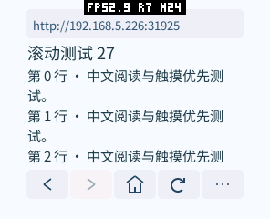
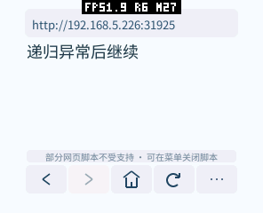

# Guest JavaScript 接入与验证（2026-10-15）

本报告保留当日的构建参数和实测数据。后续脚本内存设置、8 MiB 线性内存最大值及微信读书适配见 [2026-10-16 验证](weread-20261016.zh-CN.md)；不能把两日不同固件的内存结果直接当作优化前后对比。

JavaScript 实现位于浏览器 Guest；没有增加 ABI、Host 服务或修改设备固件。构建工具增加了可选的 `build.native_stack_checks` 开关，浏览器启用现有 WAMR AOT 原生栈检查，其他应用默认构建配方不变。引擎为 MIT 许可的 [QuickJS 2026-06-04](https://bellard.org/quickjs/quickjs-2026-06-04.tar.xz)，源码、来源校验值和移植补丁见 [UPSTREAM.md](../vendor/quickjs/UPSTREAM.md)。不链接 quickjs-libc，不向网页暴露进程、文件系统、原生模块或任意 Host 调用。

## 选择与边界

当前 WASI/WAMR AOT 组合不能直接使用依赖 setjmp/longjmp 的 Duktape、MicroQuickJS 默认实现。JerryScript 可以配置小堆，但其耗尽内存的 fatal 路径不适合在当前同一 Guest 内恢复页面。QuickJS 的异常返回、分配器及中断钩子适合本次有界执行。代价是它明显大于无 JS 的阅读浏览器，不能把它描述成零内存开销的功能。

HTTP 头或 meta 声明 CSP 的页面当前保守禁用脚本，保留静态内容，不尝试不完整地放宽策略。策略头超过既有 4 KiB 响应头预算时，GET 可重试为静态读取；POST 不自动重放。

支持经典内联/外部脚本、基本 DOM 查询及修改、文本/属性/内联样式、基本点击和表单输入事件、DOMContentLoaded/load、函数定时器、Promise、同源异步 XHR/fetch、JSON、Date、RegExp。外部经典脚本按文档顺序加载；请求完成只排队，不在网络回调里进入 VM。

不等同于完整 Web 平台：没有模块、Map/Set/TypedArray 等可选内建库、完整 CSS/布局 DOM、Canvas/WebGL、jQuery/现代框架兼容保证、WebSocket、完整 Fetch/Headers/Response、同步 XHR、字符串定时器或完整页面导航 API。图片继续使用既有 Host 解码路径；不是 JS 自己解码。不能因为引擎可以解析某段语法，就声称微信读书等站点已经能登录和阅读。

构建器不保留网页函数源码副本；`Function.prototype.toString()` 无法复现这些函数的源码。DOM 中的脚本片段不会因 innerHTML/document.write 自动执行；简单 document.write 文本及标记可用。Web Storage 按来源和 local/session 命名空间隔离，当前只在浏览器本次运行内保留，不写磁盘；清除登录会话也清除此存储。

## 调度与容量

| 项目 | 当前应用策略 |
| --- | ---: |
| JS 堆硬上限 | 256 KiB，包含自定义分配头及 realloc 时同时存活的新旧块 |
| Wasm C 栈 / 引擎栈检查 | 48 / 16 KiB |
| AOT 原生嵌套保护 | 字节码调用 8 层；调用/解析的共享加权入口上限分别为 24 / 16 |
| HTML 捕获 | 32 KiB，超过后保留静态页面 |
| 外部单脚本 / 脚本源码累计 | 32 / 48 KiB |
| XHR/fetch 单响应 / POST 正文 | 16 / 8 KiB |
| 初始元素 / 脚本数量 | 192 / 12 |
| 定时器 / 排队网络请求 / 同时传输 | 8 / 4 / 1 |
| Web Storage | 合计 8 KiB / 32 条 |
| 单次脚本调用异常保护 | 50 ms，QuickJS 中断点协作检查 |
| DOM 快照 | 每空闲轮最多遍历 8 项；完成后整体提交，至少间隔 100 ms |
| Guest 线性内存 | 初始 192 KiB，最大 1 MiB，按需增长、不固定预分配 |

期限不是实时系统的硬期限；内建函数、GC 和任务调度可能使某次调用超过目标。可信初始化拆成六个阶段，空闲帧逐步推进，触摸和编辑期间暂停。每阶段使用 200 ms 的可信启动期限；原生内建注册不可中断，单阶段实际耗时另行记录。网页脚本的单次调用保护为 50 ms；这是停止失控代码的异常期限，不是可暂停后续跑的时间片。早期 8 ms 策略在真机误杀普通约 20 ms 的回调，未采用。超时或堆耗尽会停止页面脚本并保留已显示内容，应用仍可返回、重新加载或关闭脚本。

静态页不创建运行时，但会暂存有界 HTML 以识别晚出现的脚本，而且单组件内引擎代码仍需映射。真机确认早期 Os 构建可能在 AOT 装载阶段失败，不能只凭模拟器和 VM 堆上限推断可运行。返回主页/跨文档导航/退出销毁运行时；后台、菜单、编辑、图片预览和按住拖动期间不执行页面脚本。后台取消网络传输；其失败通知在前台恢复后交给页面。

定时器无到期事件、没有点击/输入/响应/Promise job 时跳过 VM。每轮最多执行一个 Promise job；变化先合并，再用显式遍历栈分块序列化。每块立即转交 C++ 有界字符串，避免在 JS 堆中同时保留整页碎片、拼接结果和编码副本。快照期间暂停普通脚本任务，完成后才原子替换点击映射和画面；输入、点击或响应到达会取消未完成的快照并重新处理。哈希过滤相同输出，避免反复重建相同页面。网络与图片拥有分开的任务生命周期；DOM 提交等待当前图片下载/解码和帧推进结束，再按 URL 复用仍有效的两个图片缓存，并恢复其真实尺寸；避免定时更新反复取消慢图片，或让 GIF 重头播放。慢图片期间保留当前画面，网络超时后再提交最新 DOM。没有新增网页帧缓冲、纹理或默认大型缓存。

用户在脚本尚未就绪时编辑表单，首次 DOM 更新会保留这些输入；多个字段排队更新不会覆盖成仅剩最后一个字段。

## 内存与体积优化

- 浏览器自身的桥接代码构建时编译并去除源码/调试信息：当前字节码资源为 15,934 B。源码位于 `runtime/`，只分发 `assets/browser-runtime.qjb`。
- 网页源码编译时去除函数源码副本，HTML 在 DOM 构建完成后释放；桥接字节码读取缓冲在初始化后释放。
- 属性表和样式对象按需分配；`Object.hasOwn` 和内部属性查询减少重复的 JS 调用，没有为每个 CSS 属性创建闭包。
- UI/SDK 继续 O3。引擎单独 Oz，并使用 upstream 在 Emscripten 上采用的 switch 分发路径；main/engine 使用 full LTO。相对先前 ThinLTO/96 KiB 栈方案，代码减少约 64 KiB，初始线性内存减少 64 KiB，连续热启动不再出现第四/第五次装载失败。
- 使用已有 AOT 单格式打包，避免设备再存一份同平台不需要的 Wasm。需要为设备平台构建匹配的 AOT；这不是跨架构通用二进制包。
- 内存不足回归发现并修复 vendor `build_backtrace` 在嵌套 OOM 时的异常对象生命周期问题；UBSan 同时发现两个 DynBuf 回调函数指针类型不匹配，已改为正确类型的适配函数。

QuickJS 分配器统计只表示本次 VM 的申请量和峰值，不是设备总 RAM，也不含 Guest C++ 容器、libc 分配开销、Host 图片或代码映射。销毁 VM 会释放其对象；Wasm 线性内存的历史增长不等于可以立即归还给 Host。设备测试应分别看稳定占用、本次 MEMORY START/STOP 窗口峰值，以及启动以来的历史峰值。

## 复现

在 pxa-projects 根目录运行本机回归：

```sh
bash local/pxa-apps/browser/tests/test.sh
bash local/pxa-apps/browser/tests/test_script.sh
PXA_SCRIPT_TEST_WASI_MODEL=1 bash local/pxa-apps/browser/tests/test_script.sh
python3 local/pxa-apps/browser/tests/script_fixture.py --bind 0.0.0.0 --port 31925
```

引擎回归对整个引擎启用 ASan/UBSan，覆盖 DOM、脚本顺序、点击、输入、XHR/fetch、Cookie、来源隔离、空字符串存储、取消、暂停、空闲、超时、OOM、节点上限和重复启动。

构建测试包时设置 `PXA_BROWSER_TRACE=1 PXA_BROWSER_PROFILE=1`；普通产品构建不设置它们。用 `script_smoke.py` 控制真实 PXA 模拟器，不能使用桌面网页浏览器代替 Guest：

```sh
python3 local/pxa-apps/browser/tests/script_smoke.py \
  --simulator PATH_TO_PXSYS_PRODUCT_SIMULATOR --package SIGNED_PACKAGE_DIR \
  --publisher-key PUBLISHER_PUBLIC_DER --ime-package SIGNED_IME_DIR \
  --output OUTPUT_DIR --fixture-url http://127.0.0.1:31925
```

`--width --height --dpi --corner --round` 可覆盖其他屏幕。GIF、session、encoding、status、display_matrix 回归使用同一轮 Guest 实现；最终 CSP/低堆修正另以 script_smoke 和策略回归复验。菜单测试共享 TOOL_ROWS，避免增加脚本开关后仍按旧行数定位。

修改可信桥接后运行 `tools/compile_runtime.sh`；它用本机 C 编译器构建固定版本的生成器，再更新字节码与校验值。CMake 会拒绝源码/字节码校验不一致的构建。生成器不参与 Guest 运行，也不要求改动 Host。

## 实测结果

测试使用同一份冻结 SDK 和模拟器；保留了其他任务对浏览器手势的既有改动。实测数据、原始日志及截图见本目录下的 `javascript-20261015/`。以随附最终报告 JSON 为准，不能将应用提交数当作 LCD 或光学 FPS。

### 已完成的模拟器与原生验证

整个引擎 ASan/UBSan/LSan、低堆初始化（1/16/64/128 KiB）、无限循环、正则回溯超时、递归异常恢复、Promise 连续排队、OOM、暂停、销毁/重复打开、同源策略、Cookie、存储空键/空值及多字段输入回归通过；另覆盖 onload 修改 innerHTML、120 次片段替换、快照取消与旧点击映射。真实 Wasm/AOT 模拟器还验证了异步脚本加载期间输入保留；静态页没有持续重绘。64 位原生检查因对象/指针较大使用 512 KiB 测试堆和 256 KiB 栈，不能将其成功作为设备 256 KiB 堆的证据；真实 Guest 模拟器与设备构建使用表内限额。WASI 的解释器/原生调用占 2 个共享单位，赋值/单目/语句解析占 1；调用入口上限 24、解析入口 16，字节码调用另限 8 层。Wasm 线性栈地址无法代表 AOT 原生栈。

最终包通过 296×240 / 160 DPI 圆角屏和 480×480 / 320 DPI 圆屏的同一组 JS、网络、异常、慢图片、GIF、同 URL 双图和滚动测试。桌面系统模拟器还验证了后台暂停、前台沿用同一运行时、导航取消延迟脚本及两次重启。冻结版桌面模拟器在功能通过后未及时退出；测试工具对自有进程组超时清理，没有修改 Host 来掩盖此问题。

同一 UI 实现的 GIF 11 项、登录/历史/设置 6 项、中文编码和两种状态提示回归通过；六种 DPI/屏幕形状布局检查为本轮较早结果，详细适用构建见 `test-summary.json`，不冒充最终引擎在六种设备上均做过真机测试。

公开页面另外测试了努努书坊及微信读书墨水屏入口：前者可静态阅读；后者不能据此宣称支持登录、二维码或阅读。源站响应/脚本和完整浏览器 API 依赖仍是限制，CSP 页面当前保守停用脚本。

### 真机结果与分发体积

证据索引：[final-report.json](javascript-20261015/final-report.json)、[安装包与哈希](javascript-20261015/artifact-comparison.json)、[测试清单](javascript-20261015/test-summary.json)。设备为 pai-touch（296×240 / 160 DPI、8 MiB PSRAM），整个对比保持固件与字体不变。固件 SHA-256 为 `42256b9fb7f4defbc6f897bec2b0356eef3b22e004bc5651d95a14f67d8eae5d`。测试包启用相同的 TRACE/PROFILE；正式包关闭诊断并恢复正常首页。

| 场景 | 第一次 LCD 活跃帧间隔 FPS | 第二次 |
| --- | ---: | ---: |
| 原无 JS 版，同一静态长文 | 29.58 | 30.17 |
| 最终 JS 版，静态长文、未创建 VM | 30.05 | 30.15 |
| 最终 JS 版，同一长文加 20 ms 定时器 | 30.22 | 30.01 |

计时器页等待至少五次真实 DOM 提交后再测，拖动期间脚本提交为零，松开后恢复，无脚本错误。每次采样 1.6 秒/96 点拖动；工具还记录实际采样窗口、完成帧数量及每个 LCD 帧间隔。这里使用连续活跃帧间隔计算，包含窗口首尾空闲的完成数/窗口平均约 27–28 FPS，原始 JSON 同时保留两种数据；不能把两者混用。短的功能页没有持续滚动内容，其 6 FPS 或零刷新不代表运行性能下降。

静态前后两次结果接近，样本不足以声称提速。计时器页有额外工作，也不能当作等工作负载的语言性能对比。长文 DOM 快照每次需约 24 轮，期间合并更新；本测试更新频率约 2 Hz，20 ms 定时器不等于 50 FPS 网页动画。初始化累计约 191–198 ms，最大单阶段约 75–77 ms；动态长文 READY 的最大执行轮约 42–43 ms，含 DOM/网络功能页约 45 ms；快照单块在最终日志中观测最大约 47 ms。触摸优先调度降低争用，但没有用光学仪器证明首次触摸到像素延迟，也没有消除所有长帧。

连续八次应用启动按静态、动态、DOM/点击/异步网络、无限循环、OOM、递归、静态、动态排列，全部通过且无 Guest trap。递归页既覆盖执行递归，也覆盖深层语法解析；异常后继续显示「递归异常后继续」。此前失败的 Os 装载、启动超时、物理栈溢出、ThinLTO 热启动不足和 8 ms 误杀实验均保留在本地记录，不纳入最终性能样本。

| 设备整机已用内存（含系统，KiB） | 原版静态，第二次 | 最终静态，第二次 | 最终动态，第二次 |
| --- | ---: | ---: | ---: |
| 稳定 SRAM | 265.8 | 265.7 | 265.7 |
| 稳定 PSRAM | 2505.0 | 4246.3 | 4506.3 |
| 本次启动 SRAM 峰值 | 269.8 | 269.7 | 269.8 |
| 本次启动 PSRAM 峰值 | 3677.2 | 7531.3 | 7531.8 |
| 本次拖动 PSRAM 峰值 | 2513.4 | 4255.1 | 4515.5 |

峰值来自独立 MEMORY START/STOP 窗口，SRAM/PSRAM 的各自峰值不能相加冒充同一时刻。最终 QA 包代码映射由原版 983,040 B 增至 2,490,368 B，静态页初始线性内存由 131,072 B 增至 196,608 B；动态页本次线性峰值 458,752 B。动态 READY 时 JS 申请量 208,468 B、当时峰值 211,468 B；这不是后续整个运行的真实总峰值，分配器硬上限始终为 262,144 B。没有新增帧缓冲、深度缓冲或命令队列，但引擎映射及装载副本带来显著 PSRAM 成本。启动时最小可用 PSRAM 约 631 KiB；本轮只验证此 8 MiB 设备，不保证 4 MiB 设备可装载。

八轮测试前后，停止应用时可用 PSRAM 从 6,820,376 B 变为 6,816,932 B（减少 3,444 B），SRAM 相差 36 B；这是包含系统、网络及诊断服务的整机差值。Guest 原生重复启动通过泄漏检查，但尚未将这点设备侧漂移归因于缓存或泄漏，因此不宣称长时间运行零泄漏。

正式 S3 包为 **2,101,833 B**，解包 **2,890,776 B**，其中 AOT 为 **2,801,592 B**。公平比较的无 JS AOT-only 包为 829,084 B（AOT 994,028 B）；增量约 1.21 MiB 压缩包。原版同时包含 Wasm 的 1,037,008 B 包不可作同格式基线。第一版 JS/O3 双格式包 3,827,331 B，通过引擎 Oz、字节码去源码、单格式和 full LTO 减少约 45%；这些数字也包含迭代中代码变化，不能全部归因于某一个编译选项。

最终正常首页包已在设备上打开并检查菜单，全部 10 个安装文件经设备 FSSHA 与本地签名包逐项核对，随后停止应用、停止内存监控、清空 PERF 并释放串口。Wi-Fi、两款输入法包和应用私有数据均保留；设备交还输入法任务后的固件/字体更新不属于上述同固件对比。




### pai-touch 复现方法

使用 `script_fixture.py` 的 `/bench-menu`，同一字体/固件、296×240、160 DPI、同一 60 段文本、1.6 秒/96 点滑动。测试包设置 `PXA_BROWSER_TRACE=1 PXA_BROWSER_PROFILE=1 PXA_BROWSER_START_URL=http://电脑局域网地址:31925/bench-menu`；不能将 localhost 编译给真机。

```sh
python3 local/pxa-apps/browser/tests/device_script_bench.py \
  --port /dev/ttyACM0 --output OUTPUT_DIR --case 0 --unlock
```

case 0 为静态长文，1 为含 20 ms 定时器的同一长文，2 为 DOM/点击/XHR，3/4 为无限循环/堆耗尽，5 为执行递归和深层语法解析后的恢复。case 1 等待多次真实 DOM 更新后再测，并要求滚动后脚本没有异常退出；不只观察提交次数。普通产品包不设置上述三个测试变量。

`PERF present` 是 LCD 传输完成的帧间隔，不等同于光学测量或触摸到像素延迟。启动峰值包含 AOT 装载临时副本；稳定窗口单独重新 MEMORY START。截图、样本读取放在峰值窗口外。停止测量后 `MEMORY` 的 min 可能重新显示启动以来的历史值，报告只将 START/STOP 内的最小剩余堆标为本次峰值。代码映射、线性内存、JS 自定义分配器与系统总堆分别解释，不混用。

VM 按需创建，静态页不创建 VM，但同一组件内的引擎代码仍会映射。关闭脚本不会卸载这部分代码；新功能确有内存与体积成本。分阶段初始化、GC 及某些原生内建函数仍可能超过一次普通帧的时间，保护期限不是硬实时保证。动态 DOM 更新频率受快照分块和图片背压限制，目标是阅读与触摸优先，不是高帧率 Web 动画。
