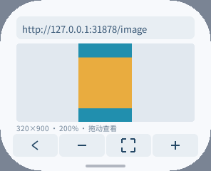

# JPEG 解码对照与图片预览（2026-10-15）

pai-touch（ESP32-S3）浏览器当前使用 ROM TJpgDec 解码 JPEG。
`esp_new_jpeg 1.0.2` 已用于设备截图的 JPEG 编码，但没有用作浏览器默认解码器。
本轮用真机确认了新库的速度优势和内存代价，并完善了浏览器图片预览。

## 独立解码对照

设备 CPU 为 240 MHz，PSRAM 为 80 MHz；同一压缩输入、RGB565 LE 输出均放在 PSRAM。
每组执行 8 次。固定输出缓冲、参考缓冲和压缩输入预先分配，表中峰值只计算本次解码的
工作区及分块 scratch，不包括它们，也不代表整机或浏览器峰值。

| 输入 / 输出 | ROM 平均耗时 | esp_new_jpeg 平均耗时 | 原生 SRAM 工作区峰值 | 原生 PSRAM 工作区峰值 |
| --- | ---: | ---: | ---: | ---: |
| 320×180 / 原尺寸 | 51.494 ms | 12.031 ms | 9980 B | 28 B |
| 640×384 / 原尺寸 | 204.402 ms | 40.412 ms | 9464 B | 28 B |
| 640×384 / 160×96 | 191.484 ms | 30.469 ms | 27032 B | 28 B |

对应 ROM 工作区均为 SRAM 0 B、PSRAM 8224 B（含堆开销）。
原尺寸 RGB565 的平均通道差约 0.52–0.53 / 255；1/4 缩放的差为 6.80 / 255，
因此缩放结果不是逐像素等价的画质比较。不同内核、缩放算法和输出处理均包含在耗时中。
320×180 的新库分块模式返回 `-4`，缩放与分块组合返回 `-1`；320×192 的分块模式成功，
但还需要 10272 B PSRAM scratch 加 9464 B SRAM。测试均无未释放的堆字节。

实测结论：新库在整图案例快约 4.3–5.1 倍，也可解码 ROM 不支持的灰度 JPEG。
但它没有公开的逐实例工作区分配器，默认接入会增加 SRAM、绕过 PXA 的应用预算；
分块和八像素对齐限制也不能直接替代目前的任意尺寸、有界缩小路径。
因此保留 ROM 默认后端，没有为这项速度提升扩大生产内存预算，也没有增加新的 ABI。
未来满足分配和峰值约束的实现可直接注册平台 codec。

[原始 JPEG 数据](jpeg-preview-20261015/jpeg.json)；
[官方模式与对齐说明](https://github.com/espressif/esp-adf-libs/blob/master/esp_new_jpeg/README.md)。

## 公共像素路径

保留的优化是 RGB565 输入写入 RGB565 目标时直接复制样本，省去三通道展开和再次量化。
两版代码编入同一诊断固件，使用相同目标、输入、分配器和输出尺寸；预热一次，再测 8 次。

| 路径 | 改前 | 改后 | 本轮预算峰值 | 输出 |
| --- | ---: | ---: | ---: | --- |
| RGB565 MCU | 26.347 ms | 18.988 ms | 65727 B → 65727 B | 校验一致 |
| RGB888 MCU 原采样 | 17.859 ms | 17.682 ms | 65727 B → 65727 B | 校验一致 |
| RGBA 单点 | 176.734 ms | 175.228 ms | 131247 B → 131247 B | 校验一致 |
| Adam7 风格点 | 15.070 ms | 15.204 ms | 131247 B → 131247 B | 校验一致 |

RGB565 耗时下降约 28%。其他格式的变化约 1%，不宣称有收益。
这项优化可复用于输出原生 RGB565 的平台 decoder；当前 ROM 输出 RGB888，
所以不把 RGB565 的改善归于当前浏览器 JPEG 或显示帧率。

试过但撤回的方案：商余递增替代逐像素除法，RGB888 慢约 3%–4%、点采样更慢；
额外 PNG 单点分支及宽泛的外层专用分发也未达到持平目标。最终保留的是原算法上的小改动。

[原始像素处理数据](jpeg-preview-20261015/blit.json)、
[源文件校验](jpeg-preview-20261015/blit-sources.json)、
[可反向恢复基线的补丁](jpeg-preview-20261015/rgb565-copy.patch)。

## 图片浏览体验

- 轻点已加载且未带链接的图片打开预览；带链接图片仍轻点跳转，长按预览。
- 底部为返回网页、缩小、适合屏幕、放大；长按可显示名称。
- 按适配尺寸提供 1、2、4、8 倍缩放；双向拖动有边界限制，缩放保留中心附近的内容。
- 返回时保留原网页滚动位置；系统返回键也先关闭预览。
- 正在加载另一张图片时，已缓存图片可立即预览；返回后恢复可见图片的加载。
- 前后台切换保留预览状态；页面导航及返回主页释放图片。

预览只有 16 B 视口状态和 4 B 横向触摸坐标，复用现有两张图片缓存、Canvas 和命令缓冲。
没有新增像素缓存、第二层帧缓冲或缩放时下载。日志使用栈上固定数组，热路径没有临时容器。
倍数相对于「适合屏幕」，不表示原图分辨率；放大不能恢复受 32768 像素上限损失的细节。

## 浏览器真机验证

固定局域网 `/images`，同一 PNG/JPEG、296×240、160 DPI、圆角与原系统设置。
用 `PERF START display` 记录 1.6 秒、96 步滚动窗口内实际完成的显示帧，
截图和 PERF 读取放在内存测量窗口外。每版重复启动两次。

| 项目 | 改前两次 | 改后两次 |
| --- | --- | --- |
| 实际网页显示 FPS | 25.67 / 24.88 | 26.24 / 25.70 |
| 提交间隔中位数 | 24.06 / 24.13 ms | 23.99 / 24.05 ms |
| 提交间隔 P95 | 47.85 / 47.72 ms | 48.02 / 47.78 ms |
| PNG+JPEG 资源驻留 | 195400 B | 195400 B |
| PXA 全局稳定 SRAM / PSRAM | 27468 / 220240 B | 27468 / 220240 B |
| PXA 全局累计 PSRAM 峰值 | 236820 B | 236820 B |
| PXA TEMP 累计峰值 | 45920 B | 45920 B |
| 回到主页图片 / TEMP 驻留 | 0 / 0 B | 0 / 0 B |

只认为滚动基本持平；两次样本不足以证明稳定 FPS 提升，提交间隔也不等于 LCD FPS。
PNG/JPEG 的端到端时间包含网络、调度和解码，见原始日志，不作为纯解码速度结论。

整机堆记录保留在 JSON 的 `heap` 中。SRAM 两次稳定空闲均约 47.1 KiB；
PSRAM 前后存在约 7–20 KiB 的连接、安装和运行历史差异，不能将这部分归因于像素优化。
`MEMORY START/STOP` 的最小空闲是本次窗口；窗口外读数可能恢复为历史最低值，不能相减后称为本次峰值。
PXA 的 `peak_external` 也为 owner/Host 生命周期累计峰值，已与局部堆监测分开列出。

## 复现与验证范围

根目录 `firmware/components/pxa/tests/jpeg_benchmark/README.md` 给出独立诊断固件的
生成、构建、仅应用分区刷写和自动恢复方法。可选 `PXA_IMAGE_BASELINE_FILE` 将基线与当前
像素处理同时测量；若从当前代码恢复基线，先复制源码到临时文件，再反向应用上述补丁并核对 SHA256。

浏览器 `tests/test.sh` 覆盖 C++26 解析、布局和视口边界，并启用 ASan/UBSan。
`image_smoke.py --case viewer/linked` 实际操作预览、缩放、拖动、返回和链接语义。
覆盖 296×240、480×480/320 DPI、240×240 圆屏、240×320 竖屏、640×360/240 DPI、
130 DPI 分数比例，以及超长 PNG。其余检查包括 40 项浏览器交互回归、
6 项原生图像/Assets/UI 回归、独立解码 ASan/UBSan、缓存淘汰、坏图和取消慢下载。

`device_image_smoke.py` 检查实际显示帧、局部堆、图片释放、部分与全帧重绘一致性；
`device_image_view_smoke.py` 检查 12 轮连续缩放、后台恢复、系统返回、图片缓存不增长及零重复下载。
诊断固件和测试包完成后恢复正常浏览器主页包；只更新应用固件分区，保留其他应用和数据。

这次没有引入 WebP/GIF、渐进 JPEG 或 JavaScript；ESP32-S3 默认 ROM 灰度 JPEG 仍显示不支持。
也未验证其他 ESP 芯片的原生库速度，不能把 S3 数据推广到所有平台。
