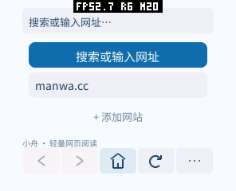
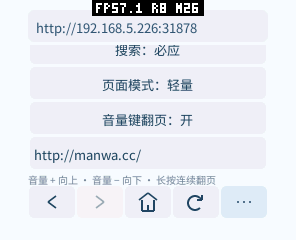
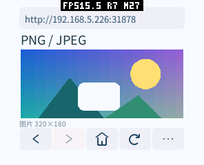
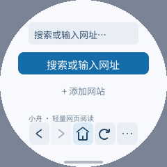
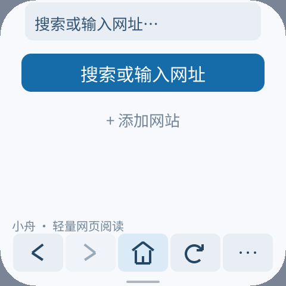

# 浏览器布局、菜单与音量键验证（2026-10-15）

本次完成小屏留白、左右居中、简洁主页、自定义网站、正常退出、可拖动滚动条，
以及可选的音量键上下翻页。开发与诊断使用 pai-touch `/dev/ttyACM3`，296×240、160 DPI、
圆角 58 像素；安装包和必要的应用分区固件，保留已有应用与数据。

## 交互与实现

- 主页只保留搜索和用户网站，最多 8 个；输入地址添加、去重、长按移除，原子保存到应用私有目录。
- 菜单包含退出。退出先完成设置保存，再通过 Window 0.3 `request_back()` 进入正常停止流程，
  不在 Window 服务回调内重入卸载 Guest。设备旧固件须更新；包声明最低 Window 0.3。
- 右侧滚动条可拖动、点击轨道定位，捕获后滑出正文仍可操作；按住时保持显示，松开后约 900 ms 隐藏。
  可见宽度 3 dp、拖动时 6 dp，触摸区 14 dp；复用已有 Canvas 命令，不创建网页位图。
- 菜单「音量键翻页」默认关闭。开启后音量 + 向上、音量 − 向下，一次移动正文高度减两行的距离，
  首次长按等待 350 ms，随后每 180 ms 翻页；不追补阻塞期间的重复，避免恢复时突然跳过多页。
  菜单也可上下滚动，图片预览中沿纵向平移。松开立即停止；输入文字、进入后台或退出时清除长按并归还音量键。
  该选项与现有设置一起保存，测试后恢复了原来的关闭状态，已有网站未改变。
- C++ SDK 新增按需头文件 `pxa/ui_volume_keys.hpp`：
  `ui::CaptureVolumeKeys(view, State<bool>, callback)` 包装顶层视图，回调接收 `ui::VolumeKeyEvent`。
  复用 UI 根节点事件掩码及已有 ABI，只增加一个绑定和一个回调，没有动态分配或默认缓存。
  模拟器独立运行器与系统桌面均转发按下/松开；不捕获时系统桌面正常调整音量。
  有序固定队列保留同一轮中的多次点击，邮箱满时重试，不从 SDL 观察器调用 Guest。
- pai-touch 的 PXADB 注入键原先直接调整音量。本次使其在应用捕获时发送真实的按下/松开，
  关闭捕获时保留系统音量行为；实体按键原有路径继续使用同一 Host 事件。

## 屏幕与截图

此前用一个统一安全矩形，隐藏状态栏仍保留其高度；此外左侧返回手势区使整个界面右移。
现在隐藏状态栏不再占用顶部高度，地址、正文及工具栏各自与物理屏幕轮廓相交，
再按左右安全距离的较大值居中。保留实体圆角和系统手势安全区。
圆屏顶部和底部避开窄尖端，中段正文仍可利用较宽区域。布局只在内容、字号或窗口指标变化时计算。

| pai-touch 区域 | 当前实际矩形 x,y,w,h | 左 / 右留白 |
| --- | --- | --- |
| 地址栏 | 28,10,240,32 | 28 / 28 px |
| 正文 | 30,45,236,127 | 30 / 30 px |
| 工具栏 | 28,186,240,32 | 28 / 28 px |

最初正文为 241×110，当前为 236×127，可用面积约增加 13.1%。
过程中较宽但偏右的 252×127 布局已被对称版本替换，不把那一版截图当作最终效果。
截图顶部的 FPS 是开发诊断浮层，不用它判定实际显示帧率。







## 实际显示帧率与内存

生产构建保持 O3 + LTO，关闭 `PXA_BROWSER_TRACE` 和 Guest 逐触摸日志。
Host 仍记录按下/松开，不记录逐次移动；两次测量使用相同固件与日志设置。
测试构建仅指定本机 `/images` 固定页面；记录 `PERF START display` 的 LCD 完成数 / 实际窗口时长，
不是应用提交 FPS。滚动为同一 1600 ms、96 步的注入手势。

| 当前生产代码工作负载 | LCD FPS | 显示间隔中位数 | P95 |
| --- | ---: | ---: | ---: |
| PNG/JPEG 页面滚动，第 1 次 | 27.31 | 24.00 ms | 47.68 ms |
| 同页滚动，第 2 次 | 26.96 | 24.03 ms | 47.64 ms |
| 图片预览 8 倍平移 | 20.97 | 未单独汇总 | 未单独汇总 |

此前带逐触摸日志的诊断构建约 20 FPS，不能拿来证明优化增益；更早约 25 FPS 的报告
视口尺寸也不同。本次记录是新布局的实际表现，未声称同负载提升，也不将缩放和平移混作普通网页滚动。
静止页面没有持续动画，不用静止状态的提交次数表示设备帧率。

| 项目 | 当前实测 |
| --- | --- |
| Guest 线性内存 / 本轮峰值 | 131072 / 131072 B，配置初始 2、最多 8 个 Wasm 页 |
| 生产测试 / 首页 AOT 代码请求 | 706844 / 704680 B |
| 生产 AOT 映射 | 均为 720896 B，映射页数保持此前水平 |
| WAMR 动态内存峰值 | 72712 B；启动快照 current 42022 B（不代表稳定网络高水位） |
| PXA 全局稳定 SRAM / PSRAM，两个图片槽加载后 | 27468 / 211942 B |
| PXA 全局 PSRAM 累计峰值 | 228522 B（Host 生命周期累计，不等于本轮峰值） |
| 图片驻留，两个槽 | 187102 B，之前较宽布局为 195400 B |
| TEMP 稳定 / 累计峰值 | 0 / 45920 B，SRAM TEMP 峰值 0 B |
| 整机稳定空闲 SRAM | 48235 B，之前同为 48235 B |
| 启动与 PNG 加载局部窗口最低空闲 SRAM | 两次均 44099 B；该窗口开始时空闲 49427 B |
| 同窗口最低空闲 PSRAM | 5124352 / 5123704 B；开始空闲 6812224 / 6811544 B |
| 后续 JPEG/滚动窗口最低空闲 SRAM | 两次均 48071 B |
| 同窗口最低空闲 PSRAM | 5842436 / 5845324 B |
| 回主页图片 / TEMP | 0 / 0 B |

`MEMORY START/STOP` 在截图和 PERF 采样之外包围初始化或交互。
首次 PNG 窗口含 Guest、代码映射、网络、图片及字形初始化；后续窗口保留已初始化资源。
窗口外的 `sram_min`、`psram_min` 会回到历史最低值，不当作本次峰值。
整机堆也包含系统、连接与字形缓存，不能将不同运行历史的全部差异归因于应用。
较窄的居中正文降低图片缓存尺寸，画质仍按相同像素预算和原生缩小策略处理，没有新增模糊/压缩设置。

增加开关和长按状态未增加 Guest 线性内存页、默认图片缓存、显示帧缓冲或深度缓冲；
浏览器不需要深度缓冲。12 轮反复缩放、恢复、后台与前台验证图片预算不增长。
带全部逐触摸日志的诊断 AOT 为 786432 B 映射，较之前诊断构建多一个 64 KiB 页；
这不是交付生产包的占用。生产首页包与上述无逐触摸日志测试包分别打包，设备最终安装首页包。

## 验证与复现

原生浏览器测试启用 C++26、ASan/UBSan；SDK 原生测试验证音量事件格式、按下/松开、
错误长度/键值、过期代次、关闭后已排队事件以及销毁订阅，断言零动态分配。
模拟器输入队列测试覆盖按键映射、同一轮多次点击、环形回绕和容量边界。
现有指针输入与系统手势回归继续通过。

真实 Wasm/AOT 包完成：

- 41 项链接、表单、输入法、POST、重定向、UA、书签及重启回归。
- 6 个显示配置：296×240/160 DPI、296×240/130 DPI、480×480/320 DPI、240 圆屏、240×320 竖屏、640×360/240 DPI。
- 模拟器 UI 验证网站新增/去重/非法地址/移除/重启、滚动条像素恢复与隐藏、正常退出，
  以及音量键默认关闭、上下、长按、松开、输入暂停与保存。
- 系统桌面模拟器验证捕获关闭时音量 60→50，开启后保持 50，后台释放后 50→40。
- 真机验证上下翻页、松开停止、重启保存、恢复原设置；真机没有通过自动化模拟实体长按，
  连续按住与中途释放由模拟器真实 UI 事件测试覆盖。
- 真机滚动条按住超过 1 秒仍显示、松开隐藏、滑出范围截断、局部/完整重绘像素一致、
  菜单退出/重复启动；PNG/JPEG、预览缩放、双向平移、返回及 12 轮复用不增加图片驻留。

在工作区启动 `tests/fixture.py --bind 0.0.0.0 --port 31878`，
以 `PXA_BROWSER_START_URL=http://电脑局域网地址:31878/images` 构建设备测试包。
调试测试可启用 `PXA_BROWSER_TRACE=1`，测帧率时应关闭。
`device_image_smoke.py --layout-file report.json` 可将诊断包实测的布局用于生产包测试。
其余脚本为 `ui_smoke.py`、`embedded_volume_smoke.py`、`device_ui_smoke.py`、`device_volume_smoke.py`、
`device_image_view_smoke.py`；均有 `--help`。正常生产包不指定启动 URL。

复现命令示例（在工作区根目录，替换包目录及串口）：

```sh
bash local/pxa-apps/browser/tests/test.sh
python3 local/pxa-apps/browser/tests/ui_smoke.py \
  --simulator build/simulator/pai-touch/pxsys_product_simulator \
  --package /path/to/trace-fixture-package \
  --publisher-key local/pxa-apps/.dev-signing/publisher-public.der \
  --ime-package /path/to/pxa-pinyin-ime --output /tmp/browser-ui
python3 local/pxa-apps/browser/tests/embedded_volume_smoke.py \
  --simulator build/simulator/pai-touch/pxsys_desktop_simulator \
  --package /path/to/trace-fixture-package \
  --publisher-key local/pxa-apps/.dev-signing/publisher-public.der --output /tmp/browser-system
python3 local/pxa-apps/browser/tests/device_volume_smoke.py \
  --port /dev/ttyACM3 --output /tmp/browser-volume
```

原始测量摘要、像素截图和断言结果保留在 [本报告的数据目录](layout-volume-20261015/)。
系统手势方面：应用可处理 Back，隐藏状态栏后首次下拉仍可唤出系统入口，Home 继续归系统管理。
本次没有新增屏蔽手势或双重确认策略的 ABI。
