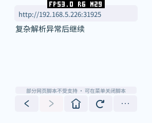

# mosaico 网页脚本操作数栈溢出

用户日志中的致命错误是脚本组件 `65538` 的 `wasm operand stack overflow`。随后 `pxa_app_stop`、`free` 的重复异常发生在同一组件清理期间。它与前面的图片网络超时是两项问题，不能只归因为网站慢或 Wi-Fi。

浏览器的 48 KiB 线性 C 栈、QuickJS 的内存/嵌套限制，与 WAMR 的操作数栈是不同资源。mosaico 当前配置的后者为 16 KiB。解释器为每个 Wasm 函数调用保留局部变量、操作数和常量区域；C/C++ 局部变量较少也不代表整个调用链占用小。仅通过桌面原生 ASan 测试不足以验证这一限制。

已在真实 PXA 模拟器复现：通过正常 UI/网络加载该站 `comics.js`，脚本组件在编译阶段触发相同异常。另有固定生成、无第三方代码的混合优先级嵌套用例，旧包也会溢出。它已加入 `tests/script_fixture.py` 的 `/js-parser` 和 `script_smoke.py`，要求返回可恢复的 JS 错误、继续后续脚本，并禁止 Guest 陷阱。网站脚本仅保留为本地调试输入，不随应用分发。

## 网站依赖与触摸等待

2026-10-16 实际下载的 [comics.js](https://www.gmanhua.com/templates/gmanhua/js/comics.js) 为 19,878 字节；名为 [jquery-1.4.1.js](https://www.gmanhua.com/templates/gmanhua/js/jquery-1.4.1.js) 的文件实际标为 jQuery 1.12.4，99,933 字节，超过当前 32 KiB 外链脚本上限。日志中的 `status=-16` 表示容量超限；图片连接超时则是另一条网络失败。修复引擎崩溃不等于补齐 jQuery、完整 DOM 与漫画阅读兼容性。

提供的日志中有 18 对可匹配的触摸入队/投递记录，中位等待 38.5 ms，最高 288 ms。这只是 Host 队列等待，未包含实际触摸采样、渲染与屏幕扫描，不能当作端到端延迟。同步脚本编译也会阻塞后续事件投递；拖动期间暂停新脚本不能抢占已经开始的编译。

## Guest 解析器调整

二元运算符的优先级处理改为固定 9 个记录的迭代过程，覆盖优先级 0–8，避免每个右操作数再增加 Wasm 调用帧。Wasm32 每次调用使用已有线性 C 栈中的 180 字节，不创建动态容器；错误路径释放所有尚未转交的私有名称引用。

普通字面量、成员访问和容器先走较小的入口，遇到二元运算符才进入完整内核。这样常见数据解析不会始终保留整个运算符内核的局部变量/常量帧。运算符顺序、结合性和 private-in 语法保持不变；164 个固定种子表达式的字节码与原解析器一致，上游语言/闭包/循环测试也通过了。

仅减少解析调用帧仍不够。此前的计数遗漏函数、类、解构、模板和 JSON 遍历等递归路径，也低估了进入解析前已有的 JS 调用栈。现按实际 FAST 解释器帧校准共享预算，并保留独立的八层字节码调用限制。预算是资源策略，具体权重和更新要求记在 `vendor/quickjs/UPSTREAM.md`；它不是 ECMAScript 标准规定的嵌套上限。

超限时先退出递归，再创建普通、独立的 `InternalError`。链式保护记录识别中间的 JS 调用和上下文边界，确保 getter/reviver 内部再次解析失败时，可以在内部正常捕获；不会推迟到外层 JSON 返回之后，也不复用可变的错误单例。记账代码放在小型辅助函数中，避免每个解析函数都膨胀。新增工作记录使用已有线性 C 栈，不新增大型动态容器；运行时新增一个保护链指针。

界面点击、输入和更改事件中，操作节点的内联处理器在 C++ 入口先按原生 `Function` 的函数体语法编译，再进入 JS 事件分发并复用节点上的缓存。祖先节点仍按实际事件传播顺序准备，子节点停止传播时，不会提前编译未访问的祖先。修改或删除事件属性会使旧缓存失效。这减少首次编译时已有的 JS 栈层数，并在该入口统计源代码容量；无需创建全局事件表。首次使用仍有编译成本，不能视为免除全部点击延迟。

## 验证结果

- 原生 ASan/UBSan 全套回归通过，包含 OOM、错误对象身份/原型、回调内再次解析、事件缓存更新/移除和停止传播时跳过无效祖先。
- `tests/parser_smoke.py` 在真实 PXA/WAMR 中运行 20 项：16 类深层语法/JSON 资源边界，以及普通嵌套数据、getter、reviver、eval 再入；全部通过，要求后续脚本执行、绘制以及退出清理都没有 Guest 陷阱。
- 原日志对应的 `comics.js` 通过本地同源服务复现，修复后返回可恢复错误，下一段脚本显示 `Parser recovered`。输入样本未放入分发仓库。
- 完整网页交互回归通过，覆盖点击、网络、图片/GIF、超时、内存、递归、导航取消、拖动暂停和空闲。480×480、240 dpi 圆屏模拟登录 6 项、普通表单会话 6 项通过；这些是合成账号测试。
- pai-touch 的静态滚动、脚本滚动、网页交互、超时、OOM、递归、复杂解析 7 项真机检查通过。复杂解析超限后实际显示“复杂解析异常后继续”，未发生 Guest 陷阱。

真机验证设备为 pai-touch；本轮没有取得 mosaico 的明确设备串口，因此尚未在 mosaico 实机复测。模拟器复现保持相同的 16 KiB WAMR 操作数栈，没有提高 Host 栈或修改 Host 代码。这里确认的是已覆盖输入和路径的恢复行为，不是所有 JS/DOM 或所有网站都已兼容。

全部阶段数据、包哈希和边界测试结果见 [测量记录](benchmarks/aot-wasm-20261016/measurements.json)，混合方案的内存和速度取舍见 [AOT + Wasm 报告](aot-wasm-20261016.zh-CN.md)。截图顶部 FPS 为设备原有 Host 叠层，静止截图的读数未用于本轮 FPS 统计。
