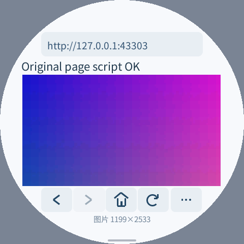
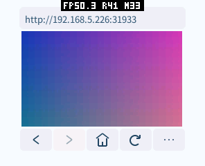
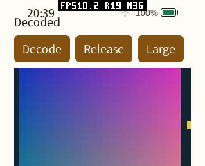

# 原始网页与有界大图解码（2026-10-16，尚未验收）

本轮改为保留网站原始 HTML、链接和脚本，撤下自动替换微信读书登录、书架、阅读页和漫画章节的路径，专用脚本与中文字形映射不再进入产品包。保留用于服务器内容协商的旧 Kindle UA；它请求官方提供的页面，不生成替代页面。浏览器仍采用有限的文字布局，不提供完整 CSS 排版。

**真机候选已撤回。** 自动测试曾显示大图并记录面板完成计数，但用户随后报告 pai-touch 出现撕裂线并停止刷新。串口、应用管理仍响应，截图接口返回 `screenshot_failed`。因此本轮不能声称真机显示验证通过，也不能把计数器推导的帧率作为已验收的实际显示帧率。已恢复从设备完整读回并校验的原生产应用镜像，以及无固定测试网址、无 TRACE/PROFILE 的普通首页浏览器包。字体、Wi-Fi、其他应用和私有数据未修改。

## 通用改动

- 动态添加经典外部 `<script src>`：连接到文档后请求、编译并触发加载/错误事件，移动已执行节点不重复请求。继续执行脚本数量、来源、总字节、堆和栈限制；网络内容不能当作可信字节码加载。
- 请求遵循通用 Referrer-Policy。支持 HTTP 响应头、HTML `meta name=referrer`、图片 `referrerpolicy`；默认 `strict-origin-when-cross-origin`。片段、账号口令和非 HTTP 来源不进入 Referer。图片防盗链不再使用漫画网站域名特判。并非完整 Fetch 标准实现，例如脚本元素独立策略尚未接通。
- Host 的 JPEG ROM MCU / POSIX 扫描线后端允许单边不超过 4096 的基线 JPEG，保留缩放和输出预算。不分配原图大小的像素帧。PNG、GIF 和 LVGL 整图后端仍保持原来的 100 万像素限制。
- 压缩 JPEG 使用 4 KiB 分块存储。ROM 顺序读取，libjpeg 借用块；不再几何扩容并同时保留新旧整份输入。头部、尺寸与 Huffman 表验证可以跨块读取。仍然要先收完下载，再开始熵解码，并非边下载边显示。
- 浏览器图片输入上限从 128 KiB 调到 512 KiB，按实际接收量分配。输出仍为每张最多 32768 像素、两个缓存；GIF 仍为 64 KiB 输入 / 8192 像素。不增加默认网页帧缓冲或像素缓存。允许更大的输入文件会占用更多按需内存，不能声称新工作负载的峰值与旧小文件相同。

这些 Host 改动复用现有图片 ABI 与 SDK，当前设备恢复的旧固件仍有旧的原图限制，尚未部署为稳定功能。新平台可以继续选择原有适配器；会分配原尺寸帧的适配器必须保留自己的尺寸/工作区限制。

## 可复现的原生结果

同一桌面、O3、320×180 基线 JPEG，附带 250 KB 合法 APP 元数据。7 组前后交替，每组先预热 1 次，再测 100 次；输出校验相同。基线为 libpxa 提交 `ae507ad413189705aab3283909b48264d66ce1e9` 的 POSIX JPEG 与输入缓冲，其他公共核心保持一致。

| 指标（组内均值的中位数） | 之前 | 之后 |
| --- | ---: | ---: |
| 输入写入 | 206.243 µs | 25.521 µs |
| 解码完成 | 603.367 µs | 619.008 µs |
| PXA 临时峰值 | 394,528 B | 258,264 B |
| PXA 总收费峰值 | 394,528 B | 323,445 B |

输入阶段约快 8.1 倍，解码完成阶段没有提速；不能推断设备获得相同比例收益。统计包括 PXA 分配前缀与新旧缓冲重叠，使用每次新建的预算，不是历史累计峰值；不包含预载测试输入、libjpeg 私有堆、Guest、网络和显示。原始数据见 [交替测量](benchmarks/original-pages-images-20261016/jpeg-input-comparison.json)。

小文件也单独核查：3505 B 输入的 POSIX 收费峰值从 71,549 B 到 71,637 B，增加 88 B 的块/源管理元数据，见 [小文件数据](benchmarks/original-pages-images-20261016/tiny-input.json)。因此不作“所有输入下解码器内存绝不增长”的结论；整体浏览器去掉了专用模块，但仍需完成同固件整机峰值对照后才能验收稳定内存目标。

新增的 1199×2533 合成竖图为 340,611 B，原生 PXA 临时/总峰值为 348,570 / 414,153 B，输出仍在 32768 像素内。覆盖 1/16/256/4096 B 输入切分、头部跨块、各次分配失败、原有截断/变异/所有权测试。完整原生 ASan/UBSan 图片测试、GIF 回归、浏览器解析与脚本/IPC 测试通过。

```sh
cmake --build build/simulator/pai-touch --target pxa_image_decode_test pxa_image_input_bench
ctest --test-dir build/simulator/pai-touch -R '^pxa_image_decode_test$' --output-on-failure
python deps/pxa-system/libpxa/tests/image_input_bench.py \
  build/simulator/pai-touch/pxa-system/libpxa/pxa_image_input_bench
PXA_SCRIPT_TEST_WASI_MODEL=1 PXA_SCRIPT_TEST_INTERPRETED=1 \
  bash local/pxa-apps/browser/tests/test_script.sh
bash local/pxa-apps/browser/tests/test_script_transport.sh
bash local/pxa-apps/browser/tests/test.sh
```

在独立 libpxa CMake 目录启用 ASan/UBSan 和 `PXA_LVGL_SOURCE_DIR`，再构建、运行 `pxa_image_decode_test` 与 `pxa_gif_decode_test`，可复现原生消毒器回归。

## 模拟器与真机口径

`tests/large_image_smoke.py` 自建两个本地 HTTP 来源，展示同一份未经替换的合成 HTML 和它动态加载的脚本。覆盖默认策略、meta、HTTP 头、禁发 Referer、图片元素覆盖五种情况，检查实际彩色像素、来源服务器校验和缩放。296×240 / 160 DPI 圆角屏与 480×480 / 240 DPI 圆屏均通过。测试数据和图片由脚本生成，不携带小说、漫画或账户内容。

```sh
python local/pxa-apps/browser/tests/large_image_smoke.py \
  --simulator build/simulator/pai-touch/pxsys_product_simulator \
  --package /path/to/signed-trace-simulator-package \
  --publisher-key /path/to/publisher-public.der \
  --ime-package /path/to/signed-ime-package --output /tmp/pxa-large-images
```



pai-touch 曾记录 340,611 B 输入、124×264 输出、约 65.6 KB 资源驻留，下载至完成 5769 ms（包含网络、排队、解码和提交，不能当作 JPEG CPU 时间）。独立内存窗口在截图前结束：首次加载 SRAM 稳定/峰值增量为 9036 / 13372 B，PSRAM 为 3,893,788 / 4,419,764 B，含 AOT、Wasm、线性内存与首次 Host 初始化。停止后仍有首次服务/缓存差额，不能据一次启动认定无泄漏。面板完成间隔曾推导出 18.08 FPS，但后续实屏故障使本次显示验收无效。保留 [未通过验收的原始记录](benchmarks/original-pages-images-20261016/device-preliminary-rejected.json)，不与文字网页或不同固件作语言/性能对比。

排查发现现有 pai-touch SPI 提交在 50 ms 等待超时后仍归还 DMA 缓冲，存在传输尚未完成就被覆盖的风险。工作区已改用驱动的无命令 drain 等待结束再复用，并移除完成信号量；生产 PERF 开/关交叉编译通过，上下文从 952 B 减至 864 B（日志关闭为 856 B）。成功和部分提交失败都必须排空；排空失败时保留缓冲并重试，不自动重启，也不以固定延时假定 DMA 已结束。这里依赖的是 pai-touch 使用的 ESP-IDF SPI 后端：`esp_lcd_panel_io_tx_param(io, -1, nullptr, 0)` 不发送命令，但等待所有排队事务结束。

修复候选已在同一 pai-touch 上通过三轮完整自动回归：每轮重新启动浏览器，加载 340,611 B / 1199×2533 的合成竖图，滚动，切换后台、前台并停止。第二轮滚动期间并行写入 256 KiB 临时文件，校验 SHA-256 后删除。三轮均得到传输完成时间递增的截图，未出现图片/脚本错误、Guest 异常、提交或排空错误；查看截图可见正确彩色图像。此前一次运行因测试使用超过协议限制的滑动步数而终止，修正为 96 步后重新完整通过，不计入产品失败或通过次数。

每轮内存窗口在截图和文件压力操作之前结束，避免把诊断截图内存混入图片加载峰值：

| 指标 | 首次启动 | 第 2 次 | 第 3 次 |
| --- | ---: | ---: | ---: |
| 加载后 SRAM 空闲 | 47,891 B | 47,927 B | 47,927 B |
| 本轮 SRAM 最低空闲 | 43,679 B | 43,679 B | 43,679 B |
| 加载后 PSRAM 空闲 | 3,051,212 B | 3,051,384 B | 3,051,236 B |
| 本轮 PSRAM 最低空闲 | 2,538,152 B | 2,528,872 B | 2,548,836 B |
| 停止后 PSRAM 空闲 | 6,916,656 B | 6,916,612 B | 6,916,232 B |

首次启动前 PSRAM 空闲 6,945,236 B，停止后约 28.6 KB 的差额包含首次初始化与缓存；后续两轮停止后的差额为 44 / 380 B。三次不能证明长期无泄漏。`MEMORY STOP` 的 heap 最低值才是本轮窗口，停止后普通 `MEMORY` 仍可能包含历史最低值。数据见 [候选回归记录](benchmarks/original-pages-images-20261016/device-dma-hotfix.json)。



**确认了 DMA 缓冲生命周期风险并完成修复候选的自动回归，尚未证明它就是用户实屏冻结的唯一根因。** 截图和传输完成时间仍不能替代实际屏幕观察。测试结束恢复原生产固件和正常首页包，候选不作为已验收固件留在设备上；需要补充实屏确认及更长时间运行。

后续用 `--image-chunk-delay-ms 50` 延长每个 4 KiB 图片块的发送时间，验证图片下载确实与 256 KiB 文件写入重叠。一轮图片成功，下载至完成为 13,023 ms，得到传输完成后的彩色截图；但 12 秒滑动命令的确认断言失败，未保存确认载荷，**整轮并发测试未通过**。另一次有重叠的运行遇到网络读超时，图片未完成；不得算作显示或解码成功。图片在文件写入结束之后才完成，因此也未证明 JPEG 解码与闪存写入同时发生。恢复生产包后，独立的 1.6 秒滑动确认正常。这里仍需完善测试记录并重新完整运行，不能用局部成功扩大前三轮结论。

交接给输入法任务前，已再次校验生产镜像 SHA-256 `6036e4cae795273504db3c1bb71c4d09d21e55c3301ab205f83a5e160ce10275`、正常首页包的全部 11 个文件及原字体；清理临时文件并停止诊断监控。后续该任务可能更新固件，这个摘要只代表交接时的状态。

## 新生产基线的隔离真机对比

输入法任务提供了可精确重建的生产 ELF 和库。先在私有目录重建带 IME 修复的 `51362b62af8fd704eeb7b301cc4453901ffbc2426c8984e9b87944c429500e02`，得到完整二进制逐字节一致的结果，再构建两份最小候选：

- 仅显示 drain：只重编译使用该内联显示头的三个源文件。固件 3,445,024 B，比生产小 160 B。
- 显示 drain＋JPEG：再替换 ROM JPEG、流式 PNG 和图片核心三个对象。固件 3,445,952 B，比生产大 768 B。

最初遗漏了另外两个内联头使用者的候选，在刷入前撤销；完整重编译后，ELF 中只保留新的 864 B Context，原结构为 952 B。候选没有改共享构建目录，保留新 IME 修复，没有夹带其他 UI/Host 工作区改动。静态 `.dram0.data` / `.dram0.bss` 均不变，IRAM 不增，Flash 只读与代码映射分别仍为 12 / 39 个 64 KiB 页。完整对象清单、源文件摘要与固件 SHA 见 [构建审计](benchmarks/original-pages-images-20261016/isolated-firmware.json)。

联网尝试发现设备持续报告 `No AP found`，基准服务器没有收到图片请求。本次没有修改已保存的网络，已请求用户恢复 Wi-Fi；此超时不算作图片解码失败，见 [网络阻塞记录](benchmarks/original-pages-images-20261016/isolated-network-blocked.json)。

为继续核查解码和显示，增加可选的 [离线诊断包](../tests/image-probe/README.md)，无网络或音频权限，也不替换浏览器。准备阶段用 4064 B 固定缓冲把包内自制 JPEG 写入该工具的私有文件；测量时交给现有 SDK 的 File 读取接口，Host 直接读压缩数据，Guest 不保留整份输入。它覆盖与 HTTP 解码共用的解码器和显示路径，不能代替浏览器的下载、DOM 或交互测试。

共同样本为同一份 **600×1200、229,193 B** 基线 JPEG，包含合法 APP 元数据。选择低于 256 KiB 的文件，使旧几何扩容缓冲也能在默认 512 KiB 临时预算内完成。输出都是 **128×256**，32768 像素上限、相同画质与同一 AOT 诊断包。每次解码同时写入 256 KiB 临时文件，校验后删除；七轮均观察到解码完成发生在写入窗口内。随后检查截图像素、持续动画、图像释放、重复解码、后台/前台及停止。

| 相同共同样本，每项 2 次 | 新生产基线 | 仅显示 drain | drain＋JPEG |
| --- | ---: | ---: | ---: |
| SDK 解码请求墙钟时间中位数 | 2332.644 ms | 2195.749 ms | 1822.239 ms |
| 单次时间范围 | 2310.642–2354.646 ms | 2167.509–2223.989 ms | 1713.725–1930.752 ms |
| 本轮 PSRAM 峰值增量范围 | 418,532–418,552 B | 418,188–418,680 B | 326,472–328,784 B |
| 此次固件启动后的 PXA 临时 PSRAM 高水位 | 393,424 B | 393,424 B | 238,672 B |
| 加载后 PXA 当前外部收费 | 90,523 B | 90,523 B | 90,523 B |
| 加载后 2 秒动画的面板完成计数 FPS | 27.85–28.36 | 27.85 | 27.49–28.35 |

临时收费减少 **154,752 B（约 39%）**，整机 PSRAM 窗口峰值增量减少约 90 KB，稳定收费相同。此次并发写入负载下，请求墙钟中位数低约 22%，但每项只有两次，包含文件 I/O、Host 解码、排队和 Guest 调度，不能当作纯 JPEG CPU 提速比例或无写入时的浏览器延迟。没有得到明确帧率提升。FPS 来自**解码完成后**动画的面板完成间隔，既不是解码期间的 FPS，也没有经过实际屏幕验收。

SRAM 本轮峰值增量，基线和纯显示版本均为 4308 B，JPEG 两次为 4308 / 4376 B。第二次额外 68 B 尚未逐笔归因；这组测试不能严格证明整机 SRAM 峰值逐字节不增长。Context 结构与静态段减少/不变是独立的可确定结果，不用它们掩盖堆测量差额。

内存窗口在解码与并发写入前开始、截图和 PERF 采样前结束。PSRAM/SRAM 最低空闲值来自每轮 `MEMORY START/STOP`；PXA budget 的峰值则自重启累计，**不会随每次 `MEMORY START` 清零**。各固件首次共同解码前临时高水位为 4080 B，随后得到表中更高值；第二次的重复高水位不能单独当作第二次真实瞬时峰值。

第七轮仅在 JPEG 候选上检查 **1199×2533、90,591 B** 的额外能力，输出 124×264 并通过同样的写入、像素与显示检查。工作量不同，不放入上表比较。原始结果见 [七轮真机记录](benchmarks/original-pages-images-20261016/isolated-device-offline.json)。



七轮自动检查均通过，但仍不能替代对用户所见撕裂/停刷的实屏确认，也未解释一次其他任务报告的早期 native UI 事件链崩溃。结束后已恢复并由 esptool 校验新的 `51362b62…` 生产镜像，原浏览器/lite 包、所有原私有文件和字体的摘要相同；卸载诊断包和数据，清理临时文件、监控和输入状态，无运行 App，明确释放 ACM0。安装器保留一个该诊断工具的 0 B 锁文件，没有绕过受管目录保护删除它。显示/JPEG 候选未留机，生产设备仍有旧图片能力限制。

## Guest 解析器栈改进

这部分保留 16 KiB Wasm 执行栈、48 KiB 线性 C 栈以及共享解析预算 88、原生入口限制 24、字节码调用深度 8，没有修改生产 Host 的脚本资源配置。

原解析器在简单表达式和普通语句中也保留成员访问、循环、switch、try 等大函数的解释器帧。现在拆分轻量入口与实际运算内核，只有使用相应语法时才保留大帧；对内核明确禁止内联，防止 LTO 又将它们合并。赋值、可选链、短路、运算优先级、作用域与标签继续沿用上游的字节码生成规则。按实际 WAMR 帧重新校准保护权重，超限仍抛普通 JS 错误，随后网页脚本可以继续执行。

| 项目 | 之前 | 之后 |
| --- | ---: | ---: |
| postfix 普通入口的 FAST 解释器帧 | 620 B | 320 B |
| 新增嵌套闭包回归用例 | 栈保护错误 | 正确得到 17 |
| 同配置 TRACE `script.wasm` | 579,434 B | 582,068 B |
| Wasm 加载后运行时请求的分配 | 1,791,849 B | 1,802,618 B |
| Wasm 加载期间请求峰值 | 1,793,553 B | 1,804,322 B |

表中是同一个桌面 WAMR 构建加载前后模块的对照，不包含输入文件、分配器头部/对齐、实例化、Guest 线性内存、执行栈或 UI。两个模块卸载并销毁运行时后，统计剩余均为 0。拆分增加了函数和模块元数据，**驻留请求增加 10,769 B，文件增加 2634 B**；局部帧变小不等于整机内存减少。它改善了已有栈预算内的兼容性，尚不能作为整机峰值不增长或帧率提升的证据。原始数据见 [模块分配](benchmarks/original-pages-images-20261016/parser-stack/module-memory.json) 与 [解释器帧](benchmarks/original-pages-images-20261016/parser-stack/frames.json)。

验证结果：

- 原生 ASan/UBSan、WASI 保护模型与 switch 解释器测试通过。
- 真实 PXA Wasm 的 23 项边界测试通过：17 项超限后恢复，6 项受支持语法/重入。没有 Guest trap 或阻塞退出。见 [测试矩阵](benchmarks/original-pages-images-20261016/parser-stack/matrix.json)。
- 完整脚本/网络/事件/图片缓存/限额/导航/拖动/空闲模拟器回归通过。
- ESP32-S3 正常首页包构建通过，无 TRACE/PROFILE 或固定测试网址；未安装到设备。
- 164 份生成语法样本的编译字节码与原始编译器一致；上游固定版本的 `test_language.js`、`test_closure.js`、`test_loop.js` 通过。四份官方登录脚本在无设备栈限制的原生模型下，编译结果也逐字节相同。未重写网站脚本，字节码一致不代表设备已能执行原站。

```sh
PXA_SCRIPT_TEST_WASI_MODEL=1 PXA_SCRIPT_TEST_INTERPRETED=1 \
  bash local/pxa-apps/browser/tests/test_script.sh
python local/pxa-apps/browser/tests/parser_smoke.py \
  --simulator build/simulator/pai-touch/pxsys_product_simulator \
  --package /path/to/signed-trace-simulator-package \
  --publisher-key /path/to/publisher-public.der \
  --ime-package /path/to/signed-ime-package --output /tmp/pxa-parser
```

`parser_smoke.py --case nested-factories --case factory-budget` 可以只重跑相关案例。可选桌面工具 `tests/wasm_module_probe.c` 链接模拟器的 `libiwasm.a`，只测模块加载，未加入产品包。

## 原站执行栈隔离实验

仅在独立复制的模拟器和 Guest 中测试，未改生产 Host、未安装到设备。原站 HTML 和脚本保持原样；不公开包含会话标识的二维码与日志。

| 每组件执行栈 | Guest 保护 | 原站结果 |
| --- | --- | --- |
| 64 KiB | 正常版 88 / 24 / 8 | 仍有 3 次 JS 编译错误 |
| 32 / 64 KiB | 仅实验：352 / 24 / 8 | 页面计数错误为 0，但只有标志图片，未出现二维码 |
| 32 KiB | 仅实验：352 / 48 / 16 | 原页出现 180×180 二维码图片，无 Guest trap，正常退出 |
| 16 KiB | 同上 | Wasm operand stack overflow，不能采用 |

三个数字依次为共享解析预算、原生入口限制、字节码调用层数。原站的异常包装可以捕获运行期栈错误，因此页面的 `errors=0` 不能独立证明登录脚本成功。只有实际出现二维码图片的实验才记录为该阶段进展；没有进行扫码、书架、会话恢复或阅读验证。

32 KiB 实验中脚本堆稳定 / 峰值为 261,399 / 362,678 B，最长脚本步骤 198,579 µs。它与失败的安全版执行了不同的工作量，不能据此做同负载性能比较。当前解析过程不能被调度器抢占，50 ms 的脚本时间预算不能保证编译步骤在 50 ms 内返回，仍有响应延迟风险。当前模拟器配置会一起改变 UI 与脚本组件的执行栈：16→32 KiB 为每组件增加 16 KiB；两组件增加 32 KiB，不能只计脚本一份。上述内存不含引擎模块、线性内存与 UI，也未验证设备的物理堆峰值。

实验说明原站兼容性确实受执行资源限制；直接提高 Guest 阈值会使当前 16 KiB 配置发生 Guest trap，危险包未在设备运行。正常版保留保护，实验包单独保存且不发布。后续可以继续降低解释器每层开销，或评估按组件声明、由 Host 在总预算内批准的执行栈配置；后者涉及 Host 脚本运行配置，超出本轮仅允许修改 Host 图片解码的范围。见 [隔离实验摘要](benchmarks/original-pages-images-20261016/parser-stack/stack-experiment.json)。

## 尚未完成

微信读书的原始登录 HTML 与四个官方脚本在无设备栈约束的原生模型下执行到网络阶段、错误为 0。解析器改动前，受保护模型下有 4 次栈溢出；改动后为 3 次，cookie 脚本可以执行，仍无法可靠启动原站登录逻辑。隔离的大栈实验已显示原页二维码，但当前安全版没有该能力。此前专用视图的二维码/扫码结果不再代表当前原网页路径，当前不能承诺原站登录、书架或阅读已可用。

真实漫画站的动态接口和原图请求已在本地检查过：完整参数及章节来源头是必要的；仅能访问静态目录不等于章节可阅读。原站 jQuery/DOM、深层脚本、渐进式 JPEG、部分平台灰度 JPEG仍有缺口。现有预览放大的是缩小后的像素，不能恢复漫画小字细节；需要进一步设计有界区域解码/按视口读取。优先完成显示故障定位、修复后的真机与重复启动验证，再继续原始页面兼容，不恢复自动站点替换。
