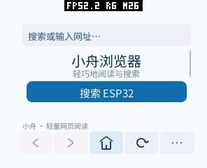

# PXA 浏览器真机性能与画面验证

应用于 2026-10-15 从“小舟浏览器”更名为“PXA 浏览器”；原始日志和截图保留测试时的名称。

2026-10-14 至 15，pai-touch，296 × 240，160 DPI，圆角半径 58，正文字号 15 dp。
同一台设备、同一固件、相同页面和触摸轨迹对比。最终包保留 O3，并启用应用范围的链接期优化。

## 实际完成显示的帧率

| 固定大页面，3 次重复 | 优化前 | 最终版本 |
| --- | ---: | ---: |
| 连续显示间隔换算 FPS，中位数 | 27.71 | 29.83 |
| 各次 FPS | 27.64 / 27.71 / 27.71 | 30.02 / 29.83 / 29.36 |
| 整个测量窗口 FPS，中位数 | 25.13 | 26.37 |
| 显示间隔 P95 | 47.71–47.77 ms | 47.77 ms |
| 最长显示间隔 | 48.00 ms | 47.83 ms |

连续滚动中位数提高 **7.7%**。原始数据：
[baseline-clean.json](performance-20261014/baseline-clean.json)、
[final.json](performance-20261014/final.json)。
另一次冷启动后测试为 28.69–30.70 FPS，其中有一次 71.40 ms 的长间隔，
没有剔除该样本：[lto.json](performance-20261014/lto.json)。不能据此保证所有网页都没有偶发停顿。

计数点在 LCD 成功完成传输的回调，包含系统 UI 的传输；这不是应用提交次数，也不是光学测量。
连续 FPS 使用全部相邻完成间隔，不滤掉慢帧。整窗口 FPS 还包含输入起始、拖动识别和结束等待。
系统/LVGL/TE 的显示节奏使间隔主要落在约 23.9/47.7 ms，P95 因而没有同步下降。

测试页 `/large` 含 1000 段固定中文及数字，实际读取 57344 B，保留可读文本 49152 B，
2 个文本跨度、无链接。每次从顶部执行 `(150,170) → (150,80)`，1600 ms、96 个输入步骤。
输入注入可能等待绘制，实际窗口时长见 JSON，不能把请求的 1600 ms 当成实际时长。
此页面没有改变英文换行后的内容布局。最终截图验证局部重绘与强制完整重绘逐像素一致。

停留页面和在顶部继续向下拖动，最终版本均 **0 次新增 LCD 传输**；表示按需绘制，没有提交相同画面，
不表示 LCD 停止扫描。旧版边界拖动仍重复提交。慢页面按服务器每 250 ms 到达的分块更新，
没有证据证明其加载 FPS 提高，因此不将它作为渲染上限。

## 阶段耗时及原因

开启汇总诊断的配对测试，用相同页面执行两段拖动；这组用于定位，不混入上面的正式包 FPS。

| 每帧阶段，6 段手势的平均值再取中位数 | 优化前 | 局部重绘后 |
| --- | ---: | ---: |
| Guest 命令编码 | 2.43 ms | 2.39 ms |
| Canvas 提交调用墙钟耗时 | 25.57 ms | 9.72 ms |
| 拖动中的排版次数 | 0 | 0 |

原始汇总保存在 [baseline.json](performance-20261014/baseline.json) 和
[partial.json](performance-20261014/partial.json)。提交耗时包含 Host 校验、复制、字体准备和 LVGL 锁等待，
不是单纯 ABI 分发耗时，也不是 Host 光栅化 CPU 时间。此次没有独立分离 Host 光栅化、锁排队和物理触摸到发光的延迟。

| 修改 | 原因及结果 | 内存和验证 |
| --- | --- | --- |
| 正文区域失效 | 滚动时无需重绘地址栏和导航；提交墙钟等待降低 | 保留完整命令列表，无新增网页位图；模拟器和真机局部/完整重绘像素相同 |
| 边界不提交 | 滚动位置没有变化时无需绘制 | 复用状态布尔值；真机边界/静止均无新增帧 |
| 文本容量封顶 | 避免 48 KiB 正文因字符串翻倍持有近 96 KiB 容量 | 按需分配；容量边界、分块和自引用输入通过 ASan/UBSan |
| O3 + 链接期优化 | 消除跨文件 SDK 冗余，降低加载及运行开销 | 冷启动峰值下降，实测 FPS 保持；不更改其它应用的构建默认值 |
| 圆弧及无柄箭头 | 原生圆弧替代背景擦除，低 DPI 保留至少 2 物理像素线宽 | Canvas 容量不变；六屏截图、SDK 编码/参数检查通过 |
| 单词换行、页面模式 | 提高阅读体验，并可手动尝试移动页面 | 换行不创建分词容器；实际请求头、设置保存与恢复通过模拟器和真机验证 |

LTO 后标准库保留 `random_get` 导入，因此 manifest 如实增加 WASI `random` 特性声明；
未新增 PXA ABI、常驻缓存或后台线程。

## 内存

重新启动设备后，从浏览器启动之前开启 `MEMORY START`，加载首页和大页面，再执行 `MEMORY STOP`。
这段窗口内不截图、不分配帧率探针。以下是 ESP 堆能统计到的全机占用；不是芯片全部静态 SRAM/IRAM。

| 冷启动至大页面，字节 | 优化前 | 最终实现 |
| --- | ---: | ---: |
| SRAM 堆稳定占用 | 265408 | 265408 |
| SRAM 堆真实窗口峰值 | 269784 | 269708 |
| PSRAM 堆稳定占用 | 2332828 | 2263112 |
| PSRAM 堆真实窗口峰值 | 2876784 | 2873980 |
| 相对启动前增加的 PSRAM 稳定占用 | 865088 | 795416 |
| 相对启动前增加的 PSRAM 真实峰值 | 1409044 | 1406284 |

稳定 PSRAM 占用减少约 **68 KiB**，冷启动窗口峰值也降低。原始记录为
[cold-baseline.json](performance-20261014/cold-baseline.json)、
[cold-lto.json](performance-20261014/cold-lto.json)。冷测使用单独检出的 LTO 构建，
其 Wasm/AOT 与最终测试包的 SHA-256 完全相同；签名包因构建元数据而哈希不同，见
[artifacts.json](performance-20261014/artifacts.json)。

加入新排版、图标和 UA、尚未启用 LTO 的中间版本初始化 PSRAM 峰值曾增加 4392 B，
已通过链接期优化消除；该中间记录也保留为 [cold-current.json](performance-20261014/cold-current.json)。

| 分类 | 核对结果 |
| --- | --- |
| Guest 线性内存 | 初始 131072 B、最大 524288 B 不变；不是预先分配最大值 |
| Guest 线性峰值诊断 | 重复运行记录出现旧版 327680 B、优化后 262144 B；该字段为引擎生命周期累计峰值，不能当作每次启动峰值。冷测的真实全堆峰值单独列出 |
| WAMR 动态元数据 | 启动后 current 从 41949 B 降到 40094 B；peak 诊断从 68443 B 降到 63244 B。与线性内存、代码映射分开统计 |
| 代码映射 | 两组均 589824 B，IBUS/DBUS 是同一块内存的映射，不能加算两次 |
| 显示缓冲 | 已有 1 个逻辑 RGB565 缓冲和 2 个旋转输出缓冲，每个 142080 B；已知合计 426240 B，不含驱动其它暂存；本次未添加缓冲 |
| 应用帧缓冲/深度缓冲 | Canvas 浏览器没有独立帧缓冲及深度缓冲；Surface frame/scratch/mailbox 均 0 |
| 命令及网络 | Canvas 固定 4000 B，接收数组及 HTTP 正文环各 4096 B；未扩大预算或新增队列 |
| 诊断探针 | 显式开启时 2176 B PSRAM；正式滚动测量含它，清除后 probe=0，冷启动内存测量不启用 |

正式滚动窗口新增 SRAM 峰值均为 88 B，PSRAM 为 6752–8376 B，旧版分别为 88–164 B、11612–11968 B。
这是本段 `MEMORY START/STOP` 的局部最小空闲量；不使用随后普通 `MEMORY` 返回的历史 min 值。
跨多次启动的字体、截图、网络和系统页面会影响堆基线，不能将两个任意时刻的 free 差当成应用内存。
上面各分类已包含在全堆统计中，不能再全部相加。

## 验证与复现

- 原生解析器：ASan/UBSan、Werror，URL、任意 UTF-8/HTML/RSS 分块、表单、容量、布局、1000 组随机输入。
- SDK：圆弧线格式及无效参数，DPI 几何/线宽往返；Host 全套原生及 sanitizer 检查，含原有 GameRender 帧率探针回归。
- 模拟器：40 个操作检查，含系统输入法、POST、停止、404、压缩提示、UA 请求头、偏好恢复、重启书签和混合中英文页面。
- 六种屏幕：296×240/160 DPI 圆角，296×240/130 DPI，480×480/320 DPI，240×240 圆屏，240×320 竖屏，640×360/240 DPI。
- 真机：固定页面、连续滚动、边界、静止、局部/完整重绘一致性、UA 两模式及恢复、冷启动内存、正式首页/菜单/HTTPS 搜索/返回/再次启动。




原始结果和截图在同目录。设备仅更新应用分区固件及浏览器包，已有应用和数据保留；
临时 UA 恢复轻量，最终安装不含测试启动 URL 的正式包，性能探针清除。

在工作区根目录启动测试服务器：

```sh
python3 local/pxa-apps/browser/tests/fixture.py --bind 0.0.0.0 --port 31878
```

构建时设置 `PXA_BROWSER_START_URL=http://电脑局域网地址:31878/`，
不设置 `PXA_BROWSER_TRACE` 或 `PXA_BROWSER_PROFILE`。安装后运行：

```sh
python3 tools/measure-device-browser.py --port /dev/ttyACM3 \
  --package 本次构建的pxa-browser.pxa --output local/browser-benchmark \
  --repeat 3 --scenes scroll edge idle
```

需要含 `PERF START display` 的 pai-touch 固件。工具参数固定为本报告的屏幕、字号和触摸坐标；
其它屏幕须重新选择轨迹。阶段诊断另建 `PXA_BROWSER_PROFILE=1` 包，不能用它替代正式包 FPS。
冷测流程见 [cold-memory.py](performance-20261014/cold-memory.py)，必须先重启设备，
该脚本针对本次设备和本工作区路径，不是通用安装工具。
旧版源码可在独立副本中反向应用 [optimization.patch](performance-20261014/optimization.patch)，
再移除 manifest 的 WASI `random` 项；不要在含现有改动的工作目录直接反向应用。

## 限制

网页图片仍只显示替代文字；没有完整 CSS、JavaScript、复杂表格、Cookie 登录和密码输入。
手机 UA 不保证网页简化，部分网站会返回验证码，详见 [网页兼容与图片](web-content.zh-CN.md)。
公网搜索属于动态、不同负载，只用于功能验证，不拿它与固定页面或其它语言版本作性能对比。
没有独立测量 Host 光栅化 CPU、显示排队及物理触摸到发光的延迟，也没有对所有网站的冷启动峰值作保证。
