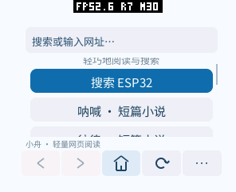
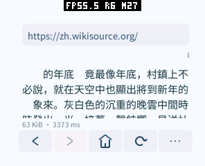

# 小说入口与阅读站点验证（2026-10-15）

后续主页已简化为搜索及用户自行保存的网站，不再预置下列入口。本报告保留当时的
站点兼容性抽查；需要时可以手动添加表中网址。

主页新增三个入口：维基文库《呐喊》《彷徨》，以及卡内基梅隆大学托管的英文
《爱丽丝梦游仙境》。维基文库入口直接定位目录，英文入口直接打开第一章。
小屏向上拖动主页即可查看全部入口，返回时恢复主页滚动位置；原有搜索、PXA 官网和
HTTPS 示例仍保留。按钮、跳转地址及内容高度来自同一份编译期数据，主页不再解析
一份重复的 HTML，也不复制链接到页面容器。

## 已检查的公开内容

| 入口 / 正文 | 网络正文 | 解析后文字 | 结果 |
| --- | ---: | ---: | --- |
| [呐喊目录](https://zh.wikisource.org/zh-hans/%E5%90%B6%E5%96%8A) | 54,170 B | 10,372 B | 目录及作品链接可读 |
| [彷徨目录](https://zh.wikisource.org/zh-hans/%E5%BD%B7%E5%BE%A8) | 37,576 B | 1,760 B | 目录及作品链接可读 |
| [狂人日记](https://zh.wikisource.org/wiki/%E7%8B%82%E4%BA%BA%E6%97%A5%E8%A8%98) | 73,998 B | 17,732 B | 正文可读 |
| [祝福](https://zh.wikisource.org/wiki/%E7%A5%9D%E7%A6%8F) | 65,746 B | 29,358 B | 正文可读 |
| [Alice 第一章](https://www.cs.cmu.edu/~rgs/alice-I.html) | 12,431 B | 11,735 B | 英文正文及下一章链接可读 |
| [Alice 第二章](https://www.cs.cmu.edu/~rgs/alice-II.html) | 12,129 B | 11,324 B | 主机下载与同一解析器验证通过 |

这些是本次网络环境和页面版本的抽查，不代表全站、全书或所有地区始终可用。
维基文库部分作品采用繁体原文；主页的简体入口不保证后续普通 `/wiki/` 链接也转换字形。
还没有跨页面连续阅读、离线书库或自动繁简转换。

## 兼容性修复

第一次实际加载维基文库失败：HTTP 响应头约 6 KiB，其中 CSP 字段超过 4 KiB，
耗尽了现有响应头预算。C++ SDK 的 `HttpRequest::wanted_headers` 现在封装已有 ABI 的
响应字段筛选能力。浏览器只保留 `content-type`、`content-encoding`、`location`，
Host 在写入缓冲之前筛选；长度及传输格式仍在筛选前检查。未扩大缓冲或增加 Host 缓存。
回归服务的 `/reading` 故意发送超过 5 KiB 的 CSP，真实应用包仍能读取正文。

页内定位现在按 UTF-8 解码 URL 的百分号转义进行无分配比较，修复中文目录锚点。
首次打开带 `mw-content-text` 的文章时直接定位正文，避免反复滚动网站导航；显式锚点及
历史恢复位置优先。不删除页面内容，仍可向上滚动查看导航。

## 没有加入的站点

- 中国哲学书电子化计划在本次请求中返回 JavaScript 验证页，不能实际阅读。
- Chinese Notes 的旧小说地址返回 404，首页已改为其他内容。
- Project Gutenberg 可打开，但整本长篇会超过当前 48 KiB 文字预算，
  中文目录也可能超过链接数上限；未把它作为本次可连续阅读的入口。
- [XKCD 手机页](https://m.xkcd.com/) 能打开且很小，但漫画主体是图片。
  当前版本仅显示替代文字，未将它误列为可看漫画的入口。图片网站需要有界解码能力后再验证。

## 复现

已通过浏览器原生 ASan/UBSan 检查、SDK HTTP / Net 原生 ASan/UBSan 检查，
六种分辨率、DPI、圆角和圆屏模拟器配置，以及 40 项应用回归检查。
生产包在模拟器及 pai-touch 上打开三个入口和两个中文作品，验证滚动、目录返回、
主页位置恢复与重复启动。没有改动设备的设置、存档或其他应用。

本次 pai-touch 单次测量：两个目录为 3,346 / 3,279 ms，《狂人日记》3,594 ms，
《祝福》3,373 ms，Alice 第一章 1,600 ms。计时从获得网络权限后发起请求到解析及排版完成，
包含 DNS/TLS 和网络等待，不是稳定帧率或触摸延迟；不能据此推算其他网络的速度。
网络正文会随站点更新略有变化，本次设备的《祝福》为 65,414 B，解析文字仍为 29,358 B。

内存预算保持：4 KiB 接收、4 KiB 响应头、4,000 B Canvas、128 KiB 初始 / 512 KiB 最大
Guest 线性内存，无额外图片、深度或帧缓冲。设备记录代码映射实际分配仍为 589,824 B，
Guest 启动线性内存 131,072 B；WAMR 启动元数据当前 39,678 B。
SRAM / PSRAM 整机稳定占用和各页面快照在原始结果中保留；其中系统 `*_min`、
`peak_total` 是设备启动以来的历史值，不能当作本次页面的真实峰值。
本轮未重新测量冷启动整机峰值或滚动帧率，不作新的性能涨幅结论；
已有固定页面的性能基准仍见 [前一轮报告](performance-20261014.zh-CN.md)。

日志、测量结果、构建哈希和截图位于 [验证材料](reading-sites-20261015/)。




用当前 SDK 构建生产包（不设置 `PXA_BROWSER_START_URL`）。原生检查：

```sh
bash local/pxa-apps/browser/tests/test.sh
```

公开站点测试需要联网，独立于确定性回归；六种屏幕适配测试沿用 `display_matrix.py`。
命令中的包路径指解包目录，不能传 `.pxa`：

```sh
python3 local/pxa-apps/browser/tests/reading_smoke.py \
  --simulator build/simulator/pai-touch/pxsys_product_simulator \
  --package /path/to/simulator/pxa-browser \
  --publisher-key local/pxa-apps/.dev-signing/publisher-public.der \
  --ime-package /path/to/simulator/pxa-pinyin-ime \
  --output /tmp/pxa-reading-check
```

测试点击三个主页入口、《狂人日记》《祝福》，滚动正文，返回目录与主页，
通过截图像素比较验证主页滚动位置恢复。公开页面变化可能使固定点击位置失效；
失败时检查截图和运行日志，不能仅以 HTTP 200 判断内容可用。
