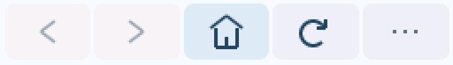
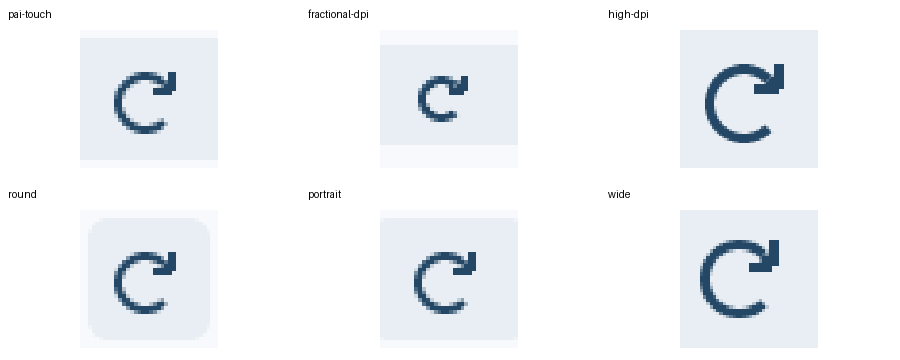

# 刷新图标修正（2026-10-15）

刷新箭头现在位于圆弧右上方，沿顺时针切线延伸，再连接折角箭头。
圆弧和箭头统一使用 Canvas 坐标，并按线条中心计算连接点，避免小箭头贴进圆弧、
方向像勾号，以及非整数 DPI 换算造成的错位。

仍通过现有圆弧、线段命令绘制，没有增加位图、缓存或动态分配。
本次没有重新测量帧率和峰值内存，不作性能提升结论。

生产配置的模拟器与 ESP32-S3 包均构建通过。六种模拟器配置通过既有
`tests/display_matrix.py` 检查并目视确认箭头：296×240 / 160 DPI、296×240 / 130 DPI、
480×480 / 320 DPI、240×240 圆屏、240×320 竖屏、640×360 / 240 DPI。
检查同时覆盖菜单和加载时的停止按钮。

pai-touch 安装后停止并重新启动浏览器，确认实际图标与模拟器一致，点击刷新后主页正常。
设备设置、应用数据和其他应用未改动。
包哈希及屏幕配置结果保存在 [验证材料](refresh-icon-20261015/)。

