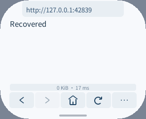

# 脚本调度、递归保护与内存验证（2026-10-17）

> 这是早期调度与 6 层保护的历史对照。后续实现和验收范围见 [原始脚本验证](original-page-scripts-20261017.zh-CN.md)，不要把本页的限制数值当作当前版本。

本轮只改浏览器 Guest 与诊断测试，没有修改 Host、ABI、SDK 或设备。界面仍为 AOT，脚本仍为按需启动的 Wasm 解释组件，不替换网站原始页面。**微信读书原页面的登录、书架和阅读仍未通过验收。** 独立微信读书应用的结果不能当作浏览器的兼容性证明。

## 保留的改动

`Page::Impl::step()` 原来把初始化、响应处理、DOM 构建和事件处理放在同一个函数中。WAMR FAST 会为每次调用保留局部变量、操作数和常量池；因此执行网站脚本时，未使用分支所需的帧空间仍然占着栈。

现在将五个阶段拆为明确禁止内联的函数，`step()` 负责选择阶段、执行预算及统计。初始化的局部状态不再伴随每次脚本递归调用。保留暂停、快照背压、执行期限、响应顺序和微任务推进规则，没有增加队列、缓存或对象字段。初始化日志的阶段/耗时转换改用 64 B 局部缓冲及 `to_chars`，去掉本层的临时动态字符串；日志接收方仍可能分配内存。

补充回归发现现有引擎的递归保护不充分：getter/setter、数组回调、JSON、对象转换和迭代器可在抛出 JS 错误前先耗尽解释器栈。修复继续使用已有计数器：字节码调用上限 **8 → 6**，原生回调消耗更多预算，对象转基本值的递归入口也计入预算，拒绝时正确释放持有的引用。基本值转换先直接返回，不增加该快路径的记账。错误退出恢复计数，随后脚本仍能正常运行。

这是兼容性取舍：更深的调用会更早收到 `InternalError`。6 层是当前构建和回归下保守的应用限制，不是完整浏览器应有的调用能力，也不是对任意未来引擎/工具链的栈安全证明。保持 16 KiB 解释器操作数栈、48 KiB Guest C 栈及原有堆/线性内存上限，未通过扩大默认内存解决问题。

## 栈空间

以下为同一 x86_64 WAMR FAST 配置下，单独拆分调度前后的保留帧之和，包含应用事件入口；不是整个程序的最大栈用量。两份测试包的 UI AOT 完全相同。

| 路径的上层调用帧 | 之前 | 调度拆分后 |
| --- | ---: | ---: |
| 外部脚本响应处理 | 1,824 B | 956 B |
| DOM 内联脚本处理 | 2,316 B | 1,320 B |

分别释放 868 / 996 B 的调用栈余量；解释器栈容量并未缩小或扩大。ESP32 的帧头布局不同，不将这两个桌面数字当作真机精确值。

## 默认构建内存

两份正常首页包均未开启 TRACE/PROFILE，使用同一 DevKit 0.4.0、WASI SDK 34 / clang 23、O3 UI、Oz 脚本及完整 LTO。旧版为本轮修改前的源码，新版包含调度及递归保护修复。UI AOT 文件逐字节相同。

| 指标 | 之前 | 本轮之后 | 变化 |
| --- | ---: | ---: | ---: |
| 脚本 Wasm 输入 | 581,819 B | 581,270 B | -549 B |
| 加载后模块请求量 | 1,801,757 B | 1,800,943 B | -814 B |
| 加载窗口请求峰值 | 1,803,461 B | 1,802,647 B | -814 B |
| 实例＋执行环境请求量（当前及本次峰值相同） | 1,886,591 B | 1,885,921 B | -670 B |
| 输入＋实例请求量 | 2,468,410 B | 2,467,191 B | -1,219 B |

测量工具是 `tests/wasm_module_probe.c --instantiate`：新进程中自定义 WAMR 分配器，先加载模块，再以 16 KiB 操作数栈创建实例和执行环境，最后全部释放。峰值属于本次测量，不是进程历史累计值。它没有调用应用入口；分配器头部/舍入、mmap 线性内存、JS 活跃堆、UI、图片、显示和整机 SRAM/PSRAM **不在此统计内**。所以这里只能证明上述加载/实例请求量的变化，不能宣称整机运行峰值不增长。Guest 初始/最大线性内存及显式栈容量未增加，未增加默认缓存。

开启 TRACE 会改变代码及帧布局，不混入正常包的表格。另测的 TRACE 包「输入＋实例」请求量反而比本轮旧版增加 95 B，因此不把调试包描述为同样的内存下降。原始数值、文件摘要、测试结果及测量口径见 [验证数据](script-scheduling-20261017/results.json)。

## 验证

- 真实 AOT UI + Wasm 脚本模拟器的 44 项检查通过：23 项解析/重入、15 项递归回调、6 项 VM 语义与错误恢复。每项新开模拟器实例，要求普通 JS 错误，并通过下一段脚本的独立网络回执确认恢复执行；不能只检查 native 测试通过。
- 与旧版共同的 18 项运行时用例，旧版有 7 项 Guest trap，新版全部通过。新增的对象转换检查还验证错误对象独立、计数器复原和后续正常转换。
- 浏览器完整脚本回归通过：网络、事件、内联处理器替换、超时、堆上限、导航恢复、图片/GIF、重复图片不重载、拖动暂停及空闲不重绘。
- ASan/UBSan 的 WASI 深度模型与解释分派检查，最终三个独立进程通过，包含对象转换拒绝后的引用释放及正常恢复。最初并行编译期间有一次「Repeated fragment」断言失败，未保留当时的页面错误详情，原因尚不能确定；该次不计为通过，也不将随后成功当作已查明首次原因。ESP32-S3 包构建通过，脚本 Wasm 与模拟器正常包逐字节相同，尚未在设备执行。



同一 UI AOT、五组前后交替的循环检查，全部校验和正确。整数循环每次 4000 次，对象转换每次 250 次；记录的是脚本内部 `Date.now()` 差值：

| 小样本脚本循环（中位数；范围） | 之前 | 本轮之后 |
| --- | ---: | ---: |
| 整数循环 | 14 ms；11–18 ms | 9 ms；6–36 ms |
| 对象转换 | 2 ms；1–2 ms | 2 ms；1–3 ms |

计时只有 1 ms 分辨率，且存在明显调度离群值，不能将中位数的字面差异当作提速或长期稳定性的证明。原始 20 条样本全部保留；可用可选工具 `tests/script_bench.py` 重测，两包 UI AOT 不相同时工具会拒绝比较。

本轮没有足够证据声称 JS 吞吐、实际显示 FPS 或触摸延迟提高。一次与并发编译重叠的循环计时超时，已剔除，不能作为性能结果。也没有进行本轮真机安装或刷写：pai-touch 由另一个任务使用，不混用旧设备、旧固件的测量。

可在工作区根目录复现，`PACKAGE` 是启用 TRACE 的签名模拟器包：

```sh
PXA_SCRIPT_TEST_WASI_MODEL=1 PXA_SCRIPT_TEST_INTERPRETED=1 \
  bash local/pxa-apps/browser/tests/test_script.sh
python3 local/pxa-apps/browser/tests/parser_smoke.py --runtime \
  --simulator "$SIM" --package "$PACKAGE" --publisher-key "$PUBLISHER" \
  --ime-package "$IME" --output /tmp/pxa-browser-engine-check

# 两份 TRACE 包；与默认包的内存统计分开。
python3 local/pxa-apps/browser/tests/script_bench.py \
  --simulator "$SIM" --before-package "$BEFORE" --after-package "$PACKAGE" \
  --publisher-key "$PUBLISHER" --ime-package "$IME" --output /tmp/pxa-browser-loop-check

# 与实际模拟器链接同一份 WAMR；不另开 MEMORY_PROFILING 改变内部布局。
cc -O2 -std=c11 -Ideps/pxa-system/wamr/core/iwasm/include \
  local/pxa-apps/browser/tests/wasm_module_probe.c \
  build/simulator/pai-touch/pxa-system/libpxa/wamr/libiwasm.a \
  -lm -ldl -lpthread -o /tmp/pxa-browser-module-probe
/tmp/pxa-browser-module-probe /path/to/script.wasm --instantiate
```

完整浏览器检查运行 `tests/script_smoke.py`，需先启动 `tests/script_fixture.py`，参数见 `--help`。前后包请用独立检出目录和相同锁定工具链构建，默认包与 TRACE 测试包分别比较；不要在原工程中覆盖旧源码。诊断实例未注册 `pxa_call`，出现未链接 import 的警告是预期结果；不能用它执行应用。

## 未采用的实验与后续门槛

大范围拆分 QuickJS VM、提高解析预算的实验仍有深嵌套对象和 `eval` 重入溢出，且引入更多代码/加载成本，未合入。单独拆分 IPC 上传解析虽让 Wasm 再小 96 B，实例却增加 482 B，也未采用。当前保留的修复尽量不改变上游 VM 的指令执行结构。

官网脚本回放必须确认 HTML 和全部四份外部脚本确实被离线服务拦截；早期未适配 curl multi、实际未拦截的记录已作废。官网脚本正文不随报告分发。当前实验不能完成原登录页执行，更没有得到原页面扫码、Cookie、书架或阅读证据；下一步仍需解决原脚本的解析/执行需求及 DOM/Web API 兼容，完成同固件真机和真实页面验证。网页错误计数为零也不足以证明登录成功，网站本身可能捕获错误。
