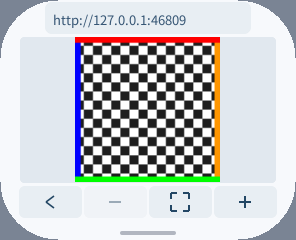

# 原始脚本的签名编译结果与图片预览回调

浏览器仍下载、校验并执行原始网页。前一阶段 P20 在 pai-touch 上因 25,442 B 的兼容库编译超过 2 s 而失败；P26 保持这一期限、原有堆预算及 AOT UI＋Wasm 引擎，已运行完原始登录脚本并显示真实二维码。**真实扫码、书架和正文仍未验收，最长回合约 1.4 s，尚不能视为流畅性通过。** Host、字体和其他应用没有更新。

## 当前 P38：减少源码临时副本

外部脚本的响应本身是拥有存储且带 NUL 结尾的字符串，现在仅在同步编译期间借用；响应槽位随后按原顺序释放。内联 HTML 切片仍复制并补终止符，避免越界读取后面的标签。所有调用使用现有页面 URL 作为编译文件名，不再复制同一个 URL。没有更改 QuickJS 字节码、脚本预算、Host 或 SDK。

| 正常构建项目 | P32 | P38 |
| --- | ---: | ---: |
| script.wasm | 596,148 B | 596,055 B |
| 加载后模块请求量 | 1,853,862 B | 1,853,583 B |
| 加载窗口请求峰值 | 1,855,566 B | 1,855,287 B |
| 实例与执行环境请求量/峰值 | 1,941,528 B | 1,941,249 B |
| 输入＋实例请求量 | 2,537,676 B | 2,537,304 B |
| S3 安装包 | 1,443,970 B | 1,443,740 B |

模拟器和 S3 的 UI AOT 仍分别逐字节相同。原始脚本配合合成 API 的协议流程，以及完整 32 KiB 外部源码/后续内联调用场景均通过；两种场景的新旧脚本组件线性高水位仍为 7 页，不能宣称物理线性内存下降。

原生分配探针对 32 KiB 源码编译窗口记录到 C++ 分配请求峰值 99,506→66,710 B，减少 32,796 B；这是 C++ `operator new` 请求量，不包括 QuickJS 的 malloc、分配器开销、模块或 Wasm 页。分配探针的前后版本均通过 ASan/UBSan/泄漏检查。

完整原生 Page/缓存/生成器回归、812 个编译取消恢复点、数组取消恢复和新增大源码生命周期检查通过；实际 WAMR 模拟器又跑过 8 项调用栈/语法用例。产品文件与已测候选逐字节一致。P50 随后在同一 d878 Host 上验证了 P38 的原始页面、四段脚本和完整二维码；26.1 s 包含网络与驱动等待，最长脚本回合仍约 1.43 s，不据此宣称帧率或触摸延迟改善。P33 是此前 P32 的历史实测。[构建、请求量及验证原始值](original-page-scripts-20261017/source-borrowing.json)。

## 资源读取候选 P49：真机内存未过门槛，未合入

候选把受签名保护的资源路径和长度生成到静态目录，完整 SHA-256 命中后借用目录条目，直接分块填充唯一的目标字符串。没有增加缓存、协程槽或堆回退。读块由 1,024 B 增至 4,064 B，兼容库读取次数 33→9，启动桥接资源 17→5；服务结构缩小，但不能用它代替整机内存测量。

同一生产 UI、原始 HTML/四段脚本、合成 API 的五组平衡交替桌面模拟器测试，观测的库加载区间中位数为 134,497→37,446 µs。起点是日志观察，终点是服务单调时间，包含轮询、存储和调度；工作站有其他负载，不能换算成真机 CPU 时间或帧率。[桌面原值和采样误差](original-page-scripts-20261017/resource-read-desktop-candidate.json)。

随后在 pai-touch 上做一组 P38→P49 先后对照：同一 Host、字体和生产 UI，仅脚本组件开启阶段日志；两次均完成原始脚本、`READY errors=0` 和真实 180×180 二维码。未扫码，不代表书架或正文通过。内存窗口从应用启动前至二维码完成，窗口内没有截图或 PERF，截图在停止窗口后进行。

| 同场景指标 | 当前 P38 | 候选 P49 |
| --- | ---: | ---: |
| 完整流程观察（含二维码后 0.8 s 等待） | 26.105 s | 22.957 s |
| 库 LOAD→COMPILED_LIBRARY 日志间隔 | 2,083 ms | 669 ms |
| READY 时已报告最大脚本回合 | 1,426,900 µs | 1,422,900 µs |
| SRAM 稳定已用 | 272,920 B | 272,920 B |
| SRAM 本次窗口最高已用 | 277,984 B | 277,020 B |
| PSRAM 稳定已用 | 5,726,868 B | 5,727,584 B |
| PSRAM 本次窗口最高已用 | 5,955,844 B | 5,961,468 B |
| READY 时 JS 当前/截至此刻峰值 | 257,327/274,768 B | 257,327/274,768 B |

完整加载本轮少约 3.15 s，但只有一组先后样本，网络及既有 Host 缓存并非完全相同，不能宣称稳定加速。日志间隔还包含日志排队与调度，最长脚本回合基本不变，流畅性仍未通过。两次启动前 PSRAM 空闲还相差 52,944 B；已同时保留绝对值和相对启动前增量，不通过扣除基线来掩盖绝对峰值增长。

**P49 的稳定 PSRAM 多 716 B，本次窗口峰值多 5,624 B，尚不能证明满足不增长要求，因此不合入。** 正常模块输入＋实例请求虽然少 657 B，不能抵消或冒充物理堆证据。实现上，Host 按请求长度预留响应，读取 worker 也分配结果缓冲；较大的单次读取可能增加临时并存内存。后续只在隔离候选中验证小块读取方案，不更改 Host 或 SDK。[真机原值、口径和精确恢复结果](original-page-scripts-20261017/device-resource-read-candidate.json)。

候选的原生 ASan/UBSan/泄漏检查覆盖 70 个真实服务加载用例，包括短读、空进度、长度变化、坏头、I/O 错误、取消及迟到事件；慢速 8 KiB/s 模拟器取消重开后必须确实命中编译资源，避免把源码回退误判为缓存通过。生成器和目录身份检查通过。当前正式代码仍保留 P38；本轮还修正了传输回归中已移除的字段引用，并覆盖三种轮询模式和非法模式拒绝。

### P51 小块候选：冷启动与重开仍未通过验收

P51 保留静态目录和目标字符串直接写入，恢复与当前版相同的 1,024 B 读取上限，不减少相对 P38 的读取次数。84 个加载边界用例、慢读取消重开通过，正常模块输入＋实例请求比 P38 少 657 B，模拟器/S3 UI 均不变。[构建与本地验证状态](original-page-scripts-20261017/resource-small-candidate.json)。

进一步在每个版本安装前普通软件重启，各做一次冷启动及确认应用注册状态不活动后的重开；这不是断电冷启动，也不是大量统计样本。相同 d878 Host、字体和原始网页，内存窗口内继续禁用截图/PERF。

| 完整二维码的冷启动样本 | 当前 P38 | 候选 P51 |
| --- | ---: | ---: |
| 完整流程观察（含二维码后 0.8 s 等待） | 25.951 s | 25.304 s |
| SRAM 稳定已用 | 272,920 B | 272,912 B |
| SRAM 本次窗口最高已用 | 277,476 B | 277,980 B |
| PSRAM 稳定已用 | 5,757,688 B | 5,756,772 B |
| PSRAM 本次窗口最高已用 | 5,986,704 B | 5,985,340 B |

P38 的重开也显示完整二维码，含相同等待的观察时间为 24.893 s。P51 重开虽先出现 `READY errors=0`，随后在二维码出现前报告“脚本执行超时”，没有 Guest trap。20.849 s 是截至失败的观察时间，**不是更快的加载时间**；该不完整路径较低的稳定 PSRAM 不能作为收益证据。

P51 冷启动 SRAM 峰值还多 504 B，未满足逐堆不增长要求；单组冷/热样本也不能将波动或超时单独归因于读取改动。候选继续隔离，不合入。超时发生在原始脚本编译执行完成以后，随后 P56 已用当前 P38 定位到 DOM 投影，并补了接近真实响应大小的非扫码数据测试。[全部原值、失败状态与恢复验证](original-page-scripts-20261017/device-resource-small-candidate.json)。

本轮接管时可用存储报告仅 106,496 B；普通重启后变为 2,891,776 B，29 个安装文件及 3 个私有文件的集合和 SHA 完全不变。因此没有归档商店或小说应用，只安装并最终归档测试浏览器。这个空间口径异常未修复，也不把变化说成删除数据或本次内存优化的收益。最新微信读书正常包及刚续期会话、Host、字体和设置均精确保留，设备已交还。

### 重开超时定位 P56：DOM 投影

保持当前 P38 的资源读取、引擎及生产 UI，仅在私有诊断构建中记录执行阶段、输入字节数和期限处理器是否实际触发，不记录响应内容。pai-touch 同一 d878 Host 上，确认应用注册状态不活动后连续启动五次：三次显示完整二维码，两次在 `take_markup` 投影阶段触发期限中断，分别观测到 71,278 / 88,808 µs；五次的四段原始脚本均已运行完，最初 `READY errors=0`。因此这次超时不局限于 P51 读取候选。

约 2.7 KiB 的二维码 JSON 回调观测到 168–171 ms，但没有触发中断；成功投影的最大观测值约 200–204 ms，也没有触发中断。50 ms 是协作式检查期限，原生操作及检查间隔会超过它，不能作为触摸延迟保证。这些诊断值包含日志与调度，不能用来宣称帧率或优化收益。[逐次阶段、真实中断标记和日志历史过滤](original-page-scripts-20261017/device-dom-projection-diagnostic.json)。

新合成检查保留原始 HTML 和四段脚本，以有固定种子的非扫码 180×180 图像生成约 2.9 / 4.0 KiB JSON，两档均必须完成图片解码、轮询和合成协议跳转。两档在实际 WAMR/生产 UI 中通过，不能代替真实账号登录。常规回归还覆盖长内联图片地址、密集转义、中文、空字符及 UTF-16 边界。

诊断代码不随产品发布，正式预算没有提高。设备验证结束后，原 29 个安装文件和 3 个私有文件的集合及 SHA 均完全恢复；微信读书原生应用及会话、Host、字体、Wi-Fi 和设置未改，设备已交还。

后续纯 Guest 转义候选的 P59 投影观测下降到 73–79 ms，但 SRAM 尚未满足逐堆门槛；P60 正常包固定 10 次对照也未过门槛，继续隔离。构建、正确性、全部失败及完整真机表格见 [DOM 投影候选报告](dom-projection-20261017.zh-CN.md)。

## 分段身份校验：P32

P26 的真机长回合仍需进一步拆解。P27 诊断在设备上累计记录到 1,421,416 µs 的 SHA 校验片段；但该次驱动误将静态提示图片当作二维码，提前结束，不能计作完整页面通过，也不能证明全部长回合都来自 SHA。

当前源码按 64 B 原始数据块推进完整 SHA-256，每次空闲轮询以 8 ms 为工作目标，再归还界面调度。这个目标允许最后一个数据块和系统调度造成超时，不是硬抢占。只保存摘要和块序号，借用现有待处理响应；页面取消或换代会丢弃摘要，重开重新计算。只有完整校验命中后才读签名资源，没有降低校验强度。

纯输入块直接组装 16 个大端字，最后一至两个块才处理补齐；轮函数采用标量状态，减少数组搬移。最终摘要直接与目录比较。命中资源时不再创建只供源码编译使用的文件名字符串。

哈希和资源读取两个阶段互斥，通过显式对象生命周期复用原有 1 KiB 缓冲。Wasm32 服务结构仍为 2,392 B，未额外常驻 36 B 摘要。生产 Wasm 也不再保留无用的阶段诊断格式化；`PXA_BROWSER_TRACE=1` 诊断构建及原生测试保留观察能力，正常性能统计和错误处理不变。`PXA_BROWSER_SCRIPT_TRACE=1` 仅启用脚本阶段诊断，保留生产 UI 二进制，避免 UI 的逐触摸/布局日志干扰。该 S3 小诊断包解包后比完整诊断包少 37,788 B，UI 与生产版逐字节一致；下文 P33 已完成真机验证。

| 正常构建项目 | P26 | P32 | 变化 |
| --- | ---: | ---: | ---: |
| script.wasm | 596,900 B | 596,148 B | −752 B |
| 加载后模块请求量 | 1,856,045 B | 1,853,862 B | −2,183 B |
| 加载窗口请求峰值 | 1,857,749 B | 1,855,566 B | −2,183 B |
| 实例与执行环境请求量/峰值 | 1,943,855 B | 1,941,528 B | −2,327 B |
| 输入＋实例请求量 | 2,540,755 B | 2,537,676 B | −3,079 B |
| S3 安装包 | 1,444,957 B | 1,443,970 B | −987 B |

UI AOT 在模拟器和 S3 均逐字节不变。相同诊断场景的组件线性内存高水位仍为 7 页（458,752 B），JS 当前/峰值仍为 257,327 / 274,768 B。这些指标不包含物理分配器开销、Host 扩容时并存内存，也不是整机 PSRAM 峰值。

相同输入、编译参数、单 CPU、平衡交替的新 WAMR 进程，各 40 个样本：旧身份匹配探针中位 19,594 µs，优化后的分块内核探针为 7,805 µs。它不包含服务轮询/调度开销，工作站也有其他负载；不据此推算真机加速、整页时间或帧率。[构建、内存与探针原始数据](original-page-scripts-20261017/source-hashing.json)。

原生完整回归和诊断模拟器通过；普通构建也用实际 HTTP 请求序列验证四段原始脚本、轮询及合成协议导航，无需诊断日志。新增原生检查覆盖部分摘要复制/重置、输入地址变化；私有 100 µs 工作片段诊断还强制在哈希未完成时离页，随后重新加载成功。正常产品保持 8 ms 目标。使用相同分段内核的 P29 诊断模拟器已从真实官方 HTML/脚本显示真实二维码，真实账号扫码、书架与正文仍未验收。P32 真机两次上传均在保守的逐文件 128 KiB 保留检查处停止，尚未部署或启动，因此这两次尝试没有运行性能数据；随后 P33 使用小诊断包完成验证。两次均精确恢复，最终 29 个原安装文件、3 个原私有文件逐项哈希相同；微信读书 v9、Host、字体与设置未改，设备已交还。不能把上传受限计作运行失败或性能样本。

## P33 真机完整流程：仍有长回合

随后换用小诊断包，保留生产 UI 与同一 P32 脚本内核，在 pai-touch 上完成原始官方页面的 `READY errors=0`、真实 180×180 二维码显示及完整预览。窗口从应用启动前开始，到二维码显示后结束；总计 27.09 s，包含网络和驱动等待，并非纯计算时间。真实扫码、书架与正文仍未验收。

哈希共 50 段，累计单调时间 459,908 µs，中位 8,634.5 µs，最大 18,234 µs。但首段至末段相隔约 2.536 s，末段至读取编译资源又约 2.107 s；轮询间隙与 1 KiB 分块资源读取同样占用时间。因此不将内核探针的加速当作整页提速。

本次初始化合计 789,635 µs，最大步 255,125 µs；资源反序列化约 301,454 µs，兼容库执行约 990,556 µs。5,369 B/5,413 B 的两个脚本从编译标记至下一执行标记约 1.425/1.285 s，包含相邻调度开销；最长报告回合仍为 1,417,676 µs。**流畅性尚未通过。** 下一步应区分解析、字节码生成及执行，并直接验证这些阶段的界面响应。

| 整机堆口径 | 启动前空闲 | 二维码后稳定空闲 | 本次窗口最小空闲 | 本次窗口最高已用 |
| --- | ---: | ---: | ---: | ---: |
| SRAM，总计 320,715 B | 49,807 B | 47,799 B | 43,663 B | 277,052 B |
| PSRAM，总计 8,358,524 B | 6,789,348 B | 2,564,780 B | 2,343,256 B | 6,015,268 B |

`MEMORY START` 使用 ESP-IDF 的局部最低空闲内存记录；`STOP` 先输出该窗口，再恢复开机累计口径，能够计入查询之间已释放的分配。上表是整机堆，包含系统工作，不是只属于浏览器的内存；两种堆的峰值也可能发生在不同时刻。READY 时 JS 当前/截至此刻峰值为 257,327/274,768 B；未单独查询二维码回调后的最终 JS 峰值。资源预算中的 `peak_*` 仍可能含历史累计，不冒充本次窗口。该次未单独采样设备 Guest 线性内存和代码映射。P26 的内存窗口止于二维码出现前，不能据此宣称完整路径的峰值下降。

四次短滑动的窗口记录 26 次 present、27 次 completed，窗口 1.670 s。它包含手势间隙，且没有覆盖编译时输入延迟，不能视为连续滚动 FPS，也不与旧版不同手势窗口直接比较。[阶段、内存原始值与口径](original-page-scripts-20261017/device-source-hashing.json)。测试结束已精确恢复全部 29 个安装文件、3 个私有文件；微信读书 v10、Host、字体与设置保持原样，设备已交还。

### 编译期间的界面响应：模拟器定位

固定 296×240/160 DPI、58 段相同正文和生产 UI AOT，五个新模拟器进程分别测量网络等待、脚本编译中及完成后的同一种拖动。测试脚本为 27,256 B、同级函数声明，不依赖账号或网站。仅脚本组件增加解析/后端阶段标记。

| 阶段 | 触摸命令等待中位数 | 首次观察到正文像素变化的中位数 |
| --- | ---: | ---: |
| 等待网络 | 1.30 ms | 45.13 ms |
| 编译进行中 | 82.31 ms | 109.92 ms |
| 编译完成后 | 2.91 ms | 40.76 ms |

编译阶段中位数为 81.69 ms，触摸命令的等待与这一阶段重合，支持继续定位同步编译对交互的影响。截图不等待下一次显示，观察还包含控制及截图开销；这里报告像素变化的观测上界，不能当作 LCD 输入延迟、持续滚动 FPS 或原始微信读书页面的提速。工作站有其他负载，真机相同阶段的延迟仍待测量。[原始数值与口径](original-page-scripts-20261017/ui-compilation-response.json)。

## 未采用的协程缓冲候选

尝试将资源读缓冲移入现有固定协程槽，读块从 1,024 B 增至 1,536 B。加载帧/读取帧为 1,704/408 B，均容纳于既有 2,048 B 槽；槽数仍为 8，没有堆回退。原始脚本协议流程和 8 KiB/s 慢读中取消重开通过，服务结构从 2,392 B 减到 1,400 B。

但正常模块输入＋实例请求比 P32 增加 357 B，诊断线性高水位仍为 7 页，结构缩小没有转化为本场景的实际线性内存下降，因此**未合入**；产品保留 P32 的 1 KiB 缓冲。仅减小一个结构体不能证明整体内存变少，也不以未测的 I/O 收益换取已观察到的加载增长。

## 处理方式

应用可以在 `runtime/libraries.json` 声明少量开源库。构建工具使用同一锁定引擎编译本地原始源码，以整个源码的 SHA-256 命名资源，并将资源、原始源码、许可证、生成器及引擎纳入 `compiled.sha256`。当前仅收录 MIT 的 es5-shim 4.5.7：源码、来源说明和许可证位于 `vendor/es5-shim/`。

只有网络下载的完整源码与清单中的长度、SHA-256 一致，才异步读取应用签名包中的编译结果。匹配与网站、URL 无关；不存在页面替换、补写登录结果或提前执行库。网络和可写页面存储中的字节码不受信任；源码不同、资源缺失或读取失败时退回正常源码编译。源码仍计入原有预算，执行期限仍为 50 ms 的主动中断目标，并非严格抢占保证。

资源加载复用现有 1 KiB 缓冲和单个协程槽，按实际大小预留资源字符串。没有默认的大型缓存或额外响应队列。已移除闲置的 `Bootstrap.setup/data` 和对应执行分支；Wasm32 `Page::Impl` 从 520 B 减到 496 B。清单设为 `libraries: []` 并重新生成即可关闭此项；普通未匹配源码不读取资源。库中的诊断文件名来自构建清单，错误栈的来源标签可能与在线编译不同。

小屏上可轻点图片完整预览。此前预览暂停所有脚本，扫码结果和后续跳转也会停住；单纯继续脚本又会受到未消费 DOM 快照的背压。现在应用私有 IPC 增加「只运行回调、暂缓 DOM 投影」模式，复用原来 40 B 消息头、缓冲和图像所有权。定时器、网络、Cookie 和导航继续推进，关闭预览后再更新页面；触摸拖动仍优先。图片信息只在独立安全空白处显示，避免覆盖完整图片底边。



## 已测资源变化：P20/P26 历史对照

同一 DevKit 0.4.0、WASI SDK 34、正常构建、相同编译选项。模块数据是分配请求计数，不含分配器头部、舍入、UI/图片或物理线性内存；不是整机 PSRAM。

| 项目 | P20 | P26 | 变化 |
| --- | ---: | ---: | ---: |
| ESP32-S3 UI AOT 文件 | 1,236,744 B | 1,237,160 B | +416 B |
| script.wasm 文件 | 594,464 B | 596,900 B | +2,436 B |
| 加载后模块请求量 | 1,849,639 B | 1,856,045 B | +6,406 B |
| 加载窗口请求峰值 | 1,851,343 B | 1,857,749 B | +6,406 B |
| 实例与执行环境请求量/峰值 | 1,937,393 B | 1,943,855 B | +6,462 B |
| 输入＋实例请求量 | 2,531,857 B | 2,540,755 B | +8,898 B |
| 签名库及许可证资源 | 0 | 34,132 B | Flash 增加 |
| ESP32-S3 安装包 | 1,416,401 B | 1,444,957 B | +28,556 B |

完整模拟器内存对照使用相同诊断 UI、原始 HTML/四段脚本和明确标注的合成 API；P20 与移除闲置接口后的 P23，各两次新进程。脚本组件的 `memory.size` 高水位均从 9 页（589,824 B）降到 7 页（458,752 B），减少 131,072 B。它包含组件内分配器、源码、临时字节码和 JS 堆，不是只看引擎统计；但**不包含 Host 扩容时新旧分配并存的物理峰值**。P26 的新增预览模式没有新增快照缓冲，此两组线性内存样本本身是 P20/P23 对照。

同一协议场景的 JS 当前占用/本次峰值从 261,399 / 362,678 B 变为 257,327 / 274,768 B。默认和最大预算未提高。模块请求量增加、线性高水位下降必须分别保留，不将其简单相加冒充整机峰值，也不将失败页面和完整二维码页面的内存当作等工作负载对比。[构建指纹、原值与口径](original-page-scripts-20261017/signed-libraries.json)。

## 验证与剩余工作

P26 的实际 AOT UI＋Wasm 模拟器 88 项矩阵和综合浏览器检查通过。原生 ASan/UBSan/泄漏及 WASI 深度模型通过；编译取消/恢复 812 项和数组复制取消保持通过。新增检查覆盖缓存命中、异步等待、同长度源码变化后的未命中、损坏头/字节码、源码预算、脚本顺序、网络字节码不受信任，以及慢速资源加载中取消再重开。

构建工具在发布文件前验证所有条目及编译输出；失败不得部分更新既有资源。无操作重新生成不改输出时间戳，不触发多余 C++ 重编译；身份变化删除旧生成物，空清单、路径越界、重复身份和大小边界均有隔离回归。

预览检查覆盖 296×240/160 DPI 圆角、240×240/160 DPI 圆屏、480×480/240 DPI 圆屏及 360×640/240 DPI 竖屏。回调修改 DOM 后继续发起网络请求，预览像素保持不变，关闭后才投影更新，图片不重复下载；上下有色边框检验没有遮挡。原始登录脚本配合合成 API 的预览中跳转也通过；这些均不冒充真实账号认证。

pai-touch 使用原 d878 PNG Host。P20 返回编译超时；P26 初始化总计 762,270 µs，最大初始化步 250,147 µs，原始脚本 READY `errors=0`，最长报告回合 1,399,468 µs，随后真实二维码可完整预览。尚无真实扫码/书架跳转证据，需进一步拆分长回合和核对完整二维码阶段的真实运行峰值。此次 MEMORY 本次窗口截至 READY 后短暂等待，二维码稍后显示，不能称为完整登录路径的峰值。临时归档的应用已精确恢复，全部原安装文件及私有文件哈希一致，设备已释放。

复现原生检查：

```sh
PXA_SCRIPT_TEST_WASI_MODEL=1 PXA_SCRIPT_TEST_INTERPRETED=1 browser/tests/test_script.sh
```

构建前运行 `browser/tools/compile_runtime.sh`；改动引擎、编译选项或库时必须重新生成并校验。模拟器使用 `tests/parser_smoke.py --runtime`、`tests/script_smoke.py`；预览专用 `tests/preview_script_smoke.py --help` 提供包、SDK 公钥、输入法包、屏幕和 DPI 参数。网络及网页后续变化可能使签名库未命中，设备仍可能触发原来的编译期限；此项不是任意网页兼容保证。


## 2026-10-18：当前 Host 下的原页扫码准备

pai-touch 当前生产 Host 为 `234edd1978bdefb9c513fc9547328c43004c37ba379f513b38fdf43ec883838e`（完整主辅助栈策略，由独立运行时任务更新）。本浏览器任务未改 Host 或字体；保留当前微信读书原生应用及最新私有会话。旧章节中的 d878 是历史测试环境，不能再作为当前设备的回退镜像。

使用现有 P38 引擎/运行时，仅在私有测试构建设置官方原始登录页为启动网址。原始 HTML 返回 200，脚本 READY 为 `errors=0`，真实 180×180 二维码已解码并完整预览；没有替换 HTML、JS、认证响应或注入其他应用的凭据。构建期间自动锁屏曾使 Guest 暂停，依据截图解锁后恢复前台；这段暂停不计入脚本启动时间。

本次从 JS OPEN 到二维码图片完成为 22.760 s，包含调度、网络及图片处理；JS READY 时引擎占用/本次峰值为 257,327 / 274,768 B，最长报告回合仍有 1,415,922 µs。它们不是登录后峰值、实际显示 FPS 或新旧 Host 性能对照，也不能说明长回合问题已经解决。仍需用户实际扫码确认，再验证登录跳转、书架及基础阅读；当前浏览器 Cookie/Storage 仍只在本次运行内保存，不能宣称重启保持登录。

[本次环境、指纹、测量口径和待验证项](original-page-scripts-20261017/original-page-current-20261018.json)。二维码及账号相关资料仅留在私有测试目录，不随文档分发。

本轮等待期间未收到实际扫码确认，最后画面仍为原始登录页，没有观察到登录跳转。已结束临时扫码测试，将浏览器代码恢复为接管前的归档状态，29 个原安装文件和 3 个原私有文件的完整集合及 SHA 全部一致；Host、字体和系统设置未修改，无运行应用，串口已释放。**本轮二维码已结束**，后续应在用户方便扫码时重新生成，不能把旧截图作为仍有效的登录入口。


## 2026-10-18：扫码长轮询提前超时

用户在微信手机端报告新二维码过期。先对截图解码，确认内容为官方 HTTPS 确认地址、`pf=2` 和有效 UUID 形状，三次刷新生成的 UID 不同。未把 UID、Cookie 或认证响应写入报告。

独立匿名会话的官方 `getlogininfo` 在 45 s 内仍未返回；浏览器原有 12 s 默认网络期限会提前终止等待，原始登录脚本又把此失败显示为“二维码已过期”。现将未指定 XHR/fetch 超时的默认值改为既有 Host 允许的 60 s，保留页面指定的非零期限、取消和请求数量/响应大小限制。不改 Host、不替换网页、不自动重发 POST。按照 [XHR 标准](https://xhr.spec.whatwg.org/#the-timeout-attribute)，零本来表示没有应用期限；这里的 60 s 仍是当前平台限制，并非完整的无限等待实现。

实际模拟器使用相同原始 HTML/四段 JS 和明确标记的合成非账号 API，将登录等待响应延迟 18 s：旧版得到网络状态 0、无法进入 weblogin/书架；修正版验证登录 POST 字段、HttpOnly Cookie、指纹 Cookie 和书架跳转均通过。原生 ASan/UBSan、显式/默认超时、库与生成器、812 项编译取消恢复及数组取消恢复通过。

UI AOT 和运行时字节码逐字节相同，脚本 Wasm 大小仍为 596,055 B，安装包大小不变；没有新增字段或缓存。等待期间原有网络资源驻留更久，真实账号登录全路径的物理稳定/峰值内存仍需实测。手机端是否因此失效尚未证实：匿名取消后再次等待的测试不能证明断开立即撤销 UID，不能将这一推断写成已修复结论。

[测试口径、原始数值和构建指纹](original-page-scripts-20261017/long-poll-timeout-20261018.json)。修正后仍需新的实际扫码结果验证手机接受及书架、阅读路径。

本轮修正版随后在 pai-touch 上完成原始页面 READY `errors=0` 和真实二维码解码/完整预览，READY 时 JS 占用/峰值仍为 257,327 / 274,768 B；这不是完整登录路径的物理峰值。最后一次码于 12:22 生成，未观察到实际登录跳转，后续等待超时。本轮已在 13:10 结束并交还设备：接管前的 29 个原安装文件和 3 个最新私有文件的完整集合及 SHA 一致，浏览器代码恢复为原归档状态，无运行应用，未写 Host/字体/系统设置。所有旧二维码均已结束使用，手机接受与真实书架/阅读仍未验证。
