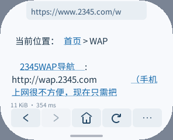
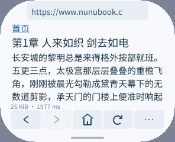
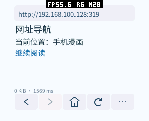
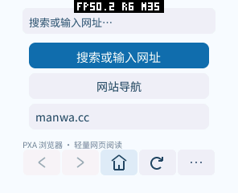
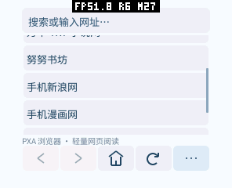

# 网站导航、旧中文编码与阅读兼容性（2026-10-15）

本轮按用户清单更新导航，修复 2345 乱码、隐藏登录弹窗的假加载文字和重复链接消耗容量的问题；新增努努书坊，并验证微信读书墨水屏 UA。保留原有自定义网站，应用 ID 仍为 `pxa-browser`。

## 导航与实际兼容性

导航现在只有 7 个入口。移除维基百科、xkcd、15pmm01、Bs0Dd 和 Cobra；TXT 图书保留手机版一个入口，页面内继续提供正常登录链接。

| 入口 | 实际 PXA 检查与限制 |
| --- | --- |
| TXT 图书 | 手机版正常显示，既有搜索/登录适配保留。真实账号认证在先前验证中完成并退出；本轮不重复输入真实凭据。 |
| 万本 TXT 小说网 | 首页有服务端正文、分类、书籍和表单。与先前一度返回 JS 验证页的结果不同，本次真实 PXA 页面可读。没有验证文件下载。 |
| 努努书坊 | 首页、一本书的目录、第一章正文均在实际 PXA 中打开。章节为普通 HTML，正文 17,387 字节、3 个链接，可直接阅读与翻页；没有通过代理生成正文。 |
| 手机新浪网 | `3g.sina.com.cn` 跳转 `sina.cn`，新闻正文/导航可读；不支持脚本栏目和完整现代样式。 |
| 手机漫画网 · 目录 | 首页、漫画目录和章节 HTML 已打开。所谓“正在加载,请稍候...”来自 `display:none` 的登录弹窗，现已过滤。章节图片由脚本 POST `chapterimagefun.ashx` 后动态生成，当前**不能阅读章节漫画图片**；页首明确提示，不把目录能打开写成漫画阅读已支持。 |
| hao123 WAP 导航 | 实际返回现代 HTML，普通文字链接可读；仍可能达到 96 个不同链接的上限，已明确提示。 |
| 2345 WAP 导航 | HTTP 未声明 charset，但 HTML meta 为 GB2312。已正确转换中文。此页很旧，含过时网站/转码链接；没有证明其中全部外链仍有效。 |

同一真实 PXA 包测试 12 页（7 个首页、漫画目录/章节、努努书籍/章节、微信读书登录页），均记录 `BROWSER DONE status=200` 并保留实际截图；完整性与能否完成网站功能分别判断。此前独立尝试遇到新浪超时和 hao123 I/O 错误，保留在原始目录，没有据此断言永久不兼容，也没有将网络耗时当作渲染性能基准。所有结果来自本机线路，不保证其他地区或网络的可达性。

## 微信读书墨水屏

直接请求 `ink.qq.com`，普通、Android、常见墨水屏和短 Kindle UA 都返回产品介绍页。实测以下完整旧 Kindle UA 会跳转到 `https://weread.qq.com/wrwebsimplenjlogic/login`：

```
Mozilla/5.0 (X11; U; Linux armv7l like Android; en-us) AppleWebKit/531.2+ (KHTML, like Gecko) Version/5.0 Safari/533.2+ Kindle/3.0+
```

浏览器仅对 `ink.qq.com` 和 `weread.qq.com` 使用此 UA，每次重定向重新判断，不影响其他网站。模拟器已实际完成该跳转。返回页面要求 JavaScript；二维码 `` 没有静态 src，需客户端脚本获取和轮询认证。因此目前**可以进入精简登录页，不能完成扫码登录和书架阅读**。没有扫码、获取用户授权或实现私有认证接口，也不将不支持 JS 的提示当作认证成功。导航未加入一个无法完成阅读的入口。

站点自身的入口见 [微信读书墨水屏](https://ink.qq.com/)，阅读端行为以本轮真实请求为准，不采用搜索结果中关于“改 UA 就能完全使用”的泛化描述。

## 解析与内存设计

| 原因 | 实现与收益 | 内存及验证 |
| --- | --- | --- |
| 老中文页没有 HTTP 编码声明 | BOM 优先，再按 HTTP charset、前 1024 字节 meta 识别；GB2312/GBK/GB18030 流式转 UTF-8。跨分片保留最多 3 字节，异常字节不吞掉引号/标签分隔符。 | 49,536 B 映射作为独立资源文件，仅旧编码页按需读取，完成/取消后释放；每次最多转换 512 输入字节，输出缓冲约 1.5 KiB。不将整页转码后再复制给解析器。 |
| 编码探测可能拖慢首段 | 已声明编码或非 HTML 只检查最多 3 字节 BOM，不等满 1 KiB。 | 复用原来的 4096 B 接收区，不新增 prefix 缓冲；慢页面未完成传输时，实际截图已出现首段。 |
| 隐藏弹窗被当作正文 | 支持 HTML `hidden` 和内联 `display:none` 子树，计数同名根标签嵌套，脚本原始文本不会提前结束隐藏区域。 | 没有 DOM/CSS 树或第二层帧缓冲；跨字节输入和嵌套隐藏测试通过。不是完整 CSS 实现，外部样式表的隐藏类仍不解析。 |
| 封面、书名重复指向相同 URL | 共享既有链接表项，达到容量后仍能复用已存在链接，并提示省略了部分新链接。 | 不增加 96 条容量，不另建哈希表；200 次重复封面/书名测试仅保留 1 个 URL。最多线性查找 96 项，仅页面解析时执行。 |
| 特定站点入口依赖脚本或 UA | 静态兼容规则隔离于两个小头文件；微信读书按 origin 选择 UA，漫画/微信登录显示明确限制。 | 无 JS VM、常驻工作线程或全站伪装；域名后缀/查询伪装测试通过。 |

映射来源是 [WHATWG Encoding](https://encoding.spec.whatwg.org/) 的 2024-09-18 固定索引，含全部 23,940 个双字节映射和 207 个四字节范围。生成器校验下载输入 SHA-256，普通构建使用已提交二进制、不联网；索引归属和许可证随资源分发。不是按某一页面出现的汉字手工拼表。

没有实现 GBK/GB18030 表单的反向编码，因此此类页面表单禁止提交，避免悄悄发出错误 UTF-8。Big5、UTF-16 等未支持编码给出明确提示，不继续显示乱码。没有声明编码的页面默认 UTF-8，不做不可靠的自动语言猜测。WML/XML 暂不从 XML declaration 推测旧编码。

按需释放 Guest 分配不等于 Wasm 线性内存能缩小：已经增长的内存页会留给后续分配复用。新增功能也会增加浏览器 AOT 代码和资源文件，不能称为整体零成本；UTF-8 页面不加载映射，SDK/其他应用没有默认编码表或缓存。

## 验证与复现

- `bash tests/test.sh`：C++26、ASan/UBSan，含 UTF-8/HTML/URL/表单既有检查、GB2312 中文、GBK 扩展、GB18030 补充平面/范围边界、异常恢复，以及全部 65,536 种双字节输入的分片一致性。
- `tests/encoding_smoke.py`：实际 Wasm/AOT 包与系统输入法，检查 meta/header 编码、BOM 覆盖、未支持编码提示、隐藏弹窗和流式首段；可传 `--sites` 检查实时网站，独立记录失败与重试。
- 新解析器通过原有 12 项 GIF 系统模拟器回归和 6 项登录/Cookie/历史/设置回归；Host 图片/Assets 的 4 个 CTest 通过，规范检查通过。C++ SDK 帧接口全套检查的完整记录见 GIF 报告。
- 所有原始截图和非私密报告在工作区 `local/browser-validation/sites-20261015-refresh/`。不把网站正文、登录凭据或 Cookie 提交到测试夹具。

```sh
python3 tests/fixture.py --bind 127.0.0.1 --port 31916
# 使用 TRACE=1、START_URL=http://127.0.0.1:31916/ 构建本地测试包。
python3 tests/encoding_smoke.py --simulator <产品模拟器> --package <签名测试包> \
  --publisher-key <公钥> --ime-package <输入法包> \
  --fixture-url http://127.0.0.1:31916 --output <结果目录>
```






## pai-touch 最终包验证

只更新应用分区，固件哈希 `cdd7bb76219bc6cfb8ef43fed299a453177e3be1a25494a92cece52277910317`。新编码页在真机正常显示；正式主页包已核对安装后的 manifest/signature 字节，与本次构建一致。新导航中努努书坊、漫画目录与 2345 均已实际截图。3 次正式主页启动/停止、3 次 GIF 启动/停止通过，所有原有应用仍在，既有书签与偏好文件逐字节一致，最终没有运行中的测试包或内存监测。

最终 GIF 包关闭 TRACE，与正式包同源 O3，只有固定测试启动 URL 不同：

| 窗口 | SRAM 稳定 / 本窗口峰值 | PSRAM 稳定 / 本窗口峰值 |
| --- | ---: | ---: |
| GIF 启动 | 272,080 / 276,344 B | 2,458,880 / 3,552,400 B |
| 不透明 GIF 稳定窗口 | 272,080 / 272,244 B | 2,458,880 / 2,477,568 B |
| 透明 GIF 稳定窗口 | 272,080 / 272,356 B | 2,476,200 / 2,545,592 B |
| 正式主页 3 次启动范围 | 272,080–272,116 / 276,216–276,324 B | 2,421,428–2,421,492 / 3,560,144–3,572,416 B |

本次 6.000636 秒有 29 次 LCD 完成，约 4.83 次/秒；保留原有系统 FPS 层，包含系统/UI 重绘，不是独立 GIF 或游戏 FPS。实际画面确认红、绿、蓝三帧，透明图片与临时状态为 32,855 + 32,160 B；不透明为 16,475 + 32,160 B，全部在 PSRAM。关闭后图片/临时预算归零。累计预算 peak 不作为当前窗口真实峰值。

最终 GIF AOT 请求映射 885,544 B，分配 917,504 B，比此前 GIF 版本的 851,968 B 增加一个 64 KiB 粒度；这是新增旧中文编码等功能的明确代码成本。Guest 启动快照仍为 131,072 B；旧编码页生命周期中的 Guest 峰值没有单独采样，不把启动快照冒充完整峰值。整个系统峰值包含在上表和公开 JSON 中，编码表本身 49,536 B，已在结束后释放供分配器复用。

与更早 GIF 表的总堆数字不作直接收益比较：固件重启、字体/HTTP/TCP 缓存和暖机历史不同。显示完成数随 UI/系统刷新而变，也不据此宣称渲染快了 16%。稳定窗口、启动窗口、测截图和 PERF 窗口分别采集。

最终还通过 6 组分辨率/DPI/形状回归，包括 480×480/320 DPI、圆屏和竖屏。公开结果见 `sites-20261015/{simulator-results,device-results}.json`；原始记录包含失败的串口/锁屏尝试，只有最终实际屏幕验证通过的运行用于统计。真机脚本先检查锁屏，截图和解锁均在内存窗口外；恢复正式包和偏好比较在 finally 中完成。






## JS 移植可行性补充

下载本站实际登录页脚本后，用 Acorn 8.15.0 的 `ecmaVersion:5` 逐个解析，4 个外部脚本均通过。业务脚本分别为 login 5,413 B、global 5,369 B、cookie 982 B，合计 11,764 B；另有 es5-shim 25,442 B。这仅证明当前登录页的语法要求，不证明登录后书架/阅读器的兼容性，更不表示这些源文件大小等于运行内存。

实际依赖包括 `document.getElementById`、节点 style/src/className、`XMLHttpRequest`、`document.cookie`、定时器、location、navigator/screen、localStorage 和少量 DOM 操作。现有 SDK 可承接联网、时钟、事件与渲染；可探索将 ES5 引擎编成浏览器 Guest 内的 Wasm/AOT 可选模块，无需先新增 Host ABI。当前尚未集成或执行页面 JS，尚未扫码认证。

[Duktape](https://duktape.org/) 提供 ES5/5.1，适合作为此类旧网页的第一轮验证候选。[MicroQuickJS](https://github.com/bellard/mquickjs) 更小但有语义子集限制，例如仅提供 Date.now；本站 cookie 脚本实际使用 new Date/setTime/toUTCString，不能原样假定兼容。[QuickJS](https://bellard.org/quickjs/) 支持更新的语言标准，可作为扩大兼容范围时的候选，实际 Wasm 代码映射和页面堆必须测量。

引擎官方最小示例占用不能作为微信读书总内存。原型应分别测量引擎初始化、脚本编译、DOM、网络响应和运行峰值，提供堆与执行时间限制，静态网页保持不创建 JS 状态。Cookie 脚本可见性、同源规则、页面销毁/后台时的请求和定时器取消均需在浏览器中实现，不能直接把 Guest 已获准的整个网络能力暴露给网页。
