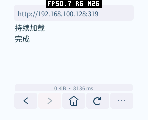
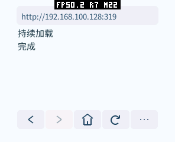

# 状态提示布局与自动隐藏（2026-10-15）

正文不再固定预留状态文字行：工具栏以上仅保留 3 dp 间距，增加 11 dp 正文高度。
工具栏下方能容纳安全的 14 dp 高、至少 96 dp 宽区域时，提示使用该空白；否则临时覆盖正文底部。
普通提示约 4 秒后隐藏，加载失败约 8 秒，加载中持续显示。菜单、文本输入时隐藏。

使用既有 Canvas 与局部重绘，不增加位图、图层或线程；隐藏后没有额外状态时钟查询。
新增截止时间和矩形共 24 B 逻辑状态，不能称为对象大小完全不变。
生产 AOT 文件为 953416 B；真机原生代码分配/映射仍为 917504 B，Guest 启动线性内存为 131072 B。
本项未单独重测整机 SRAM/PSRAM 峰值，不将这些启动数字视为峰值证明。

## 验证

- 原生 ASan/UBSan 核心及编码检查通过。
- 六种分辨率、DPI、圆角和圆屏布局通过。
- 小圆角屏及 480×480、320 DPI 圆屏验证显示、隐藏、重复消息、稳定空闲及加载超过 4 秒。
- 真实桌面系统的 12 项 GIF 回归通过。
- pai-touch 实际加载测试正文后提示自动消失；前后截图状态区域有 3292 个变化像素。
- 已恢复不含测试 URL、TRACE 或 PROFILE 的生产主页包，偏好逐字节相同，四个既有应用保留。

结果见 [验证摘要](status-20261015/results.json)。原始工作区记录位于
`local/browser-validation/status-20261015/`，复现脚本为 `tests/status_smoke.py`。

