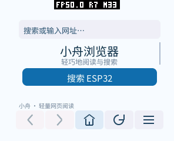
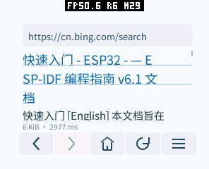
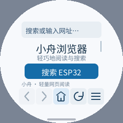

# PXA 浏览器实施与验证（2026-10-14）

应用于 2026-10-15 从“小舟浏览器”更名为“PXA 浏览器”；原始日志和截图保留测试时的名称。

交付 C++26 浏览器、流式 HTML/RSS 解析、搜索、基础表单、历史和书签，以及可重复的原生、
模拟器测试。UI 使用直接绘制的导航图标、居中的首页和按钮、左对齐的地址与正文。
按实际 DPI、安全区、圆角/圆屏及系统手势区布局，不增加网页图层或独立帧缓冲。

代码基于产品仓库 `69ad37c`、pxa-system `07c2a08` 和本轮工作区修改。
不是完整网页引擎；以下结果区分受控页面、公网服务和未验证能力。

## 采用的设计

| 原因与改动 | 性能或使用收益 | 内存变化 | 验证 |
| --- | --- | --- | --- |
| Host 全量下载不适合边下载边阅读；使用 Net 0.4 流式 HTTP | 提前读取响应头，及时取消、提示类型/编码错误，限制驻留正文 | 4 KiB 接收环和 4 KiB 响应头上限，保留最多 48 KiB 可读文字；不保存整份 HTML | 真机 HTTP/HTTPS、重定向、停止、404、大页面；底层完整网络回归 |
| 小屏无需 DOM、CSS、JS 引擎 | 分块解析文字、样式提示、链接、基础表单；排版只在内容/屏幕/字号改变时执行 | 有界的按需容器，复用容量；Guest 初始 128 KiB、最大 512 KiB | 原生容量与随机输入、实际 56 KiB 大页面 |
| 文本按钮挤占导航栏 | 返回/前进/首页/刷新或停止/更多直接画线条图标；长按显示名称 | 仍使用 4000 B 命令预算，不添加位图、控件层或帧缓冲 | 六组模拟器截图，真机导航、取消和菜单 |
| 菜单点击过滤原先误拦底部导航 | 打开菜单仍可点首页、返回、刷新；首页搜索采用所选引擎；超出内容区的菜单项仍不能截获点击 | 仅调整分支，无额外缓存或控件 | 模拟器切换引擎→首页搜索，真机菜单→首页 |
| 不同 DPI 的绘图和输入坐标单位不同 | 使用可选 SDK 坐标转换和安全矩形，绘图/触摸位置一致；Host 修正左侧手势 inset | 无状态内联函数，无其他应用的默认缓存 | 分数 DPI、整数边界 ASan/UBSan，130–320 DPI 实际包截图 |
| 现代搜索页面常依赖脚本 | 默认解析必应 RSS 的标题、摘要和链接；可切 DuckDuckGo Lite | 每条 RSS item 最多 8192 B，消费后复用；不构建 XML DOM | 真机手输 `esp32`、首页预设搜索、点击结果进入乐鑫官网 |
| 持久化不能损坏旧设置 | 临时文件写完并关闭后用 FS `replace` 原子发布；不能用拒绝覆盖的 `rename` | 保存时临时字符串最多与 8 条书签相当，不添加常驻副本 | 模拟器连续保存、真机两次字号更新、重启后书签及字号恢复 |

网络等待复用已有 Host 线程/请求槽；更完整的调度和同负载对比见产品仓库
`docs/pxa-http-stream-followup.zh-CN.md`。ESP 大正文吞吐仍有额外调度成本，
不能从更早的响应头或模拟器加速推断游戏 FPS 提升。

## 画面与屏幕适配






实际设备 pai-touch：296×240、160 DPI、四角半径 58，Host 安全边距
top/right/bottom/left 为 8/10/8/10 px。实际左侧返回手势覆盖 26 px；底部系统手势区也保留。
这些排除区和屏幕圆角取最大值，不重复相加。文字、绘图和点击均采用相同的几何转换。

模拟器使用真实 Wasm/AOT 包，覆盖 296×240@160、296×240@130、480×480@320、
240×240 圆屏@160、240×320@160、640×360@240；首页和菜单共 12 张截图。
较小的可用区域通过拖动查看更多内容，首页静止时不露出被截半的操作卡片。
长书签网址保持可读字号并裁剪，正文可以调整 12–24 dp。

这些截图验证所列屏幕配置，不能保证所有不合理的 DPI/尺寸组合都可操作。
空间过小时会显示提示；没有为每个屏幕创建额外缓存或页面层。

## 真机网络与内存

设备通过 PXADB 操作，权限预先授予。页面计时从发起网络请求开始，到正文解析结束；
不包括授权等待，也不是触摸到最终 LCD 显示的延迟。公网数据包含 DNS/TLS、网络及重定向，
是单次功能记录，不是搜索引擎性能排名。

| 页面 | 响应头 ms | 首块 ms | 完成 ms | 正文字节 | 可读文字 B / 链接 |
| --- | ---: | ---: | ---: | ---: | ---: |
| 首页搜索 `ESP32 开发`，必应 RSS | 2918 | 2924 | 2978 | 6174 | 3580 / 10 |
| 系统输入法手输 `esp32`，必应 RSS | 2861 | 2868 | 2928 | 5784 | 3246 / 10 |
| 点击结果，乐鑫 ESP32 页面 | 2709 | 2711 | 3834 | 96703 | 27996 / 96 |
| HTTPS example.com | 2669 | 2670 | 2677 | 577 | 157 / 0 |
| 局域网表单页 | 25 | 153 | 162 | 340 | 52 / 1 |
| 局域网 POST 回显 | 24 | 60 | 64 | 159 | 76 / 1 |
| 局域网容量测试 | 28 | 39 | 561 | 57344 | 49152 / 0 |

公网手输和乐鑫导航记录在最后的菜单点击修复前，HTTP 实现相同；最终包另复测首页搜索、菜单导航和重复启动，原始记录标明阶段。

公网搜索会从 www.bing.com 重定向到 cn.bing.com，程序重新发起并检查目标 URL。
搜索结果确实可点开网站，不依赖宿主浏览器或服务器代渲染。
乐鑫页面达到 96 链接上限，属于有界阅读结果，不能声称完整复现原网站。

每项动作前使用 `MEMORY START` 重置本轮局部最低空闲值，结束时 `MEMORY STOP`。
峰值增量 = 动作前空闲 − 本轮最低空闲；稳定增量 = 动作前空闲 − 动作后空闲。
截图在停止监测之后保存，排除截图编码的临时内存。数值包括 Host、字体和系统组件；
不是 Guest 堆的独立计数，不能与下面的映射/线性内存再次相加。

| 场景 | SRAM 稳定 / 峰值增量 B | PSRAM 稳定 / 峰值增量 B |
| --- | ---: | ---: |
| 启动生产包到首页，设备及网络服务已预热 | 1192 / 9176 | 612264 / 1402408 |
| 本轮已预热 HTTPS 搜索 | 0 / 3324 | 564 / 58372 |
| 打开乐鑫页面 | 0 / 4596 | 75352 / 328028 |
| 局域网普通页面跳转 | 0 / 276 | 1268 / 19988 |
| 打开系统输入法，服务已初始化 | 0 / 88 | 251288 / 546432 |
| 关闭系统输入法，服务已初始化 | 0 / 88 | −251184 / 15432 |
| 56 KiB 容量页，保留 48 KiB 可读文字 | 36 / 164 | 135168 / 359772 |

这是所记录运行的局部真实峰值，不是历史累计峰值，也不是最坏输入下的理论最大值。
首次字体/TLS/输入法会分配资源；后续复用容量。启动包含验证/AOT 加载的短暂分配，
未测量断电后的所有服务首次初始化。前后切换的缓存回收会使稳定增量小于对象容量，
不能把负增量当作某项功能的独立内存收益。

生产包 AOT 实际设备映射 589824 B（9 个 64 KiB 页），Guest 初始线性内存 131072 B、
最大 524288 B；WAMR 启动动态元数据 current=41915 B、peak=68345 B。
不同页面可使线性内存按需增长，不能把初始值当作所有页面稳定占用。
Canvas 命令 4000 B 包含在线性内存中；没有独立网页帧缓冲、深度缓冲或 Surface mailbox。
系统 LVGL 显示缓冲仍存在，Surface 统计为零不代表设备没有帧缓冲。
包、Wasm、AOT 大小及哈希见随附 `results.json`。

本轮 UI 图标、坐标和持久化修复没有增加命令预算、Guest 内存上限或默认 Host 缓存。
不把新增浏览器的全部内存与“没有浏览器”的设备状态作性能优化比较。

## 检查结果与复现

- C++26 原生 ASan/UBSan：URL、相对路径、实体、UTF-8/HTML/RSS 任意分块、表单编码、容量、
  排版、历史及 1000 组随机输入通过。SDK 可选几何函数的整数/分数 DPI、空矩形及极值通过。
- 模拟器真实包：链接、返回/前进、系统输入法、POST、重定向、慢页面停止、大页面截断、
  404、纯文本、压缩提示、重复保存书签/字号、菜单返回首页、首页采用所选搜索引擎通过；六组屏幕未出现绘图预算或应用错误。
- 真机：相同受控页面、实际公网 HTTPS/搜索、通过输入法手输关键词、点击搜索结果、
  重复启动、保存恢复和切换到 Jump Jump 3D 后重新打开通过。设备一次只运行一个应用，
  切换后的重新打开是新运行，不承诺跨进程保留本次浏览历史。
- 同时完成底层桌面 HTTP 两项回归、ESP 网络 adapter 回归；更早已完成核心 27 项及 SDK
  全套 host 检查，后续没有重复整套运行来冒充新的覆盖。

从产品仓库根目录运行：

```sh
bash local/pxa-apps/browser/tests/test.sh
python3 local/pxa-apps/browser/tests/fixture.py --bind 0.0.0.0
```

另一个终端构建受控页面包，必须使用独立输出/缓存目录，不能覆盖生产首页包：

```sh
PXA_BROWSER_START_URL=http://电脑局域网地址:31878/ \
PXA_BUILD_CACHE_DIR="$PWD/local/browser-test-cache" \
PXA_PACKAGE_OUTPUT_ROOT="$PWD/local/browser-test-output" \
PXA_APP_SOURCE_ROOT="$PWD/local/pxa-apps" \
PXA_SIGNING_KEY="$PWD/local/pxa-apps/.dev-signing/publisher-private.pem" \
bash deps/pxa-system/tools/package/package_app.sh \
  browser simulator local/browser-test-output/pxa-browser

python3 local/pxa-apps/browser/tests/simulator_smoke.py \
  --simulator deps/pxa-system/build/simulator/desktop/pxsys_product_simulator \
  --package local/browser-test-output/pxa-browser \
  --publisher-key local/pxa-apps/.dev-signing/publisher-public.der \
  --ime-package 已受信任的pxa-pinyin-ime-lite目录 \
  --fixture-url http://电脑局域网地址:31878/ \
  --output local/browser-test-result
```

`display_matrix.py` 使用生产首页包，参数见 `--help`。设备测试包改为 `esp32s3` 构建，
安装后明确停止旧运行再启动；PACKAGE run 异步完成，不能在启动回调之前立即点击。
实际用当前枚举的 `/dev/ttyACM3`，稳定 USB ID 为
`usb-Espressif_USB_JTAG_serial_debug_unit_A4:CB:8F:D5:D4:F0-if00`。
只更新 factory 应用分区，保留分区表、NVS、原 Jump Jump 3D 及数据；没有修改持久设备设置。
最终保留生产浏览器，卸载临时 HTTP 测试应用。

原始计时、逐动作内存和软件哈希见 [results.json](validation-20261014/results.json)，
截图和测试输出在同目录。完整 PXADB 日志保留于产品工作区 `local/browser-validation/`。

## 已知限制与待验证项

不支持 JavaScript、完整 CSS、图片解码、媒体、Cookie 登录或密码字段；只接受 UTF-8。
强制 gzip/非文本响应明确提示，暂不自动解压。DuckDuckGo Lite 偶尔返回图片验证，无法完成时
可切回必应；没有绕过验证。搜索服务可随时改变接口或可用性，不保证 RSS 是长期稳定 API。

Host 当前可能限制 URL 为 512 B，比应用的 1024 B 上限更小；超限显示错误。纯阅读版没有
完整字体测量，英文单词可能拆行。每屏绘制上限约 56 个片段/3000 B 正文命令，密集页面会提示；
不以丢失内容换取虚假的“完整兼容”。GET/POST 只支持有限的 URL-encoded 字段。

不加载 XML 外部实体，不自动跨域重放 POST，不接受 HTTPS 降级重定向。
含查询参数的网址不保存为书签，历史仅本次运行有效；这不等于完整的隐私或认证实现。
HTTPS 证书验证沿用 Host；本轮验证成功网站，未做证书错误、恶意网站和所有异常组合的安全审计。

没有测量电量、触摸到 LCD 的光学延迟、所有极限元数据同时占满时的内存峰值，
也没有证明任意 256 KiB HTML 都能在最大 Guest 内存中完整解析。
已验证的大页面和异常输入只是有界测试覆盖；资源上限、可见截断与错误恢复仍需保留。
