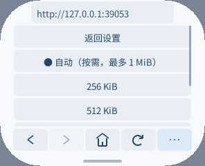
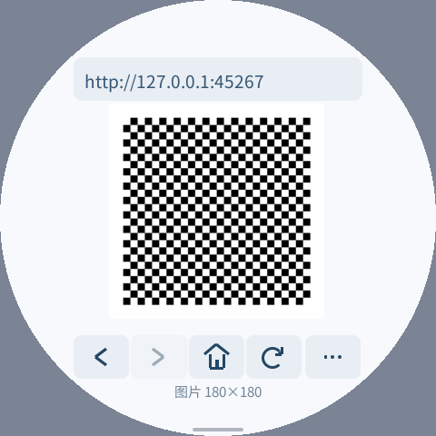

# 微信读书登录适配与脚本内存（2026-10-16）

> 历史实验记录：用户随后要求保留原网页。本文件描述的专用登录、书架和阅读替换路径已撤下，相关脚本不再随产品包分发。旧二维码/扫码证据不代表当前原始页面兼容；当前状态见 [原始网页与图片解码报告](original-pages-images-20261016.zh-CN.md)。

本轮只修改浏览器 Guest，以及已有资源压力事件的可选 C++ SDK 解码头文件；没有修改 Host、ABI、固件或设备字体。官方登录二维码已在模拟器和 pai-touch 显示，并从实际截图独立解码通过。**用户已完成真实扫码，登录会话保留刷新已验证；书架绘制和阅读尚未完成**，当前交付不能称为完整支持微信读书。

## 已实现的流程与限制

主页的「网站导航 → 微信读书（扫码登录）」打开 [墨水屏入口](https://ink.qq.com/)。既有 Kindle UA 到达 `https://weread.qq.com/wrwebsimplenjlogic/login`；只有 HTTPS、指定来源/路径及页面标记同时匹配，才使用应用维护的精简登录视图。

适配使用官网公开登录页面的同一协议：获取登录编号、获取二维码、长轮询扫码结果、提交登录、接收 Cookie、进入书架。轮询允许最长 60 秒的单次请求，暂时断网可在 180 秒窗口内重试；二维码过期显示重新获取入口，失效二维码隐藏。登录提交失败不会盲目重放。离开页面取消待处理请求，迟到响应不能导航旧页面。图片预览期间保留登录轮询，以便放大二维码后扫码。

适配脚本位于 旧实验文件 `runtime/weread-login.js`（已撤下），构建时生成 3,483 B 字节码，只在识别到登录页时加载。字节码入口只接受签名应用资源，网络脚本仍以源代码执行并保留深度、时间、同源及内存检查。没有为了运行官网的大型兼容脚本而放宽 Wasm 原生栈保护。网站变更仍可能使适配失效；当前 URL、页面标记和响应字段都必须重新核验。

真实账号还需要用手机微信扫一扫并确认，之后才能检查服务端是否接受设备指纹、Cookie 及书架跳转。当前实现读取已有 `wr_fp`，不存在时使用空值回退。不能用离线桩的成功结果代替真实账号验证，更不能据此承诺阅读页、付费内容、复杂排版或微信读书完整 Web API 兼容。

后续匿名复核使用应用的同一 Kindle UA：`/wrwebsimplenjlogic/shelf` 实际返回 302 至登录页，入口则先到书架再到登录页；两者最终返回相同的 31,982 B 登录 HTML，SHA256 与最初检查一致。响应只引用登录相关脚本，没有可用于验证真实书架和阅读行为的页面。重定向和公开脚本清单见 [匿名访问证据](weread-20261016/anonymous-access.json)。

| 完成门槛 | 当前证据 |
| --- | --- |
| 官方二维码实际显示、可扫码的像素 | 模拟器及真机截图独立解码通过 |
| 轮询、确认、Cookie、书架跳转机制 | 用户真实扫码后，真机 Cookie 保持刷新书架 HTTP 200 已验证 |
| 真实账号的书架和基础阅读 | 未验证；匿名服务器响应无法代替 |
| 原有页面功能、资源边界与屏幕适配 | 原生和模拟器相关回归通过，详见下文 |
| Guest 实现与可复现报告 | 代码、构建摘要、测试和内存口径已交付 |

目标尚未完成；目前继续依据真实响应完善书架和阅读。用户随后要求评估更小的脚本引擎；相关原型在独立本地验证目录中，尚未替换设备上的登录会话。

Cookie 和 Web Storage 仍仅在本次浏览器运行内保留，退出后不会保存登录状态。扫码 UID、二维码内容、账号标识及会话凭据不进入发布的日志或截图。真实二维码截图只保存在本地私有验证目录。

## 复用的图片与网络能力

- 严格支持 `data:image/png;base64,`，单 URI 最多 4096 B，每文档合计最多 8192 B；校验字符、长度和规范 Base64 尾部。一般网址仍保持 1024 B 上限，其他 data URL 不能导航或执行。
- 768 B 固定解码缓冲将 PNG 写入私有临时文件，复用现有 Host File 图片解码接口。正常解码完成即删除文件，启动时清理取消或异常退出留下的有界文件。没有新增软件 PNG 解码器或网页帧缓冲。
- 二维码保留宽高比，预留浮动状态文字空间；轻点进入既有图片预览。原图 180×180，pai-touch 页面中缩小后的实际二维码截图仍能被独立解码。
- XHR 支持有界 `timeout`；0 使用原有 12 秒默认值，非零限制为 1～60 秒。同源请求携带来源和来源级 Referer，保留同源、Cookie 与 HTTPS 跳转检查。

## 动态内存的实际含义

「更多 → 脚本内存」提供自动、256 KiB、512 KiB、1 MiB、2 MiB、4 MiB，保存后下次页面加载生效。自动档采用 **1 MiB 上限的保守回退**，并不读取整机空闲 RAM；大内存设备可手动调高。

| 层级 | 本轮策略 |
| --- | --- |
| Guest 线性内存 | 初始 192 KiB，64 KiB 页按需增长，最大 8 MiB，`pinned=false` |
| JS 堆 | 位于 Guest 线性内存内部；设置的是分配上限，不预留对应容量 |
| 首次 GC 阈值 | 最多 128 KiB；提高上限不意味着普通小页面会延迟 GC |
| 页面切换 | 释放旧 VM；线性内存的已增长页通常须等组件退出才能归还 Host |
| 内存压力通知 | 可选 SDK 头解析已有 UI `0x8003`；若 Host 发出，紧张时回收并降至 256 KiB，严重时停止脚本、保留可见页面 |

初始线性内存同时容纳静态数据、48 KiB Wasm C 栈和 C/C++ 堆。JS 堆之外还有 DOM、正文、网络响应等分配；AOT 映射、Host 图片缓存和显示缓冲另计。8 MiB 最大值不会在启动时分配，也不代表一台 8 MiB PSRAM 设备能容纳 4 MiB 活跃脚本堆。已有 ABI 不提供可用 RAM 与分配器最大连续块，当前固件也未确认主动发送压力通知，因此不能宣称已有按设备 RAM 自动调额机制。

若未来允许扩展 Host，适合增加可查询的应用内存预算与压力通知，由 Host 为系统、显示、AOT 映射和其他应用保留余量，Guest 在预算内分配；不宜通过探测大块 `malloc` 获取容量，因为线性内存增长后无法随探测结束立即缩回。本轮遵守 Guest 限制，未新增该接口。



## 真机数据

pai-touch：296×240、160 dpi；两种登录助手均使用同一生产固件 `2888648b…27fe4` 和同一字体 `121cb206…934a4`。测试包启用 TRACE/PROFILE，登录页和网络协议相同，截图在堆测量窗口结束后获取。完整数值、摘要和文件清单见 [results.json](weread-20261016/results.json)。

| 项目 | 运行时编译助手源码 | 构建时预编译助手 |
| --- | ---: | ---: |
| READY 前最长脚本执行段 | 165.780 ms | 两次 56.430 / 33.174 ms |
| READY 活跃 JS 堆 | 186,532 B | 178,532 B |
| READY 前 JS 堆峰值 | 194,484 B | 179,150 B |
| 启动窗口 PSRAM 增量峰值 | 3,806,436 B | 3,798,416 B |
| 稳定 PSRAM 增量 | 3,385,404 B | 3,378,812 B |
| 启动窗口 SRAM 增量峰值 | 14,216 B | 5,840 B |

这里的增量均相对于各次启动前的空闲值，峰值取独立 `MEMORY START/STOP` 窗口，不取开机以来累计最低值。两次前置空闲内存不同：PSRAM 6,940,852 / 6,887,540 B，SRAM 56,835 / 49,695 B。预编译版本的全系统绝对 PSRAM 峰值反而高 45,292 B，前置基线已高 53,312 B；因此不能将这些单次系统绝对值当作严格配对的收益证明。可直接确认的是 JS 自有堆减少约 8 KiB 活跃、15 KiB 峰值，并消除这一段源码编译；增量系统数据供复核，不当作稳定统计结论。

预编译版一次从启动命令到二维码解码事件为 6.848 秒，包含 AOT 启动、联网、TLS、官网响应及图片下载，不是完整可见帧时间，也不是多次网络平均值。独立解码验证另在绘制等待后对屏幕截图完成。初始化阶段另有最长约 76 ms 的桥接执行段，DOM 快照约 44 ms；本轮未消除所有交互停顿，也未以提交 FPS 宣称滚动收益。此前 2026-10-15 报告使用不同固件，不能拿其系统内存和本轮直接作语言或 Guest 优化对照。

当前正常首页包：压缩 2,172,532 B，目录含清单/签名共 2,983,920 B；没有自动打开测试 URL，也未启用 TRACE/PROFILE。实际包内文件与设备逐项 FSSHA 核对。

## 验证与复现

通过：ASan/UBSan 原生核心、带 WASI 调用深度模型的脚本检查，以及真实 Wasm/AOT 模拟器的通用脚本、网络、内存/超时边界、图片/GIF、拖动暂停、空闲不重绘和会话表单回归。

离线微信读书桩分别在 296×240/160 dpi 圆角屏和 480×480/240 dpi 圆屏通过六项流程：原生 PNG 解码及临时文件清理、模拟确认到 HttpOnly Cookie 与书架、导航取消、过期/坏二维码、4 MiB 策略下大于 1 MiB 的真实脚本分配、完整重启后的设置恢复。大内存页活跃 JS 堆 1,875,100 B、峰值 3,008,868 B；不是只检查设置值。

以下圆屏图片是**离线测试图案，不是登录二维码**：



```sh
# 工作区根目录；需要与应用匹配的 DevKit/SDK、签名密钥和可信 IME 包。
bash local/pxa-apps/browser/tools/compile_runtime.sh
PXA_SCRIPT_TEST_WASI_MODEL=1 bash local/pxa-apps/browser/tests/test_script.sh
bash local/pxa-apps/browser/tests/test.sh
tools/app.sh build browser --target esp32s3

# SIM/PACKAGE/PUBLISHER/IME 分别是实际模拟器、TRACE 测试包、公钥和系统输入法包路径。
python3 local/pxa-apps/browser/tests/weread_smoke.py \
  --simulator "$SIM" --package "$PACKAGE" --publisher-key "$PUBLISHER" \
  --ime-package "$IME" --output /tmp/pxa-weread-check
python3 local/pxa-apps/browser/tests/weread_smoke.py \
  --simulator "$SIM" --package "$PACKAGE" --publisher-key "$PUBLISHER" \
  --ime-package "$IME" --output /tmp/pxa-weread-round \
  --width 480 --height 480 --dpi 240 --round
```

模拟器测试包构建时设置 `PXA_BROWSER_TRACE=1 PXA_BROWSER_PROFILE=1`，不设置 `PXA_BROWSER_START_URL`。运行 `script_smoke.py` 前另启 `tests/script_fixture.py`，运行 `session_smoke.py` 前启 `tests/fixture.py`，参数见各自 `--help`。`runtime/compiled.sha256` 覆盖助手、桥接、字节码、引擎和编译工具；修改相关输入后必须重新生成，否则构建失败。

真机从正常首页进入网站导航和微信读书，等待二维码、用微信扫码确认；记录真实书架/阅读结果时须避免发布账号、书目和会话凭据。后续用户已完成扫码，真机保持 Cookie 刷新书架收到 HTTP 200 / 41,808 B；原包因 32 KiB 脚本捕获预算没有启动该页脚本，文字和链接仍不完整。该证据只证明登录会话与刷新，不证明书架和阅读可用。确定性测试中的账号和令牌均为桩数据。

## 设备保留情况

最终保留正常首页浏览器包，Wi-Fi、私有数据、内置输入法和精简拼音输入法未改。正常模式 LittleFS 空间统计仍存在打开字体后偏大的问题；没有绕过空间校验、清空用户数据或刷维护固件。本轮使用用户先前允许删除设备应用的授权，核对完整备份后归档了完整版 `pxa-pinyin-ime` 的 1,593,001 B 代码。

该精确备份位于工作区 `local/ime-refinement-20261015/restore-packages/pxa-pinyin-ime`，8 文件全部在归档前经设备 FSSHA 校验；其 manifest SHA256 为 `73e26ca1e718a5c3b6bcb261602b45b28072d949c5971c80ec59cdf37c85603c`。归档保留私有数据，后续可正常安装此签名目录恢复代码；若空间预检仍不足，应单独解决存储口径问题，不应清除用户数据。
