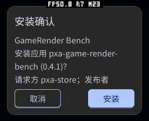
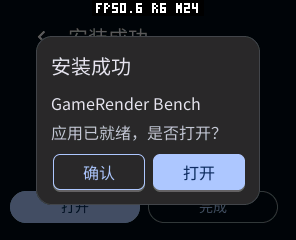
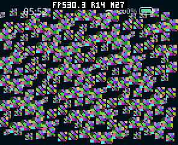

# 应用商店发布与验证 · 2026-10-14

本轮更新全部 21 个顶层应用，每个提供 ESP32-S3、ESP32-S31、桌面 x86_64 与可移植 Wasm 四种包，共 84 个当前版本附件。全部使用 C++26 / Core 2 SDK，保持原有 App ID、发布者身份和递增版本序号；不以相同 ID 的低版本覆盖生产内容。

- SDK 实现：`8de26dd3d7f71973218949ad1cd9ffd21c46af5a`。
- UTF-8 修复：`bb7ef75`；版本、描述、截图与包清单：`e68837e`。
- [每包大小与 SHA-256](artifacts.json)、[截图来源](screenshot-provenance.json)、[84 个公开下载回读](public-downloads.json)、[商店描述源](../../../store-listings.json)。清单记录发布附件本身，不包含私钥。

## 发布与回读

使用后端 `scripts/publish_profile_variants.py` 先只读预检，再 `--apply`。发布器读取已验证签名元数据中的 Core 与架构，不再把所有包误记成旧 Core 0.1；校验归属、版本序号、摘要和四个 profile。可选 `--listings` 在数据库修改前检查所有描述与图片路径。相同图片按摘要幂等复用，旧截图记录软删除、文件保留。

生产商店最终共 22 个应用、61 个 release、171 个 artifact；另一个原有非本轮应用、旧版本及四个旧 Host profile 均保留。四个新 Core 2 profile 都返回 21 个当前版本。逐项获取正式下载票据，回读全部 84 个当前附件并检查长度、SHA-256 与本地签名包一致；Store 0.8.5 修复后重新核对了四个目标。重复发布返回 21 个 SKIP，没有重复 release。原数据库备份保留在服务器维护备份目录。

## 内容与截图

21 个应用均更新中文名称、摘要、分类与使用边界。截图来自实际 Guest 或 pai-touch，已逐项查看；两项无图形界面的 ABI 检查在实际截屏上附加了明确标注的真实 PASS 日志，不伪造应用 UI。普通应用截图主要覆盖启动页和菜单，不代表全部游戏流程、全部分辨率或网络数据都已验证。

大部分桌面截屏为 800×480、216 DPI、zh-CN、暗色；绘制基准为 296×240，Store 为 pai-touch 实际 296×240。具体来源以 screenshot-provenance.json 为准。天气应用的示例城市不作为真机定位证明。

## 实测修复

Store 的 120 字节描述缓冲曾把汉字截成半个 UTF-8 码点，Host 拒绝 UI 更新，外观看似一直在加载。JSON 解码器现在逐码点写入：支持原始 UTF-8、\u 与代理对，空间不足时保留有效前缀，仍校验后续输入，拒绝过长编码、孤立代理、越界码点和 NUL。ASan/UBSan 覆盖了 40 个汉字、emoji、转义与畸形编码；票据解析检查通过。最终商店版本为 **0.8.5 / sequence 13**。

没有扩大字符串缓冲、引入堆分配或增大默认网络响应预算。目录读取仍从原有 4096 字节预算起步，仅按已有策略重试；本轮没有做全面 RAM 峰值或游戏 FPS 基准，不能据此宣称性能提升。

设备安装权限仅赋予固件预置且启用的 pxa-store。普通安装的同名副本、调试副本不能因此获得系统安装权限。当前 managed overlay 也不保留 built-in 身份，维护者应通过受保护的 factory root 更新商店；这项限制已同步到 README 与官网教程。

## 商店真机流程

pai-touch（本次枚举为 `/dev/ttyACM2`、296×240、Core 2）实际运行生产 Store 0.8.5，浏览应用和游戏、打开中文详情、取得票据并下载、查看 Host 签名包安装确认、用户确认安装、查看“安装成功”、从成功弹窗点“打开”。游戏绘制基准 0.4.1 和体素世界 0.12.4 均成功安装，已安装列表中的版本正确。

复测时修复了 Host 安装成功弹窗绕过系统任务管理器的问题（工作区提交 `aae70e2`），通过既有 `pxa_host_request_launch` 建立页面与前台实例。随后从成功弹窗直接打开绘制基准，实际出现绘制画面；体素世界获音频权限后显示标题，点击新游戏进入树林场景，右侧滑动能改变视角。不能只凭运行时 active 标志推断可见画面，因此保留了屏幕和生命周期日志证据。








调试副本、绘制基准和容器 Hello 测试包已经移除；pai-touch 保留本轮预置的 Store 0.8.5 与商店下载的体素世界 0.12.4，退出运行并恢复受保护文件系统锁。Korvo-1 保留原有三个应用；Watcher 仅作连通性确认，未改固件。刷写 pai-touch 仅更新应用分区，保留 NVS、分区表及数据，原应用分区完整备份仍在本地。

要复现下载验证，使用 Core 2 固件预置的商店，在“应用”中选游戏绘制基准，点击安装并确认系统预览，在成功页面点击打开；在“游戏”中选体素世界，重复下载、安装后打开并点新游戏。旧 Host profile 不会返回本轮 Core 2 包；普通安装的商店副本没有安装权限。

## 当前包版本

大小单位 KiB，顺序为 S3 / S31 / x86_64 / Wasm。

| App ID | 版本 | 序号 | 四目标包大小 |
|---|---|---:|---|
| pxa-abi-v1-ipc-smoke | 1.0.2 | 3 | 6.8 / 7.2 / 5.0 / 4.1 |
| pxa-abi-v1-smoke | 1.0.2 | 3 | 42.2 / 43.5 / 23.9 / 14.5 |
| pxa-arcade | 0.1.4 | 5 | 340.6 / 338.5 / 243.2 / 181.5 |
| pxa-game-render-bench | 0.4.1 | 6 | 36.5 / 33.6 / 21.0 / 14.1 |
| pxa-garden-guard | 0.2.4 | 5 | 225.6 / 219.3 / 193.0 / 170.2 |
| pxa-jump-jump-3d | 0.1.5 | 6 | 1481.8 / 1494.2 / 1343.1 / 1203.9 |
| pxa-lab | 1.0.2 | 5 | 55.0 / 51.5 / 29.8 / 19.6 |
| pxa-maze-evil | 0.1.9 | 9 | 204.5 / 203.0 / 173.5 / 145.4 |
| pxa-maze-spike | 0.1.4 | 5 | 126.6 / 125.7 / 117.6 / 108.5 |
| pxa-novel-reader | 0.1.2 | 3 | 727.5 / 728.8 / 359.1 / 185.5 |
| pxa-pinyin-ime | 1.0.1 | 1 | 1202.4 / 1201.1 / 1077.6 / 992.9 |
| pxa-pinyin-ime-lite | 1.0.1 | 1 | 198.4 / 193.2 / 120.1 / 78.0 |
| pxa-pixel-dungeon | 0.2.1 | 3 | 1615.2 / 1604.0 / 1398.0 / 1273.0 |
| pxa-plane-shooter | 0.3.2 | 6 | 214.3 / 206.1 / 162.8 / 129.5 |
| pxa-plane-shooter-raster | 0.1.5 | 6 | 25.4 / 22.0 / 16.0 / 12.5 |
| pxa-resource-scenes | 0.1.2 | 3 | 56.5 / 55.6 / 42.0 / 34.8 |
| pxa-store | 0.8.5 | 13 | 217.9 / 214.0 / 139.5 / 87.5 |
| pxa-tomb-explorer | 0.1.5 | 6 | 141.5 / 145.6 / 94.7 / 70.4 |
| pxa-voxel-craft | 0.12.4 | 17 | 574.7 / 572.5 / 368.2 / 216.0 |
| pxa-wasi-lab | 0.1.4 | 5 | 42.3 / 40.1 / 22.1 / 14.9 |
| pxa-weather | 0.3.4 | 6 | 133.7 / 132.5 / 96.9 / 69.3 |

## 复现构建

在工作区中使用已验证的 DevKit 0.3.0，而非 PATH 中任意版本的 wamrc：

```sh
export WASI_SDK_DIR=/path/to/pxa-devkit-0.3.0-linux-x86_64/toolchains/wasi-sdk
export WAMRC=/path/to/pxa-devkit-0.3.0-linux-x86_64/bin/wamrc
export PATH=/path/to/pxa-devkit-0.3.0-linux-x86_64/runtime/bin:$PATH
for source in local/pxa-apps/*/package.json; do
  app=${source%/package.json}; app=${app##*/}
  for target in esp32s3 esp32s31 simulator; do
    tools/app.sh build "$app" --target "$target" --aot-only --output "local/recheck/$target"
  done
  tools/app.sh build "$app" --target wasm --output local/recheck/wasm
done
```

签名身份由维护者自己的开发身份管理；重新构建不承诺随机签名字段逐字节相同。生产更新必须使用该应用的有效发布者身份并保持版本序号单调。不要把测试身份或调试包上传生产商店。
