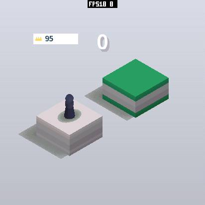
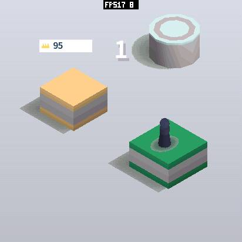
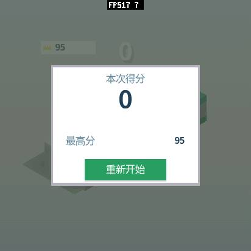
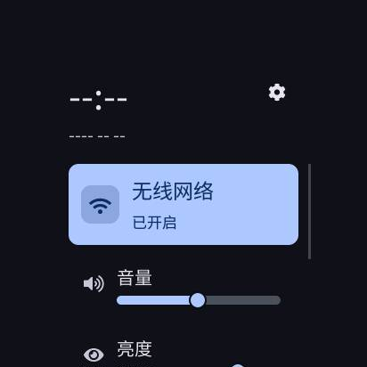
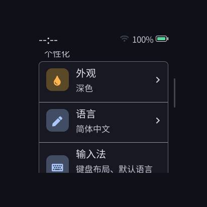
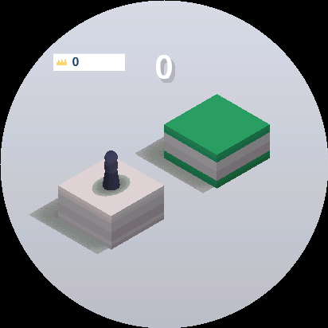

# SenseCAP Watcher：Jump Jump 3D 板级修复与实测

> 这是第一阶段的历史记录（12.2 → 18.6 FPS）。后续分块与重叠流水线的真实送屏问题和修正记录，
> 以及最新方案和公平对比见 [第二阶段报告](sensecap-watcher-pipeline-20261014.zh-CN.md)。下面的“最终版”和“后续候选”仅指第一阶段。

2026-10-14，在真实 Watcher（`/dev/ttyACM2`，UART 2,000,000 baud）上验证。
使用 PXA workspace 自己的 `firmware/boards/sensecap-watcher`，只烧录 `0x10000` 应用分区。
原应用分区及分区表已有备份；启动器、应用数据和 Weather 的“暂存、禁用”状态保留。

**结果：412×412 原生画面，静止实际显示约 12.2 → 18.6 FPS，成功跳跃约 17.8 FPS。**
无声原因是 Host 混音器无法取得连续 SRAM；修复后会话成功，非静音 PCM 已送到 ES8311/I2S。
没有降低分辨率、改变蓄力公式或增加帧缓冲。完整数值、逐帧间隔、局部堆峰值与构建哈希见
[机器记录](sensecap-watcher-20261014.json)。

## 根因与改动

| 改动 | 原因和收益 | 内存变化 | 验证 |
| --- | --- | --- | --- |
| LVGL 改为一个软件绘制单元 | 原配置两条 32 KiB 绘制线程栈造成 SRAM 紧张；旧固件最大空闲块 8192 B，小于混音器的 8592 B，音频返回 `RESOURCE_LIMIT(-9)`；SPI DMA 也发生分配失败 | 移除两条工作线程的默认栈；整机实际差额见下表，不能直接把理论 64 KiB 当成净收益 | 音频会话可打开；设置滚动、通知栏、启动器正常；新版本没有最终音频或 SPI 分配失败 |
| 游戏直接呈现，复用已有截图镜像 | 完整 RGB565 Surface 在已有任务中光栅化、合成，然后交给既有刷屏队列；减少 LVGL 的整屏重画 | 不增任务、帧缓冲、信号量或队列容量；呈现任务栈增加 1 KiB | 游戏、失败面板、HOME、恢复前台、三次重复启动截图通过 |
| 对齐像素对内核、`-O3` | Xtensa 把原来的 4 字节 `memcpy` 编译成每对像素两次函数调用；直接成对读写把合成拷贝约 42 ms 降至 17 ms | 不分配内存；保留非对齐及单像素尾部路径 | O3 + ASan/UBSan，1×/2×、完整帧、奇数裁剪、带 padding 的行测试通过；像素对比通过 |
| RGB565 快速拷贝后按覆盖范围合成 alpha | 小块 HUD 不再迫使全屏进入逐像素通用路径；保持两层透明平面的顺序 | 无新增缓存；**此项在当前 Jump 的无 alpha 初始场景中没有独立性能收益结论** | 透明、半透明、覆盖顺序、裁剪与通用内核逐像素一致 |
| 呈现任务固定 core 1、优先级 4 | 放到 UI 核，减少与 core 0 Guest 争用；第一次未绑定核心的方案使光栅化约 32 ms，已放弃 | 无新增任务 | 最终初始场景光栅化约 17.6–18.2 ms |
| 补齐 LVGL 全局锁与端口锁 | alpha 提供器可能构建快照、发送 LVGL 事件；只持有端口锁会与 Host 弹窗并发，曾触发启动提示页删除崩溃 | 无新增锁或 RTOS 对象 | 修正后所有测量及三次 HOME/恢复/重启无崩溃；DMA 完成前镜像保持不可写 |
| 两个全宽、半高的备用 LVGL 缓冲 | 保留 UI 的绘制/传输交替，释放游戏直出不需要的整屏备用容量 | PSRAM 固定减少 **339,488 B** | 设置滚动、通知栏、完整 UI 截图正常 |
| ES8311 显式取消静音，音频由设备时钟驱动 | I2S 写入本身有 DMA 背压，使用其节拍避免额外定时调度；初始化失败增加阶段/错误日志 | 音频恢复会启用原来未成功创建的混音器、工作栈和声音资源；整体内存仍下降 | 非静音 PCM `peak=3003` 到达 I2S；背景音乐解码 `underruns=0, missing=0, recovered=0`；加载蓄力、起跳、落地、失败音效无 Asset 错误 |
| 截图与测量工具修正 | 游戏截图使用已完成的镜像；补齐 stride。自动解锁先唤醒，再分步发送移动，避免路由 ACK 后 LVGL 尚未采样 | 不增加常驻资源 | 截图 source 为 `pxa-direct`；工具实机执行成功；区分绘制活跃期间帧率和整个窗口帧率 |

## 公平比较的方法

- 初始地图种子固定 `0x9e3779b9`，相机、412×412 RGB565、284 DPI、画质和原始背景音乐保持一致。
- 每场景重新启动，预热 2 秒，再采集 4 秒。`PERF START/STOP/READ` 记录光栅化和真实面板 DMA 完成间隔，探针无溢出、Surface 不变。
- 图片采集在计时和局部堆峰值窗口之外。原版音乐约 2.81 秒，保留单次播放；采集窗口会包含尾段，**不是持续播放音乐的性能测试**。
- 旧设备固件版本 `e82ce51-dirty`，最终测试固件上报 `host-tools-v0.1.0-4-gcac473e-di`，IDF 5.5.4。旧固件与当前 workspace 之间还有既有修改，因此总对比代表设备升级收益；约 42 → 17 ms 的拷贝对比来自已经恢复音频的同一中间实现与最终实现。
- 命令长度均 5116 B，初始像素处理量 213495 → 213515，差异只有 20 像素；因此不能称字节完全一致的工作负载，但几何、分辨率和主要负载一致。应用侧音频失败日志是诊断改动，不改变游戏逻辑。
- FPS 是实际完成帧间隔的倒数。失败后静态面板停止提交时，同时保留整个窗口帧率，不能把短动画的间隔 FPS 当作全窗口连续帧率。

| 场景 / 两轮结果 | 实际显示 FPS | 光栅平均 | 显示完成间隔平均 |
| --- | --- | --- | --- |
| 原设备固件，初始静止，音频初始化失败 | 12.185 / 12.214 | 17.30 / 17.25 ms | 82.07 / 81.87 ms |
| 恢复音频后的中间版，尚未优化字节交换 | 12.650 / 12.659 | 17.82 / 17.87 ms | 约 79.0 ms |
| 最终版，冷启动后的相同初始场景 | 18.568 / 18.534 | 18.09 / 18.17 ms | 约 53.9 ms |
| 最终版，用仓库测量工具复跑初始场景 | 18.651 / 18.537 | 17.63 / 18.09 ms | 约 53.6–53.9 ms |
| 最终版，约 680 ms 蓄力并成功落地 | 17.908 / 17.771 | 19.51 / 19.86 ms | 约 55.8–56.3 ms |

原设备两轮平均到最终冷启动两轮平均提升约 **52%**。
成功落地场景重新生成了平台、移动了相机和角色，不能和初始静止场景当作相同负载比较。
450 ms 蓄力失败路径也覆盖；最终活跃帧间隔约 17.5 FPS，但失败后不继续重绘，整个 4 秒窗口约 5–6 FPS。

周期抽样的最终合成拷贝约 17–20 ms，QSPI 提交到实际完成约 18 ms。此处是每 5 秒的抽样日志，不是每帧分布；每帧分布只有光栅化与完成间隔。
Guest 更新、几何编码、提交未新增独立计时器，本报告不根据提交 FPS 推算它们的耗时。

## 内存：稳定值与当次真实峰值

单位字节；峰值由 `MEMORY START/STOP` 的局部堆最低余量计算，下面比较同样的首次启动和四秒初始场景。
SRAM 与 PSRAM 的最低余量不保证发生在同一时刻，不能把它们相加当成总瞬时峰值。
整机堆已经包含运行时、帧缓冲及资源，不能再把分类表加到它上面。

| 项目 | 原设备首轮 | 最终首轮 | 变化 |
| --- | ---: | ---: | --- |
| SRAM 稳定占用 | 530204 | 515400 | 减少 14804 |
| PSRAM 稳定占用 | 3541448 | 3307568 | 减少 233880（约 228 KiB） |
| SRAM 启动窗口峰值占用 | 539828 | 533240 | 减少 6588 |
| PSRAM 启动窗口峰值占用 | 5257100 | 4899980 | 减少 357120（约 349 KiB） |
| SRAM 稳定运行窗口峰值占用 | 534176 | 523596 | 减少 10580 |
| PSRAM 稳定运行窗口峰值占用 | 3541448 | 3363340 | 减少 178108 |

SRAM 稳定值受 SPI 临时 DMA 块是否仍挂在队列影响，重复测量会有约 4 KiB 差异；不要只挑一个快照。
第二轮也记录了完整局部最低余量，见 JSON。第一次初始化、重复启动和累计预算 peak 字段分别保留。
整个长验证过程还进行了截图、系统菜单和音效资源加载，其历史最低水位属于更大的负载窗口，不冒充上述游戏启动峰值。

| 分类 | 最终情况 |
| --- | --- |
| Guest 线性内存 | 131072 B，保持 128 KiB；不是 manifest 上限 |
| AOT 映射 | 约 512 KiB；代码映射使用 PSRAM，包及固件哈希在 JSON；诊断日志会带来少量代码变化 |
| 游戏三帧缓冲 | 1018464 B，未增加 |
| 深度缓冲 | 此游戏路径不用深度缓冲，未新增 |
| Raster 命令邮箱 | 49152 B，未增加；采样探针另占 2112 B，测量后释放 |
| Host 队列 / pointer mailbox | 24×144 B / 8×456 B，保持原配置 |
| LVGL 备用缓冲 + 截图镜像 | 1018464 → 678976 B；直出复用镜像 |
| 稳定音频资源预算 | 16392 → 138264 B，因为音频恢复后真实加载了资源；没有用无声状态冒充低内存的完整游戏 |

日志可能出现 16408 B 的 Raster 上传块优先申请内部 SRAM 失败后落入 PSRAM。这是成功的首选池回退，不能与旧版无法创建音频会话、SPI 传输失败混为一谈。

## 交互、声音及画面

最终成功跳跃的注入样本至 Guest 分发 P95 约 **31–36 ms**，至关联面板 DMA 完成 P95 **101–109 ms**。
450 ms 相同失败操作在恢复音频的中间版约 **166–168 ms**，最终约 **105 ms**。
这是软件注入、Host 关联帧的测量，不含实体触摸控制器、手指接触时间和屏幕光学扫描，不能称为完整 touch-to-photon 延迟。
原设备未采集同样的交互延迟窗口，因此没有声称原设备延迟改善了某个百分比。

音频会话、资源解码、非静音 PCM 到 I2S 和音乐无欠载已验证；测试环境无法直接听到设备扬声器，**实际声学输出、响度与听感仍需现场试听确认**。
模拟器采用 dummy 音频设备，仅验证软件路径。

下面是面板完成帧的截图。优化前后的静止 JPEG 解码后，剔除顶部 FPS 覆盖的前 20 行，逐像素完全相同，RMS 为 0；没有以降低画质获得收益。
真实圆屏只显示圆形可见部分，设备截图保留完整的 412×412 逻辑帧；模拟器截图展示圆形裁切。

| 优化前的拷贝路径 | 最终初始场景 | 成功落地 |
| --- | --- | --- |
|  |  |  |

| 失败面板 | 通知栏 | 设置滚动 | 圆屏模拟器 |
| --- | --- | --- | --- |
|  |  |  |  |

## 验证与复现

已完成：原生 Jump 的时序、动作及音频恢复 6/6；PXA ESP Host 适配器 ASan/UBSan；Watcher 合成器 O3 + ASan/UBSan；PXADB 71 项测试；签名 AOT 圆屏模拟器；真机冷启动、重复启动、成功/失败跳跃、HOME/恢复、设置滚动、通知栏和截图。
应用退出后 Surface、队列、探针归零；已有应用状态保留。

在 PXA workspace 根目录，使用已配置的工具链与 IDF 环境：

```sh
tools/app.sh build jump-jump-3d --target esp32s3 --aot-only --output local/watcher-test
# 模拟器单独打包，避免把它的 artifact 占用在设备文件系统中。
tools/app.sh build jump-jump-3d --target simulator --aot-only --output local/watcher-sim
bash firmware/boards/sensecap-watcher/tests/test_host.sh
PXA_TEST_SANITIZERS=1 bash firmware/components/pxa/tests/test_host.sh
python3 -m unittest discover -s tools/pxadb -p test_pxadb.py

# 使用本仓库的 Watcher 固件，独立构建目录；不要覆盖设备分区表或数据分区。
idf.py -C firmware -B build/firmware/watcher-validation -DPXA_BOARD=sensecap-watcher build
python -m esptool --chip esp32s3 --port /dev/ttyACM2 --baud 460800 \
  write-flash 0x10000 build/firmware/watcher-validation/pxa_esp_platform.bin

python3 tools/pxadb/pxadb.py package install local/watcher-test/pxa-jump-jump-3d.pxa \
  --port /dev/ttyACM2 --baud 2000000 --yes

PXADB_BAUD=2000000 python3 tools/measure-device-gameplay.py \
  --port /dev/ttyACM2 --app pxa-jump-jump-3d \
  --package local/watcher-test/pxa-jump-jump-3d.pxa \
  --output local/watcher-gameplay --repeat 2 --warmup 2 --seconds 4 \
  --size 412 412 --scenes idle charge --charge-seconds .68
```

设备应用分区大小本次为 `0x6f0000`；刷入前应按实际分区表核对。上述设备安装使用只有 ESP32-S3 artifact 的包；本机没有删掉其他应用。

后续限制：原生全屏仍受约 18 ms 光栅化、17 ms PSRAM 字节交换拷贝和 18 ms QSPI 传输限制；当前没有重叠整帧光栅化与 DMA。
SIMD、分带重叠扫描及 SPI2 直接 PSRAM DMA 仅是后续候选，本轮没有把它们当成已实现收益。
Watcher 没有接出 TE，同步撕裂及完整光学延迟没有测量。
