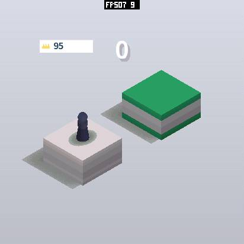
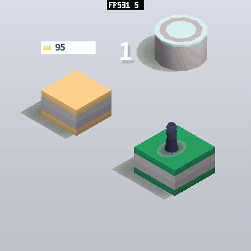
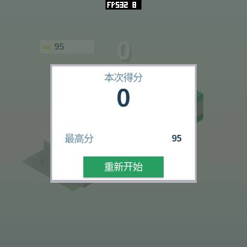

# SenseCAP Watcher：原生 412×412 游戏显示流水线

2026-10-14，使用本项目 `firmware/boards/sensecap-watcher`、IDF 5.5.4，Watcher MAC `8c:bf:ea:09:af:6c`，UART 2,000,000 baud。
**相同画质下，面板传输完成速率：静止约 18.6 → 33.6～34.5 FPS，跳跃约 17.8 → 29.7～31.9 FPS。**
稳定内存和同流程窗口峰值均下降。经过 UI 流程后跳跃均值超过 30，首次冷启动直接运行约 29.8；尚未稳定逐帧锁定 30，也没有光学扫描测量。
本轮接续[第一阶段板级修复](sensecap-watcher-20261014.zh-CN.md)；逐帧样本、重复结果、源码与镜像哈希见[机器记录](sensecap-watcher-pipeline-20261014.json)。

优化方法、实现入口、未采用方案和迁移顺序另整理在 **PXA 主仓库**
`firmware/boards/sensecap-watcher/docs/game-pipeline-optimization-reference.zh-CN.md`。
核心方法是减少整帧拷贝、复用 Surface lease、双块 DMA 与下一帧光栅化重叠；O3 / SIMD 为局部辅助优化。
单 LVGL draw unit 属于第一阶段，不能重复归因于本轮；基线已经启用的并行 Raster 也不算本轮新增收益。

## 显示正确性

用户实拍发现原生直出重复横带，出现悬浮层才正常。原 `PackNativeFrame` 构造临时 Surface 时漏设 `visible=true`，合成器早退，SRAM 小块保留旧像素，只有 FPS 标签反复绘制。真正的合成 Surface 有正确的可见状态，所以悬浮层路径正常。

现在原生分带直接调用独立 RGB565 像素转换器，不再伪造 Surface。生产转换器与真实 transport 的原生测试逐字节检查全部 **339488 B** 模拟 SPI 输出、两个块的生命周期和末尾四行，覆盖 4 / 5 / 6 / 8 / 10 / 12 行配置。
S3 启动自检另执行真实 SIMD 指令，检查 640 组偏移 / 长度与哨兵。用户已在物理屏幕确认八行修复版本“正常了”；最终十二行版本的后续验证为生产 transport 回归和真机自检，未另声称最终镜像已经人工目视确认。

此前漏画像素时的 35 / 39 FPS **全部撤回**。Host JPEG 从逻辑 Surface 截图，绕过实际送屏的小块，截图一致不能单独证明传输正确。

SPD2010 要求 `esp_lcd` 的 x_start 与**排他** x_end 都能被四整除。全宽 `[0,412)` 满足要求；LVGL rounder 将包含式 x2 向上取至 4N+3，实际发送加一。
另外有全宽编译期检查及传输运行期检查；不在发送阶段单独扩大窗口，避免像素数量 / stride 与窗口不匹配。

## 采用的设计

| 优化 | 原因与实测收益 | 内存与维护代价 | 验证 |
| --- | --- | --- | --- |
| 入队后返回，Raster 与转换 / DMA 重叠 | 去掉逐阶段串行等待；这是主要吞吐收益 | 复用现有任务、信号量和单项队列，保留三个 Surface | 按真实 DMA 完成计时；前后台与错误路径 |
| 原生 RGB565 lease 直接分带转换 | 去掉整帧 PSRAM 镜像写回和驱动再次弹跳复制 | 两个十二行 SRAM 块，共 **19776 B**；热路径不分配；整机净占用下降 | 全帧 wire、别名 / 对齐、末块、lease 不提前释放 |
| 公开 SPI API 板级 transport | 双事务交替转换 / 传输；保留 SPD2010 QIO、CS、命令与完成语义 | 同一对块供 LVGL 使用，无额外队列或任务；不改 IDF 私有驱动 | 命令字节序、奇数参数、提交 / 最末 DMA 失败、描述符回收 |
| 单 LVGL draw unit，200 行双缓冲 | 省去两个 32 KiB worker，释放连续 SRAM 给音频 / DMA | UI 两缓冲加镜像共 **669088 B PSRAM**，比本轮基线少 9888 B | 菜单、滚动、通知栏与圆屏模拟器 |
| LVGL owner 等待完成 | 默认 busy wait 曾在冷启动第二次运行触发 watchdog | 复用对象 padding 中的原子标志；等待中让出一 tick；刷屏任务只发布完成，LVGL 自己清除 flushing | 两次冷启动，3 次及 10 次重启全部通过 |
| 大 Raster 资源直接使用 PSRAM 后备池；O3 | 避免大资源先挤占 SRAM，分配失败 5 → 0；板级速度构建 | 可选 4096 B 阈值，其他板默认关闭；不增加池 / 缓存 | 默认和阈值策略 ASan/UBSan；相同命令及像素量 |
| 局部 S3 SIMD 字节交换 | 对齐时每次 16 像素；同余但未对齐时先剥离少量像素，再进入内核 | 汇编内核 29 B，保留标量回退；不改应用 / 全局编译器 | CPU 全帧测试 + S3 真指令自检；不把组合收益归给 SIMD 单项 |
| 截图流式 SHA-256 | PSA 默认会私有复制输入；一次性 hash 大 JPEG / RGB565 会耗尽连续 SRAM | 每段最多 1024 B，摘要不变；无常驻缓冲 | 噪声 JPEG 37404 B、整帧 RGB565 339488 B 均完成 SHA 校验 |
| 截图线程大编码工作区优先 PSRAM | 供应商分配器优先 SRAM，空闲量变化会引起峰值迁移；消除截图峰值回退 | 可选，其他线程及板默认保持原策略；无 encoder 缓存 / task；PSRAM 峰值仍低于基线 | 25 + 46 次截图、线程隔离 / 嵌套 / 失败回退原生测试 |
| 调整已测量的任务栈 | PXADB 20 → 18 KiB，flush 4 → 3 KiB | LVGL 仍保留 10 KiB；控制栈需内部 SRAM 以支持 flash 操作 | 实际签名部署、截图、10 次启动；最小剩余栈见下文 |
| PXADB 日志槽位耗尽时计数丢弃 | 原先回退裸串口会插入 DATA，造成截图超时 | 复用两个静态槽，不扩容 | 71 项工具回归，截图与日志同时订阅 |

直接路径只用于完整原生 Host RGB565、连续 stride、无有效 Guest / 系统 alpha 的帧。透明层、缩放和 Guest 映射沿用镜像合成。
原生 lease 与合成镜像都保持到真实传输结束，出错先回收在途事务。小块初始化失败有兼容回退；正常路径的无分配和帧率结论不适用于该回退。

JPEG 内存策略是本轮保留的一项维护取舍：`esp_new_jpeg 1.0.2` 没有公开的逐实例分配器，因此单独适配两个私有分配入口，符号变化会导致链接失败。
库升级必须重跑截图、失败清理、线程隔离及峰值回归。释放仍使用供应商原有 `heap_caps_free`，PSRAM 不足时回退原分配器。
小输出缓冲再扩容的方案已撤回：原生模拟测试通过，但真机供应商编码器在输出过小时破坏了堆，不能依赖它安全失败。最终保留原来的两张原始帧输出容量。

## 相同场景与实测结果

应用仍是 Jump Jump 3D 0.1.5 ESP32-S3 签名 AOT，SHA-256 `da5dc9757979f2a164db7ff94b8ec4a6c95388ae69bedde7743e898fc58376cb`。
每场景重新启动，种子 `0x9e3779b9`、相机、412×412 RGB565、284 DPI、画质与声音设置相同；预热 2 秒、采样 4 秒、重复两轮。
两版都先执行相同的冷启动 UI / 截图流程并恢复音量 50，然后测游戏；另保留首次冷启动直接测游戏的数据，避免把 UI 缓存差异当成优化。
初始静止两版均提交 5116 B 命令、处理 213515 像素。截图在游戏计时和局部峰值窗口外。

| 场景 | 基线 FPS（两轮） | 最终 FPS（两轮） | 最终整窗口 FPS | Raster 平均：基线 → 最终 |
| --- | --- | --- | --- | --- |
| 初始静止 | 18.622 / 18.681 | **34.325 / 34.481** | 34.084 / 34.073 | 17.676 / 17.746 → 21.593 / 21.382 ms |
| 蓄力、跳跃、成功落地 | 17.830 / 17.793 | **31.601 / 31.919** | 31.350 / 31.807 | 19.540 / 19.656 → 22.475 / 22.343 ms |

两轮均值约提高 **84.5% / 78.3%**。FPS 根据不同 frame 的真实 DMA 完成间隔，排除重复帧，不是提交 FPS。
探针未溢出、Surface 未更换、发送错误 / 下溢为零。成功跳跃完成间隔 P95 为 **36.945 / 36.354 ms**，最大 **42.441 / 43.463 ms**，所以平均超过 30 不等于逐帧锁定。

额外复核首次冷启动直接进游戏（无设置 / 截图 UI 缓存预热）：静止 **33.727 / 33.573 FPS**，成功跳跃 **29.894 / 29.733 FPS**，整窗口 **29.367 / 29.375 FPS**。
原先首次冷启动基线为 18.632 / 18.641、17.793 / 17.899 FPS；因此冷启动跳跃仍提高约 **67.1%**。
该组转换抽样 11.9～17.9 ms，明显高于 UI 后的 5.1～9.6 ms；光栅化约 20～21 ms 反而略低。
已经观测到启动状态影响内存 / 缓存布局与阶段争用，但尚未做独立控制实验确定是哪项造成差异，不能把原因写成已证实的缓存优化结论。
最终同时保留两组八轮数据，不只挑较快的 UI 后结果。

请求蓄力 .68 秒；实际设备 DOWN→UP ACK 基线 **696985 / 698599 µs**，最终 **695021 / 694885 µs**。
串口同步与主机调度使其不是严格的设备定时 680 ms，蓄力公式没有改变。粒子和落地奖励按帧生成，后续负载会有差别；这是同脚本的实际玩法比较，不是逐帧完全一致的语言比较。

每五秒抽样：转换累计墙钟约 **5.1～9.6 ms**，整次转换 / 排队 / QSPI 完成约 **18.2～28.2 ms**；有重叠、抢占与记录开销，不能相加。
40 MHz QSPI 仅传原生像素的理论下限为 16.97 ms。Raster 本身并未变快，吞吐收益主要来自少复制和重叠。
Guest 更新、几何、编码、队列等待尚没有各自独立分布，不声称已经逐项测完。

失败跳跃 .45 秒另测两次，实际 hold **467761 / 464327 µs**，活动阶段 **30.963 / 31.511 FPS**。
结果页停止重绘，四秒整窗口为 **9.963 / 9.964 FPS**；分别保留两个口径，不把静止结果页当成渲染性能下降。

## 内存与峰值口径

单位 B。稳定值取窗口末快照；峰值来自 `MEMORY START/STOP` 的局部最低余量，不使用历史累计最低水位或资源 budget 历史 peak。
IDF 对各 heap 分别记录最低值，池内汇总也可能组合不同瞬间的低点，因此是本窗口保守高水位，不能冒充瞬时同步采样总峰值；SRAM / PSRAM 更不能相加。

下表为匹配流程四轮游戏各指标的最坏值。动态占用按各构建自己的 `total-free/min` 计算；SRAM total 基线 551682、最终 551602 B。
最终 heap 少 80 B，静态占用 / 布局差异另算：改用固定 551682 B 参考容量，最终 SRAM 各占用加 80 B 后，仍全部低于基线。

| 指标（四轮最坏） | 基线 | 最终 | 减少 |
| --- | ---: | ---: | ---: |
| SRAM 稳定 | 519496 | 511624 | 7872 |
| PSRAM 稳定 | 3372160 | 3334176 | 37984 |
| SRAM 初始化窗口峰值 | 532048 | 515984 | 16064 |
| PSRAM 初始化窗口峰值 | 4946136 | 4929880 | 16256 |
| SRAM 游戏窗口峰值 | 523856 | 515984 | 7872 |
| PSRAM 游戏窗口峰值 | 3432272 | 3392716 | 39556 |

首次冷启动对照的四轮最坏值也单独核对：SRAM 稳定 **515400 → 511624 B**；PSRAM 稳定 **3326056 → 3321816 B**；
初始化峰值 SRAM **533240 → 515984 B**、PSRAM **4902876 → 4898620 B**；游戏峰值 **523856 / 3386184 → 515984 / 3381908 B**。
首次初始化和 UI 后状态均满足本轮内存约束，不混用两者的缓存占用。

冷启动菜单、设置滚动、通知栏、3 次前后台 / 重启及 25 次截图：SRAM 峰值 **533356 → 518420 B**，PSRAM **4985628 → 4981500 B**。
第二次冷启动扩展至 10 次启动及 46 次截图：**518420 / 4982044 B**，仍低于三次流程的基线；这是额外压力覆盖，不用于游戏 FPS 比较。
第一轮噪声编码诊断在内存监测窗口前；第二轮冷启动不预执行编码诊断，首次截图初始化也包含在十次流程窗口中。
稳定 UI 占用也下降；具体快照与全部首次初始化数据见 JSON。

系统启动阶段另核对每次冷启动、第一次 UI 窗口开始前的 boot 最低余量：基线 SRAM / PSRAM 占用高水位 **521076 / 2427996 B**，
最终不预执行噪声诊断的第二次冷启动为 **511040 / 2415984 B**。这是该次启动至首个窗口前的累计观测，单独保留，不拿来替代上述游戏局部峰值。

| 分类 | 本轮结果 |
| --- | --- |
| Guest 线性内存 / AOT 代码映射 | 131072 B / 约 524292 B；包不变 |
| 三个游戏帧缓冲 / 深度缓冲 | 1018464 B / 0 B；不变 |
| 命令邮箱 / Host 队列 / pointer mailbox | 49152 B / 24×144 B / 8×456 B；不变；测量探针 2112 B，测后释放 |
| LVGL 双缓冲 + 镜像 | 各 200 行，总计 669088 B PSRAM；本轮省 9888 B，第一阶段另省 339488 B |
| 两个 DMA 小块 | 19776 B SRAM，替代驱动临时弹跳块；已经包含在整机快照内 |
| 稳定 PXA 资源 budget | 内部 28956、外部 191190 B；49686 B decoder temporary 初始化后释放 |
| 固件镜像 | 3418432 → 3434640 B，增加 16208 B flash；未通过缩减游戏包换性能 |

分类不能再次加到整机数值上。TLS / 静态代码布局变化通过 heap 总容量和空闲量共同核对，不能只看 budget。
调试观测到最小剩余栈：LVGL **2620 B**、flush **992 B**、presenter **1052 B**；18 KiB PXADB 在真实签名部署和截图后仍剩 **3856 B**。
未继续裁剪 LVGL / presenter 栈；以上只覆盖本轮实际路径，后续扩展功能仍需复测。

## 延迟、声音和画质

成功跳跃的软件输入至关联显示完成 P95：基线 **109.671 / 111.080 ms**，最终 **78 / 80 ms**；输入到 Guest 分发 P95 **31 / 36 → 38 / 34 ms**，并非每一段都改善。
首次冷启动成功跳跃显示 P95 **109.035 / 90 ms**；失败跳跃为 **115.493 / 99.872 ms**。短样本不能证明所有场景的稳定延迟，也排除实体触摸扫描、光学扫描与声传播。

ES8311 音量恢复为 50，高分仍为 95，已有应用、存档及 staging 内容保留，仅更新应用固件分区。
真机非静音 PCM 已到 I2S（peak=3003），音乐累计 underruns / recovered / missing 为零；约 2.81 秒的单次背景音乐不等于持续音频压力测试，也没有麦克风或现场试听结论。

初始视角 JPEG 解码，排除顶部 20 行 FPS 调试标签，RMS **[0,0,0]**，差异区域为空。
这是逻辑矩形截图；物理圆屏只显示圆内。画质未降低，应用分辨率、材质、音效和玩法不变；物理传输的证据见开头。

| 基线 | 最终初始视角 | 成功落地 | 失败结果页 |
| --- | --- | --- | --- |
|  |  |  |  |

## 取舍与验证

- 只重叠整帧镜像的版本约 22.5～22.7 / 21.6 FPS，仍不足。
- SPI2 / SPI3 直接 PSRAM DMA 均出现真实下溢，拒绝采用；未提高 QSPI 时钟、降低分辨率或增加完整帧缓存。
- 早期正确的 10 / 12 行版本因稳定 SRAM 或 UI 峰值超过当时基线而未采用。最终在栈测量、截图峰值修复后重新验证十二行配置，不能拿早期违规版本作最终结果。
- 六行 SIMD 中间版本约 31.4 / 29.0 FPS；后续增加对齐前缀处理，结合十二行块和截图修复得到最终数据。短样本不能将全部收益独立归因于 SIMD。
- 正确画面八行版本曾因裸日志插入 DATA 超时，logger 修复后以完整通过结果重新测量。
- 冷启动复核曾发现 LVGL 忙等 watchdog；最终 owner 等待回调的两次冷启动回归通过。没有把失败测试删除或当作通过。
- Watcher 无 TE 接线，不能声称零撕裂、已测光学 FPS 或完整 touch-to-photon。

已通过：Watcher 转换 / transport O3 + ASan/UBSan、PXA Host 默认和 4096 B 策略、PXADB 71 项、原生游戏 / SDK 12 项、截图分配 / 清理原生测试。
签名 AOT 模拟器覆盖 412 圆屏 / 284 DPI、设置、通知栏、HOME / 恢复和三次重启；它不模拟 S3 SPI 和 SIMD，不能替代真机。
最终真机覆盖两组八轮游戏、两次失败跳跃、两轮冷启动 UI 共 **71 次 SHA 校验截图**、噪声编码、整帧 RGB565 校验及实际签名包重装。
停止后 Surface / mailbox / probe 均为零；注入 PERF READ 异常也执行探针清理。MEMORY STOP 的堆遍历时间不再混入已结束的 FPS 窗口。

UART 大块上传曾超时；同一签名包用 `PXADB_UART_UPLOAD_CHUNK=64` 完成重装，包列表及数据未改变。重装在同一 18 KiB 控制栈的前一镜像验证，最终镜像只补截图策略；不声称已在最终二进制再次重装。
这是现存上传吞吐限制，未扩大常驻缓冲来掩盖，也未把约八分钟的低速重装描述为快速上传。

基线固件 SHA-256：`5492444c963b4e5150bdf37dfcf5725759851869aa311fa8ab99a5f0930dbe87`。
最终固件 SHA-256：`66cadd6353ce01e6938e544e8f9a24a6a79443dfb53e73e1423f0d4a9d8e6bf2`。
工作区同时存在独立 SDK / HTTP / 系统 UI 修改，源码哈希见 JSON；这些数值表示同一应用的组合固件升级，不代表单项优化的隔离实验。

## 复现

```sh
bash firmware/boards/sensecap-watcher/tests/test_host.sh
bash firmware/components/pxadb/tests/test_host.sh
PXA_TEST_SANITIZERS=1 bash firmware/components/pxa/tests/test_host.sh
python3 -m unittest discover -s tools/pxadb -p test_pxadb.py
idf.py -C firmware -B build/firmware/watcher-validation -DPXA_BOARD=sensecap-watcher build

python3 firmware/boards/sensecap-watcher/tests/validate_device.py \
  --port /dev/serial/by-id/usb-1a86_USB_Dual_Serial_56D5054872-if02 \
  --expected-serial 8c:bf:ea:09:af:6c --jpeg-self-test --output local/watcher-ui-reproduction

# 恢复原音量，再测与基线相同的游戏流程。
PXADB_BAUD=2000000 python3 tools/measure-device-gameplay.py \
  --port /dev/serial/by-id/usb-1a86_USB_Dual_Serial_56D5054872-if02 \
  --app pxa-jump-jump-3d --package local/watcher-jump-20261014/app-device/pxa-jump-jump-3d.pxa \
  --output local/watcher-game-reproduction --repeat 2 --warmup 2 --seconds 4 \
  --size 412 412 --scenes idle charge --charge-seconds .68
```

失败跳跃用 `--scenes charge --charge-seconds .45`，检查实际 DOWN→UP ACK 时间；重复启动用 `--restarts 10`。
烧录必须用稳定 USB by-id，并在**同一 esptool 连接**核对 MAC、分区表及应用偏移 / 大小，备份后再写。
本板应用分区 `0x10000`、大小 `0x6f0000`；不写 bootloader / 分区表 / 数据分区，不仅凭 tty 编号选择设备。
日志、备份、guarded 刷写脚本和冻结镜像在主工作区 `local/watcher-30fps-20261014`。
