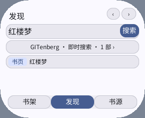
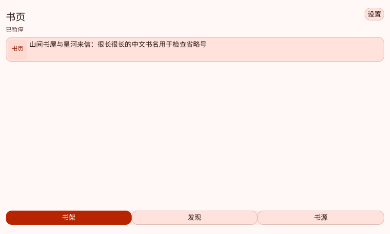
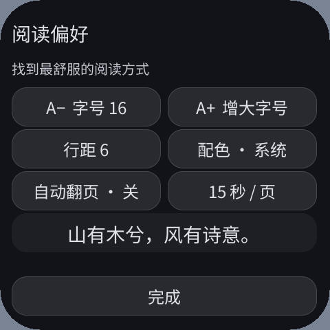

# 原生控件、系统配色与渐进缓存验收（2026-10-10）

后续双行字号预览、真实小说排版和增量目录见
[排版与增量目录验收](2026-10-10-typography.zh-CN.md)。

这次改版修复了“小屏搜索成功却没有可点击结果”和中文标签被截断的问题。
书架、搜索、设置、书源、目录、阅读菜单及翻页操作已迁移到声明式原生
Text / Button / Box；正文和后续字号预览保留同一个 Canvas，用于任意字号及圆屏逐行宽度计算。
输入框继续使用 C++ SDK 的标准 TextInput 和系统输入法。

## 配色与交互

系统 `surface` 可能与 `background` 相同。只把旧的固定颜色替换成 `surface`
会让按钮和输入区融入背景。这一版按照用途选择系统现有的颜色角色：

| 用途 | 背景 | 文字 / 边框 |
|---|---|---|
| 页面 | background | text / muted |
| 普通按钮、图书卡片、输入区 | surface_container_high | text / outline_variant |
| 搜索、添加、选中的导航 | primary | on_primary |
| 封面标记 | primary_container | on_primary_container |
| 导航容器、字号预览 | surface_container | text |
| 删除确认 | error_container | on_error_container |

颜色由 Host 解析，切换系统主色和明暗后生效。Canvas 正文和输入文字读取
ThemeService 快照并响应 UiAppearance。默认正文跟随系统；用户主动选择的纸张、
护眼和深夜阅读配色只影响正文及其设置预览。系统键盘仍使用系统主题。







书架轻点阅读，长按 550 ms 管理，拖动超过 8 个逻辑像素取消长按。
移除操作需要确认，删除后不会重新生成示例书。阅读菜单包含继续、目录、缓存、
进度、设置和返回书架。更新下载进度只修改绑定文本，保留按下中的按钮节点。

## 优化记录

| 修改与原因 | 性能 / 体验收益 | 内存变化与验证 |
|---|---|---|
| 搜索页取消重复副标题，分页移到页头，按可用高度放结果 | 296×240 屏能看到并打开单条搜索结果 | 不增加结果容器；五种规格验证 |
| 原生控件与完整 UTF-8 省略、按黑体字框留行高 | 标签不截半个汉字；保留系统输入法与原生点击 | 移除 64 项 Guest 命中表；检查长中文标题、按钮字框和 12–28 dp 正文 |
| 使用分层系统容器色、前景配对色和边框 | 控件与背景可辨，系统换色一致 | 无 Guest 调色板副本扩容；浅 / 深及蓝 / 珊瑚色截图、像素差与字形对比断言 |
| 可选 Refresh 两个内联片段，绑定文本更新 | 构建或提交失败保留旧回调；下载进度不吞点击 | 无 Guest 堆分配；Host 提交期间存在两个树的瞬时开销，不能只比较 Guest 大小 |
| 即时经典元数据与 GITenberg 正文镜像 | 四部经典书名 / 作者搜索不访问网络；三部有 GitHub 镜像 | 只增加固定元数据，不捆绑正文、图片或动态搜索索引 |
| 首段 8 KiB、后续 32 KiB Range | 首段即可阅读和翻页；暂停后按可信标识续传 | 共用 4 KiB 写入缓冲，不整书读入 RAM；完整正文 SHA-256 一致 |
| 4 KiB Flash 写入之间 Clock::yield | 单次 Guest 回调不连续写入整段正文 | 可选直接 awaiter 不增加 Task 槽；取消、错误及协议边界测试通过 |
| Host 维护任务去重，慢回调后结束本批事件投递 | 解决真机下载时维护命令堆满队列、丢失暂停点击 | 复用原有 1 字节标志，命令队列容量不变；主机洪水测试及真机复测 |
| 去掉重复 16 KiB 页缓冲，按需重绘 | 减少固定对象和无变化菜单的绘制工作 | 正文 DrawList 容量 4000→3600 B；栈仍 64 KiB，协程池仍 16400 B |

SDK 增加的样式、Refresh、主题快照均按需使用；扩展 Color 对应 Host 已有的
32 个角色。主题通知仍是原来的 60 字节 / 10 个基础色快照，原生控件解析扩展角色。
没有增加全屏帧缓冲、深度缓冲、字体图集或所有应用默认缓存。

## 可重复检查

以下命令从 PXA 工作区根目录执行。QA 使用独立身份和临时状态目录，不清除正式书架。

```sh
SANITIZE=1 bash local/pxa-apps/novel-reader/tests/test.sh
bash deps/pxa-system/tools/package/test_guest_cpp.sh
PXA_TEST_SANITIZERS=1 bash firmware/components/pxa/tests/test_host.sh
ctest --test-dir build/simulator/esp-mosaico \
  -R 'reference_ime|system_gestures' --output-on-failure

python3 local/pxa-apps/novel-reader/tests/build_playtest.py \
  --target simulator --long-labels --output local/reader-qa
python3 local/pxa-apps/novel-reader/tests/ui_sdk_probe.py \
  --package local/reader-qa/artifacts/pxa-novel-reader.pxa \
  --font-boundaries --output local/reader-screens
python3 local/pxa-apps/novel-reader/tests/ui_sdk_probe.py \
  --package local/reader-qa/artifacts/pxa-novel-reader.pxa \
  --profile 800x480-160dpi --live-theme --output local/reader-theme
```

五种完整系统规格：296×240 / 160 DPI、480×480 / 305 DPI、360×480 / 320 DPI、
480×480 / 320 DPI 圆屏、800×480 / 160 DPI。设置安全边距 12，圆角 40 / 58。
检查包括原生输入法打开、提交、清空、保留查询，书架长按与移除确认、目录、字体边界、
来源禁用 / 导入、单条结果可点击、中文标签宽高及正文命令容量。
主题测试通过真正的系统设置切换浅→深→浅、蓝→珊瑚→蓝，随后恢复原值。

```sh
python3 local/pxa-apps/novel-reader/tests/fixture_server.py --port 18766
# 另一终端：
python3 local/pxa-apps/novel-reader/tests/build_playtest.py \
  --target simulator --source http://127.0.0.1:18766/catalog.json \
  --output local/reader-fixture-qa
python3 local/pxa-apps/novel-reader/tests/ui_sdk_probe.py \
  --package local/reader-fixture-qa/artifacts/pxa-novel-reader.pxa \
  --fixture --failure-cases --export-state local/reader-cached-state \
  --output local/reader-cache
# 停止该服务器后运行离线检查：
python3 local/pxa-apps/novel-reader/tests/ui_sdk_probe.py \
  --package local/reader-fixture-qa/artifacts/pxa-novel-reader.pxa \
  --cached-state local/reader-cached-state --output local/reader-offline
```

固定 CC0 正文为 258777 字节，SHA-256
`f1401c49bf6a399717c05f9dbcd86ec63019f66e3e030f2a9a505078a574d7d9`。
检查首段、翻页、暂停、重新打开、If-Range 续传、完整发布、目录跳转后的向前翻页。
异常检查覆盖后续 HTTP 503、校验标识改变、空目录和非法 UTF-8；它们都不会发布
无效 `.txt` 或覆盖已完成缓存。分章合并也逐字节对比固定预期正文。

## 真机与内存

本轮可连接的 pai-touch 是 `/dev/ttyACM0`，序列号 `a4:cb:8f:d5:d4:f0`，
实际画面 296×240；原指定 ACM2 没有可用的 PXADB 响应。
针对维护队列问题进行了仅应用分区的固件更新，未刷分区表、NVS 或应用数据分区。
既有 Jump Jump 与 C++ I18n 包保持存在。设备 QA 身份为 `pxa-novel-reader-qa-ux`。

```sh
# fixture_server --bind 0.0.0.0 --port 18767 后，将下方地址替换为开发机 LAN IP。
python3 local/pxa-apps/novel-reader/tests/build_playtest.py \
  --target esp32s3 --source http://192.168.100.128:18767/catalog.json \
  --identity pxa-novel-reader-qa-ux --output local/reader-device-qa
python3 tools/pxadb/pxadb.py package install \
  local/reader-device-qa/artifacts/pxa-novel-reader.pxa --port /dev/ttyACM0 --yes
python3 local/pxa-apps/novel-reader/tests/device_ui_probe.py \
  --port /dev/ttyACM0 --fixture --reset --output local/reader-device-results
```

`--reset` 只允许清除此独立 QA 身份。正式包无需该选项，不得用它清除用户书架。
本次结果、内存采样及构建哈希保存在同名附件目录；`device-memory.json` 为原始整轮采样，
`device-results.json` 是后续排版版本独立通过的缓存 / 三次启动复测，不能混为同一次运行。

固定对象按同一 x86-64 Clang / 当前 SDK 对旧、新源码执行 sizeof：
ReaderApp + 持久 Page 为 **33896→17640 B（减少 16256 B）**。
Page 已含 View，不能重复相加。这是对象布局测量，不是 Wasm 峰值内存。
Guest 最小线性内存保持 128 KiB，最大 2 MiB，下载中实测增长到 192 KiB；
64 KiB C 栈和 16400 B 协程池均保留。QA 检查栈最低 8 KiB 守卫，不把它称作完整栈峰值。

新增原生 UI 能力也增加了 AOT 代码，不能用固定对象减少来声称总 RAM 降低。
旧正式 S3 产物 773992 B，新值见 build-provenance.json；代码映射按 Host 的粒度计费。
实测 SRAM / PSRAM 当前占用和 MEMORY START/STOP 运行窗口最低空闲值分开记录，
启动、稳定交互和下载各有一个窗口。`budget.peak_*`、`surface.peak_total` 仍是历史
累计值，不能冒充本次真实峰值。Linux VmRSS / VmHWM 是整个模拟器进程，也不是 Guest。

## 边界

不以阅读器的提交 FPS 证明性能；本轮依据可见截图、真实输入、首段可读、磁盘哈希及
分项内存检查。自动化首段时间包含点击及脚本等待，不能作为纯网络或显示阶段延迟。
元数据即时检索是确定收益，公网镜像更快只是本次网络环境采样，不能保证对所有网络成立。

没有引入现代小说抓取站；免费默认来源是 Project Gutenberg / GITenberg 的古典作品，
Gutendex 两个筛选范围共享同一个上游。JSON/TXT、Range 支持、8 MiB 单书及设备实际
磁盘余量等限制见 README。正文暂不使用原生多行 Text 排版；拉丁文字宽度仍保守。
没有把不同网络、不同设备或语言实现的负载当作可直接比较的性能基线。
