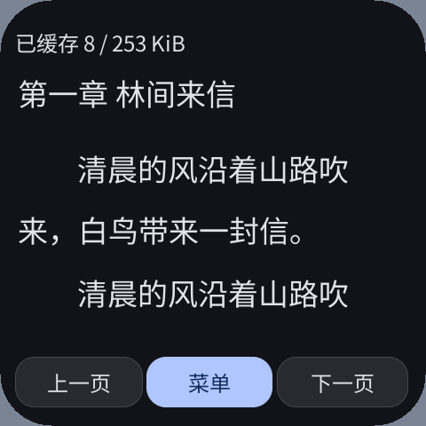

# 阅读页去除缓存提示与底部按钮（2026-10-10）

正常阅读只保留书名和正文。缓存进度、停止下载和重试入口在中间轻点唤出的阅读菜单；底部“上一页 / 菜单 / 下一页”移除。轻点左、中、右三分区分别上一页、菜单、下一页。错误与翻到缓存边界仍保留短暂反馈；初次尚无正文时显示加载提示，第一段正文出现即清除。

缓存过程中原生加载标签可能留在正文上，本轮将空页反馈纳入已有正文 Canvas，避免它在正文出现后继续覆盖文字。正文扩展到底部安全边距，圆屏不再为三枚按钮预留底部宽度，仍逐行避开弧边；前后分页与目录跳转始终使用同一种阅读几何。复用已有按压状态，拖动、取消触摸和没有按下事件的抬起不会触发翻页。

同一 CC0 小说、480×480 / 305 DPI、同字号和行距，缓存到首段时的前后画面：

| 修改前 | 修改后 |
| --- | --- |
|  |  |

本轮最终代码完成以下验收，原始记录在附件目录：

- 完整系统模拟器五种屏幕：296×240 / 160 DPI、480×480 / 305 DPI、360×480 / 320 DPI、480×480 / 320 DPI 圆屏、800×480 / 160 DPI。覆盖 12–28 字号、行距预览、原生输入法、搜索、菜单与目录；使用实际 Host 字体检查文本宽高，检查截图中文字没有裁切。
- 每种屏幕验证轻点翻页后返回原始字节位置、底部正文轻点打开菜单、拖动不翻页、单独抬起不翻页。阅读页不得有原生按钮或书架卡片覆盖正文。系统取消事件分支已处理，本轮没有额外注入取消事件来验证该分支。
- 在线首段边缓存边读、增量目录、暂停、重开与续传；断流、来源变化、空正文、无效 UTF-8 均拒绝损坏缓存并保留已有完整版本；分章缓存和目录按压期间更新通过。
- 原始《西游记》2,264,071 字节、100 回，ASan / UBSan 全文分页：四种分辨率 × 12 / 16 / 28 字号，全文非空白字节摘要一致，没有丢失或重复正文。
- simulator / ESP32-S3 / ESP32-S31 均以 O3 构建，包只携带 AOT，已更新用户 esp-mosaico 完整系统模拟器，保留其书架、缓存及设置。

内存核对：相同当前 SDK 与 Wasm 32 位 ABI 下，修改前后 ReaderApp 都为 **15,096 B**（其中 Page 为 **1,548 B**），新增提示分类标志使用已有填充空间。绘制缓冲仍为 3,600 B，正文读取上限、协程池和线性内存限制不变，没有新增帧缓冲、字体缓存或覆盖层。五个新进程的模拟器运行日志均测得 Guest 线性内存最高 **3 页 / 192 KiB**、协程最高 **7 / 8 槽**、分配失败 **0**，与上一轮同类场景一致。更多正文会增加单页命令实际长度，五种规格本轮最大 2,208 B，仍在原有固定缓冲内。

S3 AOT 从上一轮 944,740 B 到 949,528 B，TEXT 从 890,504 B 到 895,316 B；按现有映射粒度仍需 917,504 B。本轮没有重新实测 ESP 的映射或 SRAM / PSRAM 峰值：pai-touch（当前 `/dev/ttyACM0`）存储查询仅余 **4,096 B**，无法在保留现有书籍、缓存和应用的条件下安装更新。未删除这些数据，也没有改设备设置。另一块 `/dev/ttyACM2` 正运行 Mosaico Input Probe，保留其正在进行的测试。本轮真机运行内存和触摸验收待有可用安装空间的设备补测，不能将模拟器测量称为真机结论。

从工作区根目录复现：

```sh
SANITIZE=1 bash local/pxa-apps/novel-reader/tests/test.sh local/reader-typography-20261010/xiyou.txt
python3 local/pxa-apps/novel-reader/tests/build_playtest.py --target simulator --source http://127.0.0.1:18766/catalog.json --output local/reader-quiet-20261010/qa-verified
python3 local/pxa-apps/novel-reader/tests/fixture_server.py --port 18766
# 在另一终端运行，测试仅操作隔离的 QA 身份与私有数据：
python3 local/pxa-apps/novel-reader/tests/ui_sdk_probe.py --package local/reader-quiet-20261010/qa-verified/artifacts/pxa-novel-reader.pxa --fixture --failure-cases --output local/reader-quiet-20261010/cache-verified
python3 local/pxa-apps/novel-reader/tests/ui_sdk_probe.py --package local/reader-quiet-20261010/qa-verified/artifacts/pxa-novel-reader.pxa --cached-state local/reader-typography-20261010/cache-stable-state --real-book local/reader-typography-20261010/xiyou.txt --font-boundaries --output local/reader-quiet-20261010/real-verified
bash tools/app.sh build novel-reader --target simulator,esp32s3,esp32s31 --aot-only --output local/reader-quiet-20261010/release-verified
```

`xiyou.txt` 与隔离缓存模板沿用上一轮排版验收数据，来源及摘要见上一轮报告。本轮包与源代码摘要见附件 `provenance.json`。目录包含最终通过的截图、运行日志与结果；调试中失败的候选包没有列入验收。
