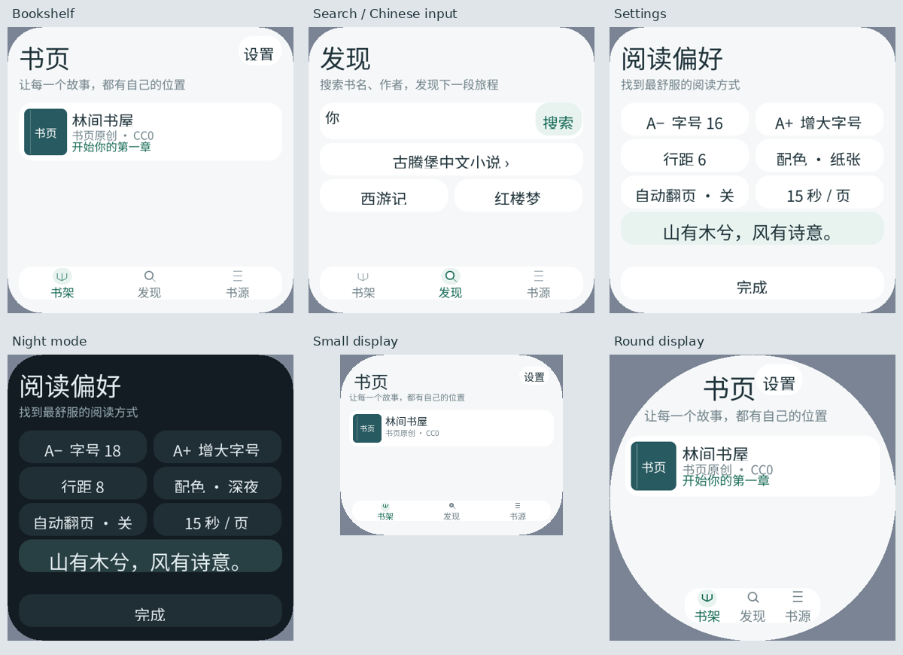

# C++ 输入接口与手机风格阅读界面

本报告记录前一版 Canvas 菜单；当前声明式原生控件、系统主色和缓存实现见
[原生 UI 与缓存验收](2026-10-10-native-ui.zh-CN.md)。

日期：2026-10-10。先完成应用层协议调用审计，再按用户追加要求改进阅读器外观。
截图为完整 PXA 系统（LVGL / WAMR x86_64 AOT），不是模拟绘制的网页。



## 修改原因、收益和开销

| 原因 | 修改 / 体验收益 | 内存及验证 |
| --- | --- | --- |
| 应用自行实现 InputBox、事件绑定和颜色编码 | 改用 SDK `TextInput(input, ref).box(box).max_bytes(512).single_line().on_submit(...)` | 原有 2 绑定 / 2 回调 / 1 Ref 不变；键盘中文编辑、确认、页面切换保留和删除确认通过 |
| 手读 UI 功能位、启动语言和时钟消息 | 使用 UiCapabilities、SystemEnvironment、ClockTick；Jump / Pixel Dungeon 同步迁移 | 无新默认缓存；业务代码已无 `pxa::wire`；严格检查消息长度、token、重复与截断 |
| 书架只有一排文字按钮，缺少阅读 App 的信息层次 | 封面、书名、作者、离线 / 进度；清晰的页标题、留白和图标底部导航 | 封面由小量几何命令绘制，不下载封面、不新增图片素材或图集；圆屏 / 小屏截图验证 |
| 设置项含义不直观 | 配色名称、字号预览、清晰的自动翻页与间隔，统一完成操作 | 沿用现有设置与存档格式；字号、行距、三种配色及返回操作通过 |
| 原生输入文字与 Canvas 的“点此输入”提示重叠 | 提示移到输入框上方，字段保留清晰空白编辑区域 | 去掉每次绘制复制 input 字符串的操作；中文输入截图验证无重叠 |
| 高 DPI 下右上角“设置”被裁掉一个字 | 按文字宽度计算按钮与标题可用空间 | 305 / 320 DPI、圆形与圆角屏截图验证 |

外观参考手机 App 的顶部栏、卡片与底部导航组织方式，参照
[Material 顶部栏](https://m3.material.io/components/app-bars/) 和
[官方 Android 导航栏文档](https://github.com/material-components/material-components-android/blob/master/docs/components/BottomNavigation.md)。
这里没有声称满足完整 Material 规范；小型屏幕按可用空间降级，不能机械套用手机尺寸。

## 为什么仍有 Canvas

Canvas 是 PXA UI 原生控件。正文需要精确分页、任意字号、逐行裁切和圆屏可用宽度，
适合保持 Canvas。搜索 / 书源输入使用标准 TextInput 和系统输入法。
本轮菜单和卡片仍为 Canvas 绘制；没有完成全部标准控件树迁移。
SDK Button / 容器仍缺少与本设计对应的完整外观和定位组合，后续迁移应先补齐这些
按需能力，并单独比较控件内存与布局成本。没有测量证明 Canvas 整套界面更快。

## 验证

- SDK：41 个原生测试、5 个 IPC 生成器检查、3 种任务池容量回归通过。
  新增输入框布局 / 启动环境测试，扩展通知与 UI 能力测试；新增路径经 ASan/UBSan 检查。
  修复原输入控件测试夹具的长文本越界，补做长输入 ASan/UBSan 检查。
- 应用：阅读器核心 JSON / UTF-8 / 来源 / 离线状态 / DPI 和异形屏分页的 ASan/UBSan 检查通过。
  共用 C++ 游戏的 6 个原生回归通过；Jump / Pixel Dungeon 模拟器 AOT 构建成功。
- 阅读器：x86_64、Xtensa ESP32-S3、RISC-V ESP32-S31 AOT 构建成功，O3；开发包不包含 Wasm 回退。
- 完整系统五种屏幕验证：480×480 / 305 DPI / 圆角 58（esp-mosaico）、
  296×240 / 160 DPI / 圆角 58、360×480 / 320 DPI、480×480 / 320 DPI 圆屏、800×480 / 160 DPI。
  覆盖书架、设置、字号预览、配色、正文、菜单、目录、搜索和系统输入法。
- 305 DPI 实际系统拼音键盘输入“你”，Guest 收到 3 个 UTF-8 字节；确认后键盘关闭，
  切换书架再返回搜索仍为 3 字节，删除并确认后为 0 字节。没有访问在线书源或修改真实书架。

[中文确认](2026-10-10-mobile-ui/480x480-305dpi-chinese-submitted.png)、
[系统键盘](2026-10-10-mobile-ui/480x480-305dpi-system-ime.png)、
[深夜设置](2026-10-10-mobile-ui/480x480-305dpi-night-settings.png)、
[改版前搜索](2026-10-10-mobile-ui/before-search.png)。
完整日志 / 额外截图位于 PXA 工作区 `local/sdk-input-api-20261010`；
屏幕汇总数据见 [results.json](2026-10-10-mobile-ui/results.json)。

## 内存与限制

原生 x86_64 Clang C++26 `sizeof`：ReaderApp **33472 → 33464 B**，
view **88 → 88 B**，Page **432 → 432 B**，TextInputBox **24 B** 与原 InputBox 相同。
普通 SDK TextInput 仍只有一个指针。无新增默认绑定、服务缓存、字体图集或绘制缓冲。
阅读器仍使用 4000 B Canvas 命令容量和 2 MiB 最大线性内存（最小 2 / 最大 32 个 Wasm 页）。
本次五屏操作实际最大 Canvas 命令为 **1155 B**，仅代表此测试内容。
输入框布局更新由 **149 → 124 B**，减少 25 B 重复属性，事务 / 调用数不变。

这些是对象、预算和消息测量，不是设备真实堆峰值。此次未烧录硬件，未重新测量设备
SRAM、PSRAM、代码映射或首次字体初始化峰值；不宣称整机实际占用完全相同。
新增 UI 的代码和常量也不等于零成本。SDK 无分配测试使用短文字；长文本仍按实际内容分配。

## 复现

在 PXA 工作区根目录执行：

```sh
bash deps/pxa-system/tools/package/test_guest_cpp.sh
SANITIZE=1 bash local/pxa-apps/novel-reader/tests/test.sh
python3 local/pxa-apps/novel-reader/tests/build_playtest.py \
  --target simulator --output local/reader-sdk-ui-qa
python3 local/pxa-apps/novel-reader/tests/ui_sdk_probe.py \
  --package local/reader-sdk-ui-qa/artifacts/pxa-novel-reader.pxa \
  --output local/reader-sdk-ui-qa/screens
./tools/app.sh build novel-reader --target simulator,esp32s3,esp32s31 \
  --aot-only --output local/reader-release-check
```

探针创建并清理每种屏幕的临时系统数据，仅保存截图与日志；关闭自己启动的进程，
不触及默认模拟器实例或设备设置。人工运行：`./tools/dev.sh sim --board esp-mosaico novel-reader`。
