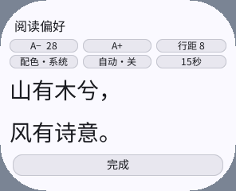
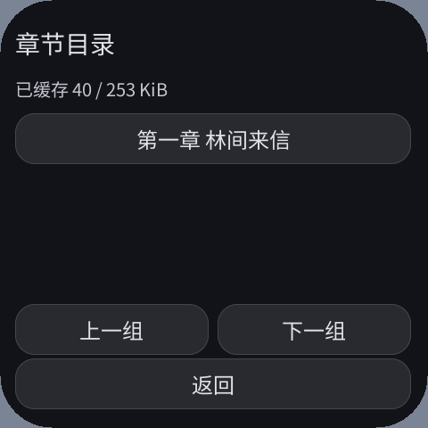
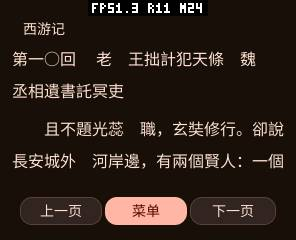

# 双行预览、小说排版与增量目录（2026-10-10）

阅读偏好的样例现在分为“山有木兮，”和“风有诗意。”两行，使用与正文相同的
Host `text_sized`、黑体抗锯齿字体、DPI 计算和行高。字号不再被菜单 Font 角色量化，
也不再被单行容器强行缩小。六个设置操作保持原生声明式按钮，采用两排三列；
预览复用既有 Canvas 和 3600 B 命令缓冲，没有第二 Canvas 或额外全屏图层。

## 结果与边界

| 原因 / 修改 | 体验与验证 | 内存与限制 |
|---|---|---|
| 原预览字体角色固定且按容器高度缩小；改为两行正文路径 | 296×240 实际字形高度 11→27 px；行距增加后基线步长 53→55 px，字体保持 28 px | 复用既有 Canvas；仅设置变化时重绘；其他菜单仍只有原生控件 |
| CRLF 和重复空行浪费屏幕；压缩显示空白，正文首行缩进两字 | 字节书签保留，跨页续行不重复缩进；诗行的原有缩进仍能辨认 | 在已有 16 KiB 页缓冲原位整理，不整书预处理或复制 |
| Gutenberg 约 32 字硬折行不等于段落；为已知 PG/GITenberg 来源合并正文硬折行 | 真实《西游记》不再每行提前断开；空行、诗句、章节标题保留边界 | 普通 JSON/TXT 来源保留单换行语义；原始缓存及校验哈希不变 |
| 按中文标点合法边界回退换行 | 避免把左引号、左括号留在行末及把标点强行推到下行；不向圆屏边界外悬挂 | 一次扫描，常数状态；连续标点长于整行的极端输入仍须强制断开 |
| TXT 原目录只索引完成文件；复用固定容量流式扫描器 | 首段 8 KiB 即出现完整标题；缓存增长增量追加，暂停重开也可索引 `.part` | 240 B 行尾状态放在原有协程槽内；不复制正文、不每段重扫全部文件；最多 1024 章 |
| 分章目录先下载正文才显示；现在先显示目录 | 已缓存章节可跳转，待缓存章节有提示和跳转守卫 | 使用原来目录向量，消除并存的第二份目录向量；离线重启只重建已缓存部分 |
| 目录刷新打断按下中的按钮 | 无新章节时不重建；新章节到达时等手指释放再刷新；模拟器跨章节到达的长按通过 | 复用书架闲置触摸状态，固定对象不增大 |
| 真机 SPIFFS 同步写入阻塞交互 | 正文单次写入限制 1 KiB，写入间合作式让出执行 | 共用原来的 4 KiB 流缓冲；更多 FS 调用，缓存吞吐可能下降，需以设备测试评估 |
| 第十等章号用“○”导致漏目录 | 中文数字、○/〇及全角数字支持；真实原文全部 100 回索引通过 | 无字库、章号字典或全书索引缓存 |

《西游记》验收来源为 [Project Gutenberg 23962](https://www.gutenberg.org/ebooks/23962)
的 [GITenberg 原文](https://raw.githubusercontent.com/GITenberg/---_23962/master/23962-0.txt)。
原文 **2264071 B**，SHA-256
`fc9a3956fd22b9a4356af8dd0dca27596fd0c9da87c35eae45c4f331c1b8f597`。
它是繁体文本，应用不偷偷转换书籍内容；字体使用 Host 的大陆黑体。
首次打开已知经典来源从首个识别到的章节开始，原文件的版权 / 制作信息仍保留在缓存中。
章标题必须在一行内且最长 240 B；跨行标题、HTML/EPUB、复杂诗歌韵律排版不在本轮支持范围。






## 可复现检查

从 PXA 工作区根目录运行：

```sh
curl -fL https://raw.githubusercontent.com/GITenberg/---_23962/master/23962-0.txt -o /tmp/xiyou.txt
SANITIZE=1 bash local/pxa-apps/novel-reader/tests/test.sh /tmp/xiyou.txt
bash deps/pxa-system/tools/package/test_guest_cpp.sh
python3 local/pxa-apps/novel-reader/tests/fixture_server.py --port 18766
# 另一终端：
python3 local/pxa-apps/novel-reader/tests/build_playtest.py --target simulator \
  --source http://127.0.0.1:18766/catalog.json --output local/reader-type-qa
python3 local/pxa-apps/novel-reader/tests/ui_sdk_probe.py \
  --package local/reader-type-qa/artifacts/pxa-novel-reader.pxa \
  --fixture --failure-cases --export-state local/reader-type-state --output local/reader-type-cache
python3 local/pxa-apps/novel-reader/tests/ui_sdk_probe.py \
  --package local/reader-type-qa/artifacts/pxa-novel-reader.pxa \
  --cached-state local/reader-type-state --real-book /tmp/xiyou.txt \
  --font-boundaries --output local/reader-type-novel
```

正文完整性测试对 296×240、480×480、360×480、800×480 和 12/16/28 dp 逐页检查全部
2264071 B，比较忽略空白后的字符序列哈希，并验证 UTF-8、字节进度、目录数量及偏移。
完整系统测试另覆盖 480×480 圆屏和 160/305/320 DPI，逐行以 Host 实际 Noto 字体
度量检查绘制宽度 / 高度，截图测量预览的真实字形高度与行距；不只检查设置数值。
模拟器真实小说使用未经修改的 128 KiB `.part`，在缓存不完整时搜索打开、跳转和翻页。
这项确定性测试不把公网延迟当作排版或语言性能收益。

固定 CC0 网络测试：首段可读、边缓存边显示目录、暂停重开、If-Range 恢复、正文 SHA-256；
异常 HTTP、变化验证标识、空目录、非法 UTF-8 不会发布完成缓存。
分章测试：目录先显示、未缓存章节不能误跳、手指按住章节按钮时下一章到达仍可释放打开。
附件提供每个测试的结果与日志。

## 内存与真机

本轮保留 O3，按当前固定工具链重建本轮前源码作对照。正式 S3 AOT 为
944700→944740 B（+40 B），TEXT 887364→890504 B；两版代码映射真机实测均为
917504 B。最终启动日志 `request=890504 map=917504 alloc=917504`；附件
`code-comparison.json` / `provenance.json` 记录二进制哈希及可选 SDK 模块源码。

曾出现 AOT 增至 971332 B、启动临时 PSRAM 峰值增加约 35 KiB 的中间版本。
最终通过 SDK 的可选有界 libc++ 诊断模块和设置标签借用视图修正；保持 O3、
硬化检查、错误上下文及异常终止，没有压缩或换成 Os。该模块显式启用，其他应用
无默认开销；基于当前 wasi-sdk 34.0 的运行库 ABI，升级时须重验链接与故障路径。
512 B 缓冲只出现在致命错误局部栈；正常 UI / 分页算法保持。SIGABRT、截断、
空指针、不支持格式及 ASan / UBSan 测试通过，完整 SDK 回归通过。
WAMR 动态稳态 49249→46931 B、动态峰值 92943→88877 B（来自各次启动日志）。

固定 CC0、位置 0、16 dp、行距 6、系统主题，截图确认的同操作真机对照如下。
只采用画面正确的各第一次运行；第二次最终测试没有进入预期设置 / 正文，
以及此前锁屏中的测试均排除，不把它们当作相同工作负载。

| 全系统指标（B） | 本轮前 | 最终 |
|---|---:|---:|
| 书架稳定空闲 SRAM / PSRAM | 35631 / 5596092 | 35631 / 5597140 |
| 偏好页稳定空闲 SRAM / PSRAM | 35631 / 5595156 | 35631 / 5598208 |
| 启动窗口最低空闲 SRAM / PSRAM | 26299 / 4532276 | 29887 / 4534464 |
| 设置 / 返回窗口最低空闲 SRAM / PSRAM | 16579 / 5146828 | 16579 / 5149852 |
| 正文 / 停止窗口最低空闲 SRAM / PSRAM | 12991 / 5150392 | 16579 / 5153248 |

对应窗口实测峰值未增加；固定容量和代码映射保持，偏好页稳定空闲 PSRAM 多 3052 B。
停止后的全系统空闲仍有小幅差异，未将其作为应用泄漏或节省的证据。
启动前全系统空闲基态不同，PSRAM 相差 9644 B；
不能把全部差值归因于 Guest。完整观测、停止后残留系统缓存和原始日志见
`matched-memory.json`，稳定与峰值分别记录。没有以历史累计 surface 峰值替代本次值。

缓存真机复测首段约 8772 ms，模拟器约 460 ms，均包含脚本点击、等待、文件写入，
不是纯网络 / 显示耗时，也不能据此把两个平台直接比较。真机完整 CC0 缓存和
三次冷启动通过；固定 SHA-256 与服务器预期一致。真实 HTTPS《西游记》验证至
270336 B 部分缓存，已识别 13 回；在未完成时打开第十回、前后翻页、重新冷启动
三次读取保存位置均通过。部分文件 SHA-256 与原文对应前缀一致，见
`device-real-book.json`。未宣称真机已完整下载 2.2 MB 小说。

固定 ReaderApp **15376 B**、持久 Page **2264 B**，合计 **17640 B**，与本轮前相同。
最小线性内存 128 KiB、上限 2 MiB、C 栈 64 KiB、8×2048 B 协程池均保持。
不根据固定对象推断整体内存：AOT 文件和映射、Host 字体、动态节点及运行窗口峰值需单独核对。
本轮之前更早的原生 UI 改版与 Host 维护队列修复见
[原生控件与系统配色报告](2026-10-10-native-ui.zh-CN.md)。

本轮设备为 pai-touch `/dev/ttyACM0`。QA 身份独立，只清理其临时书架；保留设备上的
Jump Jump、Voxel Craft 及用户数据，不修改系统主题。设备已有 FPS / 内存调试覆盖层
未改动，截图中的状态来自该原有配置。
正式阅读器是本轮首次安装，其临时对照只含出厂 CC0 示例。Flash 换包空间不足时，
仅替换这个本轮新建的示例安装，其他既有应用和数据保留。
真机结果和运行窗口内存记录见附件 JSON；启动与稳定 / 下载窗口分开记录，
不以系统启动以来最低空闲或历史 surface 峰值冒充本次峰值。

真机缓存窗口最低空闲 SRAM / PSRAM：启动 **26263 / 4498188 B**、稳定交互
**12991 / 4964540 B**、下载 **8779 / 5071736 B**；下载后当前空闲
**35595 / 5567828 B**。这是全系统的实测运行窗口；本次启动前设备上已有其他应用、
字体缓存和调试覆盖层，不能与旧报告的不同全系统基态相减后声称是阅读器的内存变化。
Guest 线性内存本轮读写仍为 128→192 KiB，QA 协程分配失败 0；没有新增渲染帧缓冲。
命令队列和 SRAM / PSRAM 总容量未修改，surface 的累计历史峰值仅在原始 JSON 中留作诊断。

通过的结果文件包括 `screens.json`、最终的 `real-screens.json`、`progressive-cache.json`、
`failure-cases.json`、`device-cache.json`、`device-real-book.json`、`matched-memory.json`、
`core-corpus.log`、`sdk-regression.log`、`bounded-diagnostics-test.log`。
真实小说设备验收使用系统默认即时书目和实际 HTTPS 下载；应用私有数据禁止 PXADB
直接写入，因此没有扩大写权限来灌入测试内容。最终正式 S3 AOT 包已安装于 pai-touch，
完整三架构正式包已安装于 esp-mosaico 完整系统模拟器。新增 `device-formal.json`
记录正式映射、双行预览字号变化、恢复原字号和应用清单；`offline-screens.json`
记录先前的离线五种规格复测；最终可选模块与标签视图的五规格完整系统复测
以 `real-screens.json` 为准。



验收脚本对部分原生控件使用 0.8 秒按下，书架使用 0.35 秒避免触发长按；
这些测试证明功能及渲染，没有测量快速轻触的响应延迟，不能据此声称输入延迟已改善。
正式配置恢复到 16 dp、行距 6、跟随系统主题，自动翻页关闭。
最终产物位于工作区 `local/reader-typography-20261010/release-memory-all/`
及 S3 专用的 `release-memory-final/`，仅携带 AOT 和 16 B 资源表，没有打包 Wasm 或小说全文。
测试结束关闭了本轮两个书源服务器，删除了独立 QA 应用；设备上的其他应用保留。
