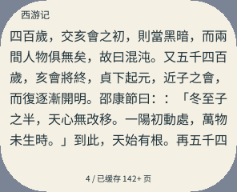
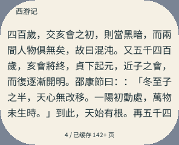
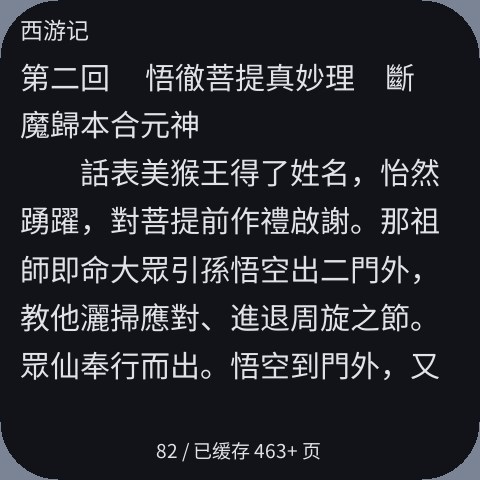
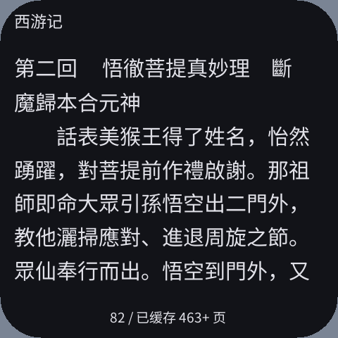
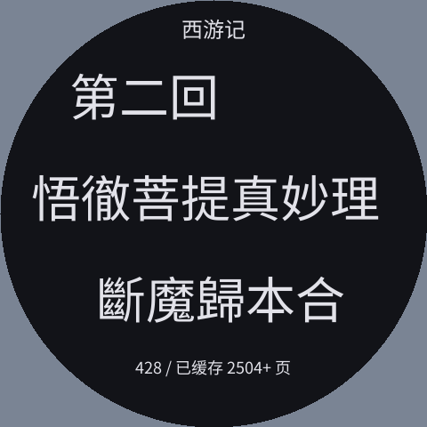

# 字号、行距变化后的阅读留白（2026-10-11）

阅读页按完整行分页，字号或行距变化后，下一行可能无法放入正文区域。此前余量全部留在底部；字体本身的上下度量也会使可见墨迹到页码的空白比行框间距更大。

现在将正文适度下移，均衡上下余量。移动上限为半个行步长，保留用户选择的字号、行距、段落间隔和缩进。正文继续左对齐，书名及页码位置固定。短末页、诗歌页和逐渐增长的部分缓存保持有限移位，避免几行文字突然移到屏幕正中央。

圆角与圆屏的可用宽度随高度变化，因此不能只改绘制的 y 坐标。均衡器检查每一行的新边界及原有文字宽度，保留相对边界的缩进，并在完整文字仍能放下的范围内求移位量。它直接修改原有 Page 的行框；文字、原文偏移、消费字节数和页数统计均不改变。计算仅发生在载入书页或重新分页时，不逐帧重复，也不重新扫描全书。

## 用户截图复现

使用现有 pai-touch 书架的独立副本：296×240、160 DPI、圆角 58、安全区上/右/下/左为 8/10/8/10 px，字号 16、行距 0、纸张配色，原始《西游记》字节位置 1441。

| 修改前 | 修改后 |
| --- | --- |
|  |  |

两张截图显示同样的六行原文及 `4 / 已缓存 142+ 页`。正文行框顶部从 33 移到 45 px，底部从 189 移到 201 px；页码区顶部仍为 216 px，因此底部行框到页码的间距从 27 减为 15 px。理论半余量为 13 px，一行的圆角宽度限制使实际移位为 12 px。原始阅读位置和设置未改动。

## 相同章节、不同偏好

以下使用原始第二回字节位置 22819、相同系统字体、同一 128 KiB 部分缓存、安全区 12 px。每对截图的文字摘要、行数、正文像素字号、原文位置和页码坐标相同。

| 屏幕 | 字号 / 行距（dp） | 正文行框到页码：前 → 后 |
| --- | --- | ---: |
| 296×240 / 160 DPI | 16 / 0 | 19 → 11 px |
| 296×240 / 160 DPI | 16 / 6 | 15 → 9 px |
| 296×240 / 160 DPI | 16 / 12 | 23 → 13 px |
| 480×480 / 305 DPI | 16 / 0 | 45 → 25 px |
| 480×480 / 305 DPI | 16 / 6 | 27 → 16 px |
| 480×480 / 305 DPI | 16 / 12 | 31 → 18 px |

| 高 DPI：修改前 | 修改后 |
| --- | --- |
|  |  |

| 圆屏，28 / 12 dp | 窄屏，24 / 12 dp |
| --- | --- |
|  |  |

## 内存与计算预算

| 项目 | 前 | 后 |
| --- | ---: | ---: |
| ReaderApp 固定对象（同一 SDK，Wasm32） | 15088 B | 15088 B |
| Page / PageNumbers / PaginationCursor | 1548 / 152 / 12 B | 相同 |
| Canvas 固定命令容量 | 3600 B | 3600 B |
| 五屏本次 Guest 线性内存峰值 | 3 页 / 192 KiB | 相同 |
| 协程池固定空间 / 实际最高使用槽数 | 16400 B / 7 | 相同，失败 0 |
| S3 TEXT 映射预算 | 917504 B | 917504 B |
| S31 TEXT 映射预算 | 917504 B | 917504 B |
| Linux TEXT 映射预算 | 458752 B | 458752 B |

移位搜索和最终写入复用同一个遍历主体，避免重复生成几何计算；保持 O3。S3 TEXT 从 914576 增至 917456 B，仍在原有映射分段内，但距离下一段仅剩 48 B，后续更改应继续检查。正式包只有三个架构的 AOT 与资源，不含 Wasm。

没有增加 Page 副本、文字缓冲、按书长增长的页表、字体图集、帧缓冲、深度缓冲或命令容量。测试里用于比较的 Page 副本仅在原生测试程序中，不进入应用。五屏流程最大的实际 Canvas 提交为 3260 B。

代码文件及 AOT 元数据仍有变化：S3 FUNCTION 节为 5792 → 5808 B，相关完整节尺寸见 `aot-comparison.json`。代码映射与固定 Guest 预算相同不等于所有 Host 分配相同。各模拟器新进程的 RSS / HWM 单独存档；本轮没有实测 ESP 的完整 SRAM / PSRAM 占用或显示，不把模拟器结果当作真机数据。

## 验证与安装

- ASan / UBSan 原生测试：不同形状 × 字号 × 行距，保留文字偏移、行数及原有行间距离；移动后的每行均在新的安全边界内。包含稠密正文、示例书和短末页。
- 原始《西游记》2264071 B、100 回，四种分辨率 × 12/16/28 字号，全书非空白字符摘要、流式页数与稀疏定位回归通过；用户截图对应的六行页面单独断言。
- 完整系统模拟器五种屏幕：296×240 / 160 DPI、480×480 / 305 DPI、360×480 / 320 DPI、480×480 / 320 DPI 圆屏、800×480 / 160 DPI。每种检查 12/16/20/24/28 dp 字号 × 0/6/12 dp 行距，共 75 组，逐个正文汉字检查实际墨迹，并检查书名及页码。
- 同一流程覆盖调整设置、下一页/上一页返回相同原文位置、目录跳转、书架长按、原生输入法及即时搜索。两个前后对比规格共 30 组，显示文字摘要与行数完全一致。
- 最终正式包已更新用户的 pai-touch 和 esp-mosaico 模拟器存储。pai-touch 的 6 个私有文件 SHA-256 原样保留；esp-mosaico 此存储中没有本应用私有书籍文件。未改变书架、位置、字号、行距和系统设置。

缓存正文不足、末页内容较短或原文诗歌分行时仍会有留白。无法放入完整文字的一行继续留到下一页，正文不会覆盖书名或页码。

## 复现

从 PXA 工作区根目录执行；QA 使用独立应用身份与状态目录：

```sh
SANITIZE=1 bash local/pxa-apps/novel-reader/tests/test.sh local/reader-typography-20261010/xiyou.txt
python3 local/pxa-apps/novel-reader/tests/build_playtest.py --target simulator --output local/reader-balanced-20261011/qa-one-pass
python3 local/pxa-apps/novel-reader/tests/ui_sdk_probe.py --package local/reader-balanced-20261011/qa-one-pass/artifacts/pxa-novel-reader.pxa --cached-state local/reader-typography-20261010/cache-stable-state --real-book local/reader-typography-20261010/xiyou.txt --spacing-matrix --profile 296x240-160dpi --output local/reader-balanced-20261011/check
bash tools/app.sh build novel-reader --target simulator,esp32s3,esp32s31 --aot-only --output local/reader-balanced-20261011/release-one-pass
```

其他规格可分别指定 `--profile`。字体及原文来源沿用前次验收，附件 `provenance.json` 记录最终源码、QA 包、正式包、字库和正文摘要；压缩日志为实际最终流程的完整输出。对应布局构造、页数、字体覆盖和在线缓存验证见此前报告。
