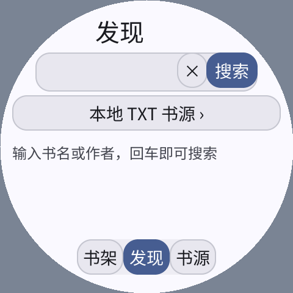
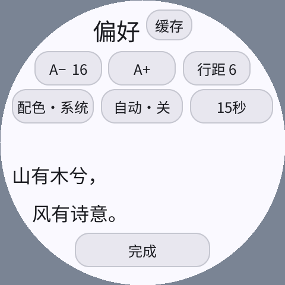

# 0.2.0：按需阅读、书源规则与翻页优化

2026-10-15。修改范围为 novel-reader，使用 C++26 SDK；验证使用独立完整系统模拟器与临时应用数据。
没有改变用户现有书架、模拟器私有目录或设备数据。本轮没有刷写设备，以下耗时都是模拟器测量。

## 行为变化

- 未缓存作品默认按需阅读，TXT 使用 8 KiB 原文窗口，分章 JSON / HTML 保留当前章内存文本；不创建正文 `.part` / `.txt`。
- 书架、偏好、真实搜索历史和少量进度仍保存。翻页位置停顿约一秒后合并写入，离开页面或进入后台时保存；断电可能丢失最后约一秒进度。
- 用户可主动“下载离线”，也可在“偏好 → 缓存”启用自动下载。已有完整或部分离线缓存保留、优先使用，不随升级删除。
- 缓存页显示当前书籍的离线大小，允许只清除正文、保留书架。TXT 保留字节位置；分章离线书清除后从首章开始，界面明确提示。
- 搜索移除固定“西游记 / 红楼梦”按钮，增加清空输入、六条真实历史、历史清除、空关键词保护。切换书源复用关键词，导入、移除或停用书源时清理旧结果。
- 宽屏输入法确认键触发搜索 / 导入；小屏 K9 收起只保留输入，仍可点应用的搜索按钮。

原书源是四部经典的内置元数据、GITenberg 正文地址、Gutendex JSON API 和自定义 JSON 目录。
现在加入 `pxa-reader-source-2` 静态 HTML 规则，覆盖搜索项、目录链接、正文容器及排除子树。
规则、模板、URL / 选择器语法和边界见[书源说明](source-rules.zh-CN.md)。保留 v1 JSON 配置和状态 v1/v2 的迁移读取。

## 优化手段

| 改动 | 原因 / 收益 | 内存与约束 |
| --- | --- | --- |
| 复用 8 KiB 原文窗口，带约 2 KiB 回看区 | 旧版每页重新打开文件并读 16 KiB；新窗口命中时同步分页，不启动读取协程 / 文件操作 | 替换旧大缓冲，不缓存整书或多份完整 Page；原文与压缩后的显示文字分开，保留真实字节偏移 |
| 翻页进度合并保存 | 避免每页立即打开、写入、关闭、替换状态文件 | 一秒停顿或离开时保存，使用原有原子替换；没有新增线程 / 队列 |
| 16 ms 轻量应用 tick | 减少等待下一次应用绘制的时间；旧值为 50 ms | 静止时不提交 Canvas，但仍有定时唤醒；未测设备功耗 |
| 正文和页脚分别判脏 | 页码统计不再让整页无条件重画；头部消息只更新原生标签 | 页脚变化使用 Canvas dirty rect；保留完整命令列表，仍有少量重新编码成本 |
| 已知页边界直接维护当前页码 | 最近页历史内前后翻页不再反复从文件重扫定位 | 继续使用 24 项历史和稀疏检查点；超出历史可协作式回溯，不增加全书页表 |
| 默认按需加载 | 不因打开作品就下载整本，也不为 TXT 总页数预先拉取全书 | TXT 页脚明确标记按需阅读；按需分章页数只针对当前章 |
| 合并协程层级 | 初版 HTML 辅助任务曾耗尽八个槽位，调整后通过完整流程 | 槽位仍为 8×2048 B，没有扩大常驻池 |
| 修正原生字体单位 | 原来的 UI 按已缩放像素选字体角色，Host 再按 DPI 放大，导致高 DPI 控件裁字 | 用实际密度与系统字体倍率选择角色；正文原有字号 / 圆屏逐行排版保持不变 |

网络读取失败时回滚待提交的翻页位置，原页保持可读；重试成功再推进历史。
按需 TXT 超出历史后从稀疏检查点重新读取并分页，深处首次回溯仍可能较慢；分章模式使用当前章内存反向定位。
清除缓存后返回阅读会重新载入；偏好中已经排好页面时直接复用，不制造额外读取。

## 相同正文的翻页基准

同一冻结 Host 二进制、相同 UTF-8 原创段落、字号 16 / 行距 6、系统浅色、安全边距 12 px。
每次创建独立状态，打开同一完整离线文件，等待初次统计后向前 24 页、向后 12 页。
正文 SHA-256 为 `8829a89a80d2c5792b892d37f60177f81c8186759677ceacfe8a3ea245c945d4`。

计时从控制接口发出 TAP 开始，包含合成按压释放、Guest 调度和截图轮询，到正文区域首次变化为止。
它是软件可见帧的端到端观察，不是纯分页函数耗时，也不是物理触摸到光子的延迟。
旧 / 新逐页原文偏移和正文区域 SHA 对照一致，前后翻页返回原文，没有通过少画文字获得收益。

| 屏幕 | 基线中位 / P95 | 最终交付中位 / P95 | 中位缩短 |
| --- | ---: | ---: | ---: |
| 296×240 / 160 DPI | 70.6 / 95.4 ms | 57.6 / 70.5 ms | 约 18% |
| 480×480 / 320 DPI 圆屏 | 115.8 / 152.1 ms | 87.0 / 105.4 ms | 约 25% |

圆屏另一轮基线为 115.8 / 137.1 ms；此前相同绘制实现的重复新版本为约 82～93 ms 中位。
小屏早期开发测量出现过 100 ms 基线及 49～61 ms 新值，存在调度 / 测试环境差异；这些结果保留，主要表格不挑最慢基线配最快新值。
本轮只有每组 36 个操作，不据此承诺任意机器上的固定延迟。

应用日志首次报告页面就绪的中位数仍约 23 ms，包含 TAP 的合成释放时间；没有声称分页 CPU 本身快了一倍。
收益主要在减少 I/O、等待和重复呈现。每次加载都读 16 KiB 的旧路径，对这 37 页会执行 37 次窗口读取；最终小屏只有 **2 次读取、35 次命中**，圆屏为 **1 次读取、36 次命中**。
这不包含单独的本地目录 / 总页数扫描。内容 Canvas 从约 **49～50 次整页提交**变为 **37 次整页提交及约 1 次局部页脚提交**。
静止观察窗口未出现持续的内容重绘。

逐帧样本、源码 / 镜像摘要和重复结果见[机器记录](2026-10-15-on-demand-and-paging.json)。

## 内存和存储口径

| 项目 | 基线 → 最终 |
| --- | --- |
| ReaderApp 固定对象，Wasm32，无 QA 宏 | 15064 → 15176 B，增加 112 B 的窗口 / 导航 / 刷新状态 |
| 原文缓冲 | 旧单页读取 16 KiB → 新可复用 8 KiB |
| 本次正文窗口 / 显示字符串 capacity | 新值 8207 + 255 B；显示内容受 3600 B 命令预算约束，容器 capacity 另有增长 / 对齐余量 |
| 协程池 / Canvas 命令容量 | 16400 / 3600 B，不变；最近页历史不变 |
| 线性内存 | 同一离线基准观察到 2 页（128 KiB）；综合网络 / 设置流程最多记录 3 页（192 KiB）；上限仍为 2 MiB，C 栈仍为 64 KiB |
| 任务槽位 | 离线读页峰值 8、综合网络流程峰值 7，分配失败均为 0 |
| 按需阅读存储 | TXT 和 HTML 都没有正文文件；综合验收状态 JSON 约 1.4 KiB |
| 按需 HTML 内存 | 保留当前章，响应最大 64 KiB，另有有界目录及请求临时内存；不等同于 TXT 的 8 KiB 常驻窗口 |
| 状态文件输入上限 | 160 KiB，覆盖八份转义后的规则和十六本有界记录；不是预分配容量，普通测试文件仍约 1.4 KiB |

新增书源 / 按需能力会增加代码和少量元数据，并未声称所有内存都下降。
同一工具链、无 QA 宏的 Linux AOT：552840 → 710024 B；TEXT 为 445628 → 576364 B。
最终 S3 / S31 AOT 为 1261820 / 1293392 B，TEXT 为 1194360 / 1164740 B。
这些是构建节尺寸，不冒充设备实际代码映射、SRAM 或 PSRAM 峰值；本轮未做真机内存测量。

## 正确性与验证

- ASan / UBSan：JSON、URL、Unicode、实体、选择器、规则限额、损坏 HTML、失败清理及新旧状态；含转义后超过 64 KiB 的合法最大配置。
- 原始 2264071 B《西游记》、100 回，四种分辨率 × 12 / 16 / 28 字号，完整非空白文本摘要与流式目录一致。
- 字库覆盖 4638 个实际用字，12 / 16 / 28 / 56 px，无缺字或空字形；应用继续使用 Host 中国大陆黑体。
- 五屏完整系统：296×240 / 160 DPI、360×480 / 320 DPI、480×480 / 305 DPI、480×480 / 320 DPI 圆屏、800×480 / 160 DPI。
- 本地 HTTP 站覆盖真实 JSON 搜索、HTML 规则导入、搜索 / 目录 / 正文提取、广告与脚本排除、当前章翻页、退出重开后的上一页、离线下载和清除。
- 默认模式下检查正文文件为零；错误 UTF-8 不发布正文。压力流程覆盖 60 页前翻、32 页回翻、读取 503、回滚保存位置、重试及无正文文件的重启恢复。
- 字号、行距、主题和缓存偏好修改后仍能阅读；小屏额外验证五秒自动翻页及关闭。
- 宽屏实际键盘确认事件触发搜索 / 导入，小屏收起保持输入；没有把收起键当作提交事件。
- 三架构签名 AOT 构建通过；**无 QA 宏的正式包**在独立模拟器回放 37 页，与 QA 正文像素匹配，最终进度正确、原缓存 SHA 不变。

没有现场设备测量、真实公网网站兼容矩阵或电量测试。HTML 只承诺文档列出的 UTF-8 静态页面规则，不运行 JavaScript，也不处理登录、分页目录、分页章节或验证码。

## 界面截图

| 小屏搜索 | 圆屏搜索 | 缓存管理 |
| --- | --- | --- |
|  |  |  |

| 字体单位修正前（本轮中间版） | 修正后 | HTML 正文 |
| --- | --- | --- |
|  |  |  |

## 复现

从 PXA 主工作区根目录，使用已配置的 SDK、Clang C++26、Python / Pillow / fontTools 和 LVGL 依赖：

```sh
cmake -S deps/pxa-system/simulator/desktop -B build/simulator/reader-validation \
  -DCMAKE_BUILD_TYPE=Release \
  -DPXSYS_LVGL_SOURCE_DIR="$PWD/firmware/managed_components/lvgl__lvgl" \
  -DPXSYS_DESKTOP_APP_SOURCE_ROOT="$PWD/local/pxa-apps"
cmake --build build/simulator/reader-validation \
  --target pxsys_desktop_simulator pxsys_product_simulator pxsys_package_installer -j8

SANITIZE=1 bash local/pxa-apps/novel-reader/tests/test.sh
python3 local/pxa-apps/novel-reader/tests/build_playtest.py \
  --target simulator --output local/reader-repeat/qa
python3 local/pxa-apps/novel-reader/tests/session_probe.py \
  --package local/reader-repeat/qa/artifacts/pxa-novel-reader.pxa \
  --stress --output local/reader-repeat/session
python3 local/pxa-apps/novel-reader/tests/paging_probe.py \
  --binary build/simulator/reader-validation/pxsys_desktop_simulator \
  --package local/reader-repeat/qa/artifacts/pxa-novel-reader.pxa \
  --output local/reader-repeat/paging

bash tools/app.sh build novel-reader --source-root local/pxa-apps \
  --target simulator,esp32s3,esp32s31 --aot-only --output local/reader-repeat/release
python3 local/pxa-apps/novel-reader/tests/release_probe.py \
  --package local/reader-repeat/release/pxa-novel-reader.pxa \
  --reference local/reader-repeat/paging --output local/reader-repeat/production
```

其他规格使用 `--width / --height / --dpi / --round`。每个脚本创建临时独立状态，不修改常用模拟器的书籍；输出目录使用新名字以保留证据。
本次原始日志、冻结源码和包在主工作区 `local/reader-optimization-20261015`；正式包位于 `delivery-release/pxa-novel-reader.pxa`。
