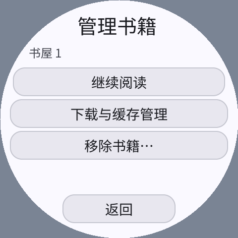

# 0.2.5 共享手势 SDK 迁移

书架长按、目录点击及正文翻页统一使用 C++ SDK `PressGesture`；移除重复的
按下时间、坐标和拖动哨兵。书架仍按住约 550ms 打开管理，目录/正文仍为普通点击。
一旦拖出容差，即使移回也不点击；取消、多指和场景切换不穿透。
书籍和目录在指针仍捕获时保留原生控件，避免后台数据更新时丢失松手事件。

| 模拟器配置 | 按住打开管理的画面观察值 | 结果 |
| --- | --- | --- |
| 296×240 / 160dpi | 570.0ms | 通过 |
| 480×480 / 320dpi 圆屏 | 570.7ms | 通过 |
| 240×240 / 160dpi 圆屏 | 565.2ms | 通过 |
| 800×480 / 160dpi | 570.7ms | 通过 |

每种配置均验证短按、松手不穿透、拖动取消和显式 CANCEL，并遍历书架/书源/目录各页；
尾页返回不跳项。Guest 线性内存峰值仍为 3 页（192KiB），协程池峰值仍为 8，
分配失败为 0，与 0.2.4 同一 QA 场景一致。增加的是识别器的固定内联状态，
没有新缓存、协程或堆分配；不能将“无堆分配”误写为“功能完全免费”。

正式无插桩三架构包另回放 37 次页面：正文像素参考、进度和缓存均一致。
SDK 全回归、ASan/UBSan、UI 自动调度与子树生命周期结果另见 SDK
`sdk/guest-cpp/docs/2026-10-15-gestures-validation.zh-CN.md`；接口见 `GESTURES.zh-CN.md`。
JSON 摘要为 [2026-10-15-sdk-gestures.json](2026-10-15-sdk-gestures.json)。

复现（源码工作区根目录）：

```sh
SANITIZE=1 bash local/pxa-apps/novel-reader/tests/test.sh
python3 local/pxa-apps/novel-reader/tests/build_playtest.py --target simulator \
  --output local/gesture-sdk-20261015/reader-qa
python3 local/pxa-apps/novel-reader/tests/interaction_probe.py \
  --package local/gesture-sdk-20261015/reader-qa/artifacts/pxa-novel-reader.pxa \
  --output local/gesture-sdk-20261015/reader-sim
bash tools/app.sh build novel-reader --target simulator,esp32s3,esp32s31 --aot-only \
  --output local/gesture-sdk-20261015/reader-release
```

正式包回放使用 `tests/release_probe.py --help`，本轮参考
`local/reader-optimization-20261015/delivery-paging-small`，输出在
`local/gesture-sdk-20261015/reader-production`。所有测试隔离存储，未触碰用户书架。
未进行本轮真机测试，桌面观察值含注入/调度/显示/截图轮询，不能作为真机触摸延迟。
包保持 O3，未上传商店。


