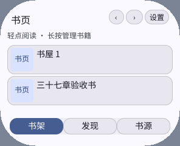
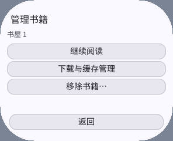
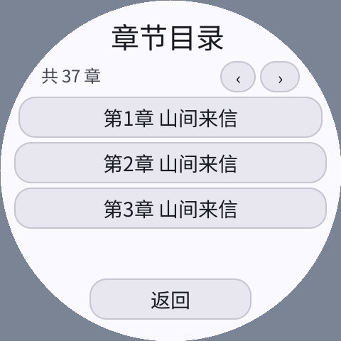

# 0.2.4：按住即触发长按与紧凑列表导航

原来的书架只在抬手事件中计算按住时间，导致长按必须松手才打开管理页。
现在复用已有帧时钟，在按住约 550 毫秒时打开管理页；不需要新协程、计时器或缓冲区。
触发后消费本次手势，抬手不再打开书籍或点击新菜单；拖动、触摸取消、切换页面、后台及屏幕尺寸变化会清除待处理长按。
短按仍在抬手后进入阅读，移除书籍仍须另行确认。

书架、搜索、书源和目录改用紧凑的 `‹` / `›` 图标，移除底部整行“上一组 / 下一组”。
列表可利用释放出的空间。图标通常在标题栏；圆屏 / 高 DPI 下标题所在弦宽不足时，移到已有的副标题行，保留标题完整性。
本轮采用图标翻组，没有改成连续滚动，也没有为整本目录创建大量原生控件。

同时修复两类导航边界：

- 末页不足一屏时，返回按完整页面容量计算，回到上一页正确起点；不按末页剩余条目数向前偏移。
- 分页网站的已加载目录可能只填了半屏。先补齐当前屏，再进入下一屏，避免新加载的章节被跳过。
  请求失败保留原目录位置，可重试。

节点容量仍为 48，回调容量仍为 16；列表按屏幕空间、节点和回调预算显示，不增加默认缓存、帧缓冲或任务池。
正文排版与缓存格式没有修改。具体包哈希、运行数据和验证范围见[验证数据](2026-10-15-touch-and-navigation.json)。

## 验证

`tests/interaction_probe.py` 使用独立 QA 身份和临时存储，在 296×240 / 160 DPI、480×480 / 320 DPI 圆屏、
240×240 / 160 DPI 圆屏及 800×480 / 160 DPI 中执行：

- 按下不抬手，确认阈值前不触发、阈值后已进入管理页；再抬手，确认没有穿透点击。
- 拖动后回到起点、取消触摸均不触发长按或短按；普通点击可正常阅读。
- 逐页遍历 15 本书、8 个自定义书源、37 章本地目录，再倒序返回，检查全部条目可达、末页和首尾边界。

本地 HTTP 会话继续检查 JSON / HTML 分页目录、半屏目录补齐、分页章节缺页及重试、离线下载、缓存清理和设置。
正式三架构包重放原有 37 页正文作图像回归。未使用真机，也不将桌面计时当作设备触摸延迟。

```sh
python3 local/pxa-apps/novel-reader/tests/build_playtest.py \
  --target simulator --output local/reader-touch-check/build
python3 local/pxa-apps/novel-reader/tests/interaction_probe.py \
  --package local/reader-touch-check/build/artifacts/pxa-novel-reader.pxa \
  --output local/reader-touch-check/interaction
python3 local/pxa-apps/novel-reader/tests/session_probe.py \
  --package local/reader-touch-check/build/artifacts/pxa-novel-reader.pxa \
  --html-paged --stress --output local/reader-touch-check/session
```




