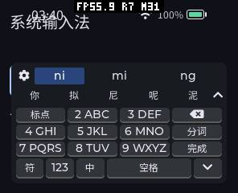
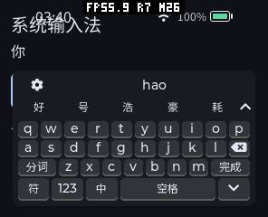
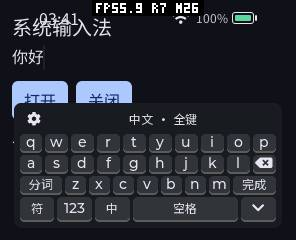

# 轻量拼音输入法验证（2026-10-13）

新增独立签名包 `pxa-pinyin-ime-lite`，使用约 19 KiB 的拼音单字表替代约 1 MiB 词库和 Google 统计解码器。完整版保留词句能力，两版共享 Host 键盘、设置、IME 0.1 协议以及 `PinyinSession<Engine>` 编辑流程，不增加 ABI 或默认 Host 缓存。候选质量不同：轻量版逐字输入，不能把它当作同质量的解码性能对比。

## 采用原因、收益与代价

| 改动与原因 | 收益或取舍 | 内存与验证 |
|---|---|---|
| 只保留许可词表的 GB2312 BMP 汉字单字；静态音节索引和 UTF-16 单字值 | 6,749 个不同字、7,292 个读音条目、410 个音节；无需读词库或构建模型，候选按原单字频率排列。没有整词/整句、学习或联想 | 表共 19,504 B，计入 Guest 线性内存；查询状态 74 B，不建动态缓存。生成器逐字节校验、所有候选枚举、别名/分割及 10,000 个 ASan/UBSan 压力输入 |
| 编译期 concept 引擎接口复用原编辑流程 | 删除、分词、尾句、分页、文字事务与旧会话处理维护一份；不增加虚函数分派 | 空的 Google 引擎适配器用 `no_unique_address`；完整版 AOT/Wasm 功能和已测线性内存保持原水平。共享层仍使用有界 `std::string`，不宣称所有路径无分配 |
| 受限设备使用单架构 AOT-only 包 | 去掉回退文件及其每次打开时的完整性校验，候选就绪在本次相邻运行中由约 1.34 s 到 1.09 s | 包更小，运行 Provider 仍是同一 AOT；不关闭签名/清单校验。两种包真机反复打开、英文卸载、取消及前台 heartbeat |
| 加载提示改成「正在准备…」 | 同时适用于有词库和无词库 Provider | 使用既有字形子集，不新增字体或 UI 字段；模拟器两版各 13 配置复验。此提示未刷入本次真机固件 |

## 相同目标的包体积

使用相同 C++26 / WASI SDK 34、O3、当前 SDK 和 ESP32-S3 目标。混合包含 S3 AOT + Wasm，AOT-only 只含 S3 AOT；表中安装文件总量为展开后的签名清单文件之和，不等同于 LittleFS 块占用，也不含上传暂存包。

| 配置 | 完整版 | 轻量版 |
|---|---:|---:|
| AOT-only 签名容器 | 1,231,146 B | 203,122 B |
| AOT-only 安装文件合计 | 1,494,303 B | 266,271 B |
| AOT + Wasm 签名容器 | 1,337,779 B | 282,156 B |
| AOT + Wasm 安装文件合计 | 1,669,842 B | 388,571 B |

轻量 AOT-only 容器约 198.36 KiB，较同配置完整版小约 83.5%。传输、升级暂存仍需要额外空间。两版都带一个可打开的帮助 UI Component；运行中文输入时只激活 Provider，不运行帮助页。数据源 TSV、生成器和许可证留在源码仓库，不是安装包额外词库文件。

## 模拟器内存

相同模拟器二进制、同一已签名普通 `system-input` 前台、同一 13 屏幕配置。完整版按词句选择，轻量版按逐字选择；其余布局、生命周期及故障脚本一致。下表为 profile 4（296×240 圆角）的实测，完整 13 配置和包/源码摘要在 [comparison.json](20261013/comparison.json)。每个 profile 创建新 engine；运行峰值含该 engine 本次八次卸载/重启等操作，非历史会话峰值。

| 分项 | 完整 AOT | 轻量 AOT | 完整 Wasm | 轻量 Wasm |
|---|---:|---:|---:|---:|
| Provider 线性内存 | 1,245,184 | 131,072 | 1,245,184 | 131,072 |
| 前台 + Provider 线性内存稳定/本次峰值 | 1,376,256 | 262,144 | 1,376,256 | 262,144 |
| WAMR 稳定占用 | 89,189 | 91,730 | 443,631 | 217,312 |
| WAMR 本次峰值 | 112,639 | 108,530 | 460,431 | 234,112 |
| artifact buffer | 0 | 0 | 134,541 | 80,874 |
| Provider event buffer | 192 | 192 | 192 | 192 |
| 关闭后线性内存 | 131,072 | 131,072 | 131,072 | 131,072 |
| 关闭后 WAMR 占用 | 32,235 | 32,235 | 32,235 | 32,235 |

单位 B。Provider 线性内存下降 1,114,112 B，约 89.5%。轻量 AOT 的 WAMR 元数据稳定值增加 **2,541 B**，不能声称每个内存类别均下降；其线性内存和本次 WAMR 峰值显著减少。artifact buffer/WAMR/线性内存按 API 分项保留，不随意重复相加。AOT 的 0 artifact buffer 不等于代码不占内存，桌面映射和 ESP 代码映射仍需另计。

## pai-touch 真机

序列号 A4:CB:8F:D6:8D:A4，实际端口 /dev/ttyACM1，296×240、160 DPI。使用现有固件 `3c22b31-dirty`，没有刷固件；同一 `pxa-ime-heartbeat` 前台，原六个应用保留，Wi-Fi 和原偏好未修改。先测轻量混合包，再替换为相同 AOT 的 AOT-only 包，期间不重启/不清字体缓存；「首轮」是该测量中的首次打开，不代表设备冷启动。没有为了配对而删除原应用安装完整版，因此旧报告完整版真机数据不作为本次受控对比。

| 指标 | 轻量混合包 | 轻量 AOT-only |
|---|---:|---:|
| 首轮键盘绘制事件 | 60 ms | 20 ms |
| 三次重开绘制事件 | 46 / 46 / 48 ms | 48 / 46 / 44 ms |
| 首轮 RESET/候选就绪 | 1342 ms | 1088 ms |
| 三次重开候选就绪 | 1338 / 1340 / 1340 ms | 1090 / 1092 / 1088 ms |
| 验证/加载步骤 | 28 | 20 |
| 最长单个加载步骤 | 约 318 ms | 约 322 ms |
| 加载窗口前台 heartbeat 最大间隔 | 约 527 ms | 约 513 ms |

混合包多验证两个 Wasm 文件，AOT-only 少 8 步。相邻运行的就绪时间下降约 250 ms，但首次绘制变化受已有字体缓存和调度影响，不能全归因于包裁剪。键盘绘制事件不是 LCD 完成时间，heartbeat 不是游戏 FPS，排队/处理时间也不是触摸到显示延迟。仍有同步签名认证、目录检查与 AOT 激活停顿，未实现完全异步启动。

AOT-only 的稳定占用与本次窗口峰值如下。监测通过 `MEMORY START` 确认 `minimum_scope=local`，在监测有效期间读取 MEMORY，再 STOP；截图在窗口外。关闭/英文空闲阶段的开机历史最低空闲只保留原始记录，不当本次峰值。

| 窗口 | SRAM 稳定 / 本次峰值 | PSRAM 稳定 / 本次峰值 |
|---|---:|---:|
| 首轮中文就绪 | 265,788 / 269,292 | 2,170,548 / 2,191,160 |
| 重开 0 | 265,788 / 269,292 | 2,170,564 / 2,191,192 |
| 重开 1 | 265,788 / 269,292 | 2,170,564 / 2,191,192 |
| 重开 2 | 265,788 / 269,292 | 2,170,608 / 2,191,244 |
| 切到英文 | 265,036 / 265,876 | 1,832,264 / 2,173,856 |
| 提前关闭 | 265,036 / 269,172 | 1,828,124 / 2,084,136 |

单位 B，包含当前产品、显示、字体、前台及 Provider；不是 Provider 独占。关闭后稳定约 SRAM 265,036 B、PSRAM 1,828,092 B，与打开前同一前台接近，未见逐次线性增长；几十字节差异不能证明无限次运行不存在泄漏。实际输入日志另确认 Provider 代码请求映射 118,708 B，物理映射 131,072 B，释放后归还该映射。线性内存之外还有 WAMR、Host 和字体开销，尚未验证无 PSRAM 板能容纳整套系统。

[混合包测量](20261013/device-mixed.json)、[AOT-only 测量](20261013/device-aot.json)、[实际提交与代码映射](20261013/device-input.json)。后一脚本从九键选择「你」，切全键输入 `hao` 选择「好」，最终普通 C++ TextInput 提交日志确认为 **「你好」**。不是仅按截图猜测提交成功。

圆屏截图的原 fixture 标题未做圆形适配；键盘和当前行辅助区单独执行物理轮廓检查。不能将原 fixture 标题当作键盘的安全区验收结果。

## 验证范围与恢复

- 原生字表/会话测试使用 ASan/UBSan：全部读音候选、候选容量、`lv/nv/lve/nve`、明确/连续分词、尾句、标点、页码、重置、敏感输入、九键选择与恢复；另有 10,000 个随机拼音及既有 T9 压力检查。
- 完整/轻量 Provider × AOT/Wasm 各通过 13 配置正常 UI/输入流程和 6 类坏包 × 13 配置，共四套验证。完整版保留整词选择，轻量版要求逐字提交。覆盖加载取消、目标销毁、背压、旧回复、超时、英文九键过滤/长度边界、密码、滚动/光标和八次加载释放。
- 当前工作区 93 项系统 CTest 全部通过（52.47 s）；包含工作区已有的独立音频等改动，不把它称为输入法的独立干净快照。最后仅将加载提示缩短，又对两版各 13 配置正常流程复验。
- 真机完成混合/AOT-only 各首轮及三次重开、英文卸载、关闭取消、闭合时与 builtin 的前台回调观察；最终检验九键和全键实际输入及提交。「关闭选择 PXA」没有持续进入 Guest，但仍保留少量选择元数据。
- 移除临时 heartbeat fixture，保留安装的轻量 AOT-only 包；原六个应用的身份/版本/启用状态保留，前台空闲，默认选择恢复 builtin，未改动 Wi-Fi、持久化布局/语言、原应用数据或固件。见 [恢复记录](20261013/device-restoration.json)。可在系统设置中选择轻量版试用。

复现命令见 [README](../README.zh-CN.md)。原始测试日志和摘要保存在本目录；签名私钥、临时构建目录、未过滤的设备日志不提交。
