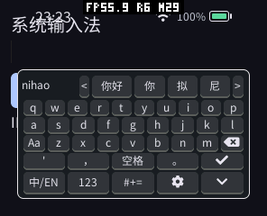
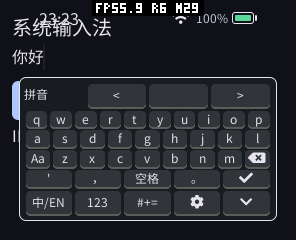
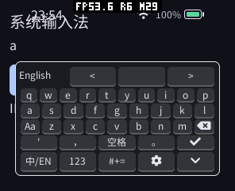
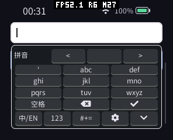

# 可安装输入法：实现与验证（2026-10-11 至 12）

本次实现独立 C++26 拼音 Provider、可选 SDK/协议及 Host 注册、选择、焦点、编辑与生命周期。参考固定版本 `VanillaNahida/lvgl_pinyin_ime` 的 libgooglepinyin 和九键分段算法，保留 Apache-2.0 许可与原始署名。布局采用系统 LVGL 控件和已有字体，Guest 不绘制第二张键盘帧缓冲。

## 紧凑布局

原先较多的工具/拼音行合并为一行候选和一行工具栏；九键拼音列表替换候选行。删除、完成、设置、收起使用图标。全键/九键切换、分词和拼音列表放进展开工具栏，展开不增加高度。功能没有因紧凑布局删减。

pai-touch 的 296×240 屏幕键盘为 144 像素高（60%）；保留圆角底部间距。模拟器还覆盖 240×320、480×480/320 DPI、454 圆屏、安全边距及 390×844。大屏根据字号和行高采用更低的占屏比例，不强制填满 60%。此次没有保留同一版本旧布局的固定场景截图，不能给出精确的高度下降百分比。

输入框位于现有滚动容器时临时向上滚动避让，关闭后恢复。模拟器验证容器删除时无悬空引用。没有新增 Window 键盘遮挡 Insets ABI；缺少可滚动父容器、输入框过高时仍需要应用调整布局。

## 修复和优化

| 改动 | 原因及收益 | 内存变化与验证 |
|---|---|---|
| 直接文件描述符读取 | ESP Newlib 无缓冲 `fread` 将大块读取拆为单字节 VFS 操作，加载会触发 Guest/任务 watchdog；改为 `read/lseek` 直读最终解码表 | 不引入读缓存；修复前真机运行 8 秒仍未完成且触发告警，修复后完成解码启动，无同类告警 |
| 解码后关闭词典能力 | 表已加载，文件描述符及 LittleFS 缓存无需继续驻留 | 关闭后释放文件资源；故障/停止路径仍由组件清理兜底 |
| Provider 初始 19 页线性内存 | 固定词典加载完成本就需要 19 页；在按需启动时分配该容量，避免多次 `memory.grow/realloc` 临时复制 | 真实 PSRAM 加载额外峰值下降约 41%，稳定线性容量完全相同；信息页和其他应用不受此设置影响 |
| 启动确认和有界排队 | 第一帧 RESET 之前输入不能丢失或发送到旧会话 | 复用 16 个短按键队列；首次启动最多等待 10 秒，后续动作 3 秒超时回退，模拟器和真机验证提前输入 |
| 按 Component 隔离超时 | 输入法使用同一 engine，不能将它的超时算到前台应用 | 无新增队列/缓存；回归注入超时，仅终止 Provider，前台组件保持 RUNNING |
| 阻止嵌套 Guest 分发 | 选词写入 LVGL 编辑器会立即产生正文事件，桌面旧路径嵌套进入 Guest 导致前台误报 INTERNAL | 嵌套调用返回 WOULD_BLOCK 且不消费事件；在当前 Guest 返回后处理，正文提交及前台存活回归通过 |
| 数字面板字面输入、九键不完整后缀 | 数字 `7` 不应参与九键分词；完整音节加未完成下一音节应能继续输入 | 无大型缓存；数字、`ni'hao`、多音节前缀及 1000 次歧义重置通过 |
| 空闲暂停键盘定时器 | 无输入时不必继续重试轮询 | 沿用原定时器，无额外容量；背压/长按/故障回退通过 |

## 真机性能和内存

使用 pai-touch，序列号 `a4:cb:8f:d6:8d:a4`。本次枚举端口为 `/dev/ttyACM1`，与请求中的 `/dev/ttyACM2` 不同；通过 HELLO 确认设备身份。仅更新应用固件分区，保留 bootloader、分区表、文件系统。

以下是相同词典、分辨率和系统输入示例的观测。旧/新均使用直接文件读取，区别为 Provider 从 2 页按需增长至 19 页，或以 19 页启动。监测区间用 `MEMORY START/STOP` 重置本次局部低水位；截图在 STOP 之后，不把截图分配算进加载峰值。系统 UI/字体已有缓存导致区间基线相差约 14 KB，不能把其差异算作 Provider 收益。

| 物理内存观测（字节） | 增长至 19 页 | 以 19 页启动 |
|---|---:|---:|
| 区间开始 PSRAM 占用 | 1,804,972 | 1,790,576 |
| 加载后 PSRAM 稳定占用 | 3,492,280 | 3,491,800 |
| 本次 PSRAM 实际峰值 | 4,709,176 | 3,499,136 |
| 相对区间开始的额外峰值 | 2,904,204 | 1,708,560 |
| 加载后 SRAM 稳定占用 | 265,792 | 265,788 |
| 本次 SRAM 实际峰值 | 269,928 | 269,924 |

额外 PSRAM 峰值下降 1,195,644 字节（41.2%）。稳定占用在观测误差范围保持相同；两种构建在模拟器中的线性容量均精确相等。参考词典增加约 1.7 MB 真机稳定占用，不能声称与内置简易输入法内存相同；该占用只在输入时出现。

模拟器独立 engine 的计数如下（AOT，包含前台输入示例）：

| 计数 | 关闭键盘 | 打开键盘 | 再关闭 |
|---|---:|---:|---:|
| Guest 线性容量 | 131,072 | 1,376,256 | 131,072 |
| WAMR allocator 当前字节 | 32,235 | 88,915 | 32,235 |
| AOT artifact 临时缓冲 | 0 | 0 | 0 |

Provider 线性增量为 1,245,184 字节（19 页）。上限 4 MiB，`pinned=false`；上限没有固定预分配。ESP AOT 代码映射为 327,680 字节，Host Provider 元数据 2,835 字节；桌面元数据 3,727 字节。Wasm 解释器会保留 Wasm artifact，实测约 132 KB，关闭后归零。桌面 WAMR allocator 不包含 mmap 线性内存，ESP 的两者会重叠，不能直接相加当成物理 RAM。无新增帧缓冲/深度缓冲，Host 命令槽位仍通过原 144 字节边界检查。

真机完整验证加启动约 3.0–3.3 秒，其中一例代码映射后约 0.67 秒结束初始化；剩余包含包签名和完整清单校验。此延迟仍是当前限制，每次关闭都会释放词典并在下次重新校验加载。本轮没有用常驻缓存掩盖该延迟。

混合中文/英文/长按删除的 30 次动作观测：入队到发送平均约 47.8 ms，发送到 PRESENT 平均约 9.6 ms；本组最大分别约 80.1/63.5 ms。最后构建的单次英文提前输入观测为 5.121/0.607 ms。它们是不同工作负载，不能将单次英文值当作中文输入延迟的改进。计数不包含物理触摸采样、LVGL 绘制和 LCD 扫描，不是触摸到显示的完整延迟；界面提交 FPS 也不能据此算成输入法吞吐率。

真机重复 3 次开启/关闭后 PSRAM 返回相同关闭水平，没有逐次增长。前台停止时卸载 Provider；模拟器另覆盖密码隔离、焦点/光标变化、外部正文改写、页面删除、故障恢复和多轮加载/释放。

## 验证与复现

完整模拟器 CTest 90/90 通过，最后补充的输入法/engine 专项 6/6 通过；C++ SDK 原生测试全部通过。签名 AOT 和仅 Wasm 包分别通过相同五种显示配置，覆盖真实 LVGL 点击/长按、中文词句、英文、数字、确认、背压重试、提前输入、容器避让、超时隔离、字典损坏/缺失回退及重复释放。

构建命令、词典重建及集成测试入口见 [README](../../README.zh-CN.md)。模拟器和真机原始计数、截图及测试日志放在 [20261011](20261011/)。设备通过有时长的 POINTER DOWN/UP 注入点击，避免零时长 TAP 在 LVGL 采样间隔中未被识别；这仍不是物理触摸测试。

设备空间不足时，先下载并核对原有两个游戏及私有数据，再使用 `PACKAGE archive` 保留授权、启用策略和存档。测试结束已恢复内置输入法选择，移除临时测试包，重新安装原签名游戏；全部 93 个原应用及私有数据文件的大小与 SHA256 校验通过，原有 5 个应用保持启用且未运行，文件系统已重新锁定。原生新建文件夹编辑测试在保存前取消，没有创建临时文件。恢复证据见 [device-restored.json](20261011/device-restored.json) 和 [device-restore.log](20261011/device-restore.log)；备份中的用户存档不放进仓库。

## 明确的限制

- 未实现用户词频持久化、双拼、模糊音、云候选和手写；引擎候选限 BMP。
- 桌面没有前台 PXA Runner 的原生系统页面仍使用内置输入法；ESP 原生页面使用按需输入法 runtime。
- 首次及重新打开需要完整校验和加载；约 3 秒延迟仍有优化空间。
- 九键搜索有工作量和结果窗口上限，不保证所有罕见分段都进入前 32 个拼音。
- 没有验证物理触摸到像素的延迟、长期输入词频学习或所有未来小于 240 像素的屏幕。
