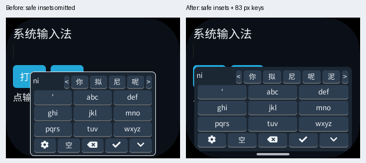
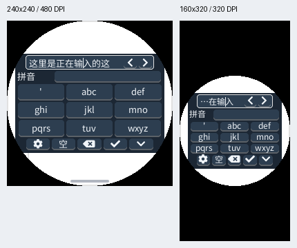
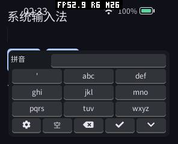
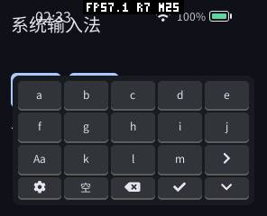
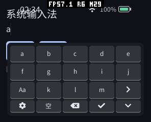

# 输入法自适应、屏幕利用与快速打开验证（2026-10-12）

本轮在可安装 C++26 Provider 的既有实现上改进 Host 键盘，不改 Guest IME 0.1 协议、词库及普通应用接口。首先解决当前输入行被遮挡，再利用圆形/圆角屏各行的可用宽度，最后把首次显示与词库就绪分开。测试包是普通 C++ SDK `system-input` 示例，业务应用无需新增键盘布局代码。

首次绘制门控已经实现；真实设备可以在词库加载期间切换英文并看到正文。冷字体缓存的一例首次绘制为 **272 ms**，三次暖字体缓存重新打开为 **28、28、26 ms**；对应候选就绪为 **3350 ms** 和 **2914、2904、2914 ms**。这是焦点到 LVGL 首次绘制的时间，不包括 LCD 扫描，不能称为物理触摸到像素的延迟。此前没有测量旧实现的首次绘制，因此不提供虚假的打开速度提升倍数。

## 布局及操作

字母和九键主键区改成三行，空格、删除、确认和收起复用工具栏。宽屏工具栏保留中英、数字、符号入口；窄屏使用五个较大的按钮，其余操作放入两行设置页，替换主键区。窄屏英文/全键使用两页字母并保留大小写、分词和所有字母；数字/符号使用四行。高 DPI 极小屏优先九键，必要时按需建立一个较小的大陆黑体 face，不建立新的字形图集。

圆角屏的底部最窄截面不再决定整个键盘宽度。圆形与圆角屏逐行计算弦宽或四个圆角的实际边界，各行按键及真实点击区域一起扩大。键盘背景覆盖按钮间隙，设备形状遮罩裁去不可见的背景；可交互控件的角点仍在安全区内。模拟器 296×240、160 DPI、58 px 圆角及安全边距场景，旧九键实绘宽约 64–65 px，新按键为 83 px；旧截图同时暴露了模拟器遗漏安全边距传递的问题；最终修复后，在真实生效的左右 10 px 边距下仍有 83 px 按键。后者由真实 LVGL button area 记录，不是给按钮做视觉拉伸。其他轮廓下各行宽度可以不同，见每个 profile 的 key-rows JSON。





编辑器已有滚动空间时优先露出原光标所在行，关闭恢复原滚动位置。底部固定、浮动或高大的多行输入框使用键盘顶部的当前行辅助区，点击文字或左右箭头直接改变原编辑器光标；插入、删除、程序移动光标都保持同步。辅助区只保存光标附近至多 257 字节、63 个码点，不复制全文或建立第二套正文。密码只能显示掩码，不发送给 Provider。辅助区保持到本次关闭，避免显隐与滚动互相反馈。

极小屏的物理面积不能同时容纳标准 44 dp 触摸目标、全部按键及正文。此实现优先保证完整功能、可见当前行和形状安全，允许键盘超过通常的 60% 高度预算；160 px 等极端配置通过了边界和输入检查，但不承诺与正常尺寸屏幕同等的操作舒适度。也没有通过调整应用整个页面尺寸来强行避让。

## 采用原因、收益及代价

| 改动 | 原因与收益 | 内存与验证 |
|---|---|---|
| 逐行轮廓键区 | 整体最窄宽度浪费中部左右空间；扩大实际按钮和触摸区域 | 圆形/圆角屏按需使用至多四个行矩阵；普通矩形仍用一个矩阵。13 配置检查实际控件边界及真实点击 |
| 候选与拼音复用控件、共享按键样式 | 两个列表不会同时显示；独立复制样式浪费空间 | 删除重复列表控件，按键共享三个样式；包含大小写、两页字母及四行数字/符号验证 |
| 候选指针表按实际回复长度分配 | 空 RESET 不需要最大候选、拼音及拼音映射容量 | 指针表与已有回复文本共用一次分配；翻页历史首次翻页才分配，保留原 32 层上限。不在绘制时分配 |
| 当前行辅助区按需创建 | 固定或高编辑器不能靠整框滚动避让 | 一个有界窗口，按需创建控件和文本缓冲，关闭/destroy 恢复和释放；容器/目标删除、光标与密码检查通过 |
| 字号约束与字体复用 | DPI 所需字体可能高于小屏可用空间 | 最多一个可选小字体 face，按真实 line height 选择；修复相同主题更新重复重建问题 |
| 首次绘制后再加载 Provider | 加载、完整清单及签名验证会争抢首帧资源 | ESP 在 runtime owner 执行，期间不持有 LVGL 锁；首帧、加载、RESET 分开统计，不以常驻词库掩盖耗时 |
| 英文本地编辑、中文有界排队 | 英文不需要词库，不应等待词库加载 | 英文不跨 Guest；提前中文保留在原 16 项队列，数字/符号不越过更早的中文输入。背压、丢弃旧回复及超时回退通过 |
| 模拟器传递安全边距 | Host 服务知道边距，键盘配置却遗漏复制，原测试未检验参数一致 | 补上复制并断言 Host/IME 环境一致；重新完成 13 配置 AOT/Wasm 与回归 |
| 父容器坐标修正 | 父容器内边距会让屏幕安全坐标整体偏移 | 以实际 display 坐标纠正，不新增缓存；13 配置增加带 padding 的父容器测试 |

## 真机数据及内存

实际设备是 pai-touch，USB 标识 `a4:cb:8f:d6:8d:a4`，本机枚举为 `/dev/ttyACM1`（请求中的 ACM2 当前不存在），296×240。只更新应用分区，保留分区表、文件系统和用户数据。包/固件 SHA256 与大小见 [artifacts.json](20261012-adaptive/artifacts.json)。原始数据见 [device-memory.json](20261012-adaptive/device-memory.json)，测量由仓库内的设备脚本产生，`passed=true`。

对比对象是本轮逐行扩大前的自适应实现和最终实现，使用同一 system-input/Provider 包，相同操作顺序；不是游戏 FPS 测试。SRAM/PSRAM 是全机统计，包含日志、文件系统、驱动和字体缓存等并发活动。

| 指标（字节） | 扩大前 | 最终 |
|---|---:|---:|
| 首次打开前 PSRAM 使用 | 1,835,500 | 1,833,704 |
| 首次候选就绪 PSRAM 使用 | 3,532,468 | 3,529,760 |
| 首次打开本次 PSRAM 峰值 | 3,540,180 | 3,535,980 |
| 三轮重新打开 PSRAM 稳定使用 | 3,541,920–3,541,980 | 3,539,976–3,539,984 |
| 三轮本次 PSRAM 峰值 | 3,548,228 | 3,546,268 |
| 三轮关闭后 PSRAM 使用 | 1,855,064 | 1,853,648 |
| 首次候选就绪 SRAM 使用 | 265,828 | 265,808 |
| 首次打开本次 SRAM 峰值 | 269,928 | 269,944 |
| 三轮本次 SRAM 峰值 | 269,928 | 269,996 |

截图在 `MEMORY START/STOP` 窗口之外，避免把 JPEG/捕获缓冲计作输入法峰值。启动前历史 `sram_min/psram_min` 与局部峰值分开保存：全程截图造成的历史最低空闲远低于这两个局部窗口，不能拿来比较 IME。首次初始化与暖启动也分开；暖启动指字体等系统缓存已热，词库每轮仍重新验证加载。

扩大后稳定 PSRAM 和本次峰值均较对照低约 1–4 KiB，三次关闭后的读数相同，Guest 释放正确。SRAM 的最终峰值多了 **16/68 字节**，尚不能严格归因于 IME；本轮不宣称所有全机 SRAM 峰值都绝对不增长。应继续用更多轮无截图、相同并发条件的测量判断这一微小差异。按需辅助控件/小字体在实际需要时仍有自身成本，也不宣称所有形状的 Host widget 内存完全相同。

| 独立资源 | 结果 |
|---|---|
| Guest 线性内存（模拟器） | 前台 131,072 B；加载 Provider 后合计 1,376,256 B；关闭恢复 131,072 B，13 配置一致；与之前实现相同 |
| 桌面 AOT WAMR allocator | 32,235 → 88,915 → 32,235 B；每个 profile 的实测运行峰值 111,701 B，不含 mmap 线性内存 |
| Wasm WAMR allocator | 32,235 → 435,313 → 32,235 B；运行峰值 452,113 B，artifact buffer 131,966 B，关闭归零 |
| 代码映射 | 桌面 AOT artifact buffer 为 0（直接映射）；设备 Provider AOT 文件 317,408 B，文件长度不是 RAM 占用 |
| 帧/深度/额外绘制缓存 | 无新增键盘帧缓冲、深度缓冲或字形图集；本次无 Surface 的 fixture 中 frame/scratch/mailbox/probe 都为 0 |
| 输入与事件队列 | 原 16 项 UI 输入队列，Provider event buffer 192 B；无新增无限排队或 Host 命令槽位 |

ESP 上线性内存/WAMR 分配与 PSRAM 统计存在包含关系，不能相加。字体缓存、包验证及 UI widget 的开销归入全机数据；本次峰值与历史峰值没有混用。

首次 Provider 校验/加载一例 **2,884,912 µs**；候选就绪 **3350 ms** 包含首次绘制、加载、初始化、调度及 RESET。它仍约需三秒，不能将键盘提前显示描述为词库已经加载完毕。K9 五次输入的平均 Host 入队排队约 **20.47 ms**、发送到 PRESENT 约 **30.84 ms**，最大 **26.72/71.03 ms**；与对照的字形缓存和候选窗口宽度不同，不能据此宣称解码提速。英文现在不计为 Provider 请求，中文/英文计数不可直接混比。







## 验证与复现

最终源代码：13 种配置分别通过真实签名 AOT 和纯 Wasm Provider，覆盖候选/拼音分页、中文提交、字母两页、数字/符号、英文、实际 LVGL 点击及长按删除、光标移动、固定多行编辑器、滚动恢复、父容器删除、密码掩码、背压及旧回复、Provider 故障与超时隔离、8 轮重复开关。损坏/缺失词典的回退也通过同一矩阵。完整回归 **90/90** 通过，最后相关回归 **9/9** 通过；逐配置图片和 Guest 内存见 [原始资料](20261012-adaptive/)。

| Profile | 分辨率 / DPI | 形状与约束 |
|---|---|---|
| 0 | 240×320 / 160 | 矩形 |
| 1 | 480×480 / 320 | 48 px 圆角 |
| 2 | 454×454 / 160 | 圆形、24 px 安全边距 |
| 3 | 390×844 / 160 | 竖屏矩形 |
| 4 | 296×240 / 160 | 58 px 圆角，上下 8 px、左右 10 px 边距 |
| 5 | 160×160 / 160 | 40 px 圆角、4 px 边距 |
| 6 | 240×240 / 480 | 圆形、4 px 边距 |
| 7 | 320×180 / 320 | 横屏、20 px 圆角、4 px 边距 |
| 8 | 1280×800 / 160 | 大屏、8 px 边距 |
| 9 | 720×720 / 480 | 圆形、16 px 边距 |
| 10 | 320×320 / 640 | 80 px 圆角、8 px 边距 |
| 11 | 800×480 / 240 | TL/TR/BR/BL = 0/96/56/4 px、8 px 边距 |
| 12 | 160×320 / 320 | 非正方形逻辑显示上的圆形可见区、4 px 边距 |

在 pxa-projects 根目录构建和运行：

```sh
cmake --build build/simulator/pai-touch -j 8
ctest --test-dir build/simulator/pai-touch --output-on-failure -j 4
bash deps/pxa-system/tools/package/test_cpp_ime_app.sh \
  build/simulator/pai-touch/pxsys_ime_test \
  local/app-output/pai-touch/pxa-pinyin-ime \
  local/pxa-apps/.dev-signing/publisher-private.pem
```

纯 Wasm 使用相同签名输入应用及只有 Wasm artifact 的 Provider 包传给 `pxsys_ime_test`；最后两个参数是独立 state 与截图输出目录。词库、签名和 AOT 构建方式见 [README](../../README.zh-CN.md)。

设备上先安装 `pinyin-ime` 和 SDK `system-input` 示例并选择该输入法。要测冷字体缓存，应先重启并等待 UI 初始化；端口根据 USB 标识确认：

```sh
python3 local/pxa-apps/pinyin-ime/tests/measure_pai_touch.py \
  --port /dev/ttyACM1 --output /tmp/ime-benchmark
```

脚本明确针对 296×240 pai-touch，校验尺寸和输入法选择，等待前台启动，使用有时长的 DOWN/UP，输出原始数据及截图，并停止测试前台、恢复局部内存统计。它不会安装、删除包或修改输入法选择。截图仍需人工检查；ACK 不表示 LCD 已完成显示，不能用于端到端延迟结论。

本轮验证结束恢复原内置输入法选择、移除两份临时测试包并恢复原 Voxel Craft 包；原有五个应用、启用策略及用户存档保留。93 个原文件的 SHA256/大小检查和最终应用列表见 [device-restored.json](20261012-adaptive/device-restored.json)。用户存档内容不放入仓库。临时 UI 操作没有保存文件或修改亮度、音量、语言和自动锁定设置。

桌面产品 Runner 与 UI 共用线程，支持先绘制但不承诺加载期间和 ESP 一样并发处理触摸；无 PXA Runner 的桌面原生系统页面仍使用内置输入法。ESP 原生编辑器的按需 runtime 首次绘制门控已改进，但本轮原生文件对话框导航未得到有效验证截图，不能把前台 fixture 的结果当作原生页面完整复测。未做物理触摸到 LCD 的高速摄影测量，也没有实现用户词频学习、双拼、模糊音、云候选或手写。
