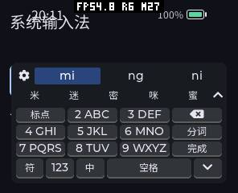
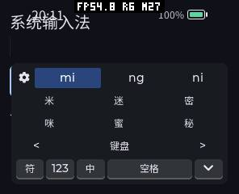
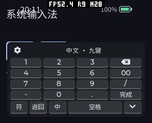
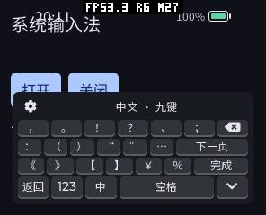
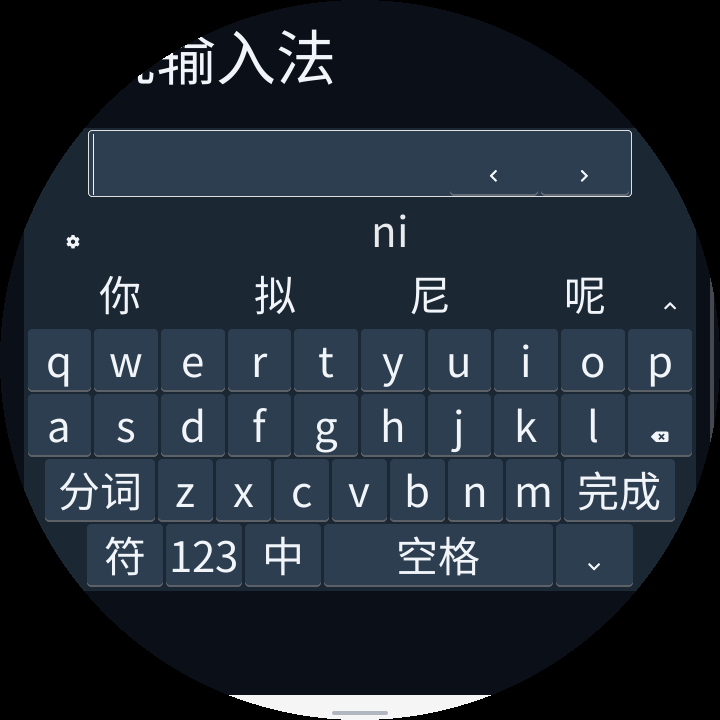
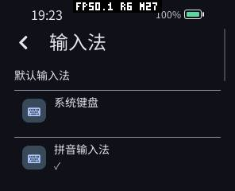

# 手机式输入法：布局、真机与内存验证（2026-10-12）

完成手机式九键、完整 QWERTY、数字/符号面板、固定底栏和可展开候选。普通应用仍使用 C++ `ui::TextInput`，没有新增 Guest ABI。输入法设置为独立系统页面，保存默认输入法、布局和语言。

## 操作与布局

- 九键三行四列：标点/ABC/DEF/删除，GHI/JKL/MNO/分词，PQRS/TUV/WXYZ/回车。长按字母组直接输入数字；数字面板提供完整 0–9、00、小数点、负号和斜杠。
- 底栏固定符号、123、当前语言、宽空格、收起；当前数字/符号入口变成返回。每个面板只有一个删除、回车和收起。符号两页，常用入口不藏进设置。
- 全键在所有尺寸保留 26 字母。中文有分词，英文单次 Shift 大写、快速双击锁定、再按恢复。双字功能键及三字符翻页键加宽，并检查文字实际宽度。极窄屏保留完整全键，但九键更易操作。
- 空闲时一行轻提示；组合时上排拼音、下排汉字，同时显示并分别左右滑动。选中读音突出且不重复显示；展开候选替换主键区，点“键盘”恢复原组合。
- 空格确认首候选或插入空格，长按左右拖动移动原光标；删除支持长按重复。回车先确认组合，再完成单行输入或给多行换行；收起不提交表单。
- 切换语言或布局先处理排队输入及所有剩余组合。九键分词锁定完整读音；半句提交后恢复剩余九键状态，避免下一按键丢失尾句。密码强制英文全键，不加载中文 Provider。









圆形/圆角逐行计算物理安全宽度，左右边缘空间用于加宽行内按键。候选栏出现前后主键区位置固定。优先滚动原编辑器使光标当前行可见；无法滚动时增加按需当前行辅助区，仍修改原光标，不复制整份文本，密码始终遮蔽。通常键盘不超过屏高 60%，极小屏为完整按键和当前行可适当提高占比。



这里截图顶部原 fixture 标题未为圆屏排版；键盘及当前行辅助区有独立轮廓检查，不能把 fixture 标题当成键盘安全区验收对象。

## 实现与代价

| 原因与实现 | 收益 | 内存变化与验证 |
|---|---|---|
| 静态不可变按键表共用于矩形/轮廓行，压缩 UI 线程私有标志 | 完整键盘无需字母翻页或每实例复制指针 | 去掉原实例键表；无新线程；13 配置 AOT/Wasm |
| 空 RESET 不分配最大候选指针表；实际回复按候选/读音数量分配 | 少用空闲及短回复内存；展开复用同一个 matrix | 有界候选、分页历史；背压、旧回复、同名候选、末页回归 |
| 复用固件已编译的拉丁抗锯齿字体；12 px 固定标签使用 39 个大陆黑体 A8 字形 | 减少首次绘制的 FreeType 字形准备 | 5532 B 只读像素；无运行时字形图集；源字体 OFL、再生成逐字节一致 |
| 分词复用九键工作区，按剩余读音恢复解码状态 | 避免半句提交后错字、尾句丢失与文字重排 | 仅增加一个前缀长度字段；固定容量；原生及随机输入检查 |
| 英文/密码 Host 直接编辑；中文释放后再构造英文键表，中文分步加载 | 键盘可先显示；无常驻词库；前台可在验证步骤间运行 | 生命周期历史对照见 [独立报告](20261012-lifecycle.zh-CN.md)；真机取消/切换/重复释放 |

大陆黑体标签由 factory 的 PXA Sans SC 生成，A8 保留抗锯齿；大字号及普通候选继续使用设备现有 Noto Sans SC。已读取设备 name 表确认 SC 字体，设备文件与 factory 字体为不同子集/衍生文件，不声称两者逐字节相同，也没有替换原设备字体；摘要见 [device-fonts.json](20261012-phone-keyboard/device-fonts.json)。没有新帧缓冲、深度缓冲、加载线程或默认大缓存。普通输入还是 Host LVGL 绘制，Provider 只解码。

## 最终受控真机配对

pai-touch 296×240、160 DPI，序列号 A4:CB:8F:D6:8D:A4，当前端口 /dev/ttyACM1。两份固件共享冻结的稳定触摸代码（4e6b59f），仅修改键盘适配器及其卸载确认调用；不混入共享目录的并行音频等改动。相同五包、相同最终 Provider/词库、重新启动、Wi-Fi 关闭、相同数字字体预热。九键输入 64426，首候选提交后英文输入 abc。固件与包的长度/SHA-256 在 [before.json](20261012-phone-keyboard/before.json) / [after.json](20261012-phone-keyboard/after.json)，[配对摘要](20261012-phone-keyboard/comparison.json) 给出条件。

| 指标 | 原键盘 | 手机式键盘 |
|---|---:|---:|
| 冷打开，首次 LVGL 绘制事件 | 184 ms | 32 ms |
| 三次重开，首次绘制事件 | 40 / 40 / 42 ms | 42 / 42 / 44 ms |
| 冷打开，中文候选就绪 | 2576 ms | 2260 ms |
| 三次重开，候选就绪中位数 | 2298 ms | 2278 ms |
| 五键平均入队→发送 | 29.71 ms | 25.14 ms |
| 五键平均发送→PRESENT | 27.52 ms | 25.07 ms |
| 各窗口最大 SRAM 占用 | 269,816 B | 269,816 B |
| 各窗口最大 PSRAM 占用 | 3,524,328 B | 3,514,868 B |

绘制计时来自 LVGL tick；0 ms 表示在同一个 tick 内收到绘制事件，不能解释为物理零延迟。它没有测 LCD 刷新完成；不能把单轮冷打开差异、五次输入或 heartbeat 当成稳定 FPS/触摸到显示收益。手机布局的主要收益是操作一致和先显示键盘，词库完整候选等待仍约 2.3 s。英文切换 heartbeat 最大间隔本次 54.49→82.77 ms；释放确认减少重叠峰值，但没有证明这个切换动作更快。

## 内存口径

局部 `MEMORY START/STOP` 捕获窗口内已释放的瞬时分配；截图在窗口之外。下表每格依次为 **SRAM 稳定 / 本次峰值 / PSRAM 稳定 / 本次峰值**，单位 B。监测窗口外 MEMORY 返回的开机历史峰值不纳入本次验收。

| 窗口 | 原键盘 | 手机式键盘 |
|---|---|---|
| 第一次中文就绪 | 265,628 / 269,728 / 3,502,864 / 3,507,668 | 265,628 / 269,728 / 3,497,424 / 3,507,936 |
| 三次重开后关闭 | 264,868 / 269,816 / 1,826,288 / 3,517,136 | 264,876 / 269,816 / 1,817,988 / 3,514,440 |
| heartbeat 中文加载 | 265,628 / 269,816 / 3,512,544 / 3,517,616 | 265,628 / 269,728 / 3,504,284 / 3,514,868 |
| 切换英文 | 264,868 / 265,716 / 1,830,672 / 3,524,328 | 264,876 / 265,628 / 1,822,660 / 3,507,280 |

冷中文窗口 PSRAM 峰值变化 +268 B；关闭后 SRAM 稳定占用变化 +8 B。这些子阶段并非全部下降；不把全窗口最大值下降说成每项都零增长，也不把个位数 SRAM 差异归因于未追踪的缓存。中文关闭后 PSRAM 稳定占用下降，Guest/词库释放。

模拟器前台 Guest 线性内存 131072 B，中文加载合计 1376256 B，关闭恢复 131072 B；Provider event buffer 192 B。AOT artifact buffer 为 0，Wasm 为 134435 B、关闭归零。AOT WAMR 32235→89189→32235 B，运行峰值 112639 B；Wasm 32235→443516→32235 B，峰值 460316 B。它们不包含全部 LVGL/字体占用，不能和全机 PSRAM 重复相加。前后真机使用同一包，Guest 内存/代码工作负载一致；相对更早版本增加了分词尾句恢复功能，不能声称 Guest 二进制与所有历史版本大小不变。

无 Surface 的 fixture 中 frame/scratch/mailbox/probe 均为 0；产品原显示缓冲保持原配置，不是 0。固件 Flash 文件 3,375,072→3,388,656 B，增加 13,584 B；这是代码/只读标签大小，不是同等 SRAM 增长。未额外分配 IME 帧缓冲或 Z-buffer。

## 验证、恢复与复现

AOT/Wasm 各 13 屏幕配置通过，包含 160×160、296×240、480 DPI 圆屏、640 DPI 圆角屏、大屏和不对称安全区。测试检查完整字母、功能键唯一、标签宽度、实际触摸/长按/拖动、稳定键位、当前行可见及关闭滚动恢复。覆盖候选/读音分页、分词/尾句、单行/多行回车、密码隔离、队列/旧回复、预算、取消/删除目标和八次释放。

最终 91 项系统回归通过；最后相关原生 5 项通过。六类坏包（同长度损坏词库、签名、缺词库、额外未签名文件、软链接、外部硬链接）再次验证回退。T9 原生测试含 1000 次随机按键序列。记录见 [checks.json](20261012-phone-keyboard/checks.json)。

最终固件真机八次加载/关闭、加载中切换前台、加载中停止后重启通过，中文选择/提交、候选滑动、数字、符号、展开截图人工复核：[device-verification.json](20261012-phone-keyboard/device-verification.json)。设置独立页面、英文偏好重启持久化且不加载 Provider 已实测；全键/九键偏好持久化另由模拟器覆盖，未把误点的真机布局操作算成通过。



恢复 93 个原文件、27 个版本匹配历史包文件并逐个校验大小/SHA-256；保留 6 个新增应用/私有数据文件。原有六个应用保留。三项临时 fixture 和测试 Provider 已卸载，前台为空。设备无法同时容纳原包、词库及安装暂存；验证过的最终安装包已保存到 `local/app-output/pai-touch/phone-keyboard/pxa-pinyin-ime.pxa`，没有为保留它而删除原应用。恢复 builtin 选择、自动布局/中文偏好、原 Wi-Fi 启用状态。三次重新启动通过，公开恢复摘要为 [device-restoration.json](20261012-phone-keyboard/device-restoration.json)。私有存档、网络标识和原始启动日志留在 Git 忽略目录。

```sh
bash local/pxa-apps/pinyin-ime/tests/run_t9.sh
cmake --build build/simulator/pai-touch -j8
bash deps/pxa-system/tools/package/test_cpp_ime_app.sh \
  build/simulator/pai-touch/pxsys_ime_test \
  /path/to/signed/pxa-pinyin-ime /path/to/publisher-private.pem
python3 local/pxa-apps/pinyin-ime/tests/measure_pai_touch.py \
  --port /dev/ttyACM1 --two-row --phone-layout --output /tmp/ime-phone
python3 local/pxa-apps/pinyin-ime/tests/measure_lifecycle.py \
  --port /dev/ttyACM1 --phone-layout --output /tmp/ime-phone-lifecycle
python3 local/pxa-apps/pinyin-ime/tests/verify_pai_touch.py \
  --port /dev/ttyACM1 --phone-layout --output /tmp/ime-phone-verify
```

设备脚本要求同版本 Provider 和对应 fixture、前台空闲，先按 HELLO 序列号确认设备。原键盘基线用相同 Provider、取消 --phone-layout 并保留 --two-row；[适配器补丁](20261012-phone-keyboard/adapter-change.patch) 可在独立检出反向应用恢复原键盘，[源码摘要](20261012-phone-keyboard/adapter-sources.json) 核验输入。只刷应用分区，保留分区表/NVS/应用数据。

剩余限制：加载最终同步激活仍有约 0.7–0.8 s 前台间隔；没有物理触摸到 LCD 的测量。内置故障回退键盘保留原有布局，本次手机布局用于已选择 PXA Provider 的 Host 适配器。用户词频持久化、模糊音、双拼、云候选和手写未实现；极小屏完整 QWERTY 的触点仍较窄，建议九键。
