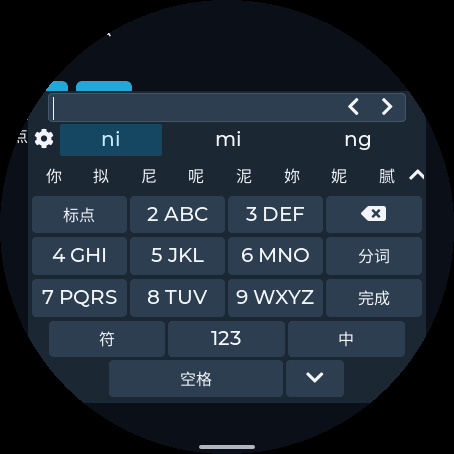
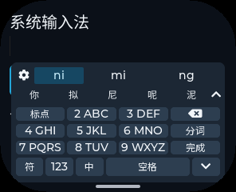

# 两版拼音 Provider 优化与验证（2026-10-15）

本轮优化 `pinyin-ime` 与 `pinyin-ime-lite` 的 Guest 引擎和共享会话。两版仍共用系统键盘；上一轮无边框导航、系统配色、减少重复布局与刷新等 Host 改进也适用于两版，不在这里重复计算收益。没有新增 UI 图层、线程、帧缓冲或运行时索引缓存。

受控原生 O3 测试中，九键一轮操作的 CPU 时间下降 **64.2% / 93.6%**（完整版 / 轻量版）。模拟器 AOT 和 Wasm 的 13 种屏幕配置中，所有记录的内存分项均不增长。修复了完整版长串输入的池越界、超长拼音尾段丢失及重开泄漏。**这不是 ESP32 的按键到显示延迟或 FPS 测量，本轮没有安装或烧录设备。**

## 实现与取舍

| 原因 | 实现与收益 | 内存变化 | 验证 |
| --- | --- | --- | --- |
| T9 每个分段扫描全部 413 个音节，重复计算字符串长度 | 生成 72 个一/二位前缀范围，直接跳过无关行；剩余最多三位从音节拼写映射；候选排序和 DFS 预算不变 | 单份无指针音节表 2,891 B、只读目录 288 B、字母映射 27 B，共 3,206 B 数据载荷；不建立堆索引 | 所有音节前缀与容量 1/6/32 对照线性参考；32,736 个前后状态比较 |
| DFS 每层复制完整累计拼音 | 一份回溯缓冲区，传递长度，以有界复制输出；被拒绝的新增数字保留原选中读音 | 递归不再各自持有完整字符串；保留 24 位输入、32 结果、每遍 256 节点上限 | 完整/部分分词、锁定读音、删除、恢复及随机操作 |
| 轻量版重复 lower_bound，取远页候选时再次扫描音节 | 复用查找结果，二分定位连续前缀范围；通过只读字表偏移直接取候选 | 引擎 74 → 72 B；桌面会话 2,192 → 2,184 B；19,504 B 字表不变，无查询堆分配 | 全部 7,292 个读音及其前缀、6,749 个不同汉字、别名和 10,000 个压力输入 |
| 完整版会话允许 64 字节，但底层解码窗口仅 39 字节 | 引擎报告已消费字节数，会话保留原始尾段；窗口切在音节内部时退回完整音节边界；选字直接追加提交输出 | 不增加默认缓存；尾串按实际长度分配，交换后先释放旧容量，再增长输出，避免分配峰值上涨 | 56 字节 `ni'hao'` 连续八组全部提交 16 个汉字；无进度时原文回退并重置 |
| 原生 ASan 发现长串声母耗尽里程碑/解析标记池后越界 | 只计入实际存储的标记；容量耗尽及时停止；清掉缺失前驱的候选；拒绝越界候选索引 | 保持原池容量，不用扩池掩盖错误；UTF-16 候选栈数组 256 → 65 个单元 | 64 个 `n` 原版崩溃，新版通过；1,000 个随机解码搜索；ASan/UBSan |
| 字典索引释放错指针，单例重建覆盖旧树，析构使用错误 delete | 修复 `lma_idx_buf_`、旧拼写树及标量哨兵的所有权；单例析构不再递归删除自己 | 修复每次原生模型重开泄漏的 195,333 B 索引和旧树；Guest 卸载仍释放整份线性内存 | close/open、显式析构/重建、LSan；产品测试每配置额外 8 次卸载重启 |
| 只读 Provider 仍创建 UserDict，空路径打开失败后丢弃，却带入虚表相关代码 | 本 Provider 定义 `PINYINIME_SYSTEM_DICT_ONLY`，不创建无效用户词典；非空路径明确拒绝；底层库保留通用构建路径 | Wasm 和 AOT 的代码/元数据下降；不删已支持功能，用户词频持久化原本就未实现 | 普通候选回复前后哈希一致；原生拒绝不支持的持久化请求；两种 VM 模式完整产品回归 |

构建保持 **O3 / C++26**。曾尝试打包数字键与循环内联，但 WAMR 解码指令的存储反而增长，因此最终选择简单的只读范围目录。只对短小共享扫描循环抑制展开/内联，避免解释器重复保存相同逻辑；没有降为 Oz/Os。动态字符串仍按实际编辑文本长度使用，并非禁止动态分配。

## 可比较的 CPU 基线

应用基线为 pxa-apps `dde2a710b714d5f7998b134840e6b452c473f539`，通过 `git archive` 独立导出，两版均使用同一工作区 SDK 和同一个测试程序。SDK 提交为 `ae2376016ec632c6fd183b16c7d4dcb01ee3477a`，带已有本地修改；这不是跨 SDK 发行版的对比。模拟器可执行文件、运行源码及包资产的 SHA256 见 [checks.json](20261015-provider-optimization/checks.json)。完整版模型 SHA256 仍为 `179311c55ab9b912a07ef040e5a95af97e704e2248b7b97735f17a3e05d13b67`。

Linux x86-64，Clang 23.1.1 / GCC 16.2.1。固定在同一允许 CPU（本次 CPU 0），前后交错运行，9 份样本、每份 500 轮，取中位数。计时使用进程 CPU 时钟，包含会话、候选编码及完整回复哈希校验，传输为同步测试桩，不包含 Host 排队、UI、显示和串口。内存跟踪与 sanitizer 分开运行，不用插桩时间作性能数据。

单位为 **μs/整轮**，不能解读为单次按键延迟，也不能把完整版与逐字轻量版作为同一语言/工作负载比较。

| 工作负载 | 完整版：之前 → 之后 | 轻量版：之前 → 之后 |
| --- | ---: | ---: |
| 全键六组词句、逐键输入、选词、标点 | 2,277.992 → 2,176.847（−4.4%） | 30.215 → 26.318（−12.9%） |
| 九键五组数字串、选读音、分词、删除、确认和标点 | 1,332.472 → 477.633（−64.2%） | 822.815 → 52.642（−93.6%） |
| `sh` 前缀分页至 10,000、`shi` 选字 | 132.473 → 131.298（约持平） | 3.639 → 3.188（−12.4%） |
| 64 个 `n`、连续尾句、标点与删除 | 原版崩溃；新版 128.578，不能计算收益率 | 47.706 → 41.142（−13.8%） |

七组可正常完成的前后工作负载，整个回复流哈希均一致；原版崩溃的长输入另做语义断言，不用不同输出计算加速比。九键另比较 1–4 位所有数字组合与 10,000 次固定种子操作，核对完整候选顺序；仅允许“拒绝数字后保留已选读音”这一明确修复的差异。

原始长采样见 [native-timing.json](20261015-provider-optimization/native-timing.json)。较短的 7×100 采样也保留在 [native-timing-short.json](20261015-provider-optimization/native-timing-short.json)；当时与其他验证并行，全键完整版有明显负载波动，不以该组较大的改善比例作为结论。小于约 1% 的变化按持平处理；没有锁系统频率，绝对时间不是设备承诺。

## 内存、代码与峰值

以下是 240×320 配置的产品模拟器快照，单位 B。每个配置新建 Host/引擎，峰值窗口覆盖本实例的初始化、全部输入与环境变化、8 次重开及最后关闭；不是系统启动以来的历史峰值。为避免只覆盖首次关闭，本轮将测试的最终快照移到所有重开之后，并用同一个更新后的测试程序重新跑基线和新版。全部 13 配置的前后数据及“不增长”检查在 [checks.json](20261015-provider-optimization/checks.json)。

| Provider / 路径 | WAMR 稳定占用：前 → 后 | 本窗口 WAMR 峰值：前 → 后 | 加载/峰值线性内存：前 → 后 | 保留代码资产缓冲：前 → 后 |
| --- | ---: | ---: | ---: | ---: |
| 完整版 / x86-64 AOT | 89,285 → 80,657 | 112,735 → 97,735 | 1,376,256 → 1,376,256 | 0 → 0 |
| 完整版 / Wasm | 443,631 → 380,145 | 460,431 → 396,945 | 1,376,256 → 1,376,256 | 134,637 → 110,453 |
| 轻量版 / x86-64 AOT | 91,730 → 85,897 | 108,530 → 102,697 | 262,144 → 262,144 | 0 → 0 |
| 轻量版 / Wasm | 217,312 → 216,795 | 234,112 → 233,595 | 262,144 → 262,144 | 80,874 → 75,190 |

四种组合关闭后，WAMR 均回到 32,235 B，线性内存回到前台应用原有 131,072 B，代码资产缓冲回到 0，事件缓冲加载时均为 192 B。WAMR 运行时分配、Guest 线性内存和资产缓冲按快照 API 分项记录；AOT 文件映射不等于“代码不占内存”。Provider 的 x86-64 AOT 文件分别从 230,244 → 191,176 B、121,888 → 112,684 B，实际物理驻留与页对齐未在本轮测量。

原生分配跟踪独立记录初始化/预热峰值与重置计数后的运行峰值，详见 [之前](20261015-provider-optimization/native-memory-before.json) / [之后](20261015-provider-optimization/native-memory-after.json)：

- 正常全键/九键/分页，完整版稳定、初始化及运行峰值均保持 1,117,239 B；轻量版均为 0 个被跟踪的堆字节，运行分配次数为 0。
- 轻量长输入运行峰值保持 386 B；结束/预热稳定保留从 17 B 降为 0。该压力场景仍有按实际字符串长度的分配，没有宣称整个会话零分配。
- 完整版长输入原版崩溃，无法建立有效内存对照；新版稳定/结束 1,117,239 B，初始化与运行峰值 1,117,498 B。不能用另一个正常工作负载的峰值证明这一项“前后下降”。
- 原生跟踪计算静态链接调用请求的分配字节，不包含共享库内部调用、分配器头部或栈；与 Guest 线性内存数据分别列示。关闭后的原生进程仍可保留库单例，LSan 用显式析构验证所有权；Guest 则由组件卸载统一回收。

本轮没有改 Host 的显示缓冲、深度缓冲、命令队列及键盘对象结构。ESP32-S3 SRAM/PSRAM、物理代码映射、显示峰值和触摸延迟未重新实测；不能把上述桌面分项当作它们的真机值，也不与 20261013 旧 SDK 报告混比。

## 正确性与画面

- 原生完整版：ASan/UBSan/LSan；真实词典；长尾完整提交、池预算耗尽、候选索引边界、1,000 次随机解码以及关闭/重开/显式析构重建。
- 原生轻量版：全字表、所有前缀与频率顺序、别名、分词、边界、消息编码及 10,000 个压力输入；ASan/UBSan。
- 每版分别运行 x86-64 AOT 与强制 Wasm 包，覆盖 13 种分辨率、160–640 DPI、圆形/圆角/矩形和安全区。包含九键/全键、中英文/数字/符号、候选与拼音滑动、展开网格、长按删除、光标、固定/多行输入、提前输入、背压、密码隔离及 8 次卸载重开。
- 每个版本/VM 组合均通过 6 类故障包：资产破坏、签名破坏、缺资产、多文件、符号链接、硬链接，验证退回内置键盘及回收内存。完整版检查词典资产，轻量版检查代码资产；没有绕过签名。
- ESP32-S3 两版 AOT+Wasm 混合包均构建成功；这只是交叉构建检查，没有真机安装或性能测量。没有修改设备设置、删除应用或覆盖用户数据。

832 张前后截图中 783 张 PNG 完全相同；剩余 49 张的像素差异为 3–306 个，位于光标、滚动条等动态区域，逐图边界见 checks.json。抽查小屏、圆角及圆屏候选与导航，没有本轮布局变化。160×160 下仍有触控目标偏小的既有限制，宜使用九键；不把功能测试通过等同于任意极小屏都舒适。




另附 [240×320 全键](20261015-provider-optimization/full-small-qwerty.png) 与 [160×160 九键](20261015-provider-optimization/lite-tiny-nine.png)。

## 复现

从 pxa-projects 根目录执行。需要 Linux、Python 3、支持 C++26 的 Clang、C 编译器及 SDK 构建依赖。脚本会创建隔离输出，不 checkout 或覆盖现有源码。

```sh
mkdir -p /tmp/pxa-ime-before
git -C local/pxa-apps archive dde2a710b714d5f7998b134840e6b452c473f539 \
  pinyin-ime pinyin-ime-lite | tar -x -C /tmp/pxa-ime-before
bash local/pxa-apps/pinyin-ime/tests/run.sh
bash local/pxa-apps/pinyin-ime-lite/tests/run.sh
python3 local/pxa-apps/pinyin-ime/tests/compare_t9.py --baseline-root /tmp/pxa-ime-before
python3 local/pxa-apps/pinyin-ime/tests/compare.py \
  --baseline-root /tmp/pxa-ime-before --output /tmp/ime-compare --samples 9 --iterations 500
python3 local/pxa-apps/pinyin-ime/tests/benchmark.py --memory --samples 1 \
  --output /tmp/ime-memory-after
# 原版长输入会崩溃，只在基线采集允许失败，并显式记录该失败。
python3 local/pxa-apps/pinyin-ime/tests/benchmark.py --memory --samples 1 \
  --source-root /tmp/pxa-ime-before --allow-failures --output /tmp/ime-memory-before

bash tools/app.sh build pinyin-ime --target simulator --source-root local/pxa-apps
bash tools/app.sh build pinyin-ime-lite --target simulator --source-root local/pxa-apps
bash tools/app.sh build pinyin-ime --target esp32s3 --source-root local/pxa-apps
bash tools/app.sh build pinyin-ime-lite --target esp32s3 --source-root local/pxa-apps
```

产品测试程序用 `cmake -S deps/pxa-system/simulator/desktop -B /tmp/ime-sim -G Ninja -DCMAKE_BUILD_TYPE=Release -DPXSYS_BUILD_TESTS=ON -DPXSYS_LVGL_SOURCE_DIR="$PWD/firmware/managed_components/lvgl__lvgl" -DPXSYS_DESKTOP_APP_SOURCE_ROOT="$PWD/local/pxa-apps"` 配置，再构建 `pxsys_ime_test`。将实际签名包目录与对应私钥传给 `deps/pxa-system/tools/package/test_cpp_ime_app.sh`；轻量版加 `--single-character-provider`。强制 Wasm 回归须构建 `PXA_PACKAGE_ARTIFACT_MODE=wasm` 的独立签名包，不能直接删除混合包文件破坏清单。对基线源码使用相同 SDK、相同 Host 可执行文件及签名方式重复测试。

本次包、资产和测试程序哈希、全部内存快照见 checks.json；[完整原生日志](20261015-provider-optimization/native-full.log)、[轻量原生日志](20261015-provider-optimization/native-lite.log)、[完整产品结果](20261015-provider-optimization/simulator-full.log)、[轻量产品结果](20261015-provider-optimization/simulator-lite.log)、[T9 差分结果](20261015-provider-optimization/t9-differential.json)、[完整版构建](20261015-provider-optimization/build-full.log) 和 [轻量版构建](20261015-provider-optimization/build-lite.log) 一并保存。前后对照工具仅测原生引擎，不替代实际设备的打开速度与端到端输入延迟测试。
