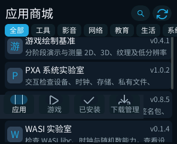
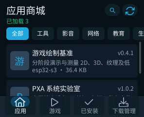
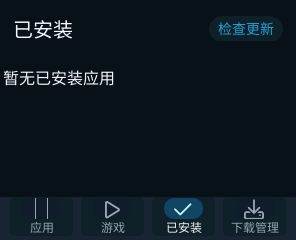
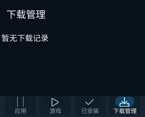

# 商店 DPI、图标及 pai-touch 几何修复

2026-10-14；商店 0.8.5 → 0.8.6，发布序号 13 → 14。
真机 `/dev/ttyACM3`：产品 `paixueji_nertc_demo_new`，ESP32-S3，296×240，130 DPI。

## 原因与修复

- **底部导航上移**：UI 环境的屏幕尺寸是面板像素，商店却直接作为密度缩放的
  dp 样式长度使用。130 DPI 的缩放比例为 0.8125，底栏因此绘制在约
  y=150..193，列表继续出现在其下方；应用根画面本身已经覆盖全屏。
  将屏幕尺寸换算为 dp，安全区和圆角保留原始像素，在使用时换算，向外取整。
  宽度断点、卡片数量估算与浮动导航由此使用同一单位。
- **安全区边序错误**：Window 的命名字段此前被复制成左/上/右/下，但 UI 数组
  要求上/右/下/左。改为命名字段映射，非对称边距不再互换。
- **应用图标缺失**：产品的 `font_awesome_20_4` 字符映射不包含 U+F00B。
  换成产品字体和 LVGL 标准符号字体都具备的 U+F015（主页），无需额外字体资源。
- **产品圆角差异**：参考 pai-touch 板级和模拟器为 58 px；产品通过
  `min(width,height)/5` 得到 48 px。产品 `lcd_display.cc` 已改成相同的 58 px。
  两边安全区均为上/右/下/左 8/10/8/10 px，保持原值；DPI 独立于物理几何。
  这项属于产品固件源码修改，尚未烧录，不把商店包更新描述为固件几何已更新。

## 真机与模拟器验证

真机已安装同发布者身份的签名 0.8.6 包，保留应用及私有数据，未重烧固件，
未更改持久设备设置。验证目录加载、四个导航入口、已安装页、下载管理页、
搜索入口与返回；页面的底栏固定在屏幕底部。
最后截图包含真实目录和恢复显示的主页图标。

| 修复前 | 修复后 |
| --- | --- |
|  |  |

| 已安装 | 下载管理 |
| --- | --- |
|  |  |

模拟器运行真实签名 Guest，不是静态 UI 模型，覆盖：

| 面板 | DPI | 圆角 | 安全区（上/右/下/左） |
| --- | --- | --- | --- |
| 296×240 | 130 | 58 | 8/10/8/10 |
| 296×240 | 160 | 58 | 8/10/8/10 |
| 800×480 | 216 | 24 | 12/16/20/8 |
| 720×1280 | 320 | 48 | 24/12/48/12 |

各尺寸截图见同目录及 `profiles.json`。检查底栏选中区域位置，并目视检查图标与
圆角遮挡。130 DPI 的模拟器成功加载目录；其他尺寸存在目录请求失败的截图，
这些截图只证明布局，不能算作联网功能通过。

原生 ASan/UBSan 布局测试通过，覆盖 80/130/160/216/320/480 DPI、
0..4096 px 的安全区往返覆盖、零密度回退、整数溢出及非对称 Window 边序。
UTF-8 目录解析及安装票据回归通过。产品真实几何初始化代码块与锁定 SDK 的
Display 实现一起编译，验证 296×240、130 DPI、58 px 四角、指定安全区及角点命中。

## 内存与范围

Wasm `store_state_t` 修复前后均为 **39,152 B**（原生 64 位为 39,168 B）。
利用原来未使用的 `has_environment` 字段保存屏幕形状，原形状字段改存密度，
没有增加状态大小，没有新缓存或动态分配。
设备 PXA 资源预算采样前后均为 external=17,724 B、fixed=2,224 B、internal=0；
这不是设备整机或本次运行的完整峰值报告。整机空闲堆受目录、网络请求和产品后台
任务影响，未将这些波动解释为本次修复的内存收益。
ESP32-S3 AOT 文件较旧交付包增加 4,040 B；该包还使用了当前 SDK 源码，
不能把全部文件差异归因于布局修复，也不能据此声称代码映射内存没有增长。

本轮更新 ttyACM3 的商店包和两处源码；未发布到线上商店，未修改 SDK ABI、
字体资源、产品分区、NERTC 或其他已有改动。产品固件圆角需单独烧录后真机确认。

## 复现

从 PXA workspace 构建 `store` 的 simulator / esp32s3 包；原生测试命令见
`store/README.md`。模拟器安装和启动示例（路径替换为自己的 DevKit 和测试目录）：

```sh
"$devkit/simulator/bin/pxsys_package_installer" --storage-root "$state" \
  --publisher-key "$publisher_public_der" --source "$simulator_package" \
  --expected-id pxa-store
SDL_VIDEODRIVER=dummy SDL_AUDIODRIVER=dummy \
PXA_SIMULATOR_FONT="$devkit/share/pxa/fonts/noto_sans_cjk_common.ttf" \
  "$devkit/simulator/bin/pxsys_desktop_simulator" \
  --installed-packages-root "$state/packages" --state-root "$state" \
  --publisher-key "$publisher_public_der" \
  --product-runner "$devkit/simulator/bin/pxsys_product_simulator" \
  --launch pxa-store --width 296 --height 240 --density-dpi 130 \
  --corner-radius 58 --safe-insets 8,10,8,10 --locale zh-CN --dark \
  --duration-ms 6000 --screenshot "$state/screen.png"
```
