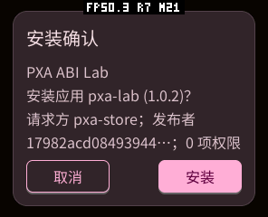
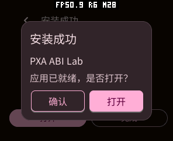
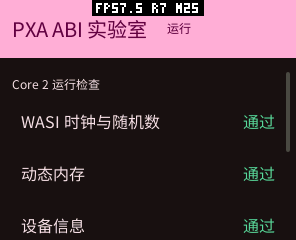

# 商城安装、PXADB 安装与残包清理验证（2026-10-15）

本报告接续[商城浏览和图片重构](../store-refactor-20261015/README.zh-CN.md)。本轮使用 pai-touch 真机完成下载、安装、启动、删除与故障测试；只更新应用固件分区，保留已有应用、存档、分区表和设备设置。USB 端口由 ttyACM3 重连为 ttyACM0，验证时按 USB 设备标识连接。

## 实现及原因

| 改动 | 收益 | 空间和内存影响 | 验证 |
| --- | --- | --- | --- |
| 商城“安装”直接使用服务 20 的 opcode 1 | 下载、确认和安装由一次请求完成，不先登记成离线下载 | 完成、拒绝、失败均删除安装用容器；不增加下载缓冲 | 生产服务器 Lab 下载 → 原生确认 → 安装成功 |
| 用户明确“下载”才使用 opcode 2 | 保留离线安装能力，下载后仍可浏览、重启再安装 | 仅有效的显式下载可以持久保留，最多八项；可手动删除 | SHA-256 与服务器 artifact 110 一致，重启后安装、打开 Lab 和删除下载 |
| 缓存安装尝试后消耗容器 | 安装失败也不长期留下完整压缩包 | 拒绝安装确认保留有效离线包；损坏缓存及实际安装尝试后删除文件和登记 | 实际 worker 原生测试，商城刷新下载列表 |
| PXADB 接收到 `.receiving-<id>`，再校验发布 | 半包不进入应用列表；一次连接完成上传和部署 | 断线、取消、超时和启动清理未提交候选 | 真机故障注入，见下文 |
| 已上传的目录直接接管进安装事务 | 避免再次复制全部解包文件和重复闪存写入 | 无第二份 decoded payload；沿用现有工作区、8 KiB 文件缓冲和事务恢复 | 原生 inode 相等断言、真机安装和启动 |
| 系统菜单安装与 PXADB 部署共用实现 | 一套验证、事务和清理规则 | 移除重复安装代码；不新增常驻缓存 | 应用固件构建、真机部署 |
| 全部接收边界清理单个上传临时文件 | 写入、摘要或提交失败不留下 `.pxadb-part` | 一个固定 `/.pxadb-upload`，不改变传输分块大小 | 错误摘要、取消、断线、超时和重启 |
| HTTP 写入前检查容器空间并保留 128 KiB 闪存余量 | 空间不足提前返回，不先下载到满盘 | 仅查询现有文件系统统计；不是分配 RAM 缓存 | 低空间 worker 原生测试 |
| 冷启动恢复安装 session，清理旧 previous/incoming 和遗留半包 | 断电后的空间回收，无需用户手工找到隐藏文件 | 无额外扫描任务或常驻索引 | 两个事务故障检查点、存档内容断言、真机重启 |

完整文件验证仍然保留。目录接管限定于 Host 私有 inbox 的单级目录，提交前校验签名、实际应用 ID、发布者谱系和所有文件摘要；当前版本及私有数据在拒绝时不被替换。新增的是 Host 适配器能力，没有增加 Guest import ABI。

本轮还修复了实际故障测试发现的问题：LittleFS 禁止重命名仍打开的源目录；目录句柄的时间属性与路径查询不同；SPIFFS 兼容模式会删除空源目录，不能随后调用文件专用的 fsync；通用 filesystem `remove_tree` 只接受目录，单文件容器必须 unlink；删除多项后需要重新打开目录避免 LittleFS 游标漏项；清单大小查询错误必须保留原始状态，不能全部误报为内存不足。

## 真机性能对比

测试包 `pxa-install-bench` 共五个文件、338228 字节，含 262144 字节确定性资源 `bytes(range(256))*1024`。同一签名目录用于全部前后测试，文件摘要见 [fixture-sha256.json](fixture-sha256.json)。对应 Container 0.1 为 76167 字节；这里比较的是**目录安装**，没有将小压缩包上传与大目录上传混在一起。

设备空闲、Guest 停止，USB Serial/JTAG 分块保持 256 字节。每轮先移除测试应用，再依次记录 INFO、MEMORY START、上传、INFO、PACKAGE deploy、MEMORY STOP、INFO。旧固件一轮；最终新固件两轮，另保留一轮接管验证数据供检查。

| 指标 | 原复制路径，n=1 | 最终接管路径，n=2 |
| --- | --- | --- |
| 上传 | 10.271 s | 10.378 / 10.965 s |
| 校验、部署 | 11.724 s | 3.731 / 3.566 s |
| 上传 + 部署 | 21.995 s | 14.110 / 14.531 s |
| 从开始到阶段边界观察到的最大新增闪存占用 | 663552 B | 376832 / 385024 B |
| 部署后保留 inbox 副本 | 有，之后需要客户端清理 | 无 |

本次部署约减少 68–70% 耗时，整体约减少 34–36%。相位边界占用减少约 272–280 KiB。闪存数据是 LittleFS 分配块统计，**不是连续采样得到的真实瞬时峰值**；不把它标为真实峰值。旧路径复制完成和客户端清理之间保留两份包，新路径不再存在这份长期副本。USB 上传本身没有宣称提速，也没有扩大 UART/USB 分块。

原始数据：[改前](copy-before-bench.json)、[接管验证](adopt-after-bench.json)、[最终第 1 轮](adopt-after-final-1-bench.json)、[最终第 2 轮](adopt-after-final-2-bench.json)。设备其他应用和开发中 Host 代码有独立更新，绝对文件系统基线不同，应比较每轮增量；n 较少，耗时不是所有设备的保证值。

## RAM 的实际边界

MEMORY START/STOP 使用 ESP-IDF 本次测量窗口的分配最低空闲值，能捕获两次快照之间释放的分配；测量结束恢复启动以来的统计。它与 Surface/资源预算的历史高水位含义不同。

| 指标，单位 B | 改前 | 最终第 1 / 第 2 轮 |
| --- | --- | --- |
| SRAM 稳定空闲 | 56083 | 56615 / 56615 |
| SRAM 窗口最低空闲 | 51579 | 52123 / 52267 |
| PSRAM 稳定空闲 | 6875612 | 6877092 / 6875748 |
| PSRAM 窗口最低空闲 | 6729312 | 6723172 / 6720824 |
| SRAM 最大连续空闲 | 19456 | 19456 / 19456 |
| PSRAM 最大连续空闲 | 6553600 | 6553600 / 6553600 |

稳定占用基本持平；本次两轮 PSRAM 窗口峰值比旧单轮约多 6.0 / 8.3 KiB，不能据此声称“所有 RAM 峰值都降低”。测量覆盖 Wi-Fi、文件系统和其他系统任务，前后固件又有独立改动，未完成严格的旧/新/旧归因对照。代码上没有扩大安装器工作区、传输缓冲、Guest 线性内存、帧缓冲或深度缓冲；新增路径短字符串仅在安装期间分配。若要求严格证明整机峰值不增长，仍需隔离固件变量、重复对照后再下结论。

## 故障与清理规则

- PXADB：主动 FSABORT、BYE 正常断开、进程直接断开后 HELLO 重连、无重连的 30 秒空闲超时、FSPUT 摘要错误、接收中重启，均验证临时文件及 `.receiving-*` 消失。重启同时清理旧 `.pxadb-part` 和无效旧 inbox 目录。见 [cleanup-device.json](cleanup-device.json)。
- 真机用已签名测试包篡改资源、或以错误 App ID 接收：均拒绝部署并删除候选；旧安装资源摘要不变、installed=1 / staged=0。显式 stage 的完整容器跨断开和重启保留，部署后文件消失。见 [reject-device.json](reject-device.json)。
- 原生 ASan/UBSan：目录接管前后 inode 相同；越界路径、身份不符、签名/载荷损坏拒绝；两个提交故障点冷启动恢复后旧版本和 `saved game` 存档内容保留。
- 实际 ESP 下载 worker 原生测试：短响应体、错误摘要、取消、安装成功/失败、无效缓存、拒绝确认、多个断电孤儿文件清理。只替换 HTTP/RTOS/Host 边界，写入和删除使用真实文件系统，签名及事务由适配器测试覆盖。
- 真机半包取消：588457 字节的生产游戏下载，worker 已写入 113630 字节时停止商城，约 5.42 秒后临时文件消失。LittleFS 对正在写入的文件 stat 仍可能返回 0，实际接收量以 worker 退出日志为准。见 [store-cancel-device.json](store-cancel-device.json)。此前一次显式下载完整完成，其有效离线包通过真实下载管理 UI 删除后，再进行本次半包测试。
- 最新源码构建后的模拟器 CTest 31/31、PXADB 76/76、GUI 22/22、ESP Host 原生回归、应用 ASan/UBSan 回归和安装适配器/容器工具 ASan/UBSan 回归通过。模拟器真实指针覆盖 20 轮详情返回、异步图片和滚动；无安装服务时明确显示“当前系统不支持应用安装”，不会误报签名问题。

异常断线不能即时通知设备；新固件会在超时、重连或重启时回收。正在运行的 HTTP worker 需要退出网络调用并关闭文件后再清理，不能在另一个任务强行关闭它的 FILE。已经开始的原子安装继续完成。冷启动遇到无法安全恢复的事务保留并报告，不能为回收空间盲目删除唯一可能恢复的应用。

当前 ESP-IDF HTTP 实现不保证将数据事件返回的错误直接用作传输取消：取消会立即停止写文件，网络层仍可能读取并丢弃剩余响应，直到请求结束或网络超时后再删除文件。本次 5.42 秒包含这个等待；不能承诺立即释放文件，也未把它算成快速中断网络传输。进一步优化可以采用 worker 自己驱动的分段读取与取消检查，需要单独验证吞吐、TLS 和内存。

**有效的显式下载、显式 stage、已安装应用和用户存档不是残包。** 显式离线包可手动删除；拒绝其安装确认会保留，实际尝试安装则消耗。测试结束移除临时探针应用和本轮测试缓存，恢复文件系统写保护与输入状态；Browser、Jump Jump 3D 和已验证的 Lab 保留。

## HTTP 流式安装仍有边界

当前 Container 0.1 的 PXCS 签名覆盖完整编码流。Host 必须先收到并认证完整容器，再解压进入 incoming；本轮没有把未认证字节提前解压执行，也没有实现真正的 HTTP 边下载边解包。商城一步安装去掉了持久离线副本、冗余验证和失败残留，但压缩容器与 incoming 在解压期间仍会同时存在。未来若要继续降低该阶段峰值，适合增加认证分块或支持预认证文件清单的传输格式，再设计有界流式事务；本报告不把这一点算作已完成。

## 复测入口

在产品仓库根目录运行：

```sh
python3 -m unittest discover -s tools/pxadb -p 'test_pxadb.py'
QT_QPA_PLATFORM=offscreen PYTHONPATH=tools/pxadb-gui \
  python3 -m unittest discover -s tools/pxadb-gui -p 'test_*.py'
bash firmware/components/pxa/tests/test_host.sh
SANITIZE=1 bash local/pxa-apps/tests/native/run.sh
cmake --build build/simulator/sensecap-watcher --parallel 4
ctest --test-dir build/simulator/sensecap-watcher --output-on-failure
tools/app.sh build store --target esp32s3 --source-root local/pxa-apps \
  --output local/store-device-install-20261015/esp32s3
```

原始签名测试目录、原固件应用分区备份、分区表备份、构建日志、PXADB 故障探针及生产服务器下载校验记录保存在产品目录 `local/store-device-install-20261015/`。原生测试可独立复现；真机探针只使用测试 App ID，在目标设备空闲时运行。基准不使用压缩包与目录两种不同输入互相比速。






