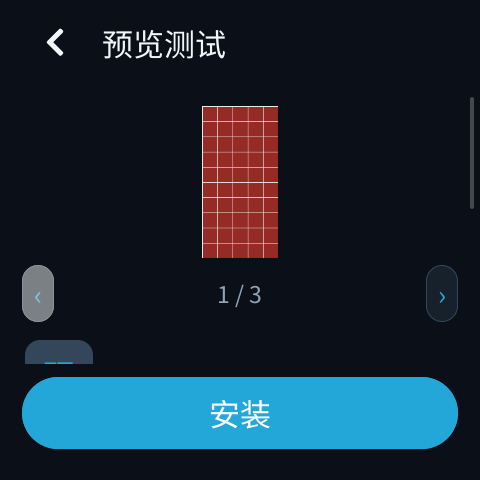
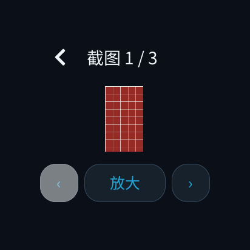
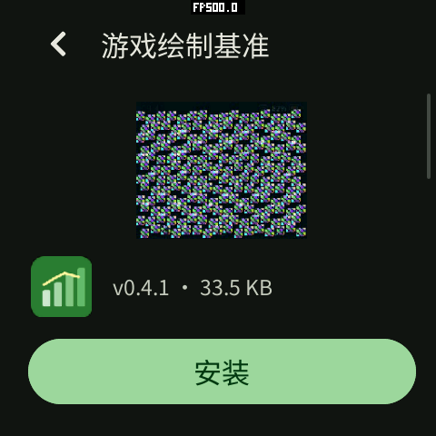
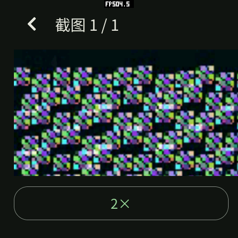
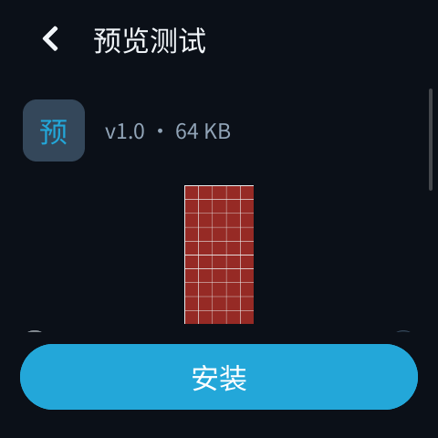
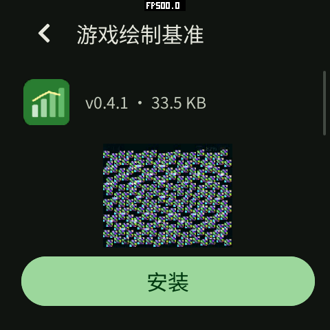
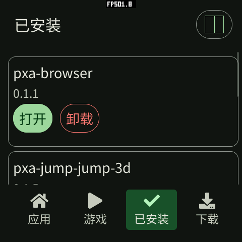
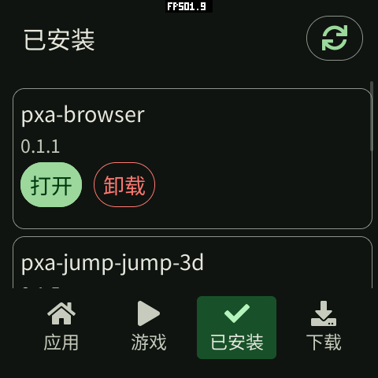
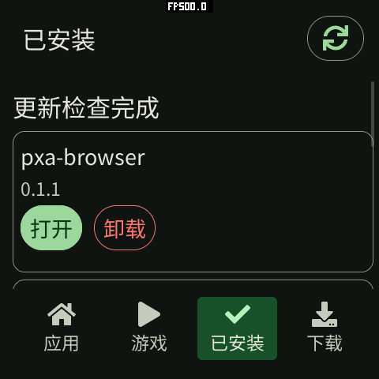

# 商城截图预览与单一安装按钮（2026-10-16）

商城版本：0.8.8，release sequence 16。

## 行为

详情页底部只有一个主按钮。未安装显示“安装”，有新版显示“更新”，已安装且
没有新版显示“打开”。不提供重复的“下载”按钮，也没有隐藏下载按钮的“更多”菜单。
点击安装/更新会刷新短期票据，交给 Host 下载和校验，再显示系统原生安装确认。
应用不能跳过确认。下载页仍可管理已有的离线包。

点击详情截图进入预览页。适应窗口大小时可以左右滑动、点击左右箭头切换截图；
边界按钮禁用，不循环越界。只有一张截图时省略切换按钮。双击在适应与 2 倍间切换，
缩放按钮依次切换适应、2 倍、3 倍。放大后拖动平移，切换图片重置缩放。
返回详情保留滚动位置；在截图上滚动详情不会误开预览。

标题、按钮和图片区域沿用系统 DPI、状态/导航栏以及圆角/圆形安全区。
预览是普通页面，没有新增全屏位图或合成层。原生滚动承接平移，移动事件不触发
应用 UI 提交。异步图片完成只替换图片内容，保留滚动容器。

预览复用原有解码缓存：8 个槽位、最多 1 个 HTTP 图片请求在途；截图解码仍限制
320×320、32768 像素，编码数据上限仍为 128 KiB。放大不会加载原始高清文件，
可能看到预览本身的像素；没有增加图片缓冲预算。Guest 增加固定容量手势状态，
没有按图片尺寸分配临时容器。

## 自动验证

通过生产 Wasm/AOT 包、Host、WAMR、LVGL 和图片解码器运行。只用固定 HTTP 响应替换网络，
避免商城内容变化。三张 PNG 分别为 120×240、240×120、240×240，覆盖不同宽高比。
检查单按钮、缩略图拖动、打开、翻页、边界、双击、2/3 倍缩放、原生平移及返回位置。

| 配置 | 分辨率 | DPI | 形状 | 结果 |
| --- | --- | ---: | --- | --- |
| Mosaico | 480×480 | 305 | 圆角 | 通过 |
| pai-touch | 296×240 | 130 | 圆角 | 通过 |
| Watcher | 412×412 | 284 | 圆形 | 通过 |
| 小屏 | 240×240 | 160 | 矩形 | 通过 |
| 低 DPI | 240×240 | 80 | 矩形 | 通过 |
| 高 DPI | 720×720 | 480 | 圆角 | 通过 |

每种配置的 60 次平移移动事件产生 0 次 Guest UI 提交；整个三图流程只发出 3 个图片
HTTP 请求，同时在途峰值为 1。回到详情的测试夹具有 31 个 UI 节点，UI 动态分配
当前 4328 B、本次峰值 11000–11064 B。这是该离线夹具的 UI 分配统计，不包括
帧缓冲、字体、解码器或整机运行内存，不能据此宣称整机峰值或 FPS 改善。

全部应用原生 C++26 ASan/UBSan 回归通过，包含手势/几何边界、UTF-8、票据、
媒体生命周期与 DPI 布局检查。

从产品仓库根目录复现：

```sh
SANITIZE=1 bash local/pxa-apps/tests/native/run.sh
tools/app.sh build store --board esp-mosaico --target simulator,esp32s31 \
  --source-root local/pxa-apps --output local/store-viewer-check/release
python local/pxa-apps/store/tests/run_viewer_probe.py \
  --build build/simulator/sensecap-watcher \
  --package local/store-viewer-check/release/pxa-store \
  --publisher local/pxa-apps/.dev-signing/publisher-public.der \
  --output local/store-viewer-check/matrix
```

模拟器需事先按项目流程构建，包含 `pxsys_store_images_test`；探针重用其编译参数和库，
不会修改模拟器工程。输出包括每配置的 `report.json`、原始日志和 PNG 截图。
桌面探针不验证 ESP 商城下载安装服务。





## Mosaico 真机

`/dev/ttyACM2`、2,000,000 baud，480×480、305 DPI。已安装 0.8.8 并停止/重新启动
商城，避免旧运行实例影响判断。对真实商城的“游戏绘制基准”详情注入触摸，经屏幕截图
确认单一安装按钮、打开预览、放大、平移、双击恢复和返回详情均正常。
该条目只有一张截图，因此不显示多图箭头；多图翻页由上述三图夹具验证。

普通安装的商城（`builtin=0`）已能发起真实下载，完成校验后显示 Host 原生确认。
测试点击“取消”，详情显示“安装已取消或未获授权”，包清单确认测试应用未被安装。
没有自动批准安装。新 Host 的开放策略与确认路径已在本机验证，用户批准后的完整
商城安装成功路径不属于此次自动确认的结果。





## 0.8.9：截图移到详情中部

按手机应用商城的阅读顺序调整为“应用图标和版本信息 → 截图 → 简介 → 更新内容 →
可展开的技术信息”。名称仍在页头，主安装按钮仍固定在底部。截图不再抢在应用信息前面，
也不会被长篇简介推到页面末尾。release sequence 为 17。

只调整已有节点的创建顺序，沿用原有图片缓存和预览交互。六种屏幕配置的生产 AOT
预览探针重新通过；每配置的节点数、UI 当前和峰值分配、图片请求数及原生平移的
Guest 提交数均与 0.8.8 回归夹具相同。



Mosaico 已更新并重启运行 0.8.9。真实商城详情截图确认图标和版本位于截图上方，
点击中部截图仍可进入预览，返回详情正常。设备设置未修改。



## 0.8.10：检查更新图标

窄屏的“检查更新”复用了页头按钮构造函数，但它把所有非返回按钮都当成“分类”，
又以 ICON 字体绘制该中文文本，造成两个缺字方框。设备字体已包含 U+F021 刷新符号，
本次不需要增加字库。按钮改为明确选择刷新符号和 ICON 角色，普通文字使用文字角色，
仍保留“检查更新”辅助标签。宽屏继续使用文字按钮。release sequence 为 18。

六种屏幕配置的生产 AOT 探针增加已安装页验证，检查实际标签、字体字形和按钮内的
绘制范围；均通过。相同探针运行旧版 0.8.9 时在缺失刷新符号的检查处失败，确认
该回归能检出原问题。沿用现有图标字体，不增加图片资源或运行时缓存。




Mosaico 已更新并重新启动 0.8.10，截图确认刷新图标显示正常。真实点击按钮后，
界面依次显示“正在检查更新…”与“更新检查完成”，日志记录逐项请求商城详情。
未修改持久设备设置或其他应用数据。




