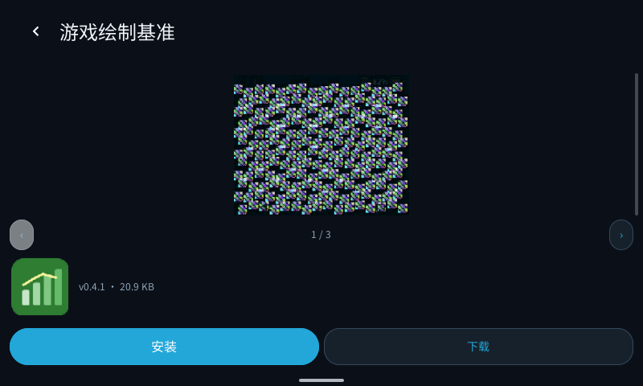
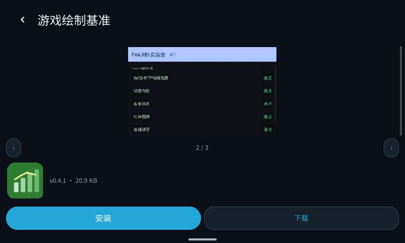
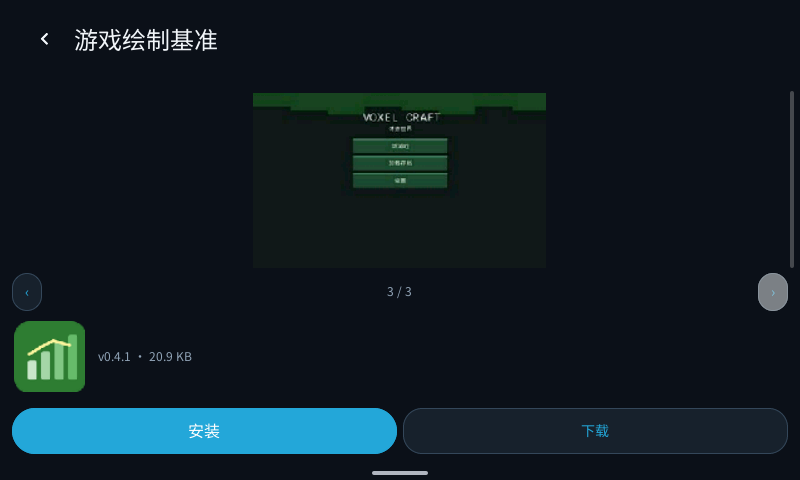
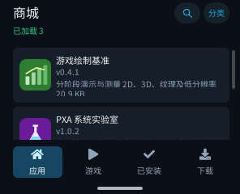
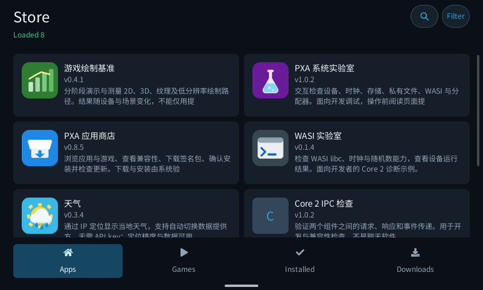
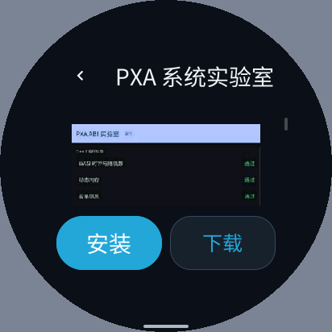

# 商城简化、渐进图片与滚动验证（2026-10-15）

本轮修改 `store`，保留了开始前已有的 DPI、安全区和下载管理改动。目录、详情、搜索、安装、卸载、更新检查与下载管理仍然可用；未发布商城、未更新设备固件。

后续已完成 pai-touch 真机下载、安装和故障清理验证，见[安装空间与清理报告](../install-storage-20261015/README.zh-CN.md)。下面保留本次浏览重构当时的测量范围。

## 设计与原因

| 改动 | 原因与收益 | 内存变化 | 验证 |
| --- | --- | --- | --- |
| 标题、可选分类、列表和导航改为纵向兄弟节点 | 原列表覆盖整个页面，再叠放标题与导航；现在滚动裁剪只作用于中间视口 | 减少默认节点和事务数据，没有新增合成缓冲 | 探针断言列表与固定栏不相交；三种屏幕截图 |
| 去掉卡片标题行包装、导航胶囊及额外导航容器 | 减少遍历、布局和绘制；分类默认折叠，小屏只显示名称、版本和安装状态 | 固定 12 项时节点 126 → 96 | 原生 UI 快照与滚动探针 |
| 下一页追加到现有列表 | 页面加载完成时不替换正在拖动的滚动对象；满 12 项后按实际淘汰行数补偿位置 | 仍只保留 12 项；图片另设有界缓存 | 慢速分页、滚动中到包、快速切页 |
| 图标与截图独立异步加载 | 文字目录先可用，图片失败不锁住浏览；完成时只更新对应图片子树 | 新增按需图片内存与 HTTP/协程代码，详见下文 | 实际 PNG/JPEG、失败占位、快速切换取消 |
| 详情按选择版本接收响应 | 环形目录索引不能识别迟到的旧详情；切到另一应用后丢弃旧响应并继续新请求 | 两个小整数，不缓存旧详情响应 | 人为延迟详情后，A → 返回 → B 与 A → 返回 → 游戏目录 |
| 只有指针移动才判定拖动 | LVGL 为半露出的卡片聚焦时也会滚动，不能因此吃掉一次正常点击 | 无新堆分配 | 实际点击第二张半露出的卡片 |
| 桌面 HTTP 区分预算超限与内存不足 | 超出目录响应预算应允许扩大后重试，不能误报资源分配失败 | 不增加缓冲上限 | `net_headers_test` 与慢速 HTTP 回放 |
| 修复 LVGL 事件回调后的节点访问 | Host 同步派发 Guest，Guest 切页可在回调返回前删除事件源；旧代码随后读已释放节点 | 仅保存栈上的 adapter 指针；无常驻分配 | 点击/虚拟列表回调内删除页面；ASan；真实快速切页 |

没有引入整页位图缓存、透明遮罩或额外的页面合成层。商城保留系统导航并使用它报告的底部安全区，避免导航手势条覆盖商城的目的地标签；状态栏仍隐藏。

## 图片与多图

- 列表图标随可见范围加载，带少量前瞻；详情只保留自己的图标和当前截图。
- 最多八个媒体缓存槽，一次一个媒体请求；目录 JSON 使用独立请求，所以图片等待不阻塞浏览。
- 详情最多记录八张截图的 URL/尺寸。只有一张时隐藏翻页栏；多张显示上一张、当前张数/总张数、下一张。切换后加载当前图片，不预先解码整组。
- 只允许同源 `/media/apps/` 地址；拒绝外域、路径穿越和截断的长 URL。解码失败保留占位，支持手动重试。
- 每个媒体请求使用 2 KiB 流环；编码数据最多 128 KiB。图标限制 64×64 / 4096 像素，预览限制 320×320 / 32768 像素，Host 按比例缩小。透明图使用 BGRA，普通图片使用 RGB565；这些是数据限额，并非整个解码器的总堆峰值。
- 编码体和像素不经 Guest 拷贝；Host 的 HTTP 流直接交给 Host 图片解码服务。离开页面或切图时取消不再需要的请求。

多图回归为一条测试详情装入三张不同的已捕获图片，实测 `1/3 → 2/3 → 3/3 → 2/3`、首尾禁用以及十轮加载中快速往返。测试拼接的图片不代表生产目录中该应用真的有三张截图。生产数据不作修改。





## 滚动基准

签名 AOT 包、同一桌面 Host、SDL dummy、412×412、284 DPI、圆屏、中文、固定十二项无图片 URL 的目录。每次独立进程；30 次预热后记录 240 次滚动，交替运行改前与改后。计时包括原生滚动、Guest 事件派发和 `lv_refr_now`，不包含实体面板传输。探针断言：纯滚动没有新的 UI 提交。

原始结果与包标识见 [scroll-comparison.json](scroll-comparison.json)。减少滚动视口与默认信息属于 UI 工作量减少，不代表语言或光栅器变快。桌面调度有波动，不据此承诺设备 FPS。

| 项目 | 改前 | 改后 | 说明 |
| --- | ---: | ---: | --- |
| 滚动平均耗时（三轮均值的中位值） | 4.023 ms | 3.310 ms | 下降 17.7% |
| 每轮 P95 的中位值 | 4.638 ms | 3.825 ms | 桌面参考 |
| UI 节点 | 126 | 96 | 下降 23.8% |
| UI 常驻元数据 | 10,544 B | 8,216 B | 下降 22.1% |
| UI 元数据本次峰值 | 37,576 B | 32,048 B | 下降 14.7% |
| Guest 线性内存 / 本次峰值 | 196,608 / 196,608 B | 196,608 / 196,608 B | 均不变 |
| WAMR 私有分配 / 本次峰值 | 35,111 / 68,978 B | 48,456 / 114,730 B | 增加，含新增 C++ 媒体能力 |
| 共享资源预算常驻 / 本次峰值 | 20,453 / 20,453 B | 20,452 / 20,452 B | 基本相同；不含 native LVGL 堆 |
| 代码加载复制缓冲 | 0 B | 0 B | 代码映射另计 |
| 纯滚动 UI 提交 | 0 | 0 | 没有滚动重建 |
| PXA 容器文件 | 227,338 B | 368,151 B | 新增媒体功能的代码成本 |

CPU：AMD Ryzen 7 4800H with Radeon Graphics。频率未锁定；先前探索批次约 11% 的改善，最终隔离批次约 18%，因此应以节点/内存和各轮原始值共同判断，不能把某一批比例外推到 ESP。

UI 内存是 UI service 维护的节点/事务数据，不是整个 LVGL 堆。表内峰值来自每个新进程从初始化到取样的高水位，没有使用历史设备累计峰值。基准没有下载图片，不覆盖图片解码过程的总内存峰值。

新增媒体功能并不是零成本：WAMR 私有分配与包/AOT 文件体积增加；Guest 线性内存页数保持不变，UI 元数据减少。`artifact_buffer=0` 表示没有整包复制缓冲，不表示代码映射没有占用地址或物理页。本轮没有测量设备 SRAM、PSRAM 或整个进程的 RSS 峰值，不能从这张表推断总内存峰值不增长。

## 可复现方式

在产品仓库根目录运行：

```sh
cmake --build build/simulator/sensecap-watcher --parallel 4
tools/app.sh build store --target simulator --source-root local/pxa-apps \
  --output local/store-refactor-20261015/after
python3 local/pxa-apps/store/tests/build_browse_probe.py \
  build/simulator/sensecap-watcher local/store-refactor-20261015/store-browse-probe
mkdir -p local/store-refactor-20261015/recheck/state
local/store-refactor-20261015/store-browse-probe \
  local/store-refactor-20261015/after/pxa-store \
  local/pxa-apps/.dev-signing/publisher-public.der \
  local/store-refactor-20261015/recheck flow \
  local/store-refactor-20261015/recheck/state
SANITIZE=1 bash local/pxa-apps/tests/native/run.sh
ctest --test-dir build/simulator/sensecap-watcher --output-on-failure
```

`build_browse_probe.py` 复用已构建的 `pxsys_store_images_test` 编译和链接配置，不修改构建目录。探针的离线目录完全固定，不访问服务器。改前包已保存在产品目录 `local/store-refactor-20261015/before/pxa-store`；将包路径换成它、模式换成 `baseline`、使用独立输出/状态目录，即可重放。改前包包含当时未提交的 DPI 修复，不能把当前 Git HEAD 当作完全相同的基线。公钥必须匹配构建签名。

在线/慢速回放使用隔离源码副本，把源地址及签名权限一起改到 `http://127.0.0.1:18381`；正式源码仍指向 `https://app.doit.am`。本轮抓取数据、回放服务器、控制脚本、签名包与全部日志保存在产品目录 `local/store-refactor-20261015/`，没有改变服务器数据。

## 验证结果与边界

- 模拟器 CTest：31/31 通过。应用原生回归在 ASan/UBSan 下通过，已加入媒体 URL/图库、UTF-8、DPI 和损坏 JSON 检查。
- LVGL adapter 原生回归在 ASan/UBSan 下通过。把事件回调后的旧节点访问恢复到临时副本，新增用例立即报告 `heap-use-after-free`；正式修复无此报告。
- 真正的模拟器指针操作覆盖圆屏 412×412 / 284 DPI、小屏 296×240 / 130 DPI、宽屏 800×480 / 160 DPI；浏览图标、查看预览、分页滚动、分类、已安装和下载页面均作截图检查。
- 慢速 JSON、慢速图片下浏览和切页不锁死；20 轮切页/滚动后进程正常。详情迟到时选择 B 保持显示 B，切到游戏目录会继续加载正确目录。
- 多图在宽屏实测切换成功。窄屏详情仍可纵向滚动到翻页栏；不同时展示全部大图。缺图保留占位，最多八张；超出部分跳过。
- 本轮按要求先验证模拟器，没有烧录设备、测量实体显示帧率或进行设备端下载/安装；下载管理接口和签名确认流程保留。




