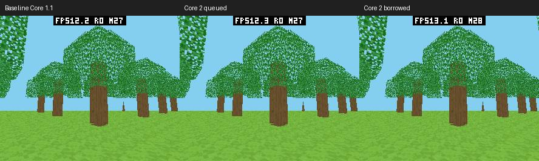

# Core 2 / 同步借用 DrawList 真机报告

后续桌面路径完善与新 SDK 复测见 [后续报告](abi-core2-refine-20261011.zh-CN.md)。
下文保留首次 Core 2 探索的数据，不与后续复测合并统计。

日期：2026-10-11。正式 voxel-craft-cpp 源代码和 package.json 本轮保持原样，测试
使用私有副本 `pxa-next-voxel-probe`。此报告比较同一个 C++ 游戏的 Host/SDK 路径，
不比较 C 与 C++ 的语言效率。配套证据在 [abi-core2-20261011/](abi-core2-20261011/)。

## 条件和统计口径

- pai-touch（ESP32-S3，MAC `a4:cb:8f:d6:8d:a4`），本机端口 `/dev/ttyACM1`，不是
  较早记录中的 ACM2。屏幕 296×240，双 RGB565 帧缓冲和 16 位深度。
- `VOXEL_BENCH_SCENE=2,VOXEL_PROFILE=1`；种子 `0x5ae1`；眼位置
  `(18.5,9.6,18.5)`，yaw `0.7`、pitch `-0.15`，FOV `1.221451928`，near `0.25`、
  far `24`。同纹理、树叶 cutout、透视插值与 Z-buffer，没有降低视距或画质。
- 每帧 245 个可见面 / 291 批、16224 B 命令、118875 个覆盖像素。固定场景关闭
  物理更新，不能从这个零更新耗时推论正常游戏物理免费。
- Wasm Clang C++26 / O3，ESP32-S3 AOT opt-level=3、size-level=0。Host raster
  为既有 O2。本轮没有为了体积降低 Guest 优化级别。
- 每组应用冷启动三次，每次预热 24 秒、采集 8 秒；至少观察 120 个预热显示帧。
  FPS 来自 LCD 完成间隔，raster 来自 Host 探针。无采集溢出、Surface 切换；固定
  测量窗口无丢帧记录。三轮不是独立设备样本，也没有进行长时间热稳态统计。
- 主表只使用最终固件 `e5f9e1d…`。中途固件结果单独保留在 comparison.json，不能
  混到最终组。基线是本轮开始的 Core 1.1 Call（`fdb4e32d…`），不是旧 Submit。

## 显示和阶段耗时

| 指标 | Core 1.1 基线 | Core 2 排队 | Core 2 借用 |
| --- | ---: | ---: | ---: |
| 三轮显示 FPS | 12.298 / 12.387 / 12.424 | 12.598 / 12.635 / 12.686 | 13.101 / 13.133 / 13.014 |
| 显示 FPS 平均 | 12.370 | 12.640 | 13.083 |
| Host raster，ms | 36.680 | 35.494 | 33.005 |
| Guest 更新，ms | 0.000 | 0.000 | 0.000 |
| Guest 几何，ms | 26.089 | 25.476 | 25.217 |
| 命令编码，ms | 6.026 | 5.966 | 5.943 |
| HUD / 收尾，ms | 0.084 | 0.084 | 0.078 |
| 提交及包含的 Host 工作/等待，ms | 38.984 | 38.182 | 40.432 |
| Guest profile 总计，ms | 71.288 | 69.806 | 71.779 |
| Host queue 诊断跨度，ms | 2.184 | 2.186 | 1.495 |
| ready → LCD 完成，ms | 35.901 | 36.076 | 37.065 |

借用组 FPS 比基线高 **5.76%**、比最终排队组高 **3.50%**；raster 比基线低
**10.02%**。排队组既有扫描线精简也有 Core/SDK 编码变化，不是只改变 raster 的
孤立 A/B。借用组还改变了执行任务和命令读取位置，不能把全部 raster 差值归因于
memcpy。各阶段可能相互重叠，不能相加得到帧时间。

Guest 阶段是日志累计均值乘样本数后，在窗口边界作差；整数日志精度和邻近边界
有舍入误差。Host queue 仍含校验等前置工作，借用模式不是“仍排了 1.5 ms 的命令
队列”。提交墙钟包含同步渲染及抢占/等待，新增借用模式使提交耗时上升但实际显示
更快，不能用应用提交 FPS 评价收益。

## 输入体验

每组另做三轮，48 次来回指针移动、间隔 160 ms。每轮确认去掉诊断浮层后的图像
发生变化。下表按有效样本数加权；采样状态可能在按住时重复，多个移动可能被同一帧
合并，三个阶段不是一一配对的样本，不能直接相减拆解延迟。

| 采样到目标点，ms | 基线 | 最终排队 | 最终借用 |
| --- | ---: | ---: | ---: |
| Guest | 5.516 | 4.454 | 5.202 |
| present 提交 | 44.420 | 42.679 | 40.865 |
| LCD 完成 | 123.118 | 120.382 | 115.943 |
| 三轮 visible p95 桶上界/最大值 | 204.425 / 202.955 / 245.555 | 185.606 / 228.750 / 163.453 | 191.256 / 181.238 / 222.923 |

借用组平均采样到 LCD 完成低 **5.83%**。这不是物理手指触碰到面板光子响应的测量。
当前直方图末桶较宽，表中尾部值不能解释为精确 p95，也没有充分证据声称尾延迟稳定
改善。延迟仍超过 100 ms，后续需要继续定位游戏节奏及显示排队。

## 内存

单位 B，稳定值取三轮最大值；启动峰值从每次 PACKAGE run 前开启的 heap-local
窗口获得；稳定峰值在预热后重新开启局部窗口获得。两类窗口分开报告，未用历史累计
最低空闲冒充当次峰值。采集探针 2112 B 三组相同，安装和窗口后的截图分配不在这些
运行峰值中。首次应用初始化包含在启动窗口，固件启动本身不在窗口内。

| 动态堆指标 | 基线 | 最终排队 | 最终借用 |
| --- | ---: | ---: | ---: |
| SRAM 稳定 | 273088 | 273088 | 273088 |
| SRAM 启动真实峰值 | 277276 | 277352 | 277276 |
| SRAM 稳定窗口真实峰值 | 273252 | 273252 | 273264 |
| PSRAM 稳定 | 2967636 | 2963616 | 2811308 |
| PSRAM 启动真实峰值 | 3713912 | 3709896 | 3557260 |
| PSRAM 稳定窗口真实峰值 | 2971220 | 2968888 | 2814908 |

借用组稳定 PSRAM 最大值少 156328 B，启动峰值少 156652 B。明确可归因的 mailbox
减少为 147456 B；剩余差值含载荷/运行时布局及采样差异，不全部记为队列收益。
排队组 SRAM 启动多 76 B，借用组稳定窗口峰值多 12 B，来源未单独定位；借用组整个
启动窗口 SRAM 峰值与基线相同。不能宣称所有池在每个窗口严格零增长。

| 固定或资源归属 | 基线 | 最终排队 | 最终借用 |
| --- | ---: | ---: | ---: |
| Guest 线性内存实际保留 / 运行峰值 | 393216 | 393216 | 393216 |
| AOT 代码映射，对齐后 PSRAM | 589824 | 589824 | 589824 |
| WAMR dynamic 稳定（启动日志） | 47059 | 47010 | 47010 |
| WAMR dynamic 启动记录峰值 | 56757 | 56616 | 56616 |
| Host 双帧缓冲 | 284160 | 284160 | 284160 |
| 深度缓冲 | 142080 | 142080 | 142080 |
| 命令 mailbox | 147456 | 147456 | 0 |
| 固件 DRAM data / BSS | 32402 / 18056 | 32402 / 18056 | 32402 / 18056 |
| 固件 IRAM text / PSRAM BSS | 114215 / 30036 | 114215 / 30036 | 114215 / 30036 |

以上归属项属于动态堆或静态段的子项，不得重复相加。Guest manifest 最大线性内存
仍为 2097152 B，这不等于已经分配了 2 MiB。最终固件 Flash text 比基线多 588 B、
rodata 少 16 B；Flash 映射不等于相同大小新增 SRAM。AOT 文件请求尺寸 571064 →
569692 B，对齐映射没有变化。任务栈容量保持原配置，未测各任务实际栈最高水位。
`surface.peak_total` 是历史计数，连续切换模式时可能仍显示以前排队模式的峰值，
不能拿它判断借用模式当前占用。

## 正确性、取舍和限制



三组九张最终比较截图（另外保留中途六张）解码后，裁去顶部 24 行 FPS 浮层，场景
RGB 逐像素一致。没有通过降画质换帧率。原生差分另将旧/新光栅器运行于所有既有
raster 回归场景，颜色、深度和遥测逐字节相同，涵盖纯色、仿射/透视、透明、裁剪等。
截图一致不能替代对所有地图/编辑操作的证明，本轮未重做完整生存玩法测试矩阵。

| 改动 | 采用原因 | 收益 / 内存 | 验证 |
| --- | --- | --- | --- |
| 跳过纯色和透视路径中不用的仿射 UV；恒定光照免插值 | 避免无效逐像素运算 | 不新增缓冲；最终排队整组 FPS +2.18%（非孤立内核归因） | 原生颜色/深度差分、真机同图 |
| 同步借用命令，可选默认关 | 绘制返回前消费 Guest bytes，显示仍异步 | 相对最终排队 FPS +3.50%；命令队列少 144 KiB | ESP ASan/UBSan、立即覆写、资源替换、背压、同 ID 重试、关闭竞态 |
| 隐藏/锁屏/图层可见门控 | 防止不可见时继续光栅化 | 不新增缓存；未独立量化后台省电 | 后端回归；排队真机三次前后台 |
| Core 2 载荷直接编码 | 减少 API 重复和无用前缀 | Transport 仍 16 B；无每帧分配 | SDK 全套、Host、模拟器、控制微基准 |

当前三轮数据只支持该场景的收益，没有证明 C++ 已超过 C 版，也不能推广到每款游戏。
桌面不支持借用模式，创建时明确拒绝；默认排队模式完成模拟器验证。直接热导入、
SIMD、新 worker、Host 网格缓存、异步可写 Guest 零拷贝均未采用。后续优先研究
约 25 ms 的几何处理和超过 100 ms 的输入显示延迟，必须另做内存预算和同图测试。

## 复现

从 PXA 工程根目录运行；构建 SDK/Host 使用本轮未提交工作树。基线 HEAD 之外还存在
此前 ABI 工作，不能仅 checkout HEAD 当作本报告基线。`baseline.json`、保存的 patch
和 untracked tar、原固件在 `local/abi-next-20261011/`；二进制 SHA 见 artifacts.json。

1. 用配套 `stage_probe.py` 创建独立源副本，正式 App 不改动。脚本只追加可选借用宏
   和测试 Core/ID，资源使用相同 apps 源文件。记录 apps HEAD 与完整源摘要。
2. 使用已经配置好的 WASI SDK/WAMRC/签名环境，按以下命令分别构建。AOT-only 是
   包安装空间选择，两个模式 AOT 本身相同构建条件，不是改用较低优化级别。

```sh
python3 local/pxa-apps/voxel-craft-cpp/docs/performance/abi-core2-20261011/stage_probe.py \
  local/pxa-apps local/abi-core2-repro/apps

PXA_APP_SOURCE_ROOT="$PWD/local/abi-core2-repro/apps" \
PXA_SIGNING_KEY="$PWD/local/pxa-apps/.dev-signing/publisher-private.pem" \
PXA_PACKAGE_OUTPUT_ROOT="$PWD/local/abi-core2-repro/queued" \
PXA_PACKAGE_ARTIFACT_MODE=aot \
PXA_APP_DEFINES=VOXEL_BENCH_SCENE=2,VOXEL_PROFILE=1 \
  bash deps/pxa-system/tools/package/package_app.sh voxel-craft-cpp esp32s3 \
  "$PWD/local/abi-core2-repro/queued/pxa-voxel-craft-cpp"
```

借用组将 output root 改为 `borrowed`，definitions 追加 `,VOXEL_BORROW_COMMANDS=1`。
新固件只更新应用分区 0x10000，须预先保存实际设备原固件；不能擦除 bootloader、NVS
和数据区。安装 private package 后运行：

```sh
python3 tools/measure-device-voxel.py --port /dev/ttyACM1 \
  --app pxa-next-voxel-probe --package PATH_TO_PXA --output CAPTURE_DIRECTORY \
  --repeat 3 --warmup 24 --seconds 8 --minimum-warm-frames 120 --local-heap \
  --unlock-swipe 148 214 148 48 --require-surface
python3 tools/measure-device-game-input.py --port /dev/ttyACM1 \
  --app pxa-next-voxel-probe --package PATH_TO_PXA --output INPUT_DIRECTORY --repeat 3
```

依设备存储空间，在两组间卸载同一 private ID 后安装另一包；使用 `--timeout 90`，
不要把慢删除的客户端超时误判为设备未执行。测量期间不同时连接串口或传输截图。
最后卸载私有探针并恢复原固件，启动原 App 验证兼容恢复。原设备五个应用和数据保留；
恢复结果见配套 `device-restored.json`。未修改亮度、音量、DPI 或 FPS 显示设置。

用 `summarize.py` 对原始采集目录重算 comparison.json；脚本按完整 LOG 去重，避免
串口日志订阅回放重复计数。配套 JSON 为原报告副本，串口原始 JSONL、固件、原始源码
快照留在 PXA 工程 local 目录，证据清单记录 SHA。完整验证范围和未通过初轮用例的
修复复跑关系见 validation.json，不将分次通过写成一次全绿。
