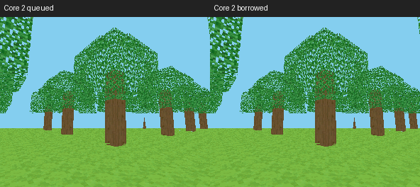
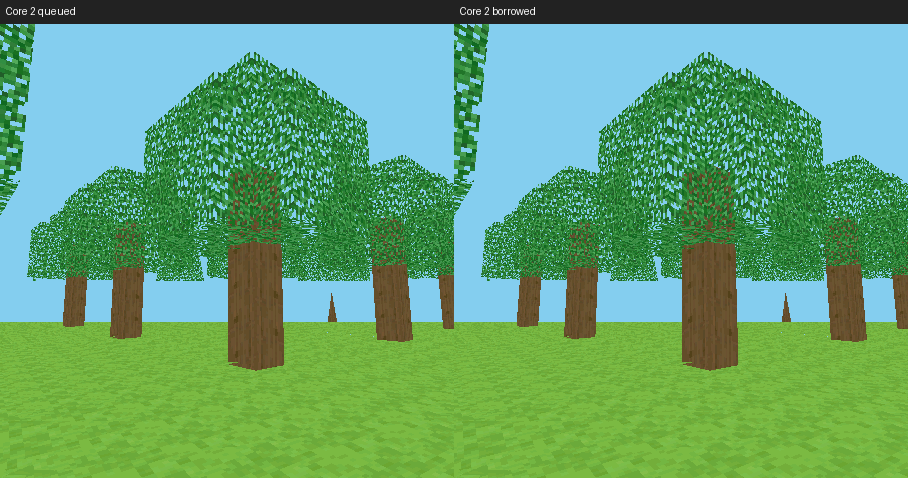

# Core 2 后续验证：桌面借用路径与 SDK 检查

日期：2026-10-11。本轮承接 [Core 2 报告](abi-core2-20261011.zh-CN.md)。只使用私有
`pxa-next-voxel-probe`，没有迁移正式 voxel-craft-cpp；不进行 C/C++ 语言性能比较。
证据在 [abi-core2-refine-20261011/](abi-core2-refine-20261011/)。

## 测试条件

- 种子 `0x5ae1`，眼位置 `(18.5,9.6,18.5)`，yaw `0.7`、pitch `-0.15`，
  FOV `1.221451928`，near `0.25`、far `24`；同纹理、透视插值、树叶 cutout 和 Z。
- `VOXEL_BENCH_SCENE=2,VOXEL_PROFILE=1,VOXEL_BORROW_COMMANDS=1`，O3 / AOT-only。
  桌面 queued 对照关闭最后一个定义。同一分辨率内逐像素比较，不跨分辨率比较工作量。
- pai-touch：296×240，MAC `a4:cb:8f:d6:8d:a4`，实际端口 `/dev/ttyACM1`。
- 新旧 SDK 包各启动 3 次，每次预热 24 秒、采集 8 秒，至少 120 个预热显示帧。
  每帧命令 16224 B、覆盖像素 118875。没有降低视距或画质，没有采集溢出。
- 设备 Host 固件两组均为上一轮最终 Core 2 固件 `e5f9e1d…`，本轮不改 ESP 渲染
  热路径。旧 SDK 对照是本次会话中重新安装旧包后的结果，而非仅引用历史数据。

## 真机显示、输入及限制

| 指标 | 旧 SDK 包本次复测 | 新 SDK 包 |
| --- | ---: | ---: |
| 三轮实际显示 FPS | 13.101 / 13.138 / 13.189 | 13.147 / 13.235 / 13.230 |
| FPS 平均 | 13.143 | 13.204 |
| Host raster 均值，ms | 32.899 | 33.034 |

FPS 来自 LCD 完成间隔，光栅耗时来自 Host 探针。两组基本持平，不能将 0.47% 的
FPS 差异当成这次 SDK 创建检查的收益。前一轮最终借用包历史值为 13.083 FPS，
也不能与本轮差值混为一项优化。

新包另测 3 轮、每轮 48 次指针移动、间隔 160 ms。有效样本加权均值：采样到 Guest
5.052 ms、到 present 提交 39.920 ms、到 LCD 完成 **114.122 ms**。前一轮借用
包均值 115.943 ms，未在此次旧包复测中重测输入，不宣称因果收益。三轮 visible
p95 桶值分别 224.772 / 166.170 / 181.439 ms；末桶较宽，不作为精确尾延迟。
这也不是物理触摸到面板光子的延迟测量。

本轮包未启用额外的 Guest 分阶段计时开关，日志中的 `VOXEL-STAGES samples=0`
表示没有样本，不能解释为几何/编码耗时为零。Guest 更新、几何、编码、HUD、排队
及显示阶段的上一轮完整结果见前报告；本轮不复用旧值冒充新测量。固定相机关闭
物理更新，也不代表正常游戏更新没有成本。

## 真实内存占用

单位 B。稳定值是采集时三轮最大值，包含相同 2112 B 探针。启动峰值从每次应用
启动前重新开启的 heap-local 窗口获得；稳定峰值在预热后重置窗口。没有使用启动
以来历史最低空闲值。固件启动、安装包及窗口后的截图不在这些应用运行峰值中。

| 全机动态堆 | 旧 SDK 包本次复测 | 新 SDK 包 |
| --- | ---: | ---: |
| SRAM 稳定 | 273128 | 273128 |
| SRAM 启动真实峰值 | 277316 | 277228 |
| SRAM 稳定窗口真实峰值 | 273256 | 273256 |
| PSRAM 稳定 | 2816028 | 2814948 |
| PSRAM 启动真实峰值 | 3562892 | 3561232 |
| PSRAM 稳定窗口真实峰值 | 2819628 | 2820200 |

PSRAM 稳定窗口逐轮峰值：旧包 2819224 / 2819628 / 2819580，新包
2818192 / 2820200 / 2818548。新包有一次高 **572 B**，其余两次更低。全机后台及
诊断工作有波动，不能据此证明峰值严格不增，也不能把稳定占用降低归因于 SDK。
历史旧包稳定占用 2811308 B，比本轮两组都低；新包运行前空闲 PSRAM 已比历史少
约 3.4 KiB，所以另外做了同会话旧包复测。保留历史、当前、复测三个原始组。

| 独立资源账目 | 旧 / 新 |
| --- | ---: |
| WAMR 动态稳定 / 峰值 | 47010 / 56616，相同 |
| Guest 线性内存稳定 / 峰值 | 393216 / 393216，相同 |
| AOT 实际代码映射 | 589824，相同 |
| AOT 申请字节 | 569692 → 569952（+260，未增加映射页） |
| RGB565 双帧缓冲 | 284160，相同 |
| Depth16 | 142080，相同 |
| Host 命令 mailbox | 0，相同 |
| 内部 / 外部资源预算实际暖态 | 28956 / 50105，相同 |
| 可选采集探针 | 2112，相同 |

SDK 新增检查只发生在渲染器创建，不增加逐帧分配或对象存储。ESP Host 固件、静态
SRAM 和缓存配置本轮完全相同，因此没有新增固件默认内存成本；全机瞬时峰值的严格
相等仍未得到测量保证。

## 桌面内存和画面

桌面原先不支持同步借用，本轮实现后采用同一光栅执行器，并根据串行产品线程模型
去掉排队模式第二份命令/资源快照。

| 指标 | 旧桌面 queued | 新 queued | 新 borrowed |
| --- | ---: | ---: | ---: |
| 48 KiB 配置下命令分配 | 98304 | 49152 | 0 |
| `sizeof(product_host_t)`，64 位 | 31840 | 31392 | 31392 |
| voxel WAMR 稳定 / 峰值 | 50218 / 138956 | 相同 | 相同 |
| voxel Guest linear 稳定 / 峰值 | 393216 / 393216 | 相同 | 相同 |
| 每种屏幕 rendered / visible / dropped | 160 / 160 / 0 | 相同 | 相同 |

296×240 / 160 DPI 和 454×454 / 305 DPI 圆屏配置各做一次后台 200 ms / 恢复。
三种路径在每种配置下输出全部 RGB565 字节一致。没有新建帧缓冲或深度缓冲。
这是可归因的分配减少；没有测量桌面进程全局 RSS 真峰值，不将该表称为 RSS 结果。





这些是圆屏最终裁切前的游戏 Surface，验证相同 viewport 下的渲染/透明孔洞一致性，
不是圆角遮罩或全部 HUD 安全区的证明。真机三组截图忽略顶部 24 行诊断浮层后，
与上一轮最终借用组同场景图片一致；输入测试另验证转向确实改变图像。

## 桌面 CPU 微基准

固定 240×240 / INDEX8 / 20 个驻留纹理、4 个精灵，所有校验和 `dca27e35`。
每进程预热 200 帧；旧新共用同一光栅库，只比较后端提交/执行组织。该负载不是
voxel，未经过真实 LCD，不能换算为游戏显示 FPS。

| 平均每帧墙钟，µs | 旧 queued | 新 queued | 新 borrowed |
| --- | ---: | ---: | ---: |
| 5 轮 × 20000 帧，总计 | 225.843 | 235.807 | 226.786 |
| 同组光栅执行 | 220.180 | 229.940 | 221.709 |
| 固定 CPU15，15 轮 × 5000 帧，总计 | 390.506 | 381.658 | 351.321 |
| 固定 CPU 同组光栅执行 | 380.431 | 371.874 | 343.192 |

运行顺序轮换，进程不并行。第二组用于排查首组 +4.4% 的差异，但相同光栅代码也
出现明显调度/频率波动；固定 CPU 不等于隔离负载或固定频率，结果方向不一致。
**没有充分证据宣称桌面 CPU 提速或严格性能持平。** 采用本轮后端简化的依据是明确
的存储下降、行为一致和代码复用，不是选择较好的一组结果。后续若优化桌面 CPU，
应在受控频率/负载下独立测量；同步借用的 submit 包含 raster，不能与 queued
单独的 submit 耗时直接比较。

## 复现与验证

工作目录为 PXA 产品仓库根目录；私有源码创建方法沿用前报告的 `stage_probe.py`。
当前测试源码、包、固件、基准 runner 的 SHA256 见证据文件，不包含签名私钥。

```sh
PXA_APP_DEFINES=VOXEL_BENCH_SCENE=2,VOXEL_PROFILE=1,VOXEL_BORROW_COMMANDS=1 \
  bash tools/app.sh build voxel-craft-cpp \
  --source-root local/abi-next-20261011/probe-apps --target esp32s3 --aot-only \
  --output local/abi-refine-20261011/voxel-esp
python3 tools/measure-device-voxel.py --port /dev/ttyACM1 \
  --app pxa-next-voxel-probe \
  --package local/abi-refine-20261011/voxel-esp/pxa-voxel-craft-cpp.pxa \
  --output local/abi-refine-20261011/device-borrowed \
  --repeat 3 --warmup 24 --seconds 8 --minimum-warm-frames 120 \
  --local-heap --wake-home --unlock-swipe 148 214 148 48 --require-surface
```

构建需要已有开发签名配置；测试前按前报告写入 Core 2 测试应用固件并安装私有包，
不要在恢复后的原固件上运行 Core 2 包。旧包使用上一轮 `voxel-borrowed` 产物，
SHA256 见 device-previous.json。模拟器将 build target 改为 simulator；queued
关闭 `VOXEL_BORROW_COMMANDS`。`voxel_probe.c`、`compile_probe.py` 与两个基准脚本
保留在证据目录，按文件中 `local/abi-refine-20261011` / simulator build 路径复现。
桌面基线 runner 可从本轮文件反向应用 `desktop-followup.patch` 恢复，再配置
`PXSYS_RASTER_BASELINE_SOURCE`；`PXSYS_RASTER_BASELINE_KERNEL` 留空。

完整 C++ 测试通过；Host/模拟器 84/84，另有 service-safety 三配置真实 AOT；
桌面后端 sanitizer（链接库非全量插桩）、ESP adapter 普通/sanitizer 测试通过。
包含畸形创建结果、句柄释放、借用覆写、资源快照、无效替换、背压、隐藏和关闭重建。
完整正式应用、背包/编辑、长时间热稳态未在本轮重复验证。

仅应用分区固件曾被写入，结束后恢复 `fdb4e32d…` 原固件并校验 flash hash；私有包
已删除，原有 5 个应用、数据及持久设置保留。Counter 启动、截图和停止均通过。
