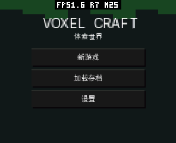
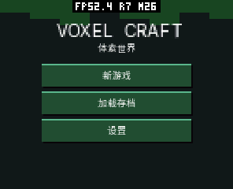
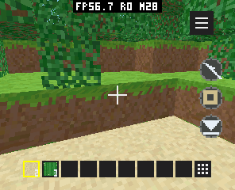

# pai-touch board 固件切换后的首次标题页修复（2026-10-11）

Voxel Craft C++ 0.12.2，release sequence 15。保持 O3、画质、视距和存档格式。

## 原因与修复

异步初始化先创建 renderer/projector，再等待纹理、字体和存档。期间的帧回调会绘制不可点击的标题页并清除 ui_dirty；初始化完成后没有再次重绘，导致按钮一直禁用。Home 后恢复会触发重绘，掩盖问题。

初始化期间禁止帧回调绘制，完成初始化后显式设置 ui_dirty。未增加字段、缓存或分配。原生回归模拟资源等待期间插入帧回调；旧实现失败，修复后首次标题绘制生成 3 个有效按钮。

## 验证

- 完整原生 ASan/UBSan：session、输入、布局、库存、声音、世界、渲染和 C/C++ 同世界/UV 检查通过；32 个种子、3062 棵树，无地形缓存溢出。
- 296×240 模拟器：首次标题、存档槽和新世界通过，使用独立临时状态。
- /dev/ttyACM1 真机：更新后重启，再首次进入标题、加载原有槽位、转向、Home、Jump Jump；截图人工检查通过。
- board 仅更新 factory 应用分区后，141 个已有文件 SHA/大小不变。再通过签名更新本 App 后，除 manifest、signature 和 AOT 外，138 个已有文件仍一致，包括世界存档、KV、纹理、字体及其他 App。未保存、编辑或删除原有世界。

## 内存与显示记录

| 项目 | 设备更新前 | 更新后 |
| --- | ---: | ---: |
| ESP32-S3 AOT 文件 | 696676 B | 679800 B |
| 按 64 KiB 对齐的代码映射 | 720896 B | 720896 B |
| Guest 首次线性内存 | 393216 B（6 页） | 393216 B（6 页） |
| Guest 线性内存上限 | 32 页 | 32 页 |

原生 VoxelCraft 对象仍为 299048 B。AOT 差异还包含固定 SDK 编译输入的差异，不能全部归因于两行逻辑修复；基线使用设备烧录前真实 SHA 清单，不能使用另一次历史测试包。未为体积调整 O3。

加载原有存档后，5 秒 PERF 窗口取得 34 次光栅化、33 个物理显示完成间隔，未溢出。光栅化均值 64.02 ms，显示间隔均值 147.39 ms（约 6.78 FPS）。此记录仅证明世界持续绘制、完成显示；修复前卡在菜单的零帧不能作为同负载 FPS 对比，也未建立本次 C/C++ 性能比较。截图中的 HUD FPS 是应用统计，不替代显示完成计数。

本次没有新增缓存；代码映射、Guest 线性内存和对象大小不增加。整体固件 SRAM/PSRAM 真峰值没有进行成对复测，不能据此宣称整体峰值改善。

结构化数据见 validation.json。此次修复不改变材质、树叶孔洞、深度遮挡、绘制路径或默认画质。
