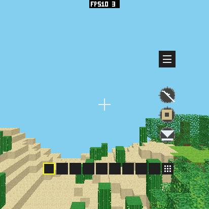
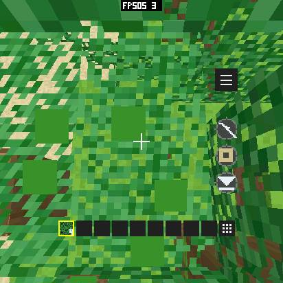
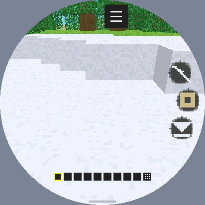
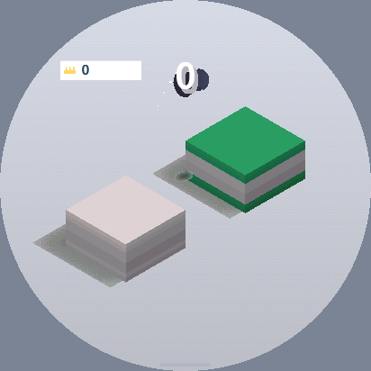

# Game-render：复用行宽倒数与 32 位区块计算（2026-10-15）

这轮保留两项小改动：相同扫描线宽度复用精确的浮点倒数；
将输入本来已经是 int32 的区块长度计算改为 int32，正确处理 INT32_MIN 步长。
实际收益按下方同条件复测记录；未确认的收益与被撤回候选分别列出，不宣称操作延迟全面降低。
没有改变纹理质量、块长上限、Z-buffer、透明孔洞、视距、应用包或 SDK/Host ABI。

上一轮已分项提交 SDK `62ffefe`、应用报告 `977dcb9`、主仓库引用 `a72f162`。
本轮基于它们继续检查；没有重复采用此前无收益的常量区块除法方案。
源码、报告之外的工作区改动持续变化，因此测量固件使用固定对象库进行私有重链接。
[构建来源](game-render-quotient-20261015/provenance.json)、[固件与代码段 SHA](game-render-quotient-20261015/firmware-pair.json)、
[对象一致性](game-render-quotient-20261015/width-archive-equivalence.json)：93 个 libpxa 对象中只有 raster.c.obj 改变。
原版 control 与上一轮设备固件的代码/常量/IRAM/DRAM 数据段完全相同；候选只替换光栅化对象。

## 固定工作负载与测量口径

Watcher：ESP32-S3，MAC 8c:bf:ea:09:af:6c，固定 USB by-id，UART 2,000,000；
412×412 RGB565、圆屏、284 DPI、40 MHz QSPI、O3。使用本仓库板级代码。
每轮校验 MAC 与已安装 manifest，重新启动相同正式 AOT 包，并加载相同存档。
不写分区表、Bootloader 或数据分区。完整旧应用分区备份保留。

Voxel 0.12.4 / release 17 包 SHA：
`f4abaf8c522c836d48daa8c2b9430c2963788197cc29ed28ead8039a7a8504d6`。
存档 SHA `ef6f185dc56835b0e79afa6ab0120551e11885582d997f9a659b9f4ffbab4970`，
seed 3646175235，world hash 2893106422；相机 (32.5,17.000850677490234,32.5)、yaw=0、pitch=0。
原生分辨率、视距 32、quality 0、cheap paths 关闭；物理、HUD、音频保留。测试期间自动视距关闭，最后恢复开启。
所有静止窗口命令均为 23,752 B、covered=250,037；画面和工作量一致。

Jump 0.1.5 正式包 SHA：
`da5dc9757979f2a164db7ff94b8ec4a6c95388ae69bedde7743e898fc58376cb`。
蓄力请求 0.68 秒。UART 和输入同步会改变设备实际按住时间，跳跃轨迹、碰撞和音效资源也有变化。
因此 charge 的小差异不视为严格性能收益。

每个窗口 4 秒，记录独立 DMA 完成间隔、Host 光栅化和输入关联时间；截图放在窗口外。
“间隔 FPS”=1/平均完成间隔；“整窗 FPS”=窗口内完成帧数/实际窗口时间，短窗口有约一帧的边界误差。
没有拿提交计数或屏幕 FPS 标签代替实际显示完成。
本轮没有新增 Guest 更新、几何、编码、SPI 独立时间戳；这些阶段不能从两项计时中直接拆分。
冷启动组在 REBOOT 回复后等待 23 秒，两个版本采用同一流程；它与普通组分别列出。

## 方案筛选

| 方案 | 原因及验证 | 性能结果 | 内存变化 |
| --- | --- | --- | --- |
| 已隐藏区块逐块预检，未采用 | 固定世界几何夹具中，整行拒绝后只有 274/7,689 区块完全隐藏（3.6%） | 收益机会低，新增深度读取和分支不划算；没有把计数当真机收益 | 未引入覆盖缓存 |
| 按材质跳过无用边插值，撤回 | 纯色不用 UV、恒定亮度不用 light；像素/深度相同 | attributes 真机结果没有明确优势，撤回新增模式和行分支 | 结构大小未增；最终不包含这套实现 |
| 区块长度计算收窄，保留 | 两个调用点早已 clamp 到 int32；无符号取负安全覆盖 INT32_MIN | 减少不必要的宽比较/绝对值；与行宽倒数复用一起测量，未单独归因 FPS | 无字段、缓存或分配 |
| 相同纹理端点的精确商复用，撤回 | 固定几何诊断中 4,562/7,689 次 V 端点可复用；画面相同 | 冷启动同条件回测没有优势，额外分支与代码不值得保留 | 最终不包含这套实现 |
| 相同行宽的浮点倒数复用，保留 | 几何诊断中 2,575/6,382 行宽与上一处理行相同；同分母复用完全相同的浮点结果 | 省去重复浮点除法，变化宽度保留原来的精确计算 | 两个 polygon 局部值；编译栈帧仍为 512 B，无持久缓存/分配 |

计数来自固定存档的 Guest 几何配合小型测试纹理/调色板，**不是生产纹理下的设备运行计数**。
见 [区块计数](game-render-quotient-20261015/block-count.log)、[端点计数](game-render-quotient-20261015/endpoint-count.log)、[行宽计数](game-render-quotient-20261015/width-count.log)。
未加入 SIMD/汇编、额外任务或并行缓存；现有板级 DMA/像素交换和 Host 并行策略保持原样。

## 真机结果

[原始逐轮数据和内存](game-render-quotient-20261015/measurements.json)；每组完整 report.json 同目录保存。

| Voxel 组 / 场景 | DMA 间隔 FPS | 整窗 FPS | Host raster ms |
| --- | ---: | ---: | ---: |
| baseline-voxel / idle | 10.561 | 10.289 | 65.077 |
| control-voxel / idle | 10.536 | 10.292 | 65.183 |
| control-cold-voxel / idle | 10.618 | 10.334 | 64.501 |
| attributes-voxel / idle | 10.535 | 10.374 | 65.407 |
| endpoint-voxel / idle | 10.603 | 10.374 | 64.665 |
| endpoint-final-voxel / idle | 10.605 | 10.335 | 64.635 |

这些短测包含初始化、对象布局、调度和后台任务波动。原版冷启动本身就比普通回测快，
不能只挑其中一个基线计算百分比。纹理端点候选保持在约 10.5～10.7 FPS 的同一水平，因此撤回；
最终行宽候选见 width-voxel，同条件基线为 control-cold-voxel：
10.618 → 10.721 DMA 间隔 FPS（约 +1%），raster 64.501 → 63.744 ms（约 -1.2%）。
只有两轮相同条件短测，结论是小幅收益；未把较慢的普通基线当作唯一参照。
这轮不能替代像素循环访存、Guest 几何以及整个显示流水线的进一步定位。

| Jump 组 / 场景 | DMA 间隔 FPS | 整窗 FPS | Host raster ms |
| --- | ---: | ---: | ---: |
| control-jump / idle | 33.700 | 33.334 | 19.833 |
| control-jump / charge | 30.525 | 30.218 | 21.110 |
| endpoint-jump / idle | 33.862 | 33.584 | 19.862 |
| endpoint-jump / charge | 29.940 | 29.622 | 21.003 |
| width-jump / idle | 33.740 | 33.580 | 19.818 |
| width-jump / charge | 30.057 | 29.845 | 21.125 |

Jump 约 34 FPS 静止、约 30 FPS 蓄力/跳跃，整体持平；没有证据支持明显收益。

| 操作组 / 场景 | DMA 间隔 FPS | 整窗 FPS | Host raster ms |
| --- | ---: | ---: | ---: |
| control-moving-voxel / turn | 9.658 | 9.460 | 69.968 |
| control-moving-voxel / walk | 10.541 | 10.457 | 64.103 |
| width-moving-voxel / turn | 9.855 | 9.459 | 68.191 |
| width-moving-voxel / walk | 9.490 | 9.213 | 69.916 |

操作组按时间注入相同手势，实际相机/行走轨迹会随调度变化；仅用于功能、负载范围与延迟回归，不能作为严格加速比例。
行走候选只有 9.49 FPS，原版 10.54 FPS；对应命令量为 23,752～30,864 B 与 20,056～23,752 B，
路线、相机及遮挡已不同，见 [两次行走的结束画面](game-render-quotient-20261015/walk-comparison.png)。
保留较低结果，不能据此断言加速或退化。未来要为移动性能比较加入可重放的相机/物理轨迹。
逐轮 Guest 分发、提交及 DMA 关联 P95/最大值保存在 JSON。仍有超过 100 ms 的关联延迟；
没有光学触摸到像素或声学测量，也没有足够证据宣称 P95 全面降低。

## 内存核对

算法无新分配、缓冲或全局字段；frame、depth、命令队列、Guest 线性内存与 AOT 页数相同。
Voxel 两帧 678,976 B、depth 339,488 B、借用路径 mailbox 0 B；测量 probe 2,176 B，结束释放。
Guest linear 393,216 B、AOT mapped 655,360 B、Raster resources 35,396 B。
Jump 三帧 1,018,464 B、depth 0 B、mailbox 49,152 B、linear 131,072 B、AOT mapped 524,288 B。

Watcher IRAM 121,275 B、DRAM data 33,064 B、bss 17,472 B、PSRAM bss 29,096 B 不变。
映射代码增加 624 B，但 64 KiB 页边界和实际映射页数不变；rodata 709,940 B 不变。
S31 实际工具链编译确认已映射 IRAM 的 depth-texture 内核仍为 312 B；没有新增 IRAM 要求。
Xtensa 编译器报告 painter 栈帧 512 B、triangle 栈帧 400 B，均不变。

| 组 / 窗口 | SRAM 稳定最大 B | SRAM 本窗峰值 B | PSRAM 稳定最大 B | PSRAM 本窗峰值 B |
| --- | ---: | ---: | ---: | ---: |
| control-voxel / startup | 511,624 | 516,240 | 3,579,340 | 4,664,528 |
| control-voxel / memory | 511,624 | 511,624 | 3,581,520 | 3,581,576 |
| endpoint-voxel / startup | 511,624 | 516,240 | 3,579,408 | 4,780,368 |
| endpoint-voxel / memory | 511,624 | 511,624 | 3,581,588 | 3,581,656 |
| control-cold-voxel / startup | 511,660 | 516,240 | 3,581,400 | 4,296,040 |
| control-cold-voxel / memory | 511,624 | 511,624 | 3,581,432 | 3,581,492 |
| endpoint-final-voxel / startup | 511,660 | 516,240 | 3,581,752 | 4,780,252 |
| endpoint-final-voxel / memory | 511,624 | 511,624 | 3,581,496 | 3,581,560 |
| width-voxel / startup | 511,660 | 516,240 | 3,581,800 | 4,780,300 |
| width-voxel / memory | 511,624 | 511,624 | 3,581,448 | 3,581,516 |

表中 heap 峰值由本次 MEMORY START/STOP 记录，区分启动与游戏窗口；原始 budget/history 保留。
整机峰值不是光栅模块自身峰值：普通候选首轮峰值比普通 control 高，冷启动组也另列实测。
此前相同原版代码已有约 4,780,188 B 的启动峰值，见上一轮 [control-cold 数据](game-render-occlusion-20261015/control-cold-voxel.json)。
不能把某次低峰值称作本轮节省，也不能承诺每个整机窗口的峰值不增长。可归因的静态/模块/页面占用均未增加；
首次初始化及背景任务重叠的差异仍需更细的分配时间线才能完全解释。
最终候选本轮最大启动峰值 4,780,300 B，相同原版历史最大 4,780,188 B（相差 112 B）；
本轮同条件原版窗口只有约 4,296,040 B，不能隐藏这个窗口差异或把历史最大当成本轮逐窗口持平证明。

## 正确性与回归

- 原生 raster/span/assets/game-render 4/4；O3 ASan/UBSan 12,000 个数值 oracle 用例通过，含 INT32_MIN/MAX、短块、clamp、透明孔洞和相等深度。
- [2,400 组 Painter 组合](game-render-quotient-20261015/width-fixture.json)：纯色、仿射/透视、NPOT、亮度梯度、裁剪、分行执行、透明与 blend；明确覆盖固定深度和固定 U/V，颜色、深度及 covered 输出 39,331,200 B 与原版完全相同。
- [20 个游戏输出](game-render-quotient-20261015/width-pixels.json)：同 Guest/SDK 对象，Voxel 四视角、两绘制质量路径、Jump 连续跳跃及固定 412×412 存档；固定场景的颜色加深度 678,976 B 相同。
- [设备截图](game-render-quotient-20261015/device-pixels.json)：排除顶部 16 像素 FPS 标签，其余图像完全相同。
- 完整 SDL product Host 的真实 AOT 游戏均启动并操作；412×412 圆屏、284 DPI；模拟器 raster 回归通过。构建过程中补上资源分配器声明缺失的头文件，其他进行中的资源改动保留；它们未混入性能固件。
- 初次功能脚本没有成功解锁，锁屏截图已排除；增加 DOWN 停留及 PXA 直出来源断言后重跑成功，见 [脚本验证](game-render-quotient-20261015/functional-harness.json)。
- 真机瞄准树林、长按挖叶并拾取、网格重建、HOME/恢复、停止重启及重载；固定存档 SHA 未变。恢复自动视距开启、飞行/反转关闭、自动跳跃开启，关闭测试应用并释放探针。

| 原版固定视角 | 最终固定视角 |
| --- | --- |
|  |  |





## 复现与限制

在 workspace 根目录使用 `local/game-render-opt3-20261015/` 的 frozen control/width 固件、
`build-width.py`、`cold-bench.py`、`functional-check.py` 和同一包/存档。
固件源包含工作区当时的 Watcher 既有流水线改动，不能仅按仓库 HEAD 宣称重现绝对 FPS；
archive/ELF/bin SHA 和所有原始日志保留在该目录。私有对象替换方式可排除其他并行改动。

```sh
PXADB_BAUD=2000000 python3 tools/measure-device-gameplay.py \
  --port /dev/serial/by-id/usb-1a86_USB_Dual_Serial_56D5054872-if02 \
  --expected-serial 8c:bf:ea:09:af:6c \
  --app pxa-voxel-craft \
  --package local/game-render-opt-20261014/voxel-package/pxa-voxel-craft.pxa \
  --output local/recheck-voxel --repeat 3 --warmup 6 --seconds 4 \
  --size 412 412 --prepare-tap 206 258 --start 206 165 --scenes idle
```

先确认自动视距关闭与固定存档，再依次测 control、候选、control；结束恢复设备设置。
未做候选固件的 pai-touch/Korvo 硬件 A/B、长时间耐久、物理触摸/声音延迟测量。
未来像素内核、SIMD/汇编或异步调度属于待验证方向；必须继续核对画面、延迟和 SRAM/PSRAM/真实峰值，不能直接外推收益。
