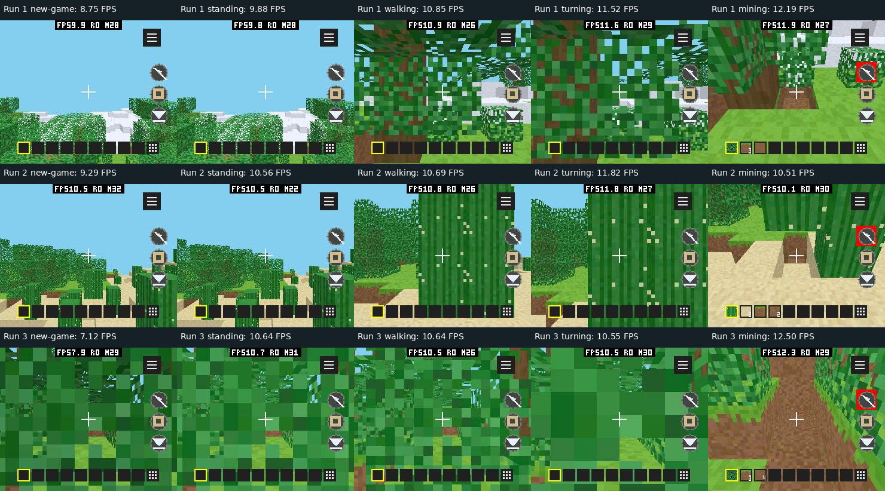

# pai-touch 正常游戏帧率、内存和延迟实测

2026-10-11。当前正式版 `voxel-craft-cpp 0.12.3` 在 pai-touch 上正常新游戏后，
本轮移动、转向、挖掘约 **10–12 FPS**，采样输入到 LCD 完成平均约 **117–124 ms**。
这个延迟会影响操作手感；此前固定场景约 13.2 FPS 不代表正常游戏速度。

## 构建和测试条件

- pai-touch / ESP32-S3，MAC `a4:cb:8f:d6:8d:a4`，本次端口 `/dev/ttyACM1`。
- 原生 296×240、160 DPI、全分辨率；双 RGB565 帧缓冲、16 位深度；
  保留树叶透明孔洞、透视纹理、物理、碰撞、HUD、背包和音效。
- 使用已提交 Core 2 Host/SDK；C++26 / O3、AOT opt-level 3、size-level 0。
  未开启 BENCH、PROFILE、VALIDATE 或 PLAYTEST 宏。
- 正式源码只修改打包身份为 `pxa-voxel-craft-cpp-ui-perf`，避免触及原游戏存档。
  **实测 AOT 与正式版矩阵中的 AOT 字节一致**，SHA256：
  `4452560465eff04a5c03f8b1c00c412d2ee7145a062c7aa9eaf3f95ca1162cce`。
  未裁剪字体或其他资源；打包及固件来源见 [provenance.json](gameplay-device-20261011/provenance.json)。
- 三次独立启动，从标题页点击“新游戏”；每轮分别采集约 6 秒的新游戏初期、
  静止、前后行走、左右转向、向下长按挖掘。初期采集后再等待 12 秒；
  走动每秒换向，转向约每 240 ms 注入一次位移。暂停菜单及背包截图也已检查。
- 使用正常的时钟随机种子和默认自动视距，**三轮地图不同**。这是实际体验采样，
  不用于相同负载的 C/C++ 或 ABI 前后对比，也不声称覆盖所有地图或长时间热稳态。
  自动视距、物理和渲染均持续运行，没有用固定相机测试替代游戏。
- 输入从设备 PXADB 注入正常输入路由，经真实 Guest 和 LCD 显示路径执行；
  不是通过测试接口直接改相机或挖掉方块。原始串口记录保留在工作目录
  `local/voxel-gameplay-20261011/measurements/serial.jsonl`。

## 实际显示帧率

来自不同 FrameId 的 **LCD 完成间隔**，不以游戏提交 FPS 或截图浮层代替。
合并 FPS = 1,000,000 / 三轮全部有效间隔的均值。所有 15 个窗口均无 raster/present
溢出、无 Surface 切换，截图均确认来自可见游戏 Surface。

| 阶段 | 三轮实际显示 FPS | 合并 FPS | 帧间隔 p95，ms | Host 光栅均值，ms |
| --- | --- | ---: | ---: | ---: |
| 点击新游戏后的初期 | 8.75 / 9.29 / 7.12 | 8.39 | 141.52 | 46.21 |
| 静止观察 | 9.88 / 10.56 / 10.64 | 10.36 | 118.01 | 44.05 |
| 前后行走 | 10.85 / 10.69 / 10.64 | 10.73 | 117.90 | 47.84 |
| 左右转向 | 11.52 / 11.82 / 10.55 | 11.30 | 117.83 | 50.28 |
| 长按挖掘 | 12.19 / 10.51 / 12.50 | 11.74 | 118.33 | 42.90 |

新游戏初期包含菜单点击、世界生成及首次网格构建；标题静止时按需绘制，
不要求连续刷新，因此不将标题闲置刷新次数作为游戏 FPS。

默认视距从 32 起步。第一轮转向结束时日志记录视距 24、`q=0`；第二轮挖掘
结束时视距 18、`q=0`；第三轮静止阶段已降到 12、`q=1`，后续保持该档。
`q=1` 采用不带光照的调色板，仍保留纹理、透明孔洞和深度。不同阶段画面、
视距、朝向及像素覆盖均变化，不能把后段 FPS 上升归因于语言或接口优化。
本轮没有手动降画质，但默认的质量阶梯确实发生了取舍。

完整帧间隔、光栅样本、内存和输入计数见
[captures.json](gameplay-device-20261011/captures.json)，汇总见
[summary.json](gameplay-device-20261011/summary.json)。
下图每列对应上表阶段、每行对应一次启动；帧率标签来自采集结果，截图在窗口外取得。



长按后方块移除、物品进入快捷栏/背包已通过每轮挖掘及背包截图确认；
音频会话初始化成功，Host PCM 提交/渲染计数随操作增加，没有拒绝或队列耗尽。
这里验证的是实际发声路径，不评价音效的主观听感。

## 操作延迟

每段先清空历史计数，再采集同一 PERF 窗口。均值按有效样本数加权；
按住手指会持续产生采样，多个指针移动可能合并进一帧，所以这些计数不是
独立按钮点击的个数，三个阶段也不是逐个配对的样本。

| 操作 | 到 Guest 均值，ms | 到渲染提交均值，ms | 到 LCD 完成均值，ms | LCD 最大值，ms | LCD 样本数 |
| --- | ---: | ---: | ---: | ---: | ---: |
| 行走 | 4.45 | 37.53 | 123.74 | 232.56 | 190 |
| 转向 | 4.18 | 30.25 | 119.33 | 155.60 | 199 |
| 挖掘 | 4.34 | 35.09 | 116.60 | 177.24 | 207 |

新游戏点击的两种边沿在每轮仅得到两个 LCD 样本，包含按下高亮和释放后生成世界。
各轮最长样本为 **627.93 / 618.19 / 649.42 ms**；不把六个样本的均值或
粗粒度 p95 当作可靠的启动延迟分布。标题初始化采用固定等待确保资源就绪，
本轮没有精确测量“启动应用到标题首次可见”的时间。

延迟从设备记录的注入指针采样时间戳开始，到 Guest 回调、渲染提交、LCD 传输
完成结束；**没有包含采样前的真实触摸硬件延迟，也不是触摸到面板光子的测量**。
`PERF INPUT` 的 p95 来自桶估计；大延迟落入末桶时可能返回该窗口最大值，
因此保留原始值但不将它包装成精确 p95。

从实测看，这个延迟偏大。10–12 FPS 的帧间隔本身约 83–100 ms，约 120 ms 的
采样到 LCD 延迟与当前吞吐相符，但不能据此认定操作体验已经足够好。
输入到 Guest 的平均成本约 4 ms，而单帧 Host 光栅已要 43–50 ms。
代码核对确认当前为同步借用命令，命令 mailbox 为 0，Presenter 收到帧通知后即尝试
呈现，并非以定时轮询等待下一次显示。因此没有证据把主要成本归咎于 ABI 分发，
也不能直接删除深度或透明处理来降低延迟。

后续需要独立测量 Guest 几何、提交背压、旋转/拷贝及 LCD 等待来继续归因；
本轮未开启 Guest 分阶段计时，不能用旧固定场景的耗时冒充当前游戏数据。
不能将上表非配对样本的均值直接相减，算成精确的各阶段独占耗时。

## 内存

单位 B，均为**整机**占用，包含系统与游戏。每次启动和每段操作分别用
`MEMORY START/STOP` 重置 ESP-IDF 分配最低空闲值，捕获瞬时分配再释放的峰值；
不使用开机以来的累计最低空闲量。截图在所有正式测量窗口之外。

| 窗口/项目 | SRAM | PSRAM |
| --- | ---: | ---: |
| 游戏阶段稳定值，三轮最大 | 286,292（279.58 KiB） | 2,937,320（2.801 MiB） |
| 游戏阶段真实峰值，三轮最大 | 286,424（279.71 KiB） | 2,940,924（2.805 MiB） |
| 应用初始化真实峰值，三轮最大 | 290,968（284.15 KiB） | 3,246,568（3.096 MiB） |

操作窗口包含 **2,112 B PSRAM** 的可选 PERF 探针，初始化窗口未分配探针。
首次授权音频的额外试运行初始化峰值为 SRAM 290,904 / PSRAM 3,219,164 B，
见 [first-grant-init.json](gameplay-device-20261011/first-grant-init.json)。该试运行的
第二次标题截图过早，套件中断；其 FPS 不计入最终三轮。正式三轮全部通过。

| 内存组成 | 本轮观测 |
| --- | ---: |
| Guest 线性内存 | 393,216 B；启动日志 linear_peak 也为 393,216 B |
| AOT 文件 | 630,772 B |
| AOT 代码映射/分配 | 655,360 B，位于 PSRAM；每次停止确认释放 |
| 两个 RGB565 帧缓冲 | 284,160 B |
| 16 位深度缓冲 | 142,080 B |
| Host 绘制命令 mailbox | 0 B，同步借用 Guest 命令 |
| 光栅资源 budget external | 35,396 B |

Guest 中的命令数组已包含在线性内存中，不能再与 Guest 总量重复相加；
帧缓冲、深度和代码映射也已包含在整机堆占用中。
日志的 WAMR `peak`、Surface `peak_total` 以及 budget `peak_*` 是历史累计诊断，
不是上表本次窗口的真实峰值。WAMR 启动日志 dynamic current 47,865 B、停止后
current 416 B 也只是对应时刻，不能当作全部游戏过程的稳定动态占用。

三次停止后 frame/scratch/mailbox/probe 全部为 0，Guest linear 为 0；
SRAM 约 283,520–283,556 B、PSRAM 约 1,492,060–1,492,460 B，
未出现随三次重复启动持续增长的游戏缓冲，resource denied/allocation_failures 均为 0。
这不是长时间内存泄漏证明。

## 复现及设备恢复

测量工具：[measure-device-voxel-gameplay.py](../../../../../tools/measure-device-voxel-gameplay.py)。
在 Core 2 固件上安装保持正式 AOT 的独立 ui-* 包，确保没有活动应用后运行：

```sh
python tools/measure-device-voxel-gameplay.py \
  --port /dev/ttyACM1 --app pxa-voxel-craft-cpp-ui-perf \
  --package local/voxel-gameplay-20261011/artifacts/pxa-voxel-craft-cpp.pxa \
  --output local/voxel-gameplay-20261011/measurements --repeat 3
```

坐标只适用于本次 296×240、160 DPI 的 pai-touch 配置；每轮世界由正式版时钟生成，
复现相同操作步骤会产生地图差异。本轮没有保存新世界，不将随机场景当作固定基准。

测试只写应用固件分区 `0x10000`。原应用分区在更新前已与备份做 Flash 摘要匹配，
完成后恢复并再次验证 `digest matched`；原五个应用 ID/版本/启用状态均一致，
原游戏未被替换，独立测试包和数据已删除，LittleFS 已用空间恢复到 7,348,224 B。
亮度、音量、DPI 和 FPS 浮层等设备设置未修改。
见 [device-restored.json](gameplay-device-20261011/device-restored.json)。
