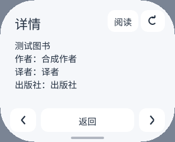
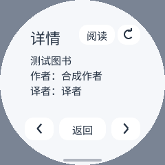

# 官方接口图书详情与云端进度

2026-10-17。本轮为独立原生客户端新增图书详情和有界登录续期，并减少序列化临时分配。最终候选已安装在 pai-touch，并通过真实接口、同场景对照和完整停止后的三次重开。下文区分原生基准、设备实测和仍未解决的问题。

## 使用与实现

- 书架、搜索结果每张书卡右侧有信息图标；卡片主体继续直接阅读。阅读菜单也有“图书详情”。
- 详情包含作者、译者、出版社、出版时间、ISBN、评分和简介，按 DPI 与安全矩形分页；可直接阅读、返回、刷新。
- 云端进度显示百分比与累计阅读时间。`1` 显示为 `1%`；只有 `100%` 且服务有完成时间才显示“已读完”。不足一分钟不显示成零分钟。
- 详情按需分配，退出时释放。打开书架、本地翻页不会调用新接口，也没有新增常驻 Key、全量书架 JSON 树或图片缓存。
- 数据流为已有会话读取已存在的 Skill Key，再调用官方 `/book/info` 和 `/book/getprogress`。不创建或重置 Key，不要求已登录用户重新扫码。
- Key 只在本次详情协程中存在，不写入私有状态、安装包或日志。网页 Cookie 与网关 Bearer 按固定来源分离；网关返回的 Cookie 不修改网页会话。
- 新请求使用原有 SDK HTTP 能力，无 Host、ABI、脚本引擎改动。取 Key 的 GET 省略无用途的 Content-Type，保留 SDK 的八请求头限制。

书架仍使用原有有界分页接口，阅读与目录仍使用已验证的轻量路径。本次没有把整个书架改为一次加载的 `/shelf/sync`，也没有实现云端位置写入或时长上报。章节全文与已购后续章节的差异见 [参考核对](official-skill-koreader-20261017.zh-CN.md)。

## 故障与生命周期

响应有独立限额：Key 4 KiB、书籍详情 32 KiB、云端进度 8 KiB；字段还有各自长度限制。解析时借用响应字段，只保留界面文本。书籍详情响应释放后才请求进度，避免同时保留两个完整响应。

鉴权拒绝、无效 Key、错误书目 ID、接口升级提示、重定向和过大的响应均可恢复。远端升级说明只作兼容状态处理，不执行其命令。进度获取失败保留书籍信息；刷新失败保留原详情。返回和直接阅读会取消未完成的任务，取消后重新打开同一本书也不能提交旧请求结果。

本地与云端阅读位置完全分开。详情不会把字节偏移当作官方坐标，不覆盖本地页码，不把测试时间上报为阅读时间。

## 已完成的验证

最终完整 LTO/O3 候选完成 **128 项 AOT/Wasm 模拟器工作流**：每种引擎各 9 项续期、12 项详情接口、19 项原阅读流程、6 项封面、18 项插图检查。新增检查覆盖 296×240、480×480 高 DPI、240×240 圆屏和 480×800 竖屏。

验证包含实际 Guest/Host 请求、绘制与输入路由，并非用 Python 重写 UI：

- 实际 Cookie、X-Vid、X-Skey 和 Bearer 请求头策略；Key 不持久化、不进日志。
- 本地详情翻页不增加网络请求；从详情阅读，以及返回原章节和位置。
- 网关 Cookie 注入不会覆盖原会话，失败可重试。
- 无效/拒绝授权、错误书目、升级、302、超大响应、进度单独失败。
- 等待正文时取消、立刻重开同一本书，旧完成结果不会提交。
- 原有登录、重开、分页、退出、限额、目录、图片、取消和资源释放。

原生 ASan/UBSan 数据测试还覆盖了正文之外的 JSON 类型、Unicode、数字边界、格式错误、进度百分比和时间单位。真实账号的两个官方接口已在开发机通过，原生解析器也读取过其私有响应；真实账号数据未加入公开测试样本。

## 分配与链接优化

| 改动 | 原因与收益 | 内存与验证范围 |
|---|---|---|
| 编译期 JSON 字段名、直接追加到输出字符串 | 避免每个字段生成键名、引号、数字和中间对象字符串；格式保持兼容 | 0/3/32 个阅读位置的分配从 4/17/136 次降到各 1 次；原生编码临时堆峰值 410/970/6,682 → 266/707/4,992 B |
| Cookie 请求头一次预留、直接追加 | 每次请求减少键值对拼接的临时字符串 | 合成的 2/16 项 Cookie 从 5/22 次分配降到各 1 次；临时峰值 325/2,258 → 95/773 B；空请求头仍为 0 次分配 |
| App 与 Guest SDK 完整 LTO，保持 O3 | 共同优化、合并模板及请求路径；不采用 Os/Oz | 最终 S3 AOT 为 1,450,304 B，文本 1,368,116 B；按 64 KiB 粒度仍为 21 页，1,376,256 B，和 v10 相同。这里是构建计算值，尚不是设备内存测量 |
| 书架单一有界重试循环 | 一处请求/协程恢复路径，明确最多续期一次；续期响应在重试前释放 | 比重复请求语句的同功能 O3 候选少 11,084 B 文件；不增加常驻缓存 |

五组交替桌面原生序列化测量，0/3/32 个位置的中位耗时分别为 599/3,177/26,049 → 380/1,472/12,466 ns。它们只证明相同序列化工作负载的分配和 CPU 变化，不能替代 S3 保存延迟、实际显示帧率或整机峰值。临时堆计数不含输入状态、分配器元数据和 Host。

S3 文件比 v10 的 1,420,304 B 增加 30,000 B。代码映射计算值保持相同，不等于总内存必然相同；各类真机计数与新增功能的按需成本见下文。Guest 上限仍为 2 MiB，不以相同上限冒充相同占用。

ThinLTO 和重复续期恢复路径曾额外占用一页代码映射，均未部署。仅禁止通用 quote/number 内联，以及动态键逐字转义的实验也未采用。完整 LTO 引出的 WASI random 导入已在签名清单中明确声明，导入校验保持启用。

## 登录续期

本轮真机起始检查发现轻量书架明确返回 `-2012`，而相同会话的官方 Skill Key 接口仍然可用。这不是有效的阅读性能基线，该次过期页面测量已排除。

开发机对固定官方 `/web/login/renewal` 的验证收到明确成功响应，同账号书架恢复；未重新扫码、未创建或重置 Key。设备私有目录禁止外部写入，调试器拒绝了直接写入，保护未绕过，原会话字节保持不变。最终 Guest 已在设备上正常续期并通过自己的私有文件接口保存；同账号书架恢复，没有重新扫码。

产品只在书架明确过期时尝试一次官方续期，成功后重试同一个幂等 GET；不自动重放登录提交、购买或其他修改操作。续期 Cookie 在有界响应完整接收、成功字段验证、账号一致后才发布。拒绝、HTTP 错误、截断、超限、账号不符及取消都保持原凭据；重试仍过期时显示重新登录入口，不无限循环。

续期新增 9 类真实 AOT/Wasm 工作流：成功、拒绝、HTTP 错误、损坏正文、超限、错误账号、无 Cookie、重试仍过期、未完成请求取消。最终构建的两种引擎各 64 项、共 128 项工作流已通过；真实详情、云端进度、分页、刷新取消、返回原阅读以及三次完整停止后的重开也已通过。

## 同固件真机对照

使用同一留机 PNG Host、字体、有效账号、偏好及图书版权页。两次正常软件重启分别测量 v10 和最终版本：HTML 241,046 B、投影数据 43,366 B、正文 901 B、300 项目录窗口；固定 10 次页外输入探针和 12 次本地前后翻页。无 Host、ABI 或字体更新。原有会话过期的失败尝试排除，不混入对照。

| 指标 | v10 | 最终版本 |
|---|---:|---:|
| Guest 水合/投影 | 1,919 ms | 1,500 ms |
| Guest 阅读模型 | 281 ms | 192 ms |
| 文本与首次字符映射 | 347 ms | 401 ms |
| 解析开始至 Guest READY | 2,548 ms | 2,094 ms |
| 载入期间 Guest 输入最大值 | 209.644 ms | 190.907 ms |
| 12 次本地翻页 Guest 输入 P95 | 8 ms | 7 ms |
| 12 次本地翻页 Guest 输入最大值 | 8.739 ms | 7.735 ms |
| 实际代码 PSRAM 映射 | 1,376,256 B | 1,376,256 B |
| 本实例 Guest 线性内存真实峰值 | 589,824 B | 589,824 B |
| WAMR 原生分配器本实例峰值 | 248,638 B | 220,332 B |
| 阅读窗口整机 PSRAM 已用峰值 | 4,006,868 B | 3,998,292 B |
| 12 次翻页后 PSRAM 已用采样 | 3,507,664 B | 3,500,844 B |
| 此时最大连续空闲 PSRAM 块 | 4,325,376 B | 4,063,232 B |

这是一组相同工作负载的冷启动对照：Guest 内容准备约少 17.8%，阅读窗口 PSRAM 峰值少 8,576 B；字符映射这一阶段反而慢了 54 ms，不能声称所有阶段均提速。初始空闲 PSRAM 两次相差 1,164 B，系统任务和分配布局也有波动；未把一次差值当作长期统计保证，未宣称碎片改善。

SRAM 按相同窗口核对：启动峰值为 276,824 → 276,788 B，阅读窗口峰值 276,236 → 276,328 B，12 次翻页后采样 272,100 → 272,140 B。这里只能说同量级且有几十字节波动，**不能声称每一个 SRAM 计数都严格不增**。WAMR、Guest 线性内存与物理堆有包含/映射关系，表中没有把这些计数相加冒充物理总量。

新增详情打开窗口的 PSRAM 已用峰值为 3,574,252 B。包含详情翻页、取消、截图和重开尝试的整次启动 PSRAM 高水位为 4,074,300 B；这是额外工作负载，不与只有阅读的 v10 混作同条件对比。按需字体/图形缓存与网络取消阶段还需进一步拆分，不能从 Guest 峰值不变推导所有功能总峰值不变。Host 显示缓冲、直接表面、命令队列配置本轮未改，普通阅读没有增加默认图片/深度缓存。

## 显示、操作与测试边界

最终显示的正文区域在两版 12 次翻页后逐像素相同；从详情返回原阅读也逐像素相同。真实云端进度已经显示。首张详情截图仍是加载提示，等待后元数据和进度显示正常，未把“请求完成”当作“已经显示”。

两次翻页窗口约 4.35/4.31 秒，显示完成计数 18/19；窗口包括静态等待和系统覆盖层，**不是饱和绘制 FPS 测试，也不证明 FPS 提升**。Canvas 路径的 present/visible 输入统计均为零，表中只报 Guest 输入交付时间，不是触摸到面板延迟。Guest READY 与第一次可见画面间仍存在排版/显示延后，首次截图曾捕获旧书架；真实首帧延迟仍需单独跟踪。约 192 ms 的同步模型阶段也仍是载入时输入长回合的限制。

第一次重开脚本只等 250 ms 就重新 run，旧实例尚在异步停止，导致测试超时；该次保留失败记录，不宣称重开通过。修正控制脚本为确认 active=0，再完成 3 次实际停止/重开，均恢复有效书架。正常停止后 Guest 线性内存为 0，WAMR 剩余 416 B，与既有基线相同。

最后核对本应用 7 个签名文件匹配，其他 22 个安装文件及其他 App 私有文件不变，同账号及偏好保留；会话只因已确认的正常续期更新。结束时无运行 App，监控停止、输入取消、系统写锁恢复。一次 ADC 采样超时随后恢复，未归因于 Guest 或宣称修复 Host。

完整的脱敏计数见 [原始统计摘要](agent-details-20261017.json)。下图为合成数据的模拟器界面，不含真实账号：

本轮没有解决已购图书部分后续章节返回空内容的差异，也没有实现云端进度写入、笔记/划线、离线、PDF、听书或官方客户端的完整功能；这些继续保留在功能矩阵中。
