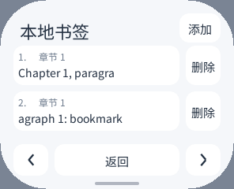
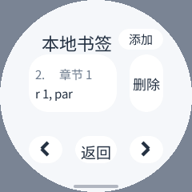

# 本地书签：开发与资源门槛

2026-10-17 开始，10-18 凌晨更新。开发候选。最初仅本地验证，后续临时安装完成了四次 S3 默认成本测量；真实功能尝试在正文请求限额处停止，未完成书签流程，已恢复原包。最新结果见 [真机记录](bookmarks-device-20261018.zh-CN.md)，不宣称功能完成全部验收。

## 行为与数据

从阅读菜单进入“书签”，保存当前 UTF-8 阅读位置、章节、分节及文字摘要；已有同一位置更新原条目，不重复添加。点击同一章节的书签直接定位，不重新请求正文；其他章节仍走原有官方授权请求，不增加正文回退或绕过权限的路径。

删除分两次点击：“删除”变为“确认”后才提交。分页、返回或保存完成清除待确认项。重开从私有文件恢复。界面标注“本地书签”，不冒充微信读书云端同步；没有调用云端写入接口。

按账号和图书分别保存，文件包含完整身份校验。文件名使用固定长度散列，仅用于生成安全路径，不作为鉴权或加密；即使路径发生碰撞，完整账号/书目不匹配也拒绝读取和覆盖。不存在文件可新建；损坏、未来版本、超限或错误身份的文件保留原字节，不能直接用空列表覆盖。

只在打开书签页时加载，离开页面或切到后台释放列表；回前台重新读取。本地位置和云端 DOM 坐标无等价假设。正文摘要校验值只用于检测文字变化，不是安全摘要；文字变化时明确提示并回到本节开头，不静默把旧字节偏移应用到新正文。回复书目、章节或分节不匹配时保留原页面。

模型最多 64 项、文件最多 64 KiB；字符串、UTF-8、控制字符及整数有界校验，编码超限不保存。新增/删除先构造临时模型，写入 `.tmp` 后经原子 replace 成功才发布；取消不会把半写文件当作已保存数据。下次读取清理同一书目的旧草稿，不扫描所有图书，也不新增默认的全量书签缓存。模型释放不等于 Wasm 线性内存可以缩回，真正占用仍需测量。

## 当前验证

- 十一项原生 ASan/UBSan 检查通过，包含原有解析/阅读模型和新增书签测试。新增测试覆盖身份、版本、事务性失败、精确整数、重复位置、64 条边界、超限编码与补充平面字符。
- 六种实际 AOT 模拟器布局通过添加、去重、局部定位、两次删除确认、停止/重开恢复和最终资源释放：296×240、480×480、240×240 圆屏、480×800、240×240/320 DPI 圆屏和 160×160 圆屏。
- AOT 另完成十类分支：错误账号、错误图书、未来版本、坏 JSON、超大文件、残余草稿、正文更新、写入失败及恢复、跨章节错误响应及恢复、取消慢下载。
- 一次取消检查在返回键刚入队就截图，取到的仍是菜单，画面比对失败；原始日志与截图保留。测试已改为等待目标正文真正显示再比较，不把这个队列/显示等待错误称为产品崩溃。该检查的 finally 会向仍运行的进程发送 SIGABRT，因此不能把清理后的 −6 退出码当作 Guest trap 的证据。
- 实际截图暴露高 DPI 圆屏的窄按钮把“删除”裁成一个字。短按钮标签改为按可用宽度适配字号，最多扫描五个 UTF-8 字符，不展开临时容器；长书名仍保留常规字号和单行裁切。修正后的“删除”已完整显示。后续卡片改为编号、标题、摘要两行，并增加上下滑动翻页；编号用固定数组编码，借用文字视图，绘制时不创建临时字符串。相关 AOT/Wasm 各 16 项重新通过。

在上一轮已经验证的精确 PNG 观察器上，前一版 AOT 和解释器八套流程各 102 项，共 **204 项全部通过**（每种运行时原有 86 项加书签 16 项）。此前一次误用的观察器缺少图片资源字段；另一次重建统计观察器链接到旧 PNG 限额库，拒绝了大图。这两项测试基线错误保留原结果，没有作为应用通过或新 Host 缺陷。截图均为合成书目和正文，不包含真实账号、二维码或笔记。最初本地阶段没有操作设备，后续真机阶段与保留证据单独记录。

### 合成截图

| 紧凑屏 | 高 DPI 圆屏 |
|---|---|
|  |  |

另见 [极小圆屏](images/bookmarks-tiny-round.png)。图片为后续两行卡片实现；编号和摘要可以区分同章节的不同位置。长摘要仍单行裁切，不是完整笔记排版。

## 尚未通过的资源项

保持 C++26、O3、full LTO、原有 16 KiB 声明栈和 8×1536 B 协程池。未改 Host、SDK ABI、图片解码或显示路径。

| S3 构建 | AOT 文件 | AOT text | 64 KiB 映射页 |
|---|---:|---:|---:|
| 已采用的划线/想法包 | 1454440 B | 1370116 B | 21 |
| 首次书签候选 | 1550556 B | 1460340 B | 23 |
| 前一版窄按钮修正候选 | 1558956 B | 1468356 B | 23 |

最新两行卡片/滑动构建为 1,562,076 B，text 1,471,444 B，仍为 23 页。真机确认映射比已采用版本多 **131,072 B**，不能忽略为“只有安装包增大”。新增 JSON 模型、文件事务、阅读定位和界面路径带来代码增长，后续测得默认 PSRAM 稳定/窗口峰值确实增加约 128–130 KiB，SRAM 少量增加；真实使用时峰值和端到端触摸延迟仍未取得，见真机报告。把大解析器保持为独立普通函数、强制不内联按钮的实验没有解决映射增长；强制不内联不是采用的最终策略。

下一步需核对冷功能按需装载或数据/绘制代码共用的可行性，实际测量默认书架、阅读、打开书签及关闭后的资源。任何新结构都要覆盖错误、取消和退出，不能为了压体积降低 O3，或把旧版本空闲数值当成新功能的资源数据。未通过前不替换设备包。

## 复现

在项目根目录：

```sh
clang++ -std=c++26 -O1 -g -Wall -Wextra -Werror \
  -fsanitize=address,undefined \
  local/pxa-apps/weread/tests/bookmarks_test.cpp -o /tmp/weread-bookmarks-test
/tmp/weread-bookmarks-test

PXA_APP_DEFINES=WEREAD_FIXTURE_PORT=19178 tools/app.sh build weread \
  --source-root local/pxa-apps --target simulator \
  --output local/weread-validation/bookmarks-fixture
python3 local/pxa-apps/weread/tests/bookmarks.py \
  --simulator /path/to/frozen/pxsys_product_simulator \
  --package local/weread-validation/bookmarks-fixture/pxa-weread \
  --publisher-key local/pxa-apps/.dev-signing/publisher-public.der \
  --ime-package local/app-output/pai-touch/pxa-pinyin-ime \
  --output local/weread-validation/bookmarks-check --port 19178
```

Wasm-only 对照用同一宏和 `--target wasm` 构建到不同输出目录，再运行同一测试。内存回归使用已有只读观察器；其重建方式是 `tests/build_memory_probe.py`，不覆盖共享模拟器。默认不访问腾讯服务、不接收真实登录信息。

机器可读结果见 [JSON](bookmarks-20261017.json)。前一版完整模拟器矩阵及后续 32 项相关检查已经完成；S3 默认成本已实测，真实书签流程尚未通过，不能由 AOT/Wasm 功能结果代替。
