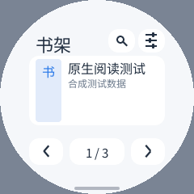

# 独立微信读书验证记录（进行中）

本应用是使用 PXA C++26 SDK 的原生客户端，未在 Guest 装入 JavaScript 引擎。下文正文与搜索基线没有修改 Host；后续插图候选增加了独立验证的 Host PNG 改动，见 [插图验证](images-20261017.zh-CN.md)。它目前是可实际登录、阅读的开发版，**尚未实现微信读书的全部功能**。状态矩阵见 [README](../README.md)，结构化结果见 [verification.json](verification.json)。

## 真实服务

用户扫码确认后，电脑上的真实 PXA 模拟器成功登录，取得 20 本书的书架。实际读取一份已授权中文正文，再切换到下一章并连续本地翻页；本次两份正文为 319 B / 1,405 B，目录 174 项。再次构建后保留私有存储，未再次扫码即可恢复书架，实际正文、下一章及私有位置保存再次通过。账号、Cookie、书名、正文和真实截图均未收入本目录。

官方页面有 873 个共享数据别名，部分章节对象通过字面属性初始化；正文不在 `state.reader.contentText` 中，而在服务端渲染的 `readerContentRenderContainer`。本实现只读取受限字面量和 HTML，不执行脚本。测试覆盖这些真实页面结构，并拒绝任意调用、全局写入、循环引用、重名别名和有歧义的对象覆盖。

另外对官方目录只读接口进行核验：HTTP 200，返回 80 条章节和 80 条阅读入口。客户端采用最多 300 项的移动窗口，处理官方协议中的 `readerUrlParmas` 字段，并让共用章节 UID 的标题都能获得入口。900 项目录的窗口与边界检查已通过原生 ASan/UBSan；实际长书逐批导航仍待真机验证。

## 模拟器

[AOT](simulator-aot.json) 与 [Wasm 解释执行](simulator-wasm.json) 均在四种屏幕通过：

- 296×240 / 160 DPI / 圆角 58；
- 480×480 / 280 DPI / 圆角 56；
- 240×240 / 160 DPI / 圆形；
- 480×800 / 240 DPI / 圆角 32。

使用合成账号与正文，检查原生 PNG 解码、临时源删除、扫码提交的数字 VID 类型、书架、正文、本地四次翻页不重新请求、重启同一页、重启后上一页、字号/深浅色/行距、音量键翻页、退出与旧写入竞态。另检查分页响应损坏时不推进书架游标、向前回到上一批、非法二维码拒绝。正式包固定请求腾讯域名；测试包只能使用编译时指定的本机 fixture 端口。

演示截图仅含自制测试内容：




复现命令见 README。模拟器的像素变化和控制往返时间不能代表物理触摸到 LCD 发光的延迟。

## pai-touch

按 MAC `a4:cb:8f:d5:d4:f0` 识别设备；本次 by-id 指向 ACM1，而非旧记录的 ACM0。保留实际 Host `host-tools-v0.1.0-25-g75673a9-d`、字体、已有应用、私有数据和 Wi-Fi，仅安装独立 `pxa-weread`。

初始 ESP32-S3 版本 AOT 为 893,416 B，映射 PSRAM 为 851,968 B；二维码阶段 Guest 线性内存为 131,072 B，Host 图片资源收费 129,695 B。Guest 不保留二维码像素副本。最大线性内存为 2 MiB，按实际需要增长，并非启动预留 2 MiB。首次网络授权至软件报告二维码就绪的一次墙钟测量为 1.84 s，**不含应用冷启动，也不是面板完成耗时**；屏幕截图中的二维码已独立解码核验。

使用 `MEMORY START/STOP` 的该段 SRAM 最小空闲 44,239 B、PSRAM 最小空闲 5,206,668 B；这是整台设备的本轮堆窗口，包含 Host、字体、网络等，不是应用独占内存。普通 MEMORY 的启动以来最低空闲和 PXA budget 历史高水位均另行保留，未当作本轮峰值。

最新版搜索与保存改动已安装真机。升级前核对旧包签名，归档的仅是本应用旧代码；全部私有文件在归档、安装前后逐项 SHA256 一致。登录未丢失，正文相同区域像素逐字节一致。三次正常后台保存、停止、重启、打开书籍均恢复同一页，无需再次扫码。当前 ESP32-S3 AOT 为 1,072,272 B；相较初始核心增加 178,856 B，同时包含原生输入框、搜索、目录、设置等功能，不能将它作为纯保存改动的大小差异。初始核心退出时 Guest 线性内存峰值为 589,824 B，最新版本的独立峰值仍须另测。

同一正文、分辨率、字体和输入脚本，比较保存改动前后。每段 12 次左右交替点按；慢节奏按住 60 ms、间隔 240 ms，快节奏为 20 / 40 ms。均未重新请求章节。结果见 [之前](device-before-io.json)、[之后](device-after-io.json)。

| 节奏 | 改动前 Guest 均值 / P95 | 改动后 Guest 均值 / P95 |
|---|---:|---:|
| 慢节奏 | 147.1 / 556.2 ms | 3.04 / 7 ms |
| 快节奏 | 4.23 / 11 ms | 3.43 / 8 ms |
| 慢节奏重复 | 269.2 / 875.1 ms | 3.16 / 7 ms |

P95 是 Host 输入直方图的桶上界。改动前后收到的事件数不同，受阻塞、合并及 MOVE 影响；旧数据在停止录制后读取，新数据在停止前读取，不能把这两组少量样本当成普遍统计保证。Canvas 的 present/visible 样本均为零，**上述数据只测输入送达 Guest，不是触摸到屏幕发光延迟**。

每次翻页原来会在 300 ms 后原子写入会话与进度，慢速点按可能撞上文件系统写入。现在只有认证变化才写会话，进度在空闲 2 s 后合并写入，后台或正常退出立即保存，并通过单写入者串行化。合成测试额外检查翻页不改变会话文件 mtime、退出登录不遗留凭据临时文件。

新版慢节奏的整机 SRAM 稳定空闲约 48.5 KB、本轮最小 48,415 B；PSRAM 稳定空闲 4,767,324 B、本轮最小 4,759,988 B。包括 Host、字体、网络及应用，不是独占收费，也不是历史累计峰值。功能增长伴随 AOT 体积和映射内存增长，应如实计入；目前不宣称整版内存不增。

静止页面按需绘制。规定点击节奏产生的 LCD 完成帧数不能当作最大 FPS；首轮 [原始统计](device-initial-reading.json) 保留用于定位保存 I/O，后续改动的性能不得引用首轮数值替代。

## 搜索与大型目录

四种屏幕、AOT 与 Wasm 解释执行的原生输入框、系统 IME 避让、搜索结果和目录入口均通过合成集成检查。真实服务返回 20 条电子书搜索结果；首本书的阅读 HTML 为 501,302 B，含 5,117 个共享别名、稀疏数组初始化及 1,645 个目录条目，超出最初的 256 KiB 限制。

新解析器仅解析数据，支持有界的数组索引初始化，用有序索引查共享字段，仅展开当前章节附近最多 300 项目录；跳过用户、调试及无关布局数据。离线真实页面由完整展开的 546,671 B 降为 40,654 B，所保留章节与全部匹配阅读入口逐项相等。新版真实账号已成功打开这本书，选择长正文后连续八次前后翻页没有重新请求章节。四屏 AOT / Wasm 的合成流程及 5,117 个别名、900 项目录用例均通过。短版权页不足一屏，正常右翻会请求下一章，未把它误计为本地重绘。

## 尚未完成

跨端进度与阅读时长、复杂搜索结果的打开、书城/详情/书架管理、书签/划线/笔记同步、漫画/PDF/离线、听书和社交/会员等流程仍在目标中，不将当前版本描述为完整官方客户端。插图的后续结果单独记录，不能用来改写本节旧基线。付费内容仍服从官方授权。后续按真实账号功能和设备证据继续实现、验证。


## 新解析器的体积与模拟器内存

第一版大目录实现的 ESP32 AOT 为 1,347,716 B。将重复实例化的模板扫描器合并为共享实现后为 1,236,636 B，减少 111,080 B；原生 Linux 的三个交替批次中，单次解析中位数由约 21.9 ms 变为 22.7 ms（开发机有其他负载）。这是空间/调用成本的取舍，不能声称速度提高，也不能当作 ESP32 耗时。详见 [原始批次](native-scanner-benchmark.json)。

使用独立的只读观察器编译未修改的 product runner，调用已有 WAMR 内存快照 API，不修改 Host 源码、应用 ABI 或设备固件。真实账号搜索、大目录正文、八次本地翻页阶段，线性内存记录末次 1,310,720 B，本次引擎峰值 1,376,256 B；上限仍为 2 MiB。线性内存包含栈、数据、堆及保留的已释放空间，不是活跃 malloc 数量。见 [AOT 真实服务内存](simulator-real-memory.json)。

合成大目录在 Wasm 解释执行中记录线性内存 786,432 B；解释器额外保留 408,399 B 的 Wasm 文件缓冲。WAMR 分配器、线性内存、事件缓冲计数存在包含/平台映射差异，不能相加成物理 RAM。见 [解释器内存](simulator-wasm-memory.json)。这些都是电脑上的运行结果，未冒充当前 ESP32 固件的实际 SRAM/PSRAM 预算。

构建只读观察器（需要既有模拟器与资源测试目标的编译产物）：

```sh
cmake --build build/simulator/pai-touch --target pxsys_resource_app_test
python3 local/pxa-apps/weread/tests/build_memory_probe.py \
  --build build/simulator/pai-touch \
  --runner deps/pxa-system/simulator/desktop/product_runner.c \
  --output local/weread-validation/memory-observer
```

集成测试的 `--simulator` 可指定该观察器，按场景输出 `guest-memory.json`。观测器写文件会干扰墙钟，不用于声称触摸或面板延迟。最新组合工作集预算保护已通过 AOT / Wasm 集成：760,000 B 响应各字段虽未触及单项上限，但合计超出工作集预算时保留原页，返回阅读的正文区域像素相同，进程继续响应。该异常场景 AOT 观察到线性内存峰值 1,703,936 B。真实服务的最新版仍完成八次本地翻页，线性内存本轮峰值保持 1,376,256 B。


## 最新真机复验

总预算版本已安装在 pai-touch。仅临时归档本应用旧签名代码以腾出升级空间，旧包逐项校验为本地可恢复签名备份；升级前后全部应用私有文件一致，其他应用的签名文件一致。运行后会话文件 SHA256 仍相同。保留原 Host、字体、Wi-Fi 和系统设置。三个正常停止/重启恢复同一页，正文区域像素完全相同。

最新 ESP32 AOT 为 1,237,816 B，实际代码 PSRAM 映射 1,179,648 B；原目录/搜索版本分别为 1,072,272 / 1,048,576 B。相同正文重开实例的 Guest 线性内存峰值由 458,752 B 降至 393,216 B；初始核心的 589,824 B 属于更早版本，不能当作上一快照。代码映射增加 131,072 B、Guest 峰值减少 65,536 B。整机稳定 PSRAM 空闲较上次减少约 68 KB，**不宣称整版总内存不增**。各项计数来源不同，未把 WAMR 统计再叠加成物理总量。见 [最新映射与线性内存](device-latest-memory.json)、[启动和章节窗口](device-latest-reading.json)。

最新慢/快/慢节奏 Guest P95 为 7 / 11 / 7 ms，未重新请求章节，Canvas present/visible 样本仍为零，见 [最新输入原始统计](device-latest-turns.json)。读完后退出实例：线性内存 0、WAMR 分配器仍留 416 B，与此前清理状态一致。

`MEMORY START` 确认返回 `minimum_scope=local`。`MEMORY STOP` 先返回该段局部最小空闲快照，再用 `minimum_scope=boot` 表示已恢复全局启动口径；没有将历史预算高水位当成本段堆峰值。最终 MEMORY/PERF 已停止并清理，普通桌面、无运行应用，设备已明确交还其他任务。

本次真机复验的是既有固定正文；大型搜索书的完整线上过程、超预算拒绝路径及其真实峰值目前以模拟器证据为准，尚未冒称在芯片上覆盖。
